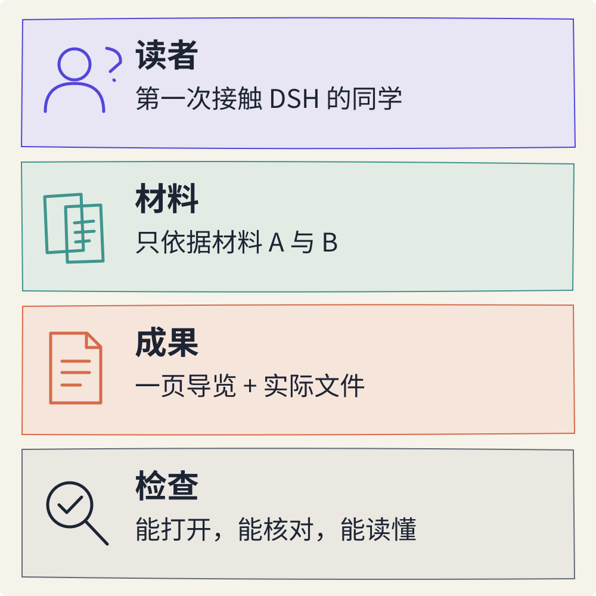

# 先做成一件事：我的第一次 AI 创作

> 状态：review
> 版本：0.2.0

一位同学听说了 DeepSeek Harness，却分不清它与聊天模型有什么不同，也不知道开始使用前要准备什么。你能不能借助 AI，给他做一页读得懂、找得到依据的项目导览？

这就是本章的任务。我们从一个具体读者、两份短材料和一份文档开始。完成时，你应当能打开自己保存的作品，指出其中的来源，并说出至少一处需要继续确认的问题。

建议先通读任务，再留出一段可以连续操作的时间。阅读可用手机，文件操作更适合在电脑上完成。本章不要求手写代码；你的主要工作是说明需求、提供材料、检查结果与作出修改。

## 1.1 先想清楚，这一页是给谁看的

“帮我介绍 DSH”听起来已经是一项任务，但它留下了很多空白。是给开发者选型，还是给第一次接触 AI 工具的同学阅读？需要讲清技术架构，还是只要让人知道它是什么、下一步去哪里？不同的答案，会得到很不一样的作品。

本章先把读者限定为**没有编程基础、第一次听说 DSH 的大学生**。他读完这一页，应当知道三件事：DSH 大致做什么；模型与工具怎样分工；开始使用前需要确认哪些条件。对于材料没有说清的部分，我们保留问题，而不替项目作出保证。


图中的一页导览像一张入门地图：它帮助来访者找到第一步。把所有资料搬上去，反而可能遮住入口。此时我们追求的是清楚、有用、可检查，版式美化可以稍后再做。

把要求写成能够检查的样子：正文约 250—400 个汉字，不计来源链接；有“它是什么、可以怎样用、开始前确认什么、还不知道什么”四部分；重要说法能对应到给定材料。这里的“一页”指适合快速阅读的一份短导览，不要求在所有手机或打印纸上恰好占满一页。

## 1.2 认识一起工作的几个角色

**模型负责根据输入生成内容。** 你可以先把它理解为从大量例子中学习规律、再根据当前材料组织输出的计算系统。DeepSeek 提供的模型是本课程的主要案例；一次任务实际用了哪个模型，要以工具中真实选择的名称为准。

**DSH 把模型与工具组织在一起。** DeepSeek Harness 简称 DSH，本章把它作为智能体工具来使用。“智能体”在这里指能够围绕任务，结合模型与读取、编辑文件等工具开展工作的系统。例如，模型提出需要整理哪些内容，系统调用读取文件的工具取得材料，再把生成的内容保存下来。具体可做的事受到工具能力、配置和权限的限制。

**AtomGit 保存项目并支持共同改进。** 其中的“仓库”，可以先理解为带有修改记录的项目资料空间。它保存文件和变化，方便以后回看、分享与讨论。保存文档并不需要先学会编程。

**你负责作品的目的和判断。** AI 可以协助整理与起草，但谁会读它、哪些话有依据、哪里需要修改，要由你来检查。让 AI 自己评价“是否全部正确”，也不能替代回到材料核对。

本章观察的项目是 DSH，使用的工具也可以是 DSH。这是两个视角：前者问“这个项目是什么”，后者问“我用什么来完成任务”。课程阅读网站提供教材；AtomGit 承载作品与协作。它们并不会因为出现在同一门课里就自动连接。

## 1.3 准备两份材料和一个工作空间

先打开[第一章材料页](../../practice/ch01/README.md)，下载并解压材料包。解压是把压缩包里的文件展开成普通文件夹：Windows 可用“全部解压缩”，macOS 通常可双击压缩包。展开后的 `my-ai-observatory` 文件夹，就是你的观察站起点。

文件保存具体内容，文件夹用于组织文件。包内的 `materials` 放材料，`work` 留给自己的作品与记录，`examples` 放编写者准备的参考例子。先使用材料，不必照抄例子。像 `materials/source-a.md` 这样的写法，表示“materials 文件夹里的 source-a.md 文件”，这叫文件路径。

`.md` 是 Markdown 文档的常见扩展名。它仍然是文字文件，使用一些简单符号表达标题或列表，例如行首的 `#` 表示标题。你现在只需会打开、阅读与保存它；本章不要求记住一套语法。

### 两份材料说了什么

以下是材料包的要点，均由课程编写者依据官方文档整理，并非一次运行结果。材料卡保留原始地址和版本。它们提供的是有限依据，不能用来证明任意功能、费用或设备都适用。

**材料 A：项目说明。** A1：DeepSeek Harness 是 DeepSeek 开发的开源智能体框架。A2：项目可通过插件扩展；插件是可以加入系统的功能组件。A3：所查阅的 README 将项目标为开发者预览，并提醒后续可能出现不兼容的变化。A4：该 README 列出的项目许可证为 MIT；第三方组件另有许可说明。

**材料 B：使用与文件。** B1：所查阅的 Web UI（网页操作界面）指南从服务已经启动的状态开始，包含模型配置与工作区选择。B2：全新 Web UI 需要添加并选中工作区，才能使用会话输入框。B3：智能体可以使用读取、编辑工作区文件等工具。B4：某项操作是否需要询问用户，取决于当前权限策略。

A、B 后面的数字是本课便于核对的材料编号，不是软件版本号。比如“DSH 能协助处理文件”可以回到 B3；“所有操作都不需要确认”却得不到 B4 的支持。

### 把工具接入和创作任务分开

如果已经有可用的 DSH，选择你解压得到的观察站文件夹作为**工作区**。工作区就是当前任务使用的文件位置；只选本次练习的文件夹，先不要把整个电脑的资料目录交给任务。确认模型已经可用，再开始新的会话——会话可以先理解为围绕同一任务连续交流的地方。

如果还没有安装或接入 DSH，材料包内的 `setup.md` 提供官方入口和准备顺序。你需要先确认系统支持、安装版本、账号或模型接入方式，以及可用额度。API 密钥是应用调用模型服务时使用的凭据，类似一把访问钥匙；它只应填在相应配置入口，不放进材料、提示词或公开记录。本章不要求读者为练习临时付费，开课时应由教学方落实可用条件。

暂时没有可用 DSH，但已经有可用的 AI 对话工具，可以先把材料 A、B 粘贴到该工具，完成限定材料的写作练习，再由自己保存文件。记录真实工具名称，以及“文件由我手工保存”。这能练习表达与核验，但不能记成 DSH 已成功读取、写入文件。若连 AI 对话入口也暂不可用，可先读材料、检查本章例子，AI 创作部分留待接入后补做。

## 1.4 把愿望变成一份清楚的任务

向 AI 发出的任务说明，通常称为**提示词**。它可以使用普通语言。有效的提示词要让对方知道为谁做、依据什么、交付什么、怎样判断完成。



这四个要素都来自刚才的准备：读者是第一次接触 DSH 的同学，材料是 A 和 B，成果是一页导览，检查方式是回到材料并打开实际文件。复杂的角色扮演或很多形容词，不能补上缺失的材料。

把下面的说明发送给 DSH；材料包中的 `prompt.txt` 也保存了同一份内容。先确认 `work/guide-v1.md` 尚不存在；如果已经有同名作品，换一个新文件名，避免覆盖自己的记录。

```text
请为一位没有编程基础、第一次听说 DSH 的大学生，
制作一页中文项目导览。

只使用 materials/source-a.md 和 materials/source-b.md。
先读取这两份材料；若读不到，先说明缺少什么，不要猜。

正文约 250—400 个汉字，分为四部分：
它是什么；可以怎样用；开始前确认什么；还不知道什么。
首次出现的术语用普通语言解释。
关键事实标注材料编号，如 [A1]、[B3]。
不要把“开源”写成“所有服务永久免费”，
不要补写材料未支持的能力或使用结果。

将初稿保存为 work/guide-v1.md，附上材料来源。
只在本工作区创建这个新文件，不覆盖已有文件；
本次不需要联网、安装软件或修改其他文件。
如果必须增加操作，先解释原因，由我决定。
若不能写文件，给出完整正文并明确说未保存。

最后说明读取了哪两份材料、产物路径，
并列出一个仍需要核验的问题。
```

使用普通 AI 对话工具时，把两份材料的全文粘贴在说明后，并把保存要求改为：“请输出完整 Markdown 正文，我会手工保存；不要声称已经写入我的电脑。”仅告诉一个不具备文件访问能力的工具“去读我的文件夹”，并不能使它看到文件。

发送后，观察发生了什么。DSH 是否找到了两份材料？是否出现权限询问？如果询问与“读取这两份材料、写入这个新文件”有关，读清范围再决定；如果突然要求安装软件或访问其他资料，先暂停，询问原因。先完成当前小任务，再考虑扩展能力。

## 1.5 收到“完成”，再做三次检查

任务结束时，你可能看到“已为你生成导览”。先找到它所说的路径，在文件管理器中进入 `work`，打开 `guide-v1.md`。可以使用文本编辑器或支持 Markdown 的预览工具；即使只看到带有 `#` 和列表符号的文字，也能够检查内容。


图中的两侧分别表达“系统给出的完成提示”和“读者能找到并检查的产物”，不是 DSH 的真实界面截图。文件存在，只说明保存这一步有了结果；接下来还要检查它写得怎样。

### 第一查：真的有一份能打开的文件吗

核对位置、文件名和内容。不要只看聊天里出现了文件名。如果实际没有文件，可以追问：“我在工作区的 work 文件夹没有找到它，请确认实际保存位置；若未保存，请明确说明。”也可以把完整正文复制出来，由自己另存。文件名应确实以 `.md` 结尾，避免变成 `guide-v1.md.txt`；用纯文本方式保存时选择 UTF-8 编码，即一种常用的文字保存方式。

### 第二查：关键说法能回到材料吗

选三处对读者最重要的说法逐一核对。材料编号只是线索，编号写得整齐不等于引用正确。要打开对应段落，看它是否真的支持这句话。

下面是为练习判断而编写的句子，不是本课程实际观察到的 AI 输出。

| 待检查的说法 | 回到哪里 | 怎样处理 |
| --- | --- | --- |
| DSH 可以使用工具读取、编辑工作区文件。 | B3 | 有材料支持；保留，并说明具体任务仍需实际检查。 |
| DSH 开源，所以所有模型调用都永久免费。 | A4 与 B1 | 两处都没有给出这项保证；删除费用推断，写明接入和额度需要另行确认。 |
| 每一项操作都会先弹窗让我批准。 | B4 | B4 说的是依权限策略判断；改成“需要审批的操作会按当前策略询问”。 |

一条说法暂时找不到依据时，可以把它改成问题，也可以删去。把“不知道”写清楚，会让导览更可靠。

### 第三查：这位同学真的读得懂吗

把自己放在第一次听说 DSH 的位置：读完能不能用一句话说明它做什么？“模型”“工作区”出现时有没有解释？是不是把复杂架构堆在开头，却没说开始前要准备什么？

挑一个具体问题再修改。例如：“第二段没有解释工作区，请补一句通俗解释，并保留来源编号。”保留初稿，将修改后的版本另存为 `guide-v2.md`，在记录中写清“哪里有问题、依据是什么、我为什么这样改”。不必反复让 AI 全文重写，也不必为了字数刚好落在范围内牺牲必要说明。

## 1.6 把成果放进观察站

现在，观察站里至少应当有两份材料、导览初稿和一份自己的记录。打开 `work/record.md`，填写本次使用的工具、实际模型名称、日期、作品位置、核对过的说法和一项待核验问题。没有发生的步骤如实写“尚未进行”。不需要保存或公开全部聊天记录。

如果你做了修订，再记录新版本的位置。这里的“版本”只是同一件作品在不同时间的状态；本章先用不同文件名区分，后面再学习更系统的版本管理。

### 愿意的话，先在 AtomGit 留下第一个版本

本章核心任务可以先在本地文件夹完成。有可用 AtomGit 账号时，可以把已经检查过的导览保存到自己的仓库，体验一次平台记录。本节不要求把 DSH 自动连接到 AtomGit。

按照 AtomGit 的项目创建入口，新建个人代码仓，取一个能认出的名字，例如 `my-ai-observatory`，并初始化 README。选择自己需要的可见范围；私密仓库也可以用于这一阶段的学习。打开 README 的在线编辑入口，把已检查的导览放进去，附上来源与当前状态，填写简短提交说明，例如“添加第一份 DSH 项目导览”，再提交并重新打开核对。

**提交**可以理解为在仓库里保存一次带说明的修改。公开分享前，再看一遍材料授权和隐私信息；DSH 的项目许可不能自动替你决定自己作品和第三方材料的全部使用条件。没有账号或暂不发布，可以继续保留本地成果，在第十章再完成平台整理。

## 1.7 检查自己学会了什么

对照本章目标，先用自己的话回答下面四个问题，再阅读参考反馈。

1. DSH 告诉你“已生成文件”，却没有在实际目录中找到它。此时完成了本章任务吗？
2. 导览里一句话附了 [A4]，就能把“免费使用”与“开源许可”画等号吗？
3. 使用普通聊天工具生成文字，然后自己保存文件，与 DSH 直接写入文件有什么不同？
4. 这次创作中，哪一个判断是你自己作出的？它改变了作品的什么地方？

### 参考反馈

第一题：还需要找到并打开实际产物。如果改为手工保存，就记录真实过程；聊天中的完成提示不能代替文件检查。

第二题：不能。A4 说明的是 README 列出的项目许可，不能据此保证模型服务的接入条件和费用。判断的重点是材料是否支持这个结论。

第三题：两种方式都可能参与内容创作，但文件由谁保存不同。前者由人操作文件，后者由系统在可用工具和权限下执行。记录这个区别，才能解释一次任务究竟完成了哪些步骤。

第四题可以有很多答案：缩小读者范围，删去没有依据的说法，补上一个解释，或调整阅读顺序。关键是说得出理由，而不只是“我让 AI 再优化了一次”。

完成时，请确认自己留下了三类证据：**一份能打开的一页初稿、两份材料的来源，以及一项仍待核验的问题**。同时，能够指出一次自己的判断。暂时只完成材料阅读，或环境仍未接通，也可以清楚标记当前进度；接入后再补做 AI 创作与文件检查。

你还可以做一个小小的迁移：如果这份导览的读者换成第一次备课的老师，哪两处内容需要调整？先说明理由，再决定是否修改。你已经开始练习将同一个工具用于不同的人和问题。

第一章的成果也许很小，但你已经经历了一次完整的创作过程：明确目的，提供依据，得到初稿，亲自核对，并保存可以继续改进的作品。下一章，我们会打开项目本身，进一步认识导览背后的材料、角色与问题。
