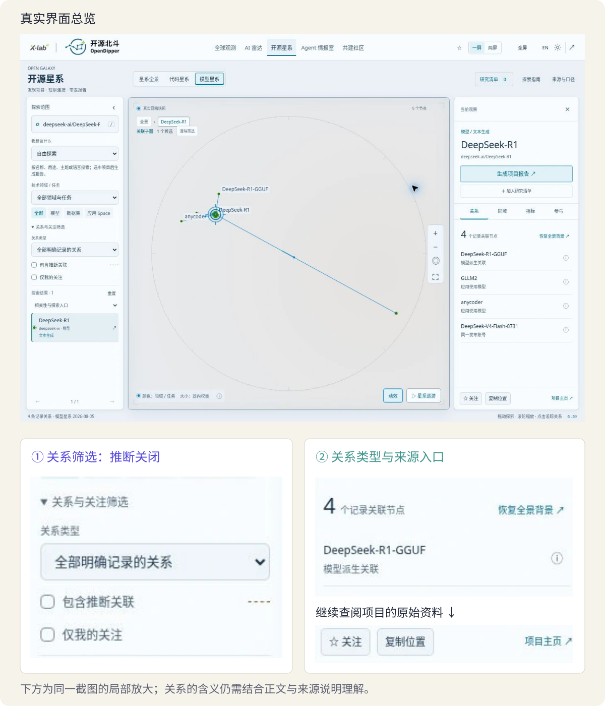

# 初识 AI 开源：从真实项目理解人工智能与开放协作

> 状态：review
> 版本：0.7.1

人工智能正在改变人们获取知识、分析问题和制作成果的方式。面对一个陌生的研究主题，学习者可以请 AI 解释概念、整理材料、提出写作方案，也可以借助它生成图表和页面。然而，得到一段完整的文字，并不意味着已经理解了问题；拥有一份形式美观的作品，也不意味着其中的结论有充分依据。

本章从一份真实的开源研究报告出发，建立 AI 与开源的整体认识：AI 怎样成为工具，开源怎样提供学习与共创的条件，个人怎样从使用走向理解和创造。在此基础上，以 DeepSeek-R1 为一个入门样本，展示如何从公开材料形成一页研究简报。模型是 AI 生态的重要组成部分；软件、数据、文档和参与建设的人，同样是本书的学习对象。贯穿全章的问题是：**怎样借助 AI，把可追溯的材料转化为对他人有用、也体现自己判断的成果？**

## 学习目标与阅读准备

学习本章后，应能够：

- 说明人工智能、生成式 AI 和语言模型的基本含义，区分模型、产品与系统。
- 解释 AI 开源生态中软件、模型、数据与社区的作用，辨别公开可见、免费使用与开放复用。
- 根据项目说明和 OpenDipper 观察，区分材料记载、分析判断与待研究的问题。
- 完成一页面向具体读者的研究简报，解释一项修改，并说明它在全书实践中的位置。

本章不要求编程、数学建模或开源协作经验。阅读中的基本概念均在首次使用时说明，学习者可先完成纸面阅读与思考，再开展计算机实践。实际创作使用浏览器、可用的 AI 对话服务和熟悉的文档工具即可；首轮教学采用 DeepSeek 网页端。具体接入与操作方法见第一章配套学习材料，不构成本章概念学习的前提。

## 1.1 AI 创作的真实场景

### 1.1.1 一份研究报告的形成过程

《2026 全球开源发展报告》是本课程的重要实践背景之一[1]。根据课程团队的实际制作经历，从 2026 年起，团队基于 OpenDigger 提供的开源活动数据，使用 DeepSeek Harness（简称 DSH）等 AI 工具辅助报告工作，包括公开信息收集、数据分析、可视化图表生成、文字润色和版式整理。

一份研究报告并不是把查到的资料依次排列起来。作者需要提出问题，选择与问题有关的材料，说明分析方法，再把发现组织成读者能够理解的论述。例如，研究某类开源项目的发展，首先要确定研究对象和时间范围，然后辨认数据反映的是参与活动、项目关联还是其他现象。没有这些判断，即使图表与文字都很丰富，也可能回答了另一个问题。

在上述工作中，AI 承担了部分整理、计算与表达任务；研究人员负责确定目的、解释现象和审查结论。两者共同组成了**人机协作**：人和计算机系统围绕同一任务分工、交流并修订成果。人机协作的价值取决于任务如何组织，也取决于使用者能否识别结果中的问题。

报告的文字与可视化页面还承担着不同功能。文字适合交代研究问题、解释方法和展开论证；可视化通过位置、颜色、大小或连线等形式表达数据，帮助人们观察差异与关系。具有交互功能的页面，则允许读者改变筛选条件或观察对象。图表既可以表达已经形成的认识，也可能帮助作者发现值得进一步调查的问题。

### 1.1.2 从专业工作到大学学习

课程团队在面向机构和组织的 AI 培训与工作坊中，还组织过新能源汽车行业分析、AI 供应链行业分析等报告任务。参与者来自管理岗位、基层岗位和计算机专业等不同背景。熟悉业务的人能够提出贴近实际的问题，熟悉资料的人能够辨认信息的价值，擅长表达的人能够改善报告的结构。AI 为这些能力提供了新的发挥方式。

这些经历说明了本课的出发点：学习 AI，不仅是熟悉一种工具的按钮，也包括用它研究问题、组织知识和创造有用的成果。对于不同专业的大学生，研究主题可以不同，但提出问题、阅读材料、形成判断和解释结果的基本要求是相通的。

本章把一份专业报告的工作过程缩小为**一页项目研究简报**。简报是一种篇幅较短的研究表达，围绕明确对象，交代重要发现、依据及后续问题。它不追求包罗万象，而是帮助特定读者迅速建立认识。把研究起点限定为一页，可以让学习者把注意力放在一个完整过程上：从材料到判断，再从判断到表达。


图 AG-01-01 把报告、观察材料与简报放在同一个研究场景中。它提示我们：简报的篇幅虽短，仍需要从真实材料出发，围绕读者的问题作出取舍。

## 1.2 AI 的基本概念

### 1.2.1 人工智能与机器学习

**人工智能（Artificial Intelligence，AI）**是研究和构建能够执行感知、语言处理、学习、推理等任务的计算系统的领域。日常所说的“使用 AI”，通常指使用其中的一种具体系统，例如识别语音的系统、提供推荐的系统，或能够生成文字的系统。人工智能并不只指聊天工具，也不表示计算机拥有与人相同的经验和意识。

**机器学习（Machine Learning，ML）**是实现人工智能的一类方法。它利用数据来调整模型，使模型能够完成某种预测、识别或生成任务[2]。例如，假设要把校园活动通知分为“学术讲座”“体育活动”和“志愿服务”，一种方法是人工编写关键词规则；另一种方法是提供已经分类的通知，让模型从这些例子中学习与分类有关的规律。这个例子说明的是两种解决问题的思路，具体系统也可以把规则与学习方法结合起来。

这里的**模型**，是对输入与输出之间关系的一种计算表示。在机器学习中，模型通过数据形成或调整这种关系。**训练**是利用数据调整模型的过程；训练后，用模型处理新的输入并产生输出的过程通常称为**推理**。模型能否处理好新问题，需要另外检验，不能只看它是否记住了训练中的例子。

模型包含参与计算的内部数值，常称为**参数**，其中许多参数也称为**权重**。后续章节将用简单例子说明参数怎样变化。本章先理解：训练形成的能力有其计算基础，模型文件也因此不等于一份可以直接翻阅的知识词典。

### 1.2.2 生成式 AI 与语言模型

**生成式 AI**是能够根据输入产生文本、图像、音频等内容的一类 AI 系统[2]。与给一条通知判断类别相比，生成一段介绍还需要组织内容与表达形式。本课主要从文字任务入门，再逐步扩展到图表与页面。

**语言模型**通过建模语言序列中的规律，处理和生成语言内容；**大语言模型（Large Language Model，LLM）**通常具有较大的模型规模，并使用大量数据进行训练[3]。名称中的“大”并不是对正确率的保证。它可以协助解释、概括与写作，但具体表现仍取决于任务、材料和使用条件。

在对话中，模型通常依据已有训练结果和当前输入组织回答。这里的**上下文**，指本次处理时模型能够利用的信息，如任务要求、提供的材料以及保留下来的对话内容。把一份项目说明提供给模型，就是为当前任务补充上下文；这与重新训练一个模型是不同的操作。

需要特别理解：**语言表达合理，与事实有充分依据，是两件事。**生成系统可能写出通顺却与材料不符的句子，也可能遗漏条件。流畅的措辞不能代替资料核对。因此，本课既学习如何借助 AI 表达，也学习如何判断表达是否成立。关于生成与错误的机制，第五章将进一步讨论。

### 1.2.3 模型、产品与系统

初学者容易把一个品牌下的不同对象统称为“某个 AI”。这种说法便于交流，却把不同层次混在了一起。**模型**提供处理输入和生成输出的计算能力；**产品**把能力组织成面向使用者的功能与体验；**系统**则指为了实现任务而相互配合的组成部分及其关系。产品强调“给谁用、怎样用”，系统强调“哪些部分怎样共同工作”。

| 观察层次 | 主要问题 | 以写研究简报为例 |
| --- | --- | --- |
| 模型 | 什么计算能力参与了任务？ | 语言模型根据提示和上下文生成文字。 |
| 产品 | 使用者通过什么功能完成工作？ | 聊天网页提供输入、会话和结果展示。 |
| 系统 | 哪些部分共同支持结果？ | 模型、界面、文件处理、检索工具及运行设施相互配合。 |

**软件工具**是帮助人完成操作的程序，例如文档编辑器；**服务**是由提供者运行系统、让他人通过网络等方式使用的形式。一个 AI 产品可以作为在线服务提供，也可能安装在本地。模型开放与产品是否收费是不同问题；产品可以使用开放模型，却不公开自身全部代码与运行材料。

本课还会接触**智能体（Agent）**：围绕目标，根据观察作出动作，并利用反馈继续工作的系统。在 AI 工具语境中，它可能组织模型和工具调用，把任务分成多个步骤。**工具调用**是请求程序执行操作，例如读取一个文件；它与在对话中写出“我读了文件”并不是同一件事。DSH 是帮助组织这类工作的智能体工具，第六章将介绍其具体过程[7]。

同一个模型可以被不同产品采用，同一个服务也可能调整后台模型。本章研究 DeepSeek-R1，同时使用 DeepSeek 网页端辅助写作，不能据此断定网页服务后台使用的就是 R1。**研究对象与使用工具应分别说明。**把模型、产品和系统区分开，是理解 AI 开源生态的第一步。

## 1.3 AI 与开源的联系

### 1.3.1 使用、理解与创造

打开聊天网页，可以请 AI 解释一段文字，这是“使用”；继续追问模型如何生成回答、说明是否有依据，是在走向“理解”；把材料组织成适合新读者的简报，并在反馈中修改，是在“创造”。这三个角度来自本课程原版的入门思路[9]，不是给学习者划分高低，也不是必须依次通关的等级。创造会暴露理解上的空缺，新的理解又会改变使用方式。

开源让这一往返过程拥有可检查的对象：人们不仅看到一个输出，还可能读到程序、方法、版本变化和讨论。需要注意，材料公开并不意味着材料一定完整或正确；它提供的是进一步理解和改进的机会。能否用好这个机会，仍取决于学习者提出什么问题、取得什么材料以及作出什么判断。

### 1.3.2 开源软件、项目与社区

软件由程序及相关材料组成。**源代码**是开发者用编程语言编写、表达程序怎样工作的内容。**开源软件**提供可取得的源代码，并通过符合开源要求的许可允许使用、研究、修改和再分发；**许可**说明相应权利及使用条件[4]。

由此需要区分三个问题：能否看见材料，是否需要付费，允许怎样使用。免费网页服务未必公开源代码；公开可读的文章也未必允许任意改编。例如，学习者可以阅读一份项目介绍，但把其中图片放进自己的报告，还需要确认图片的来源与使用条件。第三章将进一步解释这些差异。

**项目**是围绕共同目标组织成果、材料和持续工作的集合。软件开源通常以项目形式开展，除了代码，还需要说明文档、测试、讨论和维护。围绕项目参与使用、反馈、建设和维护的人及其协作活动，构成**社区**。社区成员的作用可以变化：使用者发现困难，提出清楚的反馈，就可能开始贡献；长期维护者也需要向其他项目学习。

本书以 AI 开源为主题，既学习开源软件，也研究模型、数据、研究材料与开放协作实践。不能仅因一个对象与 AI 有关、名称中有“开放”或位于公开网站，就认定它的全部组成部分符合开源条件。学习者应分别辨认成果、材料和权利。

### 1.3.3 AI 开源生态的主要对象

**生态**强调多个对象与参与者之间的联系。AI 领域不仅有发布模型的团队，也有构建工具、整理数据、撰写说明、开展研究和维护社区的人。一个项目可以同时跨越多种类型，下表是观察视角，不是互斥的分类。

| 观察对象 | 它为他人提供什么 | 本书中的入口 |
| --- | --- | --- |
| 模型及其研究材料 | 计算能力、方法说明和评价结果 | DeepSeek-R1 的模型与技术报告。 |
| 软件与智能体工具 | 组织任务、调用能力和处理文件的方法 | DSH 的程序、文档和扩展方式。 |
| 数据与分析项目 | 有来源的数据、指标或研究线索 | OpenDigger 的开源活动数据。 |
| 研究与知识产品 | 把数据、材料和问题组织成可探索的知识 | OpenDipper 的观测、关系探索与研究功能。 |
| 内容与社区建设 | 让知识可学习，让成果能够共同改进 | 本教材的正文、图件、练习和评审记录。 |

上述对象相互支持，但联系需要具体说明。例如，“项目使用某份数据”“工具调用某个模型”“两项目有共同参与者”是三种不同关系。把它们统称为“有关联”，只能提供一个起点；后续还应追问是哪一种联系，以及有什么材料支持。

对一个 AI 系统，还可以从六类材料继续观察：**数据及说明、代码、模型参数、文档与版本、评测与协作记录、许可与条件**。这份教学分类吸收了原版 AIOS101 的材料视角[9]，用于帮助阅读，不是判定开源资格的六项打勾表。不同项目所需材料不同；纯文档项目不需要提供模型权重，发布模型也不等于同时公开了全部训练过程。

开放源代码促进会的《开源 AI 定义》1.0 对数据说明、代码与参数等提出了具体要求[5]。本章先掌握一个基本方法：**说明某个对象开放时，要说清开放的是哪些材料，以及这些材料允许怎样使用。**进一步的定义和许可问题留到第三章讨论。

项目通常把文件和修改记录放在**仓库**中，并通过 README（入口说明）帮助读者开始。GitHub、Hugging Face 和 AtomGit 等平台提供不同的资源与协作入口。第二章将完整介绍怎样阅读这些入口。本章先使用整理好的材料，体验一次从理解到创作的过程。

## 1.4 课程结构与学习方法

本书的核心理念是：**用开源来理解 AI，用 AI 来贡献开源。**前半句强调从真实项目及公开材料理解对象和机制，后半句强调借助 AI 创造能够被他人使用、讨论和改进的成果。两者在同一学习过程中相互促进。

**开源北斗 OpenDipper（简称 OD）**是面向全球开源生态的数据观测与研究项目。它在本课中有双重角色：作为工具，帮助学习者查看数据、探索关系和发现问题；作为研究对象，提供产品设计、资料组织和开放协作的实际案例。

与它名称相近的 **OpenDigger** 主要提供开源活动数据与分析能力。二者在数据工作中可以衔接，但不能等同。OD 还会组织其他来源的材料，例如模型平台的公开信息。本章观察的模型关联便属于后一类，不是把所有数据都称作 OpenDigger 指标。

本书以四个部分组织十二章。**第一部分“认识开源”（第 1—3 章）**从本章的简报入手，学习打开项目、追查材料，理解开放、复用与共同创造的条件。**第二部分“理解 AI”（第 4—6 章）**通过例子与实验，探究模型学习、内容生成和智能体行动的基本机制，为研究判断提供解释基础。

**第三部分“AI 创作”（第 7—9 章）**围绕研究问题与读者需要，组织人机合作，形成并改进成果。**第四部分“开放协作”（第 10—12 章）**在 AtomGit 整理、分享和共同修订作品，并从中提炼可以用于新问题的方法。


贯穿全书的实践案例是**“科技研究与咨询：开源生态专题”**。学习者从具体读者与小问题出发，借助 OpenDipper、公开资料与 AI，逐步形成一份**开源生态专题研究报告**及其配套的**开源生态研究展示**，并将两者作为同一个项目在 AtomGit 持续维护。报告解释问题、依据与判断，交互页面帮助读者筛选、比较或探索材料。“动态”强调交互，不必依赖实时更新的数据。

这里要区分三个层面：**研究对象是开源生态，研究方法是 AI 辅助研究，成果通过开放共享与协作持续改进。**专题可以服务于工具选择、社区发展或产业分析，不要求每位学生承担宏观政策研究或真实商业委托。学习者自己的研究项目与 OpenDipper 上游分别维护，参与本课不意味着必须修改 OD 的程序。

课程采用“理解—判断—创造—协作—迁移”五维学习目标框架。理解帮助解释对象和机制；判断要求说明选择的依据；创造使想法成为成果；协作通过交流和修订改善工作；迁移则是在新对象、新读者或新条件下调整并应用方法。五个维度不是彼此隔离的五道工序，而是会在任务中反复交织。

自学时，可以循着“阅读案例—理解概念—分析示例—独立实践—解释选择”的顺序推进。操作遇到困难时，先区分是概念尚未理解，还是工具暂不可用：前者需要回到解释与例子，后者可以利用书中的材料继续分析。完成练习后，再对照参考解答检查自己的理由；答案不同时，应回到概念和材料辨认差异。

## 1.5 研究对象、问题与材料

### 1.5.1 研究对象与目标读者

本章以 **DeepSeek-R1** 为共同研究对象。其项目说明将它作为推理模型介绍，并提供研究报告、模型下载及使用说明等入口[6]。这里“推理模型”中的推理强调多步求解能力；1.2 节的推理则指模型处理新输入的运行过程。中文用词相同，含义应根据上下文辨认。它仍可能出错，具体任务表现需要有条件的检验。

选择 R1，是因为其项目身份和材料入口明确，能够与 OD 的观察相互对照；不需要先判断它是否是最新或最强的模型。它是练习材料阅读的一个样本，不代表 AI 开源项目的全部。第二章会把 OD 本身作为完整项目，进一步阅读软件、数据、文档与社区的共同作用。

研究还需要明确读者。面向初次接触 AI 的同学，介绍应优先回答“这是什么、为什么值得了解、下一步可以看什么”；面向已有使用经验的人，则可能需要更具体的条件与比较。读者不同，会影响解释的深浅和材料的选择，但不会改变事实本身。

### 1.5.2 项目说明与关系材料

**材料 A：项目怎样介绍自己。**以下依据 DeepSeek-R1 官方 README 的固定版本整理，查阅日期为 2026 年 10 月 30 日[6]。固定版本指向特定的文件记录，便于日后找回同一份内容。

- **A1 · 对象。**DeepSeek-AI 发布了 DeepSeek-R1 模型项目；项目说明将其作为推理模型介绍。推理在这里涉及为问题形成多步求解过程，不表示每一次回答都正确。
- **A2 · 材料。**README 提供技术报告、模型下载、本地运行与许可等入口。技术报告解释研究方法与结果；模型文件是运行模型所需的材料之一。本章只阅读入口，不下载模型。
- **A3 · 区分。**下载区列有 R1、R1-Zero 和若干名称带有 Distill 的模型。这些是不同条目。当前简报只讨论 `deepseek-ai/DeepSeek-R1`，不把其他条目的信息直接移过来。
- **A4 · 下一步。**原始说明能够帮助我们提出“它适合什么、怎样使用、允许怎样复用”等问题；某项具体任务是否做得好，还需要在明确条件下查看或开展测试。

材料 A 的 A1 提供对象身份，A2—A3 帮助辨认材料与不同条目，A4 留下进一步调查的方向。阅读项目说明时，应当区分“发布者怎样描述项目”与“我们已经独立验证了什么”。例如，技术报告提供的方法与结果值得研究，却不能直接代替某一位使用者的实际任务测试。

**材料 B：从关系中发现线索。**以下依据 OD 模型网络及关系说明整理，并与实际公开界面对照[8]。模型数据的观察日为 2026 年 8 月 5 日，查阅和截图日期为 2026 年 10 月 30 日。这里使用的是 Hugging Face 公开元数据。**元数据**是描述数据或对象的信息，如名称、发布账号、任务类别和声明的关联。

- **B1 · 身份。**模型星系中存在 `deepseek-ai/DeepSeek-R1` 节点，类型为模型，任务类别为文本生成；其项目主页指向 Hugging Face 上的对应模型页面。
- **B2 · 观察。**该节点与 `unsloth/DeepSeek-R1-GGUF` 存在“模型派生关联”。这里保留完整名称作为检索线索，暂时不需要理解 GGUF 文件格式。
- **B3 · 依据。**这是来源元数据明确记录的关联。OD 的关系说明提供来源入口，并说明当前按无向关系展示；这条记录本身不是效果比较，也不足以确定派生方向。
- **B4 · 追问。**如果想知道关联对象改变了什么、为谁解决什么问题，应继续阅读它的项目说明。仅凭相似名称、节点大小或一条连线，不能替代这一步。



图 AG-01-03 展示了 OD 中的一次实际观察，下方放大了关系筛选与来源入口，便于对照阅读。图中的**节点**表示对象，连线表示某类关系；项目档案给出身份和关系类型，来源入口用于继续追查材料。阅读这类图，关键在于理解节点与连线的含义，而不是仅凭图形的疏密、位置或大小作判断。

图中关闭了“推断关联”，展示的是来源材料明确记录的关系。其中的模型派生关联没有保留可恢复的方向，因此按无向关系显示。由这条线可以找到相关对象，却不能单独判定谁改进了谁，更不能推出性能优劣。图注中的数据观察日与截图日期也有不同含义：前者说明材料所描述的时间，后者说明取得界面画面的时间。

### 1.5.3 从数据到研究证据

**数据**是对对象或现象的记录，可以表现为数值、文字、图像或关系。**证据**则是针对某个问题，用来支持或反驳某项判断的材料。数据是否能成为合适的证据，取决于它与问题的关系、产生方式和适用范围。

以材料 B 为例，两个模型之间存在一条记录关系，可以支持“OD 的这份数据记录了二者的关联”；若要判断“其中一个更适合我的电脑”，还需要了解运行要求；若要判断“其中一个解释课程概念更准确”，则需要明确题目、评价方式和实际结果。同一份材料可以引出多个问题，却未必能够回答所有问题。

写作时，可以区分三个层次。**材料记载**说明来源实际写了什么；**分析判断**说明根据材料如何理解问题；**研究问题**指出尚未解决、需要进一步寻找依据的部分。材料自述也可能不完整或有误，因此注明来源并不是停止核对，而是让判断有一个可以继续检查的起点。

例如，“模型网络记录了二者的派生关联”属于对材料的描述；“研究相关项目可能帮助理解模型怎样被继续利用”属于分析判断；“相关项目为哪些使用场景作了调整”则是后续问题。把三个层次说清楚，既能避免把猜测写成事实，也能保留探索的空间。

## 1.6 人机合作的基本方法

### 1.6.1 任务目的与提示词

**提示词（Prompt）**是提供给生成式 AI、用于表达任务要求和相关信息的输入内容。有效的提示词首先来自清楚的任务设计。对于本章的研究简报，可以从读者、材料、成果和检查四个要素组织要求。

| 要素 | 需要回答的问题 | 本章的具体含义 |
| --- | --- | --- |
| 读者 | 谁将使用这份成果？ | 尚不了解 R1、具有明确兴趣的同学 |
| 材料 | 可以依据哪些信息？ | 项目材料 A 与 OD 观察材料 B |
| 成果 | 希望形成什么表达？ | 一页包含对象、发现、意义与问题的简报 |
| 检查 | 怎样判断成果是否有用？ | 依据可追溯，概念易懂，结论与材料相称 |


图 AG-01-04 将四个要素比作一份准备充分的编辑任务夹：明确收件人，附上材料，约定成果，再说明如何检查。工具可以帮助生成文字，任务的目的和判断标准仍需由作者说明。

**例 1-1　项目研究简报的任务说明。**下面的示例给出了任务结构。使用时，应先确定自己的读者与问题，再提供材料全文及来源。只写一个链接，并不能保证工具已经取得链接中的内容。

```text
请协助我写一页 AI 开源项目研究简报。
读者：[写明一位具体读者及其已有了解]
我想回答的问题：[写下自己的问题]
研究对象：deepseek-ai/DeepSeek-R1。
依据：下面粘贴的材料 A、B；请使用材料编号指明依据。
成果：约 400—600 字，依次写清项目是什么、一条值得注意的发现、它与读者的关系、下一步要查的问题，最后列出材料来源。
检查：解释新手不熟悉的词；分清材料记载与我的推测；材料不足的地方保留为问题，不补写数据、测试结果或不存在的引用。
请直接在对话中给出初稿，我会核对、修改并自行保存。

[在这里粘贴材料 A 和材料 B，连同来源与日期。]
```

提供明确材料，能够让生成任务围绕共同依据展开，也便于作者比较结果与原文。这样的约束并不保证回答一定正确。若输出中出现材料没有提供的数字、测试结果或引文，仍应回到来源核对；暂时无法确认的内容，可以删除、改写或保留为后续问题。

### 1.6.2 来源核对与内容修订

AI 初稿提供了可以讨论和修改的对象。作者需要判断哪些内容应当保留，哪些解释还不充分，以及文字是否适合预定读者。修订不仅包括纠正错误，也包括补充概念、调整顺序和缩小问题。

**例 1-2　从关系描述到有依据的表达。**以下句子为教材编写者构造的比较例子，用于分析修订理由。

| 原表述 | 修订后的表述 | 分析 |
| --- | --- | --- |
| “星图证明 R1-GGUF 比 R1 更好。” | “OD 记录了二者的模型派生关联；性能差异需要另查测试条件与结果。” | 关系材料不足以支持性能结论。 |
| “这里有 base-model 关系。” | “这里记录了一种模型派生关联，可沿关系说明追查来源。” | 把陌生标签解释为读者能够理解的概念。 |
| “这个项目对所有专业都有巨大帮助。” | “对关心 AI 学习工具的同学，可以进一步比较它对课程概念的不同解释。” | 把宽泛评价变成与读者有关、可以继续调查的问题。 |

第一项修订解决依据不足，第二项改善概念解释，第三项收敛研究方向。三者都体现了作者的判断。学习者应能够说明修改前后的差别，以及差别为什么有意义，而不只是说明文字更通顺。

### 1.6.3 创作过程与版本保留

同伴反馈可以揭示作者不容易察觉的困难。例如，作者认为已经解释清楚的术语，读者仍可能不理解。自学者也可以暂时放下原材料，以新读者的视角重读作品，检查仅凭简报能否辨认对象、理解发现并继续查证。

保存版本有助于保留认识变化的过程。初稿、修订稿和关键修改理由，使作者能够回顾自己如何从笼统判断走向具体解释。记录不需要繁复；保留重要材料的来源、实际工具、一次修改和一个后续问题，已经可以支持下一阶段的学习。

本课所说的 AI 创作，因此包含一系列相互联系的工作：提出目的，组织材料，借助 AI 形成表达，由人核对和修订，再通过反馈持续完善。成果的质量由这个过程共同决定。

## 1.7 综合实践：撰写一页研究简报

### 1.7.1 任务与完成要求

以 DeepSeek-R1 为对象，为一位具体读者撰写一页研究简报。建议正文约 400—600 字，字数用于控制规模，不作为质量的主要标准。简报应说明项目是什么、从材料中发现了什么、为何值得读者继续了解，以及下一步需要调查什么。

实践可分为三个阶段。**准备阶段**，独立阅读材料 A、B，写出自己的读者与问题；**创作阶段**，参考例 1-1 使用 AI 形成初稿，再根据材料和读者需要修订；**回看阶段**，保存成果与来源，并独立说明一项重要修改及理由。具体网页操作可使用配套指南。

完成后，应能从作品找到相应来源，也应能区分自己观察到的内容与引用的教材观察。若以书中的材料 B 开展练习，就说明依据来自教材；若实际使用 OD 观察，则记录观察日期和相应来源。两种情况均可用于分析材料，但不能把未进行的操作写成个人经历。

### 1.7.2 参考成果与分析

**例 1-3　R1 的一条连接，能告诉我们什么？**这是教材编写者提供的参考简报，不是学生作品或某次 DeepSeek 会话的实录。设定读者为对 AI 学习工具感兴趣、尚未接触模型项目的大学生。

> 我研究的对象是 DeepSeek-AI 发布的 DeepSeek-R1 模型项目。这里研究的语言模型通过训练获得处理和生成语言的能力；它与我们打开的聊天网页不是同一件事。R1 的项目说明提供技术报告、模型下载与使用说明等入口，让我们能够继续了解研究方法与使用条件（A1—A2）。
>
> 这次最值得注意的，是模型周边还有其他可探索的对象。教材提供的 OpenDipper 观察显示，`deepseek-ai/DeepSeek-R1` 与 `unsloth/DeepSeek-R1-GGUF` 之间存在“模型派生关联”。这一关联来自公开元数据，页面提供了关系说明与来源入口（B1—B3）。因此，我可以沿着关联继续读相关项目，但还不能说其中一个模型效果更好，也不能只从这条无向关系确定派生方向。
>
> 对想用 AI 辅助学习的同学，这个发现提供了一条学习路线：先看一个明确项目，再追到周边材料，了解不同工具或模型版本在解决什么问题。我们不必把所有陌生词一次记住；先保留完整项目名与来源，就能在后续找到它。
>
> 我想继续研究：相关项目怎样说明自己的使用条件？如果最终用于解释课程概念，又应当选哪些具体问题来检验解释是否清楚？现有两张卡还没有回答这些问题。我准备先阅读关联项目的说明，再决定是否做一次小范围比较。
>
> 材料来源：R1 README，见文献[6]；OpenDipper 模型网络与关系说明，见文献[8]。模型数据观察日为 2026-08-05，材料查阅日为 2026-10-30。本例引用教材观察。

这份简报首先区分研究对象与聊天工具，再介绍有来源的关联，最后联系读者提出后续问题。它没有把“可能有研究价值”写成已经验证的效果，也没有把所有技术细节搬入正文。参考简报用于理解组织方法；不同读者与问题，应形成不同的内容选择。

### 1.7.3 自我评价与后续学习

评价简报时，可以考察四个方面：**对象是否清楚、发现是否有据、解释是否适合读者、作者是否能够说明自己的判断。**页面美观和文字流畅可以改善阅读，但不能替代这四项要求。

本章的简报是后续研究的起点。第二章《打开一个开源项目》将把视角扩展到完整项目，学习独立寻找材料并建立档案，用新的依据修订认识；第三章《开源的力量》将落实一项材料的复用条件，并完成一次面向读者的改进。三章沿用同一份简报，让每次变化都有可以解释的理由。之后再用机制理解、小实验与人机合作丰富研究，逐步形成完整报告与研究展示。

## 本章小结

AI 创作建立在任务、材料和判断的共同作用之上。机器学习利用数据调整模型，生成式 AI 能够组织新的内容；模型提供计算能力，产品组织使用体验，系统使多个组成部分共同工作。能够使用某项服务，不等于已经理解其中的模型，也不等于服务当前使用的模型与研究对象相同。

AI 开源生态包括模型、软件、数据、知识产品与社区；使用、理解和创造可以相互促进。项目中的说明、代码、研究材料和协作记录为学习提供入口。阅读这些材料，需要辨认对象、来源、时间和使用条件，并区分材料记载、分析判断与尚待解决的问题。OD 的关系图可以帮助发现线索，具体结论则需要与问题相匹配的证据。

本章以一页研究简报连接概念学习与实践：提出读者和问题，借助 AI 组织表达，通过修订形成个人判断，再保留版本与来源。这个过程为全书的报告、动态页面与开放协作打下基础。

**关键概念：**人工智能、机器学习、模型、训练与推理、生成式 AI、大语言模型、上下文、模型与产品、智能体、开源项目与社区、AI 开源生态、数据与证据、提示词。阅读中若不能用自己的例子解释某个词，可返回相应小节，再对照下面的练习。

## 思考与练习

### 基础理解

1. 一款软件按预设时间自动保存文件，另一款软件根据输入材料生成摘要。能否仅凭“自动完成工作”就认定它采用了机器学习？说明理由。
2. 某同学使用 DeepSeek 网页端写了介绍 R1 的简报，因此在文末标注“本简报由 R1 生成”。这一标注是否有充分依据？还需要知道什么？
3. “免费使用”“公开可读”“允许修改并分享”分别回答什么问题？为什么不能把它们当作同一个意思？

### 材料分析

4. 根据材料 B，判断下列说法哪些有现有依据，哪些仍需调查，并说明理由：“OD 记录了两个对象之间的模型派生关联”；“R1-GGUF 在所有任务上都更好”；“可以沿关系说明继续找来源”；“没有显示关联，就说明两个项目毫无关系”。
5. 将“请帮我写一篇关于 DeepSeek 的好文章”改写为一个明确的任务说明。应如何限定对象、读者、材料与成果？解释其中一项调整为什么有用。

### 拓展与迁移

6. 从 1.3 节选择一个模型以外的对象，面向本专业教师提出一个值得研究的问题。说明需要补充什么材料，以及第一章的 R1 材料为什么不能直接回答它。此题不要求立即完成新研究。

### 参考解答与学习提示

**第 1 题。**不能。自动保存可以由明确规则触发，是否采用机器学习，要看系统是否利用数据形成或调整相关模型。生成摘要是生成式 AI 的典型任务，但判断某个具体产品的实现仍需要产品材料。关键是区分功能表现与实现方法。

**第 2 题。**依据不足。研究 R1 与使用网页服务是两件事。需要服务对实际模型的明确标识或其他可核对的运行信息；无法确认时，应记录实际服务名称，不推定后台模型。

**第 3 题。**三者分别涉及费用、访问与授权条件。免费不必然意味着代码开放，能够阅读也不必然允许修改传播。应根据所用材料查阅适用说明，而不是从一个标签推导全部条件。

**第 4 题。**第一、第三项受到材料 B 支持；第二项缺少任务、条件与测试结果；第四项把“当前材料未显示”扩大成“现实中不存在”。资料范围、记录方式或时间差异都可能影响能否观察到关系。

**第 5 题。**答案可以不同，但应确定具体对象（如 R1）、读者已有知识、使用材料及一页简报的结构。例如，限定材料 A、B，使生成与核对围绕相同依据展开；限定读者，有助于决定术语解释的深浅。

**第 6 题。**例如，研究 OpenDipper 是否有助于同学查找开源研究来源，需要理解其检索与来源入口，再设计具体任务并观察使用情况。R1 材料只提供一个模型的身份和关联，不能直接回答研究工具是否好用。也可选择数据项目、DSH 或本教材；评价重点是对象、问题与所需证据是否相称。

## 参考文献

[1] X-lab2017. 2026 全球开源发展报告。[项目仓库](https://github.com/X-lab2017/2026-Global-Open-Source-Development-Report)

[2] Google for Developers. What is Machine Learning? Introduction to Machine Learning。[在线资料](https://developers.google.com/machine-learning/intro-to-ml/what-is-ml)

[3] Google for Developers. Introduction to Large Language Models. Machine Learning Crash Course。[在线资料](https://developers.google.com/machine-learning/crash-course/llm)

[4] Open Source Initiative. The Open Source Definition，1.9。[定义原文](https://opensource.org/osd)

[5] Open Source Initiative. The Open Source AI Definition，1.0。[定义原文](https://opensource.org/ai/open-source-ai-definition)

[6] DeepSeek-AI. DeepSeek-R1 README。[项目说明](https://github.com/deepseek-ai/DeepSeek-R1/blob/0cf78561f1d51c84a21b2190626b21116d5c68bb/README.md)

[7] DeepSeek-AI. DeepSeek Harness README。[项目说明](https://github.com/deepseek-ai/deepseek-harness/blob/ce7073d51254c26cd63b22a60835b8f948deb447/README.md)

[8] X-lab2017. OpenDipper：模型网络与开源星系。[模型网络](https://github.com/X-lab2017/open-dipper/blob/465c4737a36c4c5e67e39f971b3e09d28d1e84f5/public/data/galaxy/model.json)；[关系说明](https://github.com/X-lab2017/open-dipper/blob/465c4737a36c4c5e67e39f971b3e09d28d1e84f5/docs/OPEN_GALAXY.md)

[9] X-lab2017. AIOS101：为什么要学习 AI 开源素养。[原版课程第一章](https://www.x-lab.info/AIOS101/#/learn/CH01)；[固定版本正文](https://github.com/X-lab2017/AIOS101/blob/9acf393293ed629cdf1ffd1162d1257814aa57e7/textbook/chapters/CH01-why-ai-open-source-literacy.md)
