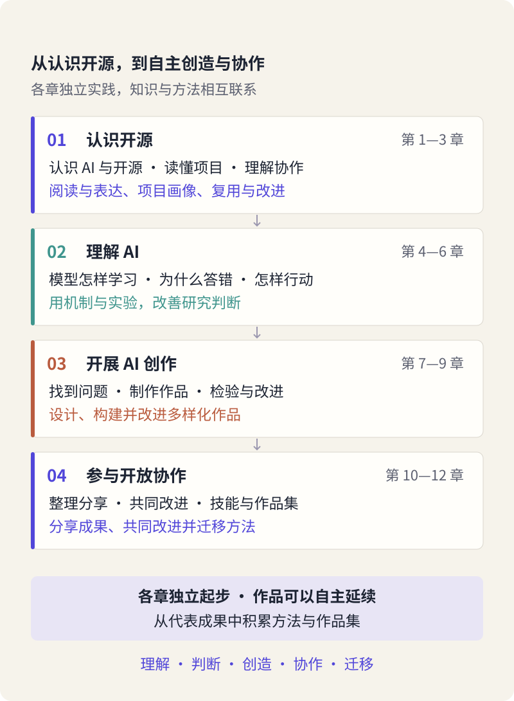
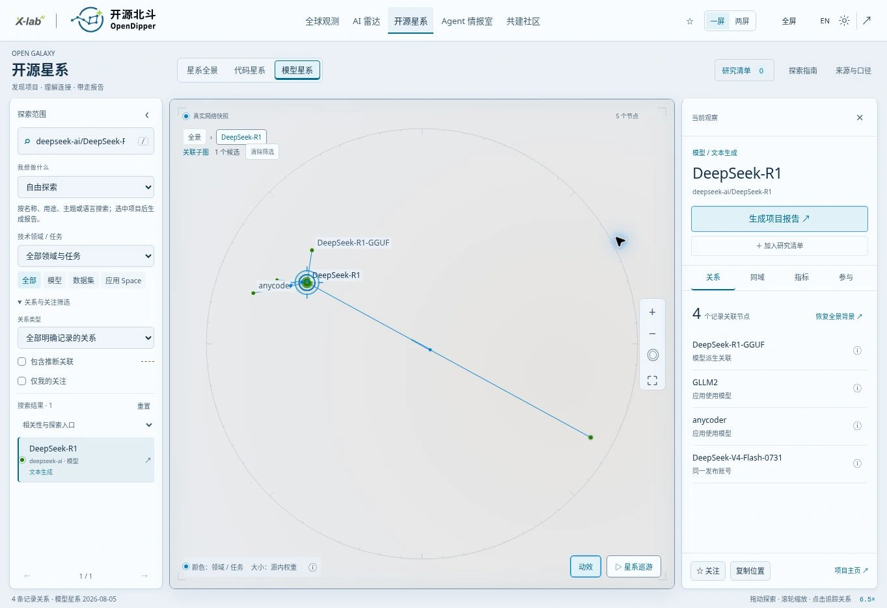

# 先做成一件事：我的第一次 AI 开源探索

> 状态：review
> 版本：0.3.0

如果请你研究一个 AI 项目，你会从哪里开始？搜几篇文章，问 AI 写一份介绍，还是先试着使用它？这些都是入口。真正的研究还需要多走一步：找到具体材料，说清自己的发现，让另一个人能够沿着你的说明继续探索。

这一章，我们先做成一件小事：**为一位尚不了解 DeepSeek-R1 的同学，制作一页有依据、有自己判断的项目研究简报。**简报是一份帮助读者快速了解问题、发现和下一步行动的短文。你不需要编程，也不用先懂模型怎样训练。用浏览器、DeepSeek 网页端和自己熟悉的文档工具，就能开始。

本章按两课时、90 分钟设计。先读故事与材料，再动手起草、修改和保存。读完时，你应当能说明自己研究了什么、依据来自哪里，以及为什么改动了其中一句话。所需材料都在正文中；需要离线使用时，可取用[第一章材料包](../../practice/ch01/README.md)。

## 1.1 从一份真实报告，到你的一页发现

序言中的《2026 全球开源发展报告》，也是这门课的一个真实起点。根据课程团队的制作经历，从 2026 年起，我们基于 OpenDigger 的数据，使用 DSH 等 AI 工具辅助报告工作：收集公开网络信息、分析数据、生成可视化图表、润色文字和整理版式。研究人员仍要决定关注什么、怎样解释数据、哪些结论值得保留，再把不同环节组织成一份面向读者的成果。

这里的 **OpenDigger** 主要为我们提供开源活动数据与分析能力；**开源北斗 OpenDipper（简称 OD）** 则把开源生态中的数据、关系和研究线索组织成可探索的观测平台。二者名称相近，承担的工作有所不同。本课会利用 OpenDipper 看项目、找线索，同时把它本身作为可以研究的真实项目。它使用的材料来自不同来源，例如代码项目的活动数据与模型平台的公开信息，并不全是同一类数据。

一份报告往往有两种互相支持的表达。文字解释“我们为什么研究、发现了什么”；可视化页面让读者自己查看对象、比较关系、追问细节。图表也会反过来帮助作者发现问题：一个变化可能值得解释，一条关联可能值得回到来源核对。因此，制作报告既是在表达已有认识，也是在继续形成认识。

这套方法还走进了团队面向机构和组织开展的 AI 培训与工作坊。管理岗位、基层岗位和计算机专业背景的参与者，都曾借助 AI 完成各自领域的专业研究报告，例如新能源汽车行业分析、AI 供应链行业分析。不同人的优势并不相同：熟悉业务的人更容易发现有用的问题，熟悉数据的人更容易辨认材料的边界。AI 扩展了他们整理和表达的能力，人的经验则决定了研究往哪里走。这些是团队的实践经历，也启发了本课的设计。

你的第一份作品可以小得多。我们把这段工作缩小成一个起点：**认识一个项目，找到一条有意思的线索，为一个具体读者写清楚，再留下一个值得追问的问题。**先完成这一页，后面再逐步扩展研究。

> 插画占位 · 图 AG-01-01　一页简报，从读者的问题开始
>
> 画面拟表现：一位学生把项目材料与观察笔记整理成一页简报，另一位读者从中提出新问题。以真实报告页面、纸张和浏览器窗口为素材，后续统一绘制；不使用虚构数据充当发现。

现在先想一位读者。可以是同专业同学，也可以是第一次听说 R1 的室友。试着写下一句：“我希望他读完这一页后，能够……”这句话会成为你选择材料和修改作品的依据。

## 1.2 四篇十二章，你的作品怎样长大

本书围绕一句主张展开：**用开源来理解 AI，用 AI 来贡献开源。**“开源”先从软件理解：作者通过许可，让他人能够查看、使用、修改和分享源代码。源代码是人编写、用来表达程序如何工作的内容，许可则说明允许怎样使用。走进 AI 项目，还会遇到模型文件、数据和文档；它们各有用途与使用条件，第二、三章会带你逐项认识。

开放让学习有了可以追问的材料。我们不仅看工具给出了什么回答，还能阅读项目说明、了解方法、观察问题讨论。AI 又能帮助我们解释材料、组织思路和制作作品，把理解转化为别人可以使用和改进的成果。



**第一篇“认识开源”（第 1—3 章）**，从本章的一页简报出发，学习打开项目、寻找依据，并理解开放与复用的条件。你的问题和材料逐渐有了来处。

**第二篇“理解 AI”（第 4—6 章）**，通过例子与小实验，理解模型怎样学习、为什么会答错，以及智能体怎样调用工具完成任务。这些知识帮助你解释现象，也帮助你选择合适的工作方法。

**第三篇“AI 创作”（第 7—9 章）**，围绕值得研究的问题与真实读者，开展研究、组织人机合作、检查并改进作品。前面积累的材料，将逐步发展为专业研究报告与配套动态展示页面。这里的“动态”指读者可以筛选、比较或探索，并不一定需要实时数据。

**第四篇“开放协作”（第 10—12 章）**，把报告与页面作为同一个项目放到 AtomGit，保存版本、分享成果、吸收反馈，并提炼可以用于新问题的方法。**AtomGit 是存放项目文件和支持协作的平台；仓库就是项目材料及修改记录的共同空间。**你的研究项目属于你和合作者，OpenDipper 则是你们使用和研究的项目之一，不要求人人都去修改它的程序。

这条路线反复练习五种能力：理解对象与机制，判断材料与结论，创造有用成果，与人协作改进，把方法迁移到新情境。它们会在同一次任务里交织出现。例如，你今天解释“我为什么删掉一句夸大的评价”，就在同时运用理解、判断和创造。

全书的终点可以先记成一句话：**借助 OpenDipper 完成一份专业开源研究报告及配套动态页面，在 AtomGit 上把它持续建设成自己的开源作品。**本章只迈出第一步。学会一个小而完整的过程，比第一天就做出完整网站更有价值。

## 1.3 从聊天窗口，走进一个真实项目

### 研究对象与使用工具，先分清楚

本章选定的研究对象是 **DeepSeek-R1 模型项目**。语言模型是一种经过训练、能够根据输入处理和生成语言内容的计算系统。R1 是一个具体模型的名称，项目公开说明介绍了它的推理能力与相关材料。我们选择它，是因为它有明确的项目资料，也能在 OpenDipper 中找到；这不是一次“当前最强模型”的评选。

你实际用来起草文字的是 **DeepSeek 网页端**。它是一项聊天服务：有人把模型运行起来，你通过网页输入问题、取得回答。研究 R1，不代表这个聊天服务当前使用的模型就是 R1。就像使用一个检索网站研究某本书，检索工具与研究对象可以有关联，但不能混为一谈。

后续还会用到 **DeepSeek Harness，简称 DSH**。它是一种智能体工具，能够在配置和权限允许的情况下，把模型与文件等工具组织起来执行任务。现在先记住它将帮助扩展工作过程；本章不需要安装或配置它。

### 在 OpenDipper 中寻找 R1

打开 [OpenDipper 的开源星系](https://www.x-lab.info/open-dipper/#ecosystem)。星图中的一个**节点**代表一个对象，例如模型、数据集或应用；两个节点之间的连线表示系统记录或推断的一种关系。连线值得探索，但它的含义要看关系说明。

1. 选择“模型星系”，搜索 `deepseek-ai/DeepSeek-R1`。斜杠前的 `deepseek-ai` 是发布账号，后面的 `DeepSeek-R1` 是模型名称。
2. 选择名称恰为 `DeepSeek-R1`、发布账号为 `deepseek-ai` 的结果，打开项目档案。先别选名称中带有其他后缀的条目。
3. 在“关系与关注筛选”中保持“包含推断关联”关闭。查看“关系”页签，点击“只看关联”，聚焦这个项目附近的连接。
4. 找到 `DeepSeek-R1-GGUF` 的“模型派生关联”，点“解释关系”，读一遍说明；再通过“项目主页”或“查看来源”回到公开材料。



这张真实截图保留了搜索、项目身份、关系类型和来源入口。截图于 2026 年 10 月 30 日取得，界面标示的模型数据观察日为 2026 年 8 月 5 日：**看到页面的日期，与数据描述的时间，可以不同。**点图可放大。界面以后若有变化，也可以沿着“选对象—看关系—读说明—找来源”这条路线完成观察。

此处的“模型派生关联”来自来源材料记录的关系。当前数据没有保留可恢复的方向，页面以无向关系显示；所以，单凭这条线不能判定“谁改进了谁”，更不能推出“谁的效果更好”。你已经有了一条研究线索，下一步是查看相关项目如何介绍自己的工作。

如果暂时打不开星系，先用下面的材料 B 和截图继续，记录为“阅读课程提供的观察”，以后再补一次亲自操作。你不必为进入学习而先排除所有网络问题。

## 1.4 读两份材料，提出自己的问题

第一份简报不需要搜集几十篇文章。先把两份材料读明白，就能体验研究中最基本的动作：认识对象、发现线索、形成问题。

### 材料 A：项目怎样介绍自己

以下是课程依据 [DeepSeek-R1 官方 README 固定版本](https://github.com/deepseek-ai/DeepSeek-R1/blob/0cf78561f1d51c84a21b2190626b21116d5c68bb/README.md)整理的中文材料卡，核对日期为 2026 年 10 月 30 日。**README** 是项目常见的入口说明，意思接近“请先读我”；“固定版本”让以后的人还能找到我们当时阅读的那一份文件。

- **A1 · 对象。**DeepSeek-AI 发布了 DeepSeek-R1 模型项目；项目说明将其作为推理模型介绍。推理在这里涉及为问题形成多步求解过程，不表示每一次回答都正确。
- **A2 · 材料。**README 提供技术报告、模型下载、本地运行与许可等入口。技术报告解释研究方法与结果；模型文件是运行模型所需的材料之一。本章只阅读入口，不下载模型。
- **A3 · 区分。**下载区列有 R1、R1-Zero 和若干名称带有 Distill 的模型。这些是不同条目。当前简报只讨论 `deepseek-ai/DeepSeek-R1`，不把其他条目的信息直接移过来。
- **A4 · 下一步。**原始说明能够帮助我们提出“它适合什么、怎样使用、允许怎样复用”等问题；某项具体任务是否做得好，还需要在明确条件下查看或开展测试。

### 材料 B：从关系中发现线索

以下是课程依据 OpenDipper 固定数据并与上述实际界面对照整理的观察卡。模型网络的数据观察日为 2026 年 8 月 5 日；本轮查阅及截图日期为 2026 年 10 月 30 日。模型信息来自 Hugging Face 公开元数据。**Hugging Face** 是分享模型、数据与应用的平台；**元数据**可先理解为描述这些对象的信息，例如名称、发布账号和声明的关联。

- **B1 · 身份。**模型星系中存在 `deepseek-ai/DeepSeek-R1` 节点，类型为模型，任务类别为文本生成；其项目主页指向 Hugging Face 上的对应模型页面。
- **B2 · 观察。**该节点与 `unsloth/DeepSeek-R1-GGUF` 存在“模型派生关联”。这里保留完整名称作为检索线索，暂时不需要理解 GGUF 文件格式。
- **B3 · 依据。**这是来源元数据明确记录的关联。OD 的关系说明提供来源入口，并说明当前按无向关系展示；这条记录本身不是效果比较，也不足以确定派生方向。
- **B4 · 追问。**如果想知道关联对象改变了什么、为谁解决什么问题，应继续阅读它的项目说明。仅凭相似名称、节点大小或一条连线，不能替代这一步。

材料 B 的固定来源为 [OD 模型网络](https://github.com/X-lab2017/open-dipper/blob/465c4737a36c4c5e67e39f971b3e09d28d1e84f5/public/data/galaxy/model.json)及[关系说明](https://github.com/X-lab2017/open-dipper/blob/465c4737a36c4c5e67e39f971b3e09d28d1e84f5/docs/OPEN_GALAXY.md)，便于回到同一份记录。

两张材料卡的作用不同：A 帮你理解项目自述，B 帮你发现项目之间的关系。把它们放在一起，问题就可以从“R1 是什么”走向“一个开放模型会怎样被不同的人继续使用或改造”。后一个问题现在还没有完整答案，但已经知道可以去哪里寻找。

先用自己的话写两句：**我目前能说清的是……；我还想查的是……。**例如，教育专业的读者可能想比较模型对同一知识点的不同解释；管理专业的读者可能关注一个模型周边出现了哪些应用；设计专业的读者可能关注怎样把关系呈现得更易读。这些都是后续选题的方向，不是两张卡已经证明的结果。

## 1.5 与 DeepSeek 合作，做出第一份简报

现在打开 [DeepSeek 官方网站](https://www.deepseek.com/)，进入网页聊天服务。使用自己已有、可以正常使用的账号即可；本章直接使用网页对话，无需额外安装工具或下载模型。若入口需要登录而暂未准备好，可以先完成材料阅读与手工提纲，之后补做 AI 起草。

给 AI 的任务说明常被叫作**提示词**。它不必是一句神奇口令。把任务说清楚，通常要交代四件事：**写给谁、依据什么、要做成什么、怎样判断有用。**例如，读者不懂术语，就需要解释；材料只说明有一条关系，就不应写成已经证明某个效果。

> 插画占位 · 图 AG-01-04　说清任务的四个要素
>
> 画面拟表现：读者、材料、成果、检查共同围绕“一页研究简报”，对应本节具体例子。后续统一绘制；四项文字与关系须准确，避免装饰性流程图替代解释。

先把刚才想到的读者与问题填进下面的说明，再把本节前面的材料 A、B 一并粘贴到同一条消息中。不要只发材料名称或链接：本次练习让工具直接取得你选定的文字，便于你知道初稿依据了什么。

```text
请协助我写一页 AI 开源项目研究简报。
读者：[写明一位具体读者及其已有了解]
我想回答的问题：[写下自己的问题]
研究对象：deepseek-ai/DeepSeek-R1。
依据：下面粘贴的材料 A、B；请使用材料编号指明依据。
成果：约 400—600 字，依次写清项目是什么、一条值得注意的发现、它与读者的关系、下一步要查的问题，最后列出材料来源。
检查：解释新手不熟悉的词；分清材料记载与我的推测；材料不足的地方保留为问题，不补写数据、测试结果或不存在的引用。
请直接在对话中给出初稿，我会核对、修改并自行保存。

[在这里粘贴材料 A 和材料 B，连同来源与日期。]
```

400—600 字只是帮助你控制规模的建议，不是凑字数的目标。把 AI 返回的文字先读一遍：它有没有回答你的问题？是否让读者知道下一步可以做什么？如果它写得过于宽泛，可以追问“请把第二段改成对材料 B2 的具体解释”；如果它用了陌生词，可以请它解释，再决定是否保留在简报里。

你也可以让 AI 帮你检查，但要自己回到材料。一个回答里出现“资料表明”，不等于真的提供了依据；要求它补一个来源，也不等于来源就一定存在。你已经读过两张卡，正好可以用来判断哪些句子有来处，哪些需要改成问题。

### 看一段编写者示例

> “我研究的是 DeepSeek-AI 发布的 DeepSeek-R1 模型项目。它的 README 提供技术报告、模型下载和使用说明等入口（A1—A2）。OpenDipper 中，R1 与 `unsloth/DeepSeek-R1-GGUF` 之间有一条模型派生关联，关系说明给出了来源（B2—B3）。这提示我继续查看相关项目如何使用模型，但还不能据此比较两者的效果。”

这是一段课程编写者示例，用来展示“对象—材料—发现—下一步”的写法，**不是实际 DeepSeek 会话的输出，也不是学生成果**。完整参考简报和修订说明收在材料包中；建议先完成自己的版本，再作比较。你的问题和读者不同，写出来也应当有所不同。

## 1.6 改一处，让它真正对读者有用

初稿的价值，在于让你有了可以修改的对象。改稿并不只是改错别字，也可以是补一句解释、调整顺序、删掉夸大判断，或把笼统问题变成能够继续调查的问题。

先找出简报里最重要的一句话，对照材料阅读。下面是一组**编写者构造的修订例子**，用来帮助你判断修改为什么有意义，不表示 AI 必然会生成其中的错误。

| 初稿中的一句话 | 可以怎样改 | 为什么这样改 |
| --- | --- | --- |
| “星图证明 R1-GGUF 比 R1 更好。” | “OD 记录了二者的模型派生关联；性能差异需要另查测试条件与结果。” | 关系记录支持“有关联”，不支持性能结论。 |
| “这里有 base-model 关系。” | “这里记录了一种模型派生关联；点开关系说明，可以继续找来源。” | 让新读者先理解含义和下一步，不被英文标签挡住。 |
| “这个项目对所有专业都有巨大帮助。” | “对我想帮助的同学，下一步可以比较它对同一课程概念的几种解释。” | 把空泛评价变成贴近读者、可以继续探索的任务。 |

现在选择你自己初稿中最值得改的一处。没有事实错误也没关系：一个准确但难懂的段落，同样值得改进。保存修改前后的句子，再写一句“我这样改，是因为……”。**能解释为什么改，才说明这次创作包含了你的判断。**

如果身边有同学，让他只读你的简报，然后问：“你看懂了哪个项目？哪句话最难懂？接下来愿意查什么？”根据回答再改一处。自学时，可以暂时收起材料，以第一次接触项目的读者身份重读：只靠这一页，能否找到项目、理解发现、知道下一步？不需要虚构一位读者的反馈。

最后再看来源。简报可以用 A1、B2 帮助定位，但在分享的版本中，还要保留相应的原始链接、材料日期，并说明 B 是自己操作所得，还是引用了课程观察卡。这样，读者拿到作品后仍能继续追问。

## 1.7 留下第一个版本，让研究继续

把修改后的简报复制到自己熟悉的文档工具中，取一个能认出的名字，例如“DeepSeek-R1 一页研究简报-v1”。**版本**就是作品在某个时间点的样子；以后继续修改，保留旧版或利用工具的历史记录，就能看见认识怎样变化。不要求你现在学习某种文件格式。

在文末简短留下：研究对象与读者，所用材料的来源和日期，实际使用的 AI 服务与操作日期，一处修改及理由，以及下一步问题。已有正文能够说明的内容不用再填一次表。材料包中的记录模板只是帮助，不是额外作业。

重新打开文档，确认正文和来源都在。聊天记录可以保留，但一份能够独立阅读的作品更方便后续整理、分享和改进。今天先保存在自己的文档或文件夹中即可；后续课程会带你把报告与页面组织到 AtomGit 仓库，让每次修改和共同讨论都有来处。

从这一页继续往前，你可能会发现值得比较的对象、需要补充的数据，或一个适合展示的关系。它们会逐渐变成专业研究报告的选题与材料。此时只要留下一个真实的问题，不必预先填满整本报告的目录。

## 1.8 回看：我学会了什么，还想追问什么

暂时离开 AI 对话，试着用自己的话回答下面三个问题。回答不必长，但要能联系自己的作品。

1. 我研究的 DeepSeek-R1，与我使用的 DeepSeek 网页端，有什么区别？
2. 我修改了哪一句话？这次修改怎样让结论更有依据，或让读者更容易理解？
3. 如果读者从本专业同学换成另一专业的新生，我会怎样调整简报？又需要补什么材料？

对照时抓住这三个要点：第一问要区分具体模型项目与聊天服务，不能凭网页体验认定后台模型身份；第二问要说明修改理由，而不仅说“更通顺了”；第三问要考虑读者的已有知识与目的，保留事实依据，调整解释方式，并承认尚需调查的部分。

完成本章时，应留下**一页简报及其来源、一次有理由的修改、一个后续问题**，并能独立解释这些选择。若今天只完成了阅读与手工提纲，就把 AI 起草留作接续任务；不需要把未做过的操作写进记录。

你已经经历了一次小型研究：选择对象，阅读材料，观察线索，与 AI 合作表达，再由自己作出判断。下一章，我们打开项目的原始页面，学习辨认说明、模型材料和社区讨论，让今天这页简报背后的依据更加清楚。
