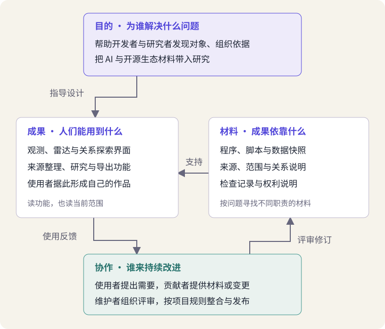
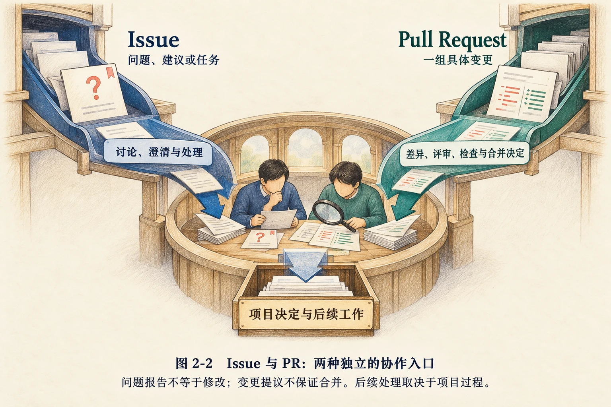

# 打开一个项目：从项目全貌到材料与协作

> 状态：review
> 版本：0.4.0

第一章以给定材料支持一次创作：了解 R1，把项目说明与 OpenDipper 观察组织成一页简报。接下来，要把这种有引导的阅读发展为能够迁移的方法。一个 AI 开源项目究竟是什么？打开它的主页以后，除了模型名称和下载按钮，我们还应该看见什么？

本章以 **OpenDipper（开源北斗，简称 OD）** 为主案例，把它从第一章的观察工具转为学习对象。通过它的说明、材料与协作记录，认识一个项目怎样把目标、成果、文件和参与者连接起来，再用 R1、DSH 及本课程作对照。贯穿全章的问题是：**怎样读懂一个项目的全貌，并为自己的研究找到合适的材料与参与方向？**

## 学习目标与阅读准备

学习本章后，应能够：

- 从目的、成果、材料和协作四个方面解释项目，区分项目、仓库与平台。
- 按问题选择 README、文件目录、研究说明、版本记录与贡献指南，解释它们各自的用途。
- 结合真实项目说明不同成果类型与社区参与方式，区分来源记载、个人判断和未解决的问题。
- 完成有依据的项目档案，修订第一章简报，并提出一个可以继续研究的小问题。

项目阅读服务于全书“科技研究与咨询：开源生态专题”实践：先读懂对象，后续才能选择专题、组织依据，形成研究报告与交互展示。

本章以第一章的基本概念为基础，不要求编程经验。核心材料以中文阅读卡和例题提供，可以独立完成纸面学习。在线阅读时可访问 GitHub、Hugging Face 和 AtomGit；无需安装开发环境、下载模型或向社区提交内容。实践重点是读懂与解释，不是记忆平台按钮的位置。

## 2.1 一个项目不只是一个下载对象

### 2.1.1 从使用 OpenDipper 到研究 OpenDipper

在第一章，我们用 OD 查看模型之间的关联。若只停留在这一步，OD 像是一个提供图表的网站。换一个问题：“这个网站怎样让研究者从分散材料走向可检查的报告？”就会发现，还需要了解数据来源、说明文档、工作过程以及共同维护它的人。

**项目**把一个持续追求的目标、围绕目标形成的成果，以及建设和改进这些成果的工作组织在一起。一个项目可能交付软件，也可能交付数据、模型、教材或多种成果。公开仓库只是其中一个入口，项目的知识还可能分布在文档站、模型平台和讨论区。

OpenDipper 的 README 将其目标概括为：帮助人们从 AI 与开源生态数据中发现对象，组织知识，并形成可以评审的研究报告[1]。这里既有软件功能，也有数据解释和研究表达。为了读懂它，可以先提出四个互相联系的问题。

| 阅读问题 | 在 OD 中寻找什么 | 为什么需要它 |
| --- | --- | --- |
| 为谁解决什么问题？ | 开发者查找项目，研究者整理主题与依据。 | 确定项目价值与自己的需要是否相关。 |
| 交付什么成果？ | 可浏览的观测与研究界面，以及导出的材料或报告。 | 区分项目提供的工具与使用者形成的作品。 |
| 依靠哪些材料？ | 程序、数据快照、来源说明、设计与使用文档。 | 看见界面背后的组成与依据。 |
| 怎样共同改进？ | 需求、反馈、贡献指南、评审与版本变化。 | 理解成果如何被建设和维护。 |

图 AG-02-01 表达的是项目阅读框架。目标影响成果设计，材料支持成果实现，使用和评审中的反馈又推动调整。箭头表示这些工作之间的联系，并不是 OD 的程序架构或自动执行流程。

### 2.1.2 先看功能，也要看当前范围

**材料 A：OpenDipper 的目标与当前成果。**以下依据项目固定版本 README 整理[1]。

- **A1 · 用途。**项目服务于 AI 与开源生态探索，帮助使用者发现对象、组织来源、准备研究和交付报告。
- **A2 · 成果。**入口包括全球观测、AI 雷达、开源星系、智能体情报室与社区。模块共同支持发现、阅读、整理和研究等工作，不只提供模型下载。
- **A3 · 阅读路径。**README 提供一次从官方来源进入知识整理、再阅读和编辑报告的示例。该示例不需要 API 密钥。
- **A4 · 当前范围。**上述完整报告是编写好的示例，不是现场运行 DSH 生成的结果；该版本说明研究执行服务尚未接通。数据还有各自的观察时间与样本范围。

读材料 A 时，A1 说明目标，A2—A3 介绍使用者可以看到的功能与路径，A4 交代当前实现范围。四者缺一，项目介绍都容易失真：只列功能而忽略范围，会把计划或示例当成已经实现的能力；只记录限制而不理解目的，也无法判断项目为何值得研究。

**例 2-1　“能够展示报告”说明了什么？**一位读者看到完整报告，写下“OD 已接通 DSH，能自动完成全部研究”。这句话把界面上可见的成果与成果产生的过程合并了。根据 A3—A4，更合适的表述是：“该版本提供了完整的报告示例，支持阅读、编辑和导出；现场研究执行尚未接通。”下一步可以研究示例怎样组织引用，但不能把示例当作实际运行记录。

这一方法适用于其他项目：把“目标是什么”“当前能做什么”“还有什么条件”一起读。项目处于建设过程中并不妨碍学习；明确阶段，反而能帮助我们理解改进从何处发生。

## 2.2 项目、仓库与平台各是什么

### 2.2.1 仓库组织文件与变化

**仓库（Repository）**是组织项目文件及其修改历史的空间。常见仓库由 Git 这样的版本管理工具记录变化：哪些文件发生修改，修改形成了什么状态，以及后续怎样继续演进。初学时不必先操作命令，只要理解仓库既保存文件，也保存文件怎样变化的线索。

**项目与仓库并不是一一对应的关系。**一个项目可以同时维护程序仓库、文档仓库和数据仓库；一个仓库也可能包含多个工具。OpenDipper 的主仓库提供程序与说明，它所用的部分数据另有上游来源；DeepSeek-R1 的说明仓库与模型文件入口也分布在不同位置。读到一个仓库，不等于已经取得项目的全部材料。

常见地址用 `拥有者/仓库名` 标识对象。例如，`X-lab2017/open-dipper` 表示组织账号 X-lab2017 下的 open-dipper 仓库。完整标识比简称更适合查证：同名对象、社区衍生项目与原始发布项目可能来自不同账号。确认入口时，可交叉查看项目主页、README 与组织账号提供的链接，不能只选择搜索结果中名字最像的一项。

### 2.2.2 平台提供不同的资源与协作入口

**平台**为许多项目提供承载与协作服务，不是某个具体项目本身。本课接触的三个平台有不同侧重，但功能存在交叉。

| 平台 | 本课主要用它做什么 | 阅读时应辨认什么 |
| --- | --- | --- |
| GitHub | 查看案例项目的仓库、修改记录与公开讨论。 | 账号、仓库、文件路径和对应版本。 |
| Hugging Face | 查看模型、数据集与应用空间的材料。 | 对象类型、发布者、说明卡、文件与适用条件。 |
| AtomGit | 保存、分享并持续维护自己的研究项目。 | 自己的作品、来源记录、变化与协作约定。 |

去哪个平台，首先取决于要找哪份原始材料。把研究作品放到 AtomGit，并不要求把案例的所有文件搬过去。本课先积累自己的解释、来源与成果，后续再学习如何发布与共同修订。

### 2.2.3 从 README 建立阅读路线

**README** 的意思接近“请先读我”，通常是项目的入口说明。它可能介绍目的、主要功能、开始方式、相关文档和参与路径[5]。它既帮助人开始，也帮助人决定“下一步读哪里”，并不是一份必须逐行读懂的全部知识。

读 OD 的 README，可以先用一句话回答“谁需要它”；再查看“可以做什么”与范围说明；接着只追踪与自己问题有关的链接。例如，要判断图中一条连线意味着什么，应到关系说明；想为术语解释提供帮助，应读贡献指南。安装命令适合准备运行软件的人，暂时不运行时可以保留位置，不必让它阻断概念阅读。

这是**按问题阅读**：先提出一个需要回答的问题，再寻找能提供相应信息的材料。与从头抄到尾相比，它要求读者作出选择，也更容易发现哪里缺少依据。

## 2.3 读懂材料怎样支撑成果

### 2.3.1 文件不同，承担的工作也不同

第一次打开仓库，常见困难是文件很多，名字陌生。可以先辨认职责：哪些文件给人解释，哪些文件给程序执行，哪些提供输入，哪些用于检查结果。识别职责不等于掌握文件内容，却能帮助我们选择阅读顺序。

**材料 B：OpenDipper 的材料组织。**以下概述依据 README 的技术视图与文档导航[1]。它描述该版本公开说明的材料关系，不代表本章已经运行了程序。

- **B1 · 输入。**项目组织 OpenDigger 等来源的数据，以及官方发布、来源记录和经审核的材料。来源不同，时间与范围也不同。
- **B2 · 处理。**收集脚本把相关材料整理为数据快照；程序界面与经过检查的材料共同参与构建。快照是保存某次数据状态的文件，不等于实时数据。
- **B3 · 呈现。**构建后的网页让使用者浏览观测、对象关系与研究材料；部分个人整理与导出发生在浏览器中。
- **B4 · 解释。**文档导航分别提供当前状态、数据范围、架构、历史与决定等入口；它们帮助读者了解数据和功能的含义。

这里的**脚本**是完成一组操作的程序；**构建**是把源文件及相关材料处理成可发布或运行成果的过程。理解材料 B 时，重点是看到“来源—处理—呈现”之间需要说明和检查，而不是记住所用编程语言。

| 材料类别 | 主要用途 | 阅读时提出的问题 |
| --- | --- | --- |
| README 与使用文档 | 向人介绍目的和开始方式。 | 我能用它完成什么，前提是什么？ |
| 源代码与脚本 | 表达界面、计算或处理过程。 | 哪部分负责取得、处理或展示材料？ |
| 数据及其说明 | 保存记录并解释来源、范围和时间。 | 一条记录表示什么，覆盖到哪里？ |
| 配置与依赖说明 | 告诉程序怎样运行、需要哪些组件。 | 运行要求是什么，与我的条件相符吗？ |
| 测试与检查记录 | 检验预先规定的行为或规则。 | 实际检查了什么，哪些效果还没验证？ |
| 状态、贡献与权利说明 | 说明项目阶段、参与方法和复用条件。 | 什么尚未完成，我可以怎样参与或使用？ |

这张表也适用于阅读自己的研究项目：报告相当于对人的说明，数据表保存依据，生成页面的程序负责呈现，检查记录说明你验证了什么。文件名称可以不同，承担的职责应当清楚。

### 2.3.2 名称相似的关系，要分别解释

第一章已区分 OpenDipper 与 OpenDigger。根据材料 B，可以进一步表述：OD 把 OpenDigger 等来源提供的材料用于观测与研究功能；这是一种具体的数据来源关系，不能因此说二者是同一个项目。

项目中的“关系”还可能表示软件运行时需要另一个组件，或两个项目拥有共同参与者。前者属于**依赖**，后者反映人的参与联系。OD 的开源星系说明区分记录关系与推断关系；记录的共同贡献者关系并不等于软件依赖，也不等于质量排名[1][4]。

**例 2-2　图上相邻，就能认定有技术依赖吗？**不能。应先查看连线类别及来源。如果连线表达共同贡献者，只能在相应记录范围内讨论参与联系；若要确认技术依赖，应继续查找依赖声明或相关程序说明。没有追到合适材料之前，图形只是调查入口。

### 2.3.3 “公开”与“允许复用”分开记录

材料说明还要回答权利问题。OpenDipper 的这个固定快照明确写明：根目录应用许可尚未选定，应用代码、数据、地图与品牌资产的权利需要分别确认[3]。因此，本章把它作为公开建设过程的真实案例来阅读，不能把“仓库公开”写成“全部材料已经统一授权”。

记录这一点不需要在本章完成复杂的许可分析。项目档案只需保留实际状态与来源；下一章再依据具体材料讨论复用条件。对其他项目也一样：看见许可文件，应判断它适用于哪些内容；没有找到时，应写“在当前材料中尚未确认”，不要代替维护者补上一个熟悉的许可名称。

## 2.4 比较项目类型：共同问题，不同材料

### 2.4.1 模型、工具与研究产品

用同一组问题比较对象，能够帮助我们理解差别；用同一份文件清单要求所有对象，则容易造成误解。模型项目需要说明模型本身及其使用条件，智能体工具要解释它怎样组织操作，研究产品还要说明材料怎样形成知识和判断。

| 比较维度 | OpenDipper | DeepSeek-R1 | DSH |
| --- | --- | --- | --- |
| 主要对象 | 生态观测与研究产品。 | 模型及相关研究成果。 | 组织模型与工具工作的智能体软件。 |
| 读者可能需要 | 查找对象、追查关系、组织研究。 | 理解模型方法、取得运行材料。 | 组织文件操作等任务，理解工具行为。 |
| 优先阅读 | README、数据与关系说明、贡献指南。 | README、技术报告、模型卡与文件说明。 | README、运行文档、贡献与扩展指南。 |
| 不能直接等同的事 | 展示报告与现场运行研究。 | 下载权重与取得全部训练材料。 | 安装工具与完成某项实际任务。 |

三者可以合作，但其中一个对象的特点不能替代另外两个。本教材也可以作为内容项目来观察：它交付正文、图件、练习与网页，其建设质量要看概念、来源、阅读体验和教学反馈；没有模型权重不妨碍它成为开放协作的对象。读懂项目，需要把共同框架与具体成果结合起来。

### 2.4.2 模型项目有哪些特别的材料

**模型卡（Model Card）**是模型仓库中介绍模型的说明，通常包含用途、使用方法、限制、训练或评价信息；Hugging Face 的模型卡通常由 README 文件承载，并可包含结构化元数据[6]。卡片提供查证入口，不自动保证每个栏目齐全或每个结论经过独立验证。

R1 的模型文件目录除 README 外，还可以看到配置文件与分片保存的权重文件[7]。配置帮助程序正确加载，权重保存模型计算所需的数值。对研究模型来源的人，技术报告更重要；对准备运行的人，模型文件、配置和运行要求更重要。只为理解项目，无需先下载这些大文件。

同一项目还可能发布多个对象。R1 的 README 分别列出 R1、R1-Zero 与名称带有 Distill 的模型；其中 DeepSeek-R1-Distill-Qwen-7B 的基础模型是 Qwen2.5-Math-7B，训练说明又提到使用 R1 生成的样本[7]。前者说明从哪个模型继续训练，后者说明样本的来源。这一例子提示：**相似名称不等于同一对象，同一对象也可能有多种不同来源关系。**本章不展开蒸馏训练机制，只要求读者知道应到哪里核对。

### 2.4.3 先比较适配性，再讨论优劣

“哪个项目更好”通常过于宽泛。对于准备撰写研究报告的同学，OD 的材料组织方式可能值得观察；对于研究语言模型训练方法的同学，R1 技术报告更相关。它们服务的问题不同，不能用同一条榜单直接比较。

更有用的问题是：“为了完成我的任务，哪个项目提供了什么帮助，还需要哪些材料与条件？”这种比较把选择与使用目的联系起来，也为后续测试留下了明确方向。阅读得到的是准备判断的依据，实际效果仍需要在相应条件下检验。

## 2.5 社区怎样使项目持续发展

### 2.5.1 贡献并不只有代码

项目公开以后，使用者会发现作者未曾预料的情境：某个术语难懂，某条来源过时，某种操作容易出错。将这些困难转化为可讨论的材料，是社区改进项目的一个起点。

**贡献者**提供代码、文档、数据、反馈或其他有用改进；**维护者**持续负责方向、评审、整合和发布等工作。这些角色不是固定身份，一个人可以同时使用、贡献与维护不同项目。参与价值也不能简单用提交数量衡量：一条准确的来源纠正，有时比大量无依据的内容更有帮助。

**材料 C：OpenDipper 的参与入口。**以下依据 CONTRIBUTING 与公开 Issue #19 整理[2]。

- **C1 · 谁可以参与。**使用者、领域研究者、开发者和 AI 工具都可以参与；人提出需要、提供领域知识并评审成果。
- **C2 · 怎样开始。**先查看现有任务与贡献说明；需求反馈可以说明谁遇到什么问题、希望得到什么结果，不必先制定代码修改方案。
- **C3 · 一个真实任务。**Issue #19 邀请参与者围绕一个 AI 与开源主题，整理 3—5 个原始来源，附日期及简短的价值说明。
- **C4 · 怎样处理。**材料与实现需要按项目过程接受审核；提交反馈不会自动启动 AI 执行，也不意味着建议已被采用。该 Issue 在本章查阅时仍是开放的任务邀请。

C3 与本课研究实践有直接联系：识别主题、找到原始材料、解释为何有用，本身就可能服务于社区。这里列出的是社区真实提出的需要，不是教材虚构的“学生已经成功贡献”故事。学习者可以先在自己的作业中练习这种材料整理，再根据能力、意愿和项目当前规则决定是否参与。

### 2.5.2 Issue 与 Pull Request 解决不同问题

**Issue** 是记录和讨论问题、建议或任务的入口。一个好的问题报告会交代发生情境、实际结果、预期结果以及可检查的依据。它让维护者理解需要，但不一定包含解决方案。

**Pull Request（PR，合并请求）**则把一组具体文件变更提交给项目评审，便于查看改了什么、讨论差异、运行检查并决定是否合并。它不只用于代码，也可以用于文档。Issue 与 PR 可以相互关联，但二者并非必须成对出现：一个 Issue 可能经解释而解决，一个小文档修订也可能按规则直接提交 PR。

图 AG-02-02 复用原版 AIOS101 的协作插图[9]。两条入口都需要人的判断与后续处理：提出问题不等于已经修好，提出变更也不保证合并。图中的人物和工作台是概念表达，不是某次社区活动的照片。

本章先读懂协作过程，不要求操作分支、提交 PR 或向上游发帖。后续章节会在自己的 AtomGit 研究项目中练习发布与共同修订。

### 2.5.3 参与规则也有项目差异

DSH 的一份固定版本贡献指南说明：当时处于早期积极开发阶段，暂时无法接收外部 PR；同时欢迎通过 Discussions 报告问题，创建插件，撰写文章与操作指南，以及回答其他成员的问题[8]。**Discussions** 是面向问答和交流的讨论空间，与项目用来跟踪任务的 Issue 有不同侧重，具体用途仍由项目约定。

这个对照说明，开放协作不是“所有人随时向所有项目提交任何修改”。维护者需要根据阶段与能力安排入口，参与者则应阅读当前指南。OD 欢迎的一种提交形式，不能自动成为 DSH 的规则；某个固定版本的规则，也不能永远代表项目未来的安排。

如果使用 AI 协助整理来源或起草反馈，参与者仍须核对内容，说明实际做过的工作，并承担自己提交内容的责任。AI 可以帮助协作，贡献是否有用要由实际问题、证据和评审共同判断。

## 2.6 让项目判断能够被复查

### 2.6.1 分清说明、观察与判断

阅读完整项目以后，学习者会积累多种信息。为了让别人理解自己的结论，应当区分三种表达。

| 表达层次 | 项目阅读中的例子 | 所需依据 |
| --- | --- | --- |
| 来源记载 | “该版本 README 说明研究执行尚未接通。” | 对应文档及具体位置。 |
| 个人观察 | “我打开示例并成功导出一份报告。” | 实际完成的操作、条件与结果。 |
| 分析判断 | “这个示例可能适合练习检查引用。” | 从材料到用途的理由；效果仍待检验。 |

没有实际操作时，只能把第二项改为“文档介绍了导出方式”。引用教材提供的卡片也可以完成分析，但应写明是教材材料阅读。诚实区分学习路径，能够使同伴提供更准确的帮助。

### 2.6.2 版本与日期分别回答什么

**版本**是成果在某一阶段的状态。仓库中的一次**提交（commit）**记录一组变化，并有可定位的标识。指向固定提交的链接，可以把读者带回当时的文件；指向 `main` 等分支的链接通常随新提交移动，适合查看当前情况。

阅读档案至少需要记录来源名称、链接、材料位置和实际查阅日期。如果结论依赖当时的规则或状态，还应记录固定提交或发布版本。本章 OD 材料固定于提交 `465c473…`；应用自身的版本号与文档提交标识属于不同层次，不应相互替代。

日期也可能有多种含义：数据观察日说明记录对应的时间，文档更新时间说明文字何时变化，查阅日期说明自己何时取得材料。第一章模型网络的数据观察日与截图日期不同，正是一个例子。把它们混成“最新数据”，会使读者误判材料覆盖的时间。

### 2.6.3 有来源，还要看来源是否回答了问题

可追溯并不等于结论必然正确。项目 README 能说明发布者怎样介绍功能，却不能单独证明某个班级使用后的学习效果；测试记录能证明相应检查通过，却不能证明所有场景都可靠；Issue 记录有人提出了问题，不一定说明项目存在已经确认的缺陷。

较稳妥的写法是让判断与材料处在同一范围。例如：“这份贡献指南列出了内容任务”有具体依据；“所有没有编程基础的人都能轻松完成任务”则超出了指南。遇到材料不足，可以把结论缩小，或者把它转化为下一步研究问题。

## 2.7 综合实践：建立一份项目档案

### 2.7.1 任务与步骤

本章以 OpenDipper 为主对象，建立一份能够支持研究的**项目档案**。档案是对用途、成果、材料、协作和当前认识的有组织记录；它帮助自己继续工作，也帮助他人复查。档案可以用一至两页完成，重点是解释清楚，不是列得越多越好。

1. **说明全貌。**用自己的话写明对象、主要读者、所解决的问题和成果，附官方入口。
2. **选择材料。**围绕一个具体问题，选择两类有不同作用的材料，解释为什么要结合阅读，并记录位置与日期。
3. **理解协作。**依据贡献指南或 Issue #19，描述一项可能有用的参与及其审核过程。只作分析，不把尚未发生的参与写成经历。
4. **作出对照。**在 R1、DSH 或本教材中选择一个对象，用约 100—150 字解释它与 OD 在成果或阅读材料上的差别。
5. **修订与追问。**回看第一章简报，修订一处表述或补写一段对生态的认识，说明理由，并提出下一步研究问题。

可独立完成，也可两人分读材料后交换解释。使用 AI 时，可以请它帮助翻译和整理，但应自己决定材料是否相关，并能解释至少一项选择。只阅读教材的人记录材料卡编号；实际访问原站的人记录所读页面与日期。

### 2.7.2 项目档案参考及分析

**例 2-3　从“一个关系图网站”到研究项目。**以下是编写者依据本章材料形成的示范，不是学习者作业或实际社区贡献记录。

| 档案项目 | 参考记录 |
| --- | --- |
| 对象与用途 | `X-lab2017/open-dipper`，面向 AI 与开源生态的观测与研究项目，帮助开发者与研究者发现对象、整理依据并准备报告。 |
| 成果与范围 | 提供观测、雷达、星系、情报室与社区入口；材料 A 所述完整报告为编写示例，该版本研究执行尚未接通。 |
| 我的阅读问题 | 不会编程的人，怎样帮助这个研究项目改善材料？ |
| 选择的材料 | README 用于了解产品目标；CONTRIBUTING 与 Issue #19 用于了解需要什么材料、怎样提交与审核。两者分别回答“为何需要”和“怎样参与”。 |
| 可以形成的成果 | 针对一个 AI 开源主题整理 3—5 个原始来源及日期，说明它们分别提供什么信息；是否被采用由社区评审决定。 |
| 权利与来源 | 固定快照的应用许可尚未选定；不据公开仓库推断统一授权。依据文献[1]—[3]，材料定位见对应小节与任务。 |
| 仍需调查 | 同一主题中，怎样区分项目发布说明、方法报告与独立评价，使来源互相补充？ |

这份档案把目标、材料与协作连接起来。它没有逐项复制功能表，而是选择了“材料贡献”这一阅读问题。如果研究问题换成“关系图怎样帮助选择研究对象”，应转向关系说明、来源样本与具体使用任务；档案也应随之调整。

**一个简短对照。**“R1 主要发布模型与研究材料，OD 主要组织生态观察与研究工作。研究 R1 的方法需要技术报告，研究 OD 的关系解释需要数据和关系说明。两者都可以阅读 README 与版本记录，但不能要求 OD 像模型仓库一样提供自己的模型权重，也不能用 R1 的开放材料替代 OD 自身的权利说明。”

**一项简报修订。**将“AI 开源就是把模型放出来给大家用”改为：“模型是 AI 开源生态的一部分。软件工具、数据、文档和社区工作同样支撑使用与创造；不同材料的开放与复用条件应分别确认。”修订理由是补上了模型以外的对象，并把访问与授权分开。若自己的原稿没有这类问题，可选择另一处实际需要改善的表述。

### 2.7.3 自我评价与下一章

完成后，用五个问题自查：能否解释项目全貌？选用的材料是否回答了自己的问题？是否分清来源记载、实际操作与判断？参与方向是否来自真实需要？能否说明一次修订及一个后续问题？不必把所有缺口当场填满，但要知道接下来去哪里寻找依据。

第一章提供材料、帮助你开始创作；第二章要求你自己选择阅读路线、组织项目认识；第三章将进一步追问这些材料为什么可以开放，以及在什么条件下可以复用与共同改进。保留本章档案和第一章简报，后续研究将从这些可以继续检查的认识出发。

## 本章小结

理解一个 AI 开源项目，需要把目的、成果、材料与协作联系起来。模型项目只是其中一种形态；软件、数据、研究与内容项目同样构成学习与共创的场域。仓库组织文件和历史，平台承载资源与活动，二者都不能替代项目全貌。

阅读应由问题引导。README 帮助定位，代码、数据、文档和研究材料分别回答不同问题，贡献指南说明参与路径。Issue 与 PR 是不同的协作入口，实际规则取决于项目及其阶段。

一份有用的项目档案既说明已经理解了什么，也保留尚需调查的部分。来源、版本和日期帮助复查，清楚的概念与理由使材料成为研究依据。这样的工作让第一章的一页简报逐步成长为可以分享、讨论和持续改进的研究成果。

**关键概念：**项目、仓库、平台、README、数据快照、依赖、模型卡、贡献者、维护者、Issue、PR、版本与提交、项目档案。

## 思考与练习

### 基础理解

1. 一位同学说：“我已经打开项目的代码仓库，因此掌握了项目的全部材料。”这句话忽略了什么？用 OD 或 R1 举例。
2. 阅读项目时，怎样区分目的、成果、材料与协作？请用 OD 的一个具体阅读问题把四者联系起来。
3. README、模型卡和贡献指南各适合回答什么问题？为什么不能要求所有项目都有模型卡和权重文件？

### 材料分析

4. 根据材料 A、B，分析两句话：“OD 显示了完整报告，所以研究服务已经接通”；“开源星系连接了两个项目，所以其中一个运行时一定依赖另一个”。分别说明问题在哪里、应查什么材料。
5. 根据材料 C 与 DSH 对照，评价“不会编程就无法贡献”“开放项目必须接收所有外部 PR”“提交 Issue 就会自动启动 AI”三句话，并提出一项范围明确的内容贡献。

### 拓展与迁移

6. 为自己的“开源生态专题研究报告”与“开源生态研究展示”设计一份简明项目档案。说明主要读者、成果、两类必要材料与一个可接受反馈的入口，并指出从 OD 案例可以借鉴什么、哪些条件仍需自己决定。

### 参考解答与学习提示

**第 1 题。**仓库是入口，项目可能跨多个仓库和站点。OD 还有上游数据及其说明；R1 的研究说明和模型文件也有不同入口。应根据问题追查相关材料，不能从打开一个地址推断已经获得全部内容。

**第 2 题。**例如，研究怎样帮助初学者理解关系图：目的涉及让人探索生态，成果是关系浏览与说明，材料包括数据定义与来源，协作可以是提交术语改进建议。四者连接起来，才能说明一次改进为何有用。

**第 3 题。**README 帮助把握项目与开始方式；模型卡说明具体模型；贡献指南说明如何参与。材料由成果与读者需要决定，纯内容项目或研究工具不必自行发布模型。相同名称的文件也可能承担不同程度的说明，需要实际阅读。

**第 4 题。**第一句混淆示例成果与产生过程，材料 A 明确区分报告示例和现场研究执行；应读当前状态与运行说明。第二句把参与关系等同技术依赖；应先查连线定义，再查依赖声明。两句都需要让证据与判断对应。

**第 5 题。**三句均不成立。OD 接受来源整理等非代码参与，DSH 固定版本说明暂不接收外部 PR，材料 C 也未承诺自动执行。可提出“围绕一个主题整理三份原始来源，分别写明日期、信息用途与仍缺少的材料”。真实提交前还要阅读当前任务和规则。

**第 6 题。**答案随专业变化。可以借鉴 OD 对目标、来源、当前范围和贡献入口的说明；自己的读者、研究方法、页面功能与复用条件需要另作选择。评价重点是材料怎样支撑成果、反馈怎样推动改进，而不是是否复制了 OD 的模块名称。

## 参考文献

[1] X-lab2017. OpenDipper README：Overview、First exploration、Technical view 与 Documentation。[项目说明](https://github.com/X-lab2017/open-dipper/blob/465c4737a36c4c5e67e39f971b3e09d28d1e84f5/README.md)

[2] X-lab2017. OpenDipper CONTRIBUTING；Issue #19：共建首批 AI 来源与情报样刊材料。[贡献指南](https://github.com/X-lab2017/open-dipper/blob/465c4737a36c4c5e67e39f971b3e09d28d1e84f5/CONTRIBUTING.md)；[任务讨论](https://github.com/X-lab2017/open-dipper/issues/19)

[3] X-lab2017. OpenDipper：来源、品牌与许可状态。[权利说明](https://github.com/X-lab2017/open-dipper/blob/465c4737a36c4c5e67e39f971b3e09d28d1e84f5/docs/RIGHTS.md)

[4] X-lab2017. OpenDipper：Open Galaxy。[关系说明](https://github.com/X-lab2017/open-dipper/blob/465c4737a36c4c5e67e39f971b3e09d28d1e84f5/docs/OPEN_GALAXY.md)

[5] GitHub Docs. About READMEs。[文档](https://docs.github.com/en/repositories/managing-your-repositorys-settings-and-features/customizing-your-repository/about-readmes)

[6] Hugging Face. Model Cards。[文档](https://huggingface.co/docs/hub/model-cards)

[7] DeepSeek-AI. DeepSeek-R1 README；模型文件目录。[项目说明](https://github.com/deepseek-ai/DeepSeek-R1/blob/0cf78561f1d51c84a21b2190626b21116d5c68bb/README.md)；[模型文件](https://huggingface.co/deepseek-ai/DeepSeek-R1/tree/56d4cbbb4d29f4355bab4b9a39ccb717a14ad5ad)

[8] DeepSeek-AI. DeepSeek Harness 中文贡献指南。[贡献说明](https://github.com/deepseek-ai/deepseek-harness/blob/f3803c96974ad4a94195fb97e5c637e9c2a3afe3/CONTRIBUTING.zh.md)

[9] X-lab2017. AIOS101：开源协作机制，图 2-2。[原版章节与图件](https://github.com/X-lab2017/AIOS101/tree/9acf393293ed629cdf1ffd1162d1257814aa57e7/textbook)
