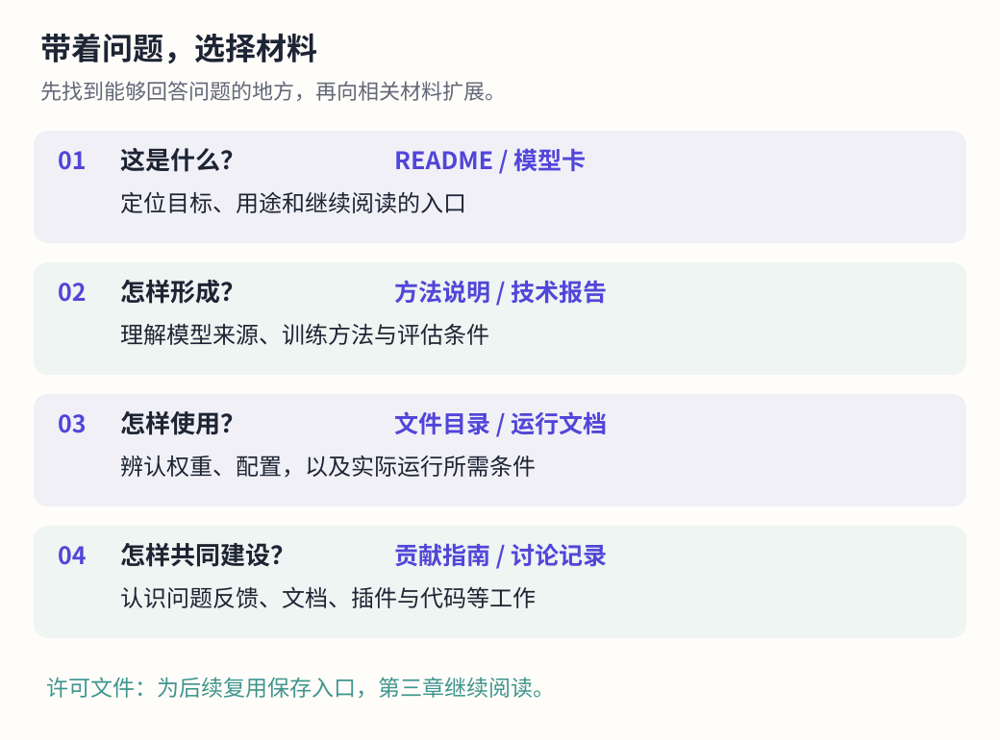
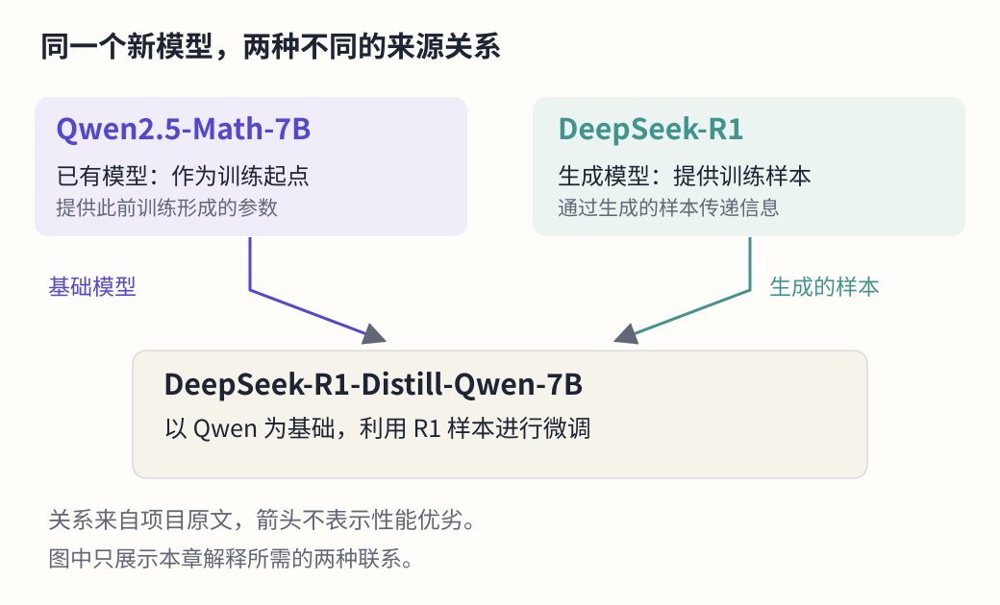
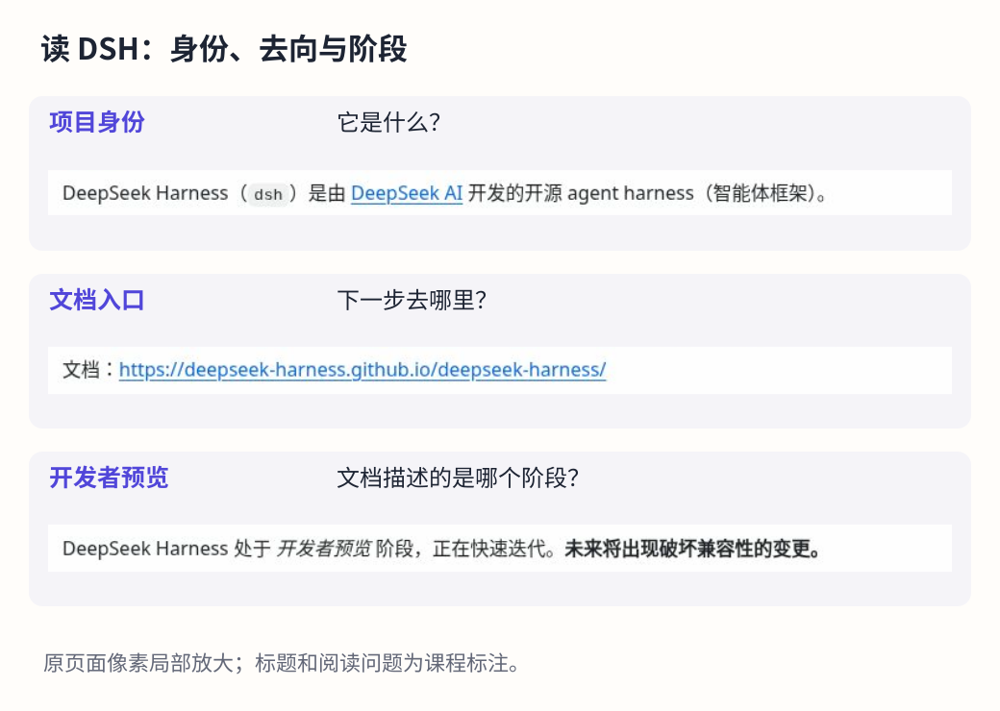

# 打开一个项目：从使用 AI 到读懂 AI 项目

> 状态：review
> 版本：0.3.0

打开 DeepSeek-R1 的项目说明，会看到一组相近的名称：DeepSeek-R1、DeepSeek-R1-Zero、DeepSeek-R1-Distill-Qwen-7B。它们出现在同一个项目中，却各有自己的说明与下载入口。尤其值得追问的是：为什么一个以 DeepSeek 命名的模型，名称里还出现了 Qwen？

答案就藏在项目公开的材料中。下载表列出了相关模型及其基础模型；方法说明介绍了它们怎样利用 R1 生成的样本进行训练。沿着这些线索，可以发现，一个 AI 成果与已有模型、运行软件、研究方法以及参与建设的人相互联系。[1]

第一章借助公开材料和 AI 完成了一页研究简报。本章进一步走进材料的来源：认识一个项目提供了什么，学习怎样阅读，并把发现组织成自己的理解。这里采用两个真实对象：以 **DeepSeek-R1** 为主案例，以 **DeepSeek Harness（DSH）** 为工具与社区的对照。OpenDipper 帮助我们发现对象及关系，原始项目材料帮助我们解释这些关系。

## 学习目标与阅读准备

学完本章，应能够：

1. 区分项目、仓库与平台，按问题选择并解释主要材料的用途。
2. 依据 R1 项目说明，解释基础模型与训练样本来源的不同关系。
3. 结合 DSH 贡献指南，说明维护者、使用者与贡献者怎样共同建设项目。
4. 形成有来源的主项目档案与简短对照，解释简报修订和下一步问题。

阅读前，回想第一章的三个概念：模型参与生成内容，在线服务提供使用入口，工具组织完成任务所需的操作。本章会把这些概念放回项目材料中辨认。核心例题所需内容已写入正文；动手探索时，再通过浏览器访问项目。没有自己的第一章简报，也可以使用本章参考例句完成分析。

## 2.1 从一个名字到一个项目

### 项目、仓库与平台各指什么

日常说“我使用了 DeepSeek”，通常足以交流体验。开展研究时，还需要说清所指对象：是某个模型、一项工具，还是聊天服务？同一品牌可能同时提供这些成果，它们解决的问题并不相同。

**项目**是围绕一个目标持续开展的工作，以及由此形成的成果、材料和协作活动。例如，R1 项目公开介绍了模型方法、模型文件入口与评估结果；DSH 项目则围绕智能体工具提供程序、文档和参与方式。项目的目标让分散的材料和活动有了共同方向。

**仓库（repository）**是保存项目文件与修改记录的空间。可以把它理解为能够持续修订、保留历史的资料集合，其中既可能有程序，也可能有说明、图像、研究报告和配置。一个项目可以使用多个仓库；同一份材料也可能被镜像到其他地方，因此不能简单地把仓库数量当成项目数量。

**平台**提供托管、检索或协作服务。GitHub 和 AtomGit 都可以承载项目仓库；Hugging Face 提供模型、数据等资源的发布与交流空间。平台帮助组织材料，项目才是本章研究的对象。写“来源是 GitHub”，就像写“资料来自图书馆”，还没有告诉读者具体读了哪本书、哪一页。

在 `deepseek-ai/DeepSeek-R1` 这个仓库标识中，斜杠前是账户或组织名，后面是仓库名。Hugging Face 上同名的模型仓库与 GitHub 仓库相互关联，但平台地址和材料用途不同。记录完整入口，有助于避免把它们混成一份材料。

### 找到对象，也找到自己的问题

研究项目并不要求先把所有文件读完。有效的起点是一个能够推动阅读的问题。本章的问题是：“R1 项目中这些名称相近的模型有什么关系？”如果关注写作应用，可以问：“哪些材料说明了模型的适用任务？”如果关心参与开源，则可以问：“这个项目希望收到怎样的帮助？”

问题决定阅读范围。名称和关系问题首先需要项目介绍、下载表与方法说明；实际运行问题还要看环境条件和运行文档。先把问题写清楚，就能判断一份材料为什么值得阅读。

OpenDipper 的开源星系提供搜索、对象信息和关系线索，帮助学习者从一个项目走向相关对象，再进入原始来源。第一章已经观察过 R1；本章沿用这个对象，将注意力从网络全景移到具体材料。OD 的记录范围与数据日期应随观察保留。[5]

确认项目身份时，可以从已知的官方发布入口或发布组织出发，再核对项目全名、页面用途及相互链接。社区教程、镜像和翻译也能提供帮助，只要继续辨认它们所引用的原始材料。项目页面的热度和视觉效果可以吸引注意，却不能代替身份与内容的核对。

## 2.2 一个项目里有什么

开源项目提供的材料各有分工。有的介绍目标，有的保存计算所需的文件，有的解释方法，还有的记录人与人之间的协作。理解这些分工，比记住大量文件名更有用。

### 从入口说明到具体材料

**README** 是项目常见的入口文档，名称可以理解为“请先读我”。它通常介绍项目做什么、怎样开始、哪里可以获得帮助，以及谁在维护。README 可以带领读者继续寻找文档、报告和贡献指南，但不必包办所有细节。[3]

**模型卡（model card）**围绕一个模型组织说明，常涉及用途、使用条件、训练或评估信息以及局限。它不一定是视觉上的卡片。在 Hugging Face，模型卡通常由模型仓库中的 `README.md` 文件呈现，并可附带任务、语言和基础模型等元数据。因此，“README”与“模型卡”可以指向同一份文件，只是强调的角度不同。[4]

**元数据**是描述材料的资料。例如，模型名称、发布者、任务类型和语言标签，都帮助平台组织与检索模型。标签能缩小查找范围，但仍需结合正文理解其含义；有一个字段，不意味着该字段已经填写完整或经过独立验证。



图 AG-02-01 按“想知道什么”组织阅读入口。读者可以从任意一个问题开始，再沿文档链接继续。真实项目的文件安排可能不同，应以项目实际说明为准。

### 模型文件为什么不是一篇说明书

训练使模型中的许多数值发生调整，这些数值通常称为**参数或权重**。运行程序利用它们进行计算。权重以文件保存，规模较大时可能分成多个文件。它们与供人阅读的说明书用途不同，也不是逐条排列的知识问答。

### 材料 A：R1 模型目录中的三类文件

- **A1 说明文件。** `README.md` 提供供人阅读的模型说明。
- **A2 配置文件。** `config.json` 描述加载模型时所需的设置。
- **A3 权重文件。** 目录中可见名称类似 `model-00001-of-000163.safetensors` 的文件，表明权重按分片保存。

来源：R1 固定版本模型文件目录；这里只观察名称与用途，无须下载文件或记忆后缀。[2]

**代码**描述程序怎样执行操作；**权重**保存训练得到的数值；**数据**可用于训练、评估或实际任务；**配置**说明程序采用哪些设置。它们可以共同构成一个运行系统，却不能相互替代。取得项目代码压缩包，未必同时取得模型权重；看到权重，也不等于看到了全部训练材料。

### 阅读材料与运行材料

一份**技术报告**通常更详细地介绍问题、方法、实验设置与结果。它帮助我们理解作者为什么采取某种方法，以及结果是在什么条件下得到的。初次阅读可以先找与问题直接相关的段落，数学推导和完整实验细节留待需要时深入。

**运行文档**说明怎样使用软件或模型，可能包含硬件、依赖、命令和配置要求。阅读它可以帮助识别条件；真正运行则需要在具体环境中执行并观察结果。本章聚焦阅读，运行实践将在后续逐步展开。

**贡献指南**说明项目如何接收问题、建议和修改；**许可文件**说明相关材料的使用约定。前者帮助组织协作，后者交代复用条件。第三章将进一步学习开放与复用，本章先为相关材料保留入口。

## 2.3 带着问题读 R1 的说明

面对一份较长的项目文档，可以采用“问题—位置—解释”的阅读方法：先说清需要回答什么，再找到最可能回答它的部分，最后用自己的话说明读到了什么。

### 先看结构，再读段落

R1 的 README 使用了 Introduction、Model Summary、Model Downloads、Evaluation Results 等标题。对于本章的名称与关系问题，Introduction 帮助确认对象，Model Downloads 帮助区分条目，Model Summary 中的蒸馏说明补充方法。这样就有了一条可控制的阅读路线。[1]

遇到英文，可以先识别标题和项目名称，再借助浏览器翻译或 AI 理解段落。专有名称应保留原样，尤其是模型名称中的后缀。翻译的目的是帮助理解原文，不应把不同对象翻译成同一个宽泛名称。

下面两张材料卡依据本章固定版本的 R1 README 整理，是课程的中文概述，保留了分析所需的信息。

### 材料 B：同一项目中的不同对象

- **B1 项目介绍。** README 分别介绍 DeepSeek-R1-Zero 与 DeepSeek-R1，并列出其他带有 Distill 的模型。
- **B2 基础关系。** 该版本说明 R1-Zero 与 R1 基于 DeepSeek-V3-Base 训练。
- **B3 下载条目。** 下载区将 DeepSeek-R1-Distill-Qwen-7B 作为单独条目，其基础模型栏列为 Qwen2.5-Math-7B。
- **B4 材料位置。** 上述信息分别位于 Introduction 与 Model Downloads；不同条目有各自的模型入口。

来源：DeepSeek-R1 README，固定提交 `0cf7856…`。[1]

### 材料 C：Distill 所表达的方法联系

- **C1 样本来源。** 项目说明使用 DeepSeek-R1 生成的样本，对 Qwen、Llama 系列中的基础模型进行微调。
- **C2 所形成的对象。** 由此发布的模型分别具有自己的名称与下载入口。
- **C3 使用说明。** README 提醒相关模型采用调整后的配置和分词器设置，并提供相应运行说明。

来源：同一 README 的 Distillation 与 DeepSeek-R1-Distill Models 部分。此处转述项目方的方法说明，没有代替独立复现实验。[1]

### 例 2-1：从名称走向关系

**问题：** DeepSeek-R1-Distill-Qwen-7B 是 R1 的另一个名称吗？为什么其名称中会出现 Qwen？

**分析：** 先看材料 B3，它作为单独下载条目出现，且基础模型是 Qwen2.5-Math-7B。这说明它不能直接与 R1 本体互换。再看材料 C1，R1 与该模型的联系在于生成训练样本。把这两条材料合在一起，才能解释名称所指向的关系。

**参考表述：** DeepSeek-R1-Distill-Qwen-7B 是一个独立列出的模型条目。按照项目说明，它以 Qwen2.5-Math-7B 为基础，利用 DeepSeek-R1 生成的样本进行微调。因此，Qwen 与 R1 在这里承担不同角色：一个提供训练起点，一个提供训练样本。

这个答案选择了能够回答问题的材料，并解释它们之间的联系。以后阅读其他项目，也可以先寻找这种“哪些内容合在一起才能回答问题”的关系。

## 2.4 项目之间怎样相连

### 用两个概念解释刚才的发现

**微调（fine-tuning）**是以已有模型为起点，继续使用相应数据进行训练，使模型适应新的任务或要求。可以把“基础模型”理解为这段训练工作的起点。这个起点已包含此前训练形成的参数，后续训练继续调整它们。

**知识蒸馏（knowledge distillation）**是一类利用一个模型提供的信息来训练另一个模型的方法。在本章案例中，项目采用的是由 R1 生成样本、用这些样本微调其他基础模型的做法。较大的模型常被用来帮助训练较小的模型，但“蒸馏”强调的是训练信息如何传递，不能仅凭文件大小判断是否发生了蒸馏。[1]

这两个概念从不同角度描述同一过程：微调说明从已有模型继续训练；这里的蒸馏说明训练样本怎样借助另一个模型产生。它不是把 R1 的模型文件简单压缩，也不意味着较小模型在所有任务上都与 R1 相同。



图 AG-02-02 将两种联系分别画出。下方模型接收来自两边的不同贡献：一边是作为训练起点的基础模型，另一边是由 R1 生成的样本。箭头表示本例中公开说明的训练关系，不表示性能高低，也不是按 OD 网络位置推测的关系。

### 从一个模型看见开放生态

这个案例呈现了开源 AI 研究的一种组织方式：已有成果成为后续工作的起点，新成果又带来新的研究与应用机会。不同项目的公开材料，使后来者能够辨认这种联系，而不只看到一个最终产品名称。

这里可以初步使用**生态**这个词，指围绕模型、软件、数据、工具和社区形成的相互联系。有的项目复用已有模型，有的提供运行工具，有的共享贡献者，有的由同一账户发布。研究生态时，应先说清所观察的是哪一种联系。

### OpenDipper 中的线怎样阅读

OD 的开源星系同时呈现代码与模型等对象。其当前数据说明将代码网络中的关系解释为共享贡献者联系；模型网络则区分记录关系和推断关系。代码网络的一条线不因此成为软件依赖，模型图上的一条线也不能自动变成完整的训练过程。[5]

本章使用的 OD 数据说明还指出：模型记录在导出处理中未保留可恢复的方向，因此以无箭头关系呈现。想知道“谁基于谁”，需要回到对应模型的原始说明。图让值得追问的联系更容易被发现，原文与其他证据帮助我们解释联系。

**例 2-2：观察怎样变成研究问题。** 阅读者在 OD 中发现两个模型之间有记录关系，可以先记下对象与关系类型，再打开项目说明核对。若原文说明了基础模型关系，就能进一步解释；若只知道它们属于同一发布账户，研究问题仍未得到同样的回答。这是依据平台材料设计的阅读情境，不是一次模型运行实验。

同样，节点较大、位置接近或连接较多，首先要按图例理解。若想比较模型完成任务的能力，还需要相同任务、合适的测试方法与结果。生态观察和任务评价可以相互补充，它们回答的问题不同。

## 2.5 项目也由人共同建设

模型与代码让我们看见成果，文档和讨论则让我们看见成果怎样被共同维护。下面以 DSH 为对照，把注意力从模型材料转向工具与社区。

### 同一种阅读方法，另一类对象

DSH 的中文 README 将项目介绍为 DeepSeek AI 开发的开源智能体框架，并提供文档、运行方式与社区支持入口。本章可以先把**智能体框架**理解为组织模型、工具和任务过程的软件结构；其具体工作机制将在后续章节展开。[6]



图 AG-02-03 保留实际 README 页面中的三处内容，提示分别对应项目身份、进一步阅读的去处与所处阶段。阅读 R1 时，我们关心模型条目和训练关系；阅读 DSH 时，则可以关心它组织哪些能力、怎样使用以及如何参与。方法相同，问题和材料重点发生了变化。

### 社区不是页面上的一个数字

**开源社区**是围绕项目持续开展交流、使用、维护和改进的人及其协作关系。维护者往往承担方向判断、问题分流、版本维护等工作；贡献者可能提供代码、文档、设计或数据；使用者也可能通过反馈与答疑参与改进。同一个人可以在不同时间承担不同角色。

**Issue** 通常用于记录问题、建议或任务；**Discussions** 常用于讨论和问答；**Pull Request（PR）**是提交一组修改、请求审阅并考虑合入的方式。具体分工由平台与项目共同决定。理解这些词，是为了读懂项目怎样协作；本章不要求掌握操作命令。

### 材料 D：DSH 如何邀请参与

- **D1 当时的接收方式。** 本章固定版本的贡献指南说明，项目处于早期积极开发阶段，暂时无法接收外部 PR。
- **D2 其他参与方式。** 同一指南欢迎通过 Discussions 报告问题，也提到创建插件、撰写文章与操作指南、回答其他成员的问题。
- **D3 对生态的理解。** 指南鼓励社区围绕自己的需要开展工作，并说明官方仓库中的包并不天然比社区开发的包更重要。

来源：DSH 中文贡献指南，固定提交 `f3803c9…`。这里描述的是该版本的参与约定。[7]

### 例 2-3：怎样理解“暂不接收外部 PR”

**问题：** 阅读 D1 后，能否得出“新手不能为 DSH 作贡献”？

**分析：** D1 说明的是一种修改接收方式；D2 列出了其他参与方式。判断社区怎样开放协作，需要把这些信息合起来阅读。项目当前无法接收某类修改，不等于没有其他有价值的工作。

**参考表述：** 在该版本的参与约定下，可以先阅读讨论、整理具体问题，或围绕真实使用需要编写操作指南。是否有帮助，要看它解决了什么问题、是否准确易用，而不只看提交了多少内容。

例如，一份解释“模型与工具有什么区别”的清楚说明，可能帮助新的使用者开始探索。这是根据指南提出的可行方向，并不表示已经存在某个获认可的贡献。后续协作章节会进一步学习怎样理解需要、提出反馈和回应修改意见。

这一对照也说明，本教材的学习成果可以与开源建设相连。读懂项目之后形成的研究、解释和图示，只要具有实际用途，就可能成为别人继续学习的材料。

## 2.6 把发现写成自己的判断

阅读并不止于摘录。把几处材料组织成一段清楚的解释，需要选择、推理和表达。这个过程也会暴露尚未理解的地方。

### 一句话为什么需要修改

下面是一句用于练习的初稿，并非真实学生记录：

> R1-Distill-Qwen-7B 就是 R1 的小文件版本，所以能保留 R1 的全部能力。

这句话包含两个问题。前半句把训练产生的新模型误写成文件压缩；后半句又把模型关系扩大为所有能力相同的结论。材料 B、C 能帮助修正前半句，却没有提供“保留全部能力”的依据。

结合例 2-1，可以改成：

> 根据 R1 项目说明，R1-Distill-Qwen-7B 以 Qwen2.5-Math-7B 为基础，利用 R1 生成的样本进行微调。若要判断它是否适合某个任务，还需查阅相关评估，并结合具体需求进一步测试。

修改后的文字说明了方法关系，也把下一步问题表达清楚。这里的判断不只是删掉过强的词，更在于重新组织“已有材料支持什么、还需要了解什么”。

### 三个有用的提问

整理材料时，可以问自己：**项目怎样说？我实际看到了什么？我据此作了什么解释？**

“项目怎样说”帮助正确转述作者的说明；“我看到了什么”要求写清自己的阅读或操作；“我作了什么解释”则呈现思考过程。例如，读到了下载条目是阅读观察，依据两处材料解释模型关系是分析；亲自运行并测试模型则属于另一种观察。

这些提问不是给每句话强行贴互斥标签。“我在 README 中读到作者这样解释”同时包含阅读行为与项目自述。关键在于把内容和依据说清楚，让读者知道结论怎样形成。

### 给依据留下能找回的位置

一条轻量的来源记录可以包括：项目与材料名称、相关小节、完整链接，以及材料版本或自己的阅读日期。固定版本链接有助于找回同一份文件；阅读日期说明自己何时查看。没有明确版本的网页，可以记录标题、位置与访问日期。

仓库中的**提交**保存一次修改记录，并有对应标识；**分支**则是持续发展的修改路线。指向 `main` 的链接可能随新提交变化，指向某次提交的文件链接则定位特定记录。本章 R1 材料采用固定记录点，完整标识保留在参考链接中，无须背诵。

固定 README 不会把它链接到的所有外部页面一并冻结。模型文件目录、在线服务和讨论区可能独立更新。尤其不能用一份旧 README 推断今天聊天网站正在使用哪个模型版本；要回答服务状态问题，应阅读相应服务的当前说明。

### 让 AI 帮助阅读，而由人完成理解

AI 可以协助翻译术语、概括已给出的段落，或比较两份说明。给它具体材料，比只给一个项目名更容易限定讨论范围。可以采用下面的阅读提示：

```text
我正在研究：R1-Distill-Qwen-7B 与 R1、Qwen 分别有什么关系。
请只根据我随后提供的材料完成以下工作：
1. 找出能够回答这个问题的句子或小节，并标明位置。
2. 用初学者能理解的话解释；保留模型的完整名称。
3. 分别列出材料已经说明的内容和仍未回答的问题。
最后请给我一个需要自己解释的追问，不要替我回答。
```

将原文或本章材料卡附在提示之后，再检查回答是否对应材料。完成后，尝试离开 AI 的表述，用自己的话解释基础模型与样本来源的区别。能够重新解释，才能把整理出来的文字逐步转化为自己的知识。

## 2.7 形成你的研究起点

### 把阅读积累成项目档案

本章的**项目档案**是一份围绕具体问题整理的简明研究记录。它把对象、材料与判断放在一起，方便以后继续使用。档案不求覆盖项目的全部信息，而应让自己和读者知道已经理解了什么、接下来研究什么。

下面是一份依据本章材料编写的参考档案。它是教材示例，不是学生的访问或运行记录。

| 档案项目 | 参考内容 |
| --- | --- |
| 主对象与问题 | DeepSeek-R1 项目；研究 R1-Distill-Qwen-7B 与 R1、Qwen 的关系。 |
| 主要材料 | R1 README 的 Model Downloads 与 Distillation 说明；完整固定链接见参考文献 [1]。 |
| 阅读所得 | 下载表区分了模型条目，方法说明解释了样本来源。 |
| 我的解释 | Qwen2.5-Math-7B 提供训练起点，R1 提供生成样本；两种联系不能合并成“同一个模型的不同文件”。 |
| 简报修订 | 将“小文件版本、全部能力”改为明确的训练关系与待研究的任务适用性。 |
| DSH 短对照 | DSH 是工具项目；README 说明身份，贡献指南说明参与方式。保留许可入口，第三章继续阅读。 |
| 后续问题 | 选定一个具体任务后，哪些项目材料能帮助判断该模型是否值得进一步试用？ |

### 综合实践：从一页简报继续前进

沿用第一章的简报，完成下面的阅读与修订。也可使用本章参考例句作为起点。

1. **确定问题。** 选择 R1 项目中一个能用公开材料推进的问题。首次练习可沿用本章模型关系问题，熟悉后再换成与专业兴趣有关的问题。
2. **寻找并阅读材料。** 在 OD 和原始项目入口之间往返，为主对象选取两处能够帮助回答问题的材料，记录实际阅读的位置、链接和日期。
3. **解释一个发现。** 可以解释模型关系，也可以解释材料中某个概念或条件；说明为什么所选材料有用。
4. **完成 DSH 短对照。** 用几句话说明工具项目与模型项目的阅读重点有什么不同，保留 README、贡献指南和许可入口。
5. **修订与提问。** 回到第一章简报，修改或补充一句重要表述，写出理由，并留下一个准备继续研究的问题。

具体入口与空白模板见本章配套材料。可以使用普通文档编辑器整理结果，不以文件格式熟练程度判断是否学会。

### 怎样把宽泛兴趣变成可研究问题

“哪个模型最好”包含太多不同标准，难以直接推进。可以逐步限定：为谁解决什么任务？准备观察哪种结果？目前能取得哪些材料？比如，从“我对 AI 写作感兴趣”走向“面向中文课程材料整理，项目说明提供了哪些用途和限制信息”，就能开始一次材料研究。若进一步比较实际效果，还需设计后续测试。

好问题不一定立刻有答案，但应指出下一步行动。查阅模型卡、阅读方法报告、寻找具体任务的评估，或询问一处文档尚未解释的条件，都比继续搜索一个宽泛项目名更容易积累认识。

本章档案将成为后续研究报告中的对象说明和材料依据。到第三章，我们会沿着其中一份具体材料继续追问：当自己引用、改写和分享这些成果时，应怎样说明来源、理解使用条件，并为共同创造留下空间？

## 本章小结

一个 AI 开源项目不仅有最终成果，也有帮助理解成果的说明、文件、方法与协作活动。项目、仓库和平台各有含义；README、模型卡、权重、报告与贡献指南各自回答不同问题。

本章通过 R1 的真实条目理解了两种关系：作为训练起点的基础模型，以及提供训练样本的模型。借助 OD 可以发现值得追问的线索，解释它们则需要结合关系类型与原始材料。DSH 的贡献指南进一步表明，文档、答疑和插件等工作也可以支持项目建设。

从材料到理解，需要主动选择、解释与修订。项目档案保存这个过程，并将一个新的问题带到后续学习中。

## 思考与练习

### 基础理解

1. 为什么“我使用了 DeepSeek”不足以准确说明一个研究对象？请用模型、工具和服务各举一个本章涉及的例子。
2. 要分别了解项目目标、模型文件、训练关系和参与方式，可以优先查阅哪些材料？为什么不必先读完整个仓库？
3. 在 Hugging Face，README 与模型卡一定是两份不同文件吗？请解释它们的关系。

### 材料分析

4. 根据材料 B、C，解释 R1-Distill-Qwen-7B 中的 Qwen 与 R1 分别承担什么角色。再指出，仅凭这些材料还不能回答的一项问题。
5. 根据材料 D，评价这句话：“DSH 暂不接收外部 PR，所以学习者只能旁观。”请给出一个合理的参与方向和判断其价值的依据。

### 拓展与迁移

6. 为一个你感兴趣的 AI 开源项目提出具体问题，选择两类材料并说明理由。如果暂时不独立选项目，可用 DSH 完成：哪些文档能帮助新使用者理解工具的用途与参与方式？

## 参考反馈

**第 1 题。** 同一名称可能关联不同对象。R1 是模型研究对象，DSH 是智能体工具项目，DeepSeek 聊天网页提供在线服务。说明对象时要保留项目全名与入口；不能凭品牌名认定在线服务实际使用的模型版本。

**第 2 题。** 项目目标可先读 README；模型文件查看文件目录及相关说明；训练关系查下载表、模型卡或方法报告；参与方式查贡献指南。问题决定材料选择，先有目的地阅读，遇到需要解释的细节再扩大范围。

**第 3 题。** 不一定。在 Hugging Face，模型仓库的 README.md 通常呈现为模型卡。README 强调入口文件，模型卡强调围绕模型组织的信息；它们可以重叠。也不能因此假设每份模型卡都包含完整的训练与评估资料。

**第 4 题。** 该条目以 Qwen2.5-Math-7B 为基础，使用 R1 生成的样本进行微调。可进一步追问它在某个具体任务中的效果、所需运行环境或适用限制。基础关系不能直接证明与 R1 能力相同，也不能证明适合所有专业任务。

**第 5 题。** 这句话把一种提交方式扩大成全部参与方式。指南还列出问题反馈、插件、操作指南和答疑等方向。可以先寻找具体需要，再提出准确、可使用的帮助；价值应结合解决的问题与实际反馈判断，不能仅用数量或是否合入代码衡量。

**第 6 题。** 答案可以不同。合适的回答应交代对象和读者需要，并解释材料怎样帮助回答问题。例如，研究 DSH 的入门支持，可读中文 README 确认定位，再读贡献指南确认适合的参与方式。若只写“多看看官网”，还需缩小问题并指出具体阅读位置。

## 参考文献与配套资源

[1] DeepSeek-AI. DeepSeek-R1 README，固定提交 `0cf78561f1d51c84a21b2190626b21116d5c68bb`。使用 Introduction、Model Summary、Model Downloads 等部分，作为项目方公开说明。[原始材料](https://github.com/deepseek-ai/DeepSeek-R1/blob/0cf78561f1d51c84a21b2190626b21116d5c68bb/README.md)

[2] DeepSeek-AI. DeepSeek-R1 模型文件目录，固定版本 `56d4cbbb4d29f4355bab4b9a39ccb717a14ad5ad`。用于辨认说明、配置与权重文件。[文件目录](https://huggingface.co/deepseek-ai/DeepSeek-R1/tree/56d4cbbb4d29f4355bab4b9a39ccb717a14ad5ad)

[3] GitHub Docs. About the repository README file。用于解释 README 的入口与导航作用。[官方文档](https://docs.github.com/en/repositories/managing-your-repositorys-settings-and-features/customizing-your-repository/about-readmes)

[4] Hugging Face. Model Cards。用于解释模型卡、README 与元数据的关系。[官方文档](https://huggingface.co/docs/hub/model-cards)

[5] X-lab2017. OpenDipper / Open Galaxy，固定提交 `465c4737a36c4c5e67e39f971b3e09d28d1e84f5`。用于说明发现、关系类型与数据范围。[模块说明](https://github.com/X-lab2017/open-dipper/blob/465c4737a36c4c5e67e39f971b3e09d28d1e84f5/docs/OPEN_GALAXY.md)

[6] DeepSeek-AI. DeepSeek Harness 中文 README，固定提交 `f3803c96974ad4a94195fb97e5c637e9c2a3afe3`。图中保留该版本页面；说明项目身份与文档入口。[中文说明](https://github.com/deepseek-ai/deepseek-harness/blob/f3803c96974ad4a94195fb97e5c637e9c2a3afe3/README.zh.md)

[7] DeepSeek-AI. DeepSeek Harness 中文贡献指南，同一固定提交。用于分析该版本的参与方式。[贡献指南](https://github.com/deepseek-ai/deepseek-harness/blob/f3803c96974ad4a94195fb97e5c637e9c2a3afe3/CONTRIBUTING.zh.md)

本章材料核对日期：2026 年 10 月 30 日。固定材料用于稳定的阅读练习；项目的新版本可在后续探索中另行记录。书中例题与参考档案为编写者示范。

数字配套提供项目入口、材料卡、档案模板与自查反馈：[第二章实践材料](../../practice/ch02/README.md)。
