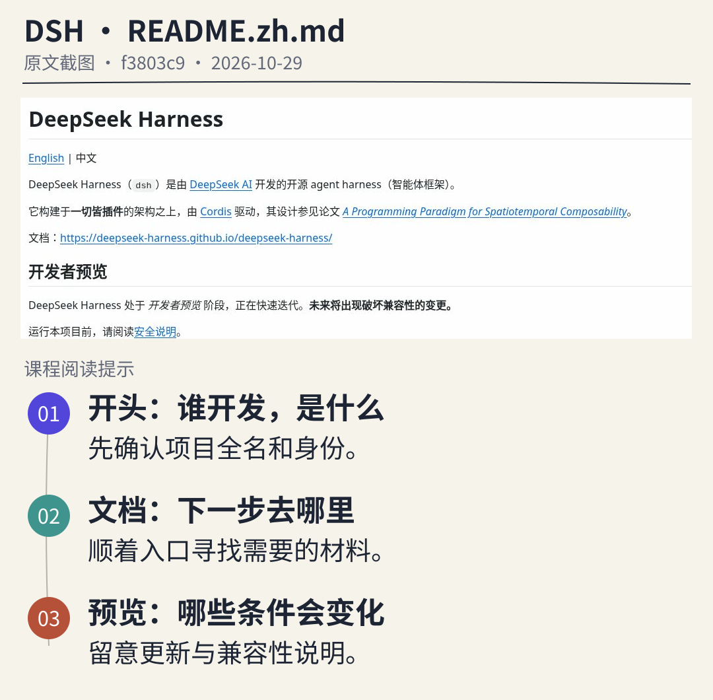
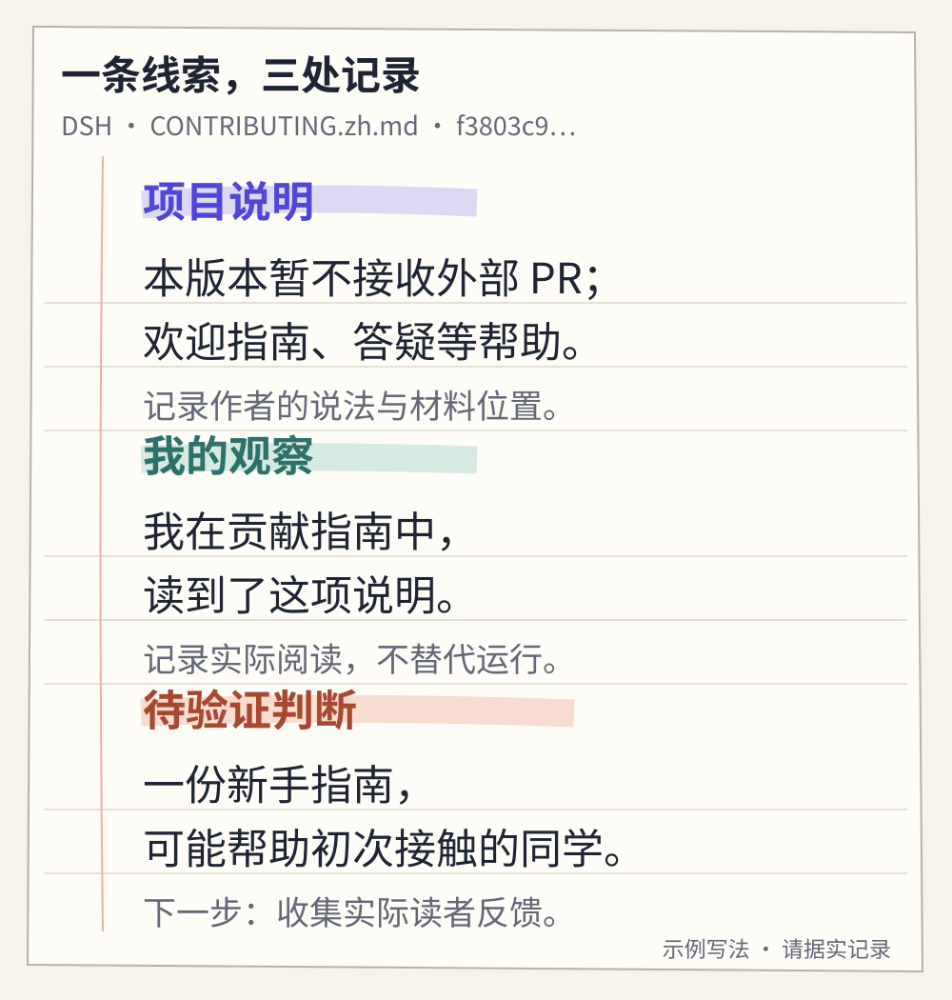

# 打开一个项目：看见 AI 背后的世界

> 状态：review
> 版本：0.2.0

第一章里，你借助两份材料制作了一页 DSH 项目导览。现在，一位同学读完后问：“这份介绍我看懂了。可是，我怎么知道自己找对了项目？模型文件在哪里？除了说明书，还有什么值得看？”

这些问题把我们从一件作品带回它的来源。一份导览可以帮助人入门，一份项目档案则要让人顺着记录，找到介绍背后的材料。本章就来建立这样的档案：分别认识一个 DeepSeek 模型项目和 DSH 工具项目，记录能确认的内容，也留下一个想继续探究的问题。

准备好第一章的导览和一个浏览器即可。本章不要求安装新工具、下载模型或运行代码；暂时没有完成第一章操作，也可以先跟随这里的阅读练习，再回去补做创作。

## 2.1 先确认，你打开的是哪个项目

搜索“DeepSeek”，可能看到官方网站、聊天入口、模型页面、教程和很多名字相似的仓库。它们可能互有关联，却回答着不同的问题。如果只在档案里写“研究 DeepSeek”，别人还不知道你研究的是哪一个对象。

本章选定两个对象：**DeepSeek-R1**，作为观察模型的例子；**DeepSeek Harness（DSH）**，作为观察智能体工具的例子。这里选 R1 是为了沿着一组明确材料练习阅读，不表示它是当前最新模型，也不表示第一章的 DSH 会话实际使用了 R1。那次会话用了什么模型，仍要回到自己的记录确认。

### 从能够核对的入口出发

先打开[第二章材料页](../../practice/ch02/README.md)。其中的来源导航给出了官方入口及本章使用的固定版本：DeepSeek 的 R1 发布页链接到模型项目中的技术报告；DSH 官方产品页链接到它的 GitHub 仓库。沿着这些关系，再核对发布组织、项目全名和页面用途，比仅凭一个相似的名字更可靠。

在 GitHub 地址 `deepseek-ai/DeepSeek-R1` 中，斜杠前是账户或组织名，后面是仓库名。仓库是保存项目文件与修改记录的空间，GitHub 是承载它的平台。页面最上面的名称、文件路径和正文标题，应当能与自己要找的对象对应起来。

教程、镜像和社区改进版也有价值。**镜像**是为了同步或访问而保存的另一份副本；它可能与原项目有更新差异。如果从这些地方获得线索，就继续追到它们引用的原始材料，并写清你实际读的是哪一份。页面醒目、收藏多或排在搜索前面，都不能单独证明它是官方入口。

把一个项目想成一间开放工坊：门口有介绍，里面有材料、工作方法和人们交流的痕迹。走进来以后，我们可以带着问题逐处查看。图中的部分柜门仍然关着，提醒我们：能进入项目，不等于已经知道所有内部细节。

## 2.2 带着问题读 README，而不是从头硬啃

README 是项目常见的入口说明，意思接近“请先读我”。它通常帮助读者判断项目做什么、怎样开始、去哪看更多资料。不同项目的写法并不统一；它是一张导览图，不是一份必然完整的说明书。

第一次阅读，可以先找三个答案：**这是什么？我需要的材料在哪里？开始使用有什么条件？** 看见陌生词时，先判断它是否影响这三个答案。暂时不影响的训练方法或程序细节，可以记下位置，之后再回来。

### 先用 DSH 的中文说明练习

在本章固定版本的 `README.zh.md` 中，开头交代了项目名称、开发者和智能体框架的身份；“文档”链接给出继续阅读的去处；“开发者预览”说明项目仍在迭代，更新可能带来不兼容的变化。“不兼容”可以先理解为：旧方法或旧组件，在新版本中不一定还能照常使用。

图中保留的是实际页面文字，下方标注是本课程提供的阅读提示。手机上可点图放大。此刻不必看懂画面中的每个技术名词，先练习从原文找到这三类线索。它们描述的是项目，不是对你电脑环境的检查结果。

### 再到 R1 的说明中寻找模型材料

打开材料页给出的 R1 README。遇到英文，不必整页翻译；先借助以下几个标题定位。也可以用浏览器翻译或请 AI 解释一个段落，但保留原始名称和来源，回到原文核对“不支持”“建议”“可能”等影响意思的词。

| 想知道什么 | 可以先找的标题 | 本章读到这里即可 |
| --- | --- | --- |
| 这是哪个模型？ | Introduction：简介 | 记录具体名称与作者如何介绍它 |
| 模型材料在哪里？ | Model Downloads：模型下载 | 找到对应模型的链接，区分不同条目 |
| 怎样在自己的环境使用？ | How to Run Locally：本地运行 | 确认说明针对哪种模型，并记录条件或下一步文档 |
| 使用时应查什么约定？ | License：许可 | 记下对应材料的许可入口，下一章再细读 |

这份 README 的下载区同时列出了 DeepSeek-R1、DeepSeek-R1-Zero，以及名称中带有 Distill 的其他模型。**Distill 指蒸馏**，可先理解为利用一个模型产生的示例帮助训练另一个模型的方法；具体原理留到理解 AI 的篇章。现在只需知道：这些名称对应不同对象，不能把某个条目的下载地址、条件或结果套给所有条目。

沿着 DeepSeek-R1 的链接，可以进入 Hugging Face 上的模型页面。Hugging Face 是分享模型、数据与应用等资源的平台；其中的 **Model card（模型卡）**用于说明模型，**Files（文件）**用于查看所提供的文件。模型卡不一定是一张图卡，也可能是一篇较长的说明。

模型训练得到的许多数值通常称为**参数或权重**。它们参与模型的计算，并以文件保存；可以先把它们理解为训练留下的一部分成果。我们查阅的 R1 文件目录列有分片保存的 `.safetensors` 文件，也有 `config.json` 这样的配置文件。前者用于保存权重数值，后者交代程序加载模型所需的一些设置。这里只观察名称与用途，不需要下载、打开或修改这些大文件。

因此，下载一个代码仓库的压缩包，与取得模型权重并准备好运行环境，是不同的事。模型文件也不是一份可直接翻阅的“全部训练资料”。看到权重，并不意味着我们已经知道模型学习过程中用过的每一份材料。

## 2.3 走出首页：说明、讨论与参与方式

README 往往把读者引向更具体的地方。想知道一个设置怎么用，可以找用户文档；想了解某次变化，可以看版本记录；想参与改进，则先看贡献指南。**贡献指南**常命名为 `CONTRIBUTING.md`，它说明项目希望怎样接收问题和帮助。

这里有一个真实的例子。我们查阅的 DSH 中文贡献指南写明，该阶段暂不接受外部 PR，同时欢迎通过讨论报告问题、撰写文章与操作指南、回答社区成员的问题。**PR（Pull Request）**可以先理解为“请维护者审阅并考虑合入我这一组修改”的请求。它是一种参与方式，并不等于全部贡献。

这条材料很有用：如果你想帮助 DSH 的新用户，不必从修改核心程序开始。但也不能把“项目欢迎指南”进一步写成“我写的指南已经得到项目认可”。你还需要看看自己的内容是否准确、是否帮助了具体读者，以及适合放在哪里。

在一些项目里，你会看到 **Issue（议题或问题记录）**、**Discussions（讨论区）**等入口。它们的名称和分工由平台能力与项目约定共同决定。DSH 的这版说明指向 Discussions；不能因为另一个项目使用 Issues，就机械套用同一做法。本章只需要找到并记录参与入口，不要求发帖、加入群聊或提交修改。

社区也不只是一个数字。维护者、使用者、文档作者和提供反馈的人，通过阅读、提问、修改与回应形成协作。一个没有很多收藏的项目可能认真处理问题；一个受到广泛关注的项目，也不一定适合你的具体任务。先观察与自己问题有关的材料，再作判断。

## 2.4 分清模型、软件、服务与社区

现在可以把第一章认识的角色放到真实材料中，再看清一些。

本章讨论的语言**模型**，是经过训练、能够处理和生成语言内容的计算系统。研究一个具体模型时，我们关心它的名称、权重、说明、适用条件和测试材料。R1 是本章选择的模型对象。

**软件**是组织计算与操作的程序。DSH 这样的工具可以把模型、文件操作等能力组织起来；运行模型本身也需要相应软件。工具能做什么，受到版本、配置与权限的影响。

**服务**是有人把模型或工具运行起来，提供给别人使用的方式。例如聊天网站，或让其他程序发出请求的 API。API 即程序之间约定的调用接口；你不必亲自管理背后的机器，也可能使用到模型，但通常需要确认服务的访问条件与实际提供的模型。

**社区**是围绕项目共同工作的参与者及其协作活动。社区会产生文档、讨论、反馈与改进；平台提供存放和协作的空间。AtomGit 上的观察站，正是我们整理作品、逐步参与协作的地方。

这四个词并不是四个互不相干的盒子。一个在线服务可以用软件运行模型，社区可以改善这些软件和文档。同一个品牌也可能同时提供模型、工具与服务。分清它们，是为了准确表达自己做过什么。

例如，“我在聊天网页上得到了一次回答”，说明你使用过某项服务；它没有自动证明你下载了相应模型。“我打开了 DSH 的源代码仓库”，说明你访问过项目材料；它没有自动证明你已安装 DSH。若第一章确实完成了文件任务，就另记工具、实际模型与产物，而不从品牌名反推运行条件。

本章记录许可入口即可；软件、模型文件、在线服务和其他材料的使用条件，需要分别查明。下一章会专门讨论开放、复用与贡献怎样连接。

## 2.5 写下结论以前，先说清依据

一份项目档案不需要把所有内容都写得很确定。它更需要让读者分清：哪些是项目的说明，哪些是你做过的观察，哪些还是有待验证的判断。

**项目自述**回答“作者怎样介绍它”。例如，DSH README 将项目标为开发者预览；R1 README 提供了模型下载与运行说明。这些都是有来源的内容。转述时写“项目说明中……”，不要悄悄变成自己已经验证的结果。

**个人观察**回答“我在什么条件下做了什么，看到什么”。阅读观察可以是“我在固定版本的下载区找到了 R1 的链接”；运行观察则可能是“我在所记录的配置下，用这两份材料生成并打开了一个文件”。两种观察都有价值，但涉及的范围不同。只看过说明，就如实记录阅读观察。

**推断或判断**回答“根据已有材料，我认为还可能怎样”。例如，看到 DSH 欢迎操作指南，你推测“给新同学补一份导览可能有帮助”。这个判断提供了行动方向，却还需要通过阅读反馈确认。推断不必被禁止，关键是不要把它伪装成已经发生的事实。

图中的三个位置并非一套互斥标签。“我读到项目这样说”，同时包含阅读行为与项目自述；但它仍不能证明那项功能在自己的环境中运行成功。写清具体动作与条件，比只贴一个“已核验”的标签更有用。

### 让一句过大的话缩回证据支持的范围

假设档案里出现：“R1 提供了本地运行说明，所以我的笔记本已经可以运行它。”前半句可以查文档，后半句却跨过了实际环境。应改成：“我找到了本地运行说明；本机是否满足相应条件，尚未验证。”本章不要求你为了消除这个未知而立刻安装运行。

另一个常见句子是：“我没在 README 里找到完整训练数据，所以项目没有公开任何相关材料。”这里把一次有限查找，扩展成了关于整个项目的结论。更准确的写法是：“在本次查阅的 README 中，我没有找到能回答这个问题的完整说明；还需查看报告或其他材料。”

未知可以成为下一步的起点。好的档案既保存答案，也保存“答案目前停在哪里”。

## 2.6 给材料一个能找回来的位置

“来源：GitHub”太宽泛；“来源：DeepSeek 官网”也很难让别人找到你引用的那句话。一个实用记录至少包含：**项目与文件、具体小节或位置、链接、材料版本、自己的阅读日期。** 对网页中没有明确版本的部分，就记下访问日期和可见标题，不编造版本号。

第一章提到过“版本”。现在进一步区分：应用可能有面向用户的版本号；仓库中的一次提交则用一串字符标识。当链接中的 `main` 或 `master` 指向持续更新的分支时，之后打开同一地址，内容可能变化。**分支**可以先理解为项目的一条修改路线；**提交标识**可以先理解为这条路线上的一个记录点。

本章来源导航提供固定版本链接。R1 README 所在记录点以 `0cf7856` 开头，DSH 的以 `f3803c9` 开头；完整字符保留在链接里。它们用来找回材料，不需要背下来，也不能填进第一章的“实际应用版本”一栏。

还要留意：固定一份 README，不会把它链接到的所有网页一起冻结。比如，它指向的模型页、服务入口或用户文档，可能继续更新。本章另行固定了所查阅的 R1 模型文件目录；你以后查看新的页面时，应为那次阅读另记日期和位置。

可以这样保存一条记录：“对象：DSH；材料：`CONTRIBUTING.zh.md`；位置：开头说明与参与方式列表；版本：`f3803c9…` 的固定链接；阅读日期：我实际打开它的日期；记录：该版本暂不接收外部 PR，但列出其他参与方式。”这里的日期由你自己填写，不能直接把教材的编写日期当成自己的访问日期。

时间也会改变一句话的适用范围。旧发布页可以帮助确认项目来源和当时的发布信息，但不能单独证明今天的聊天服务仍使用同一个模型。遇到新旧材料不一致，先核对对象、日期和条件，把差异记下来，再决定是否能够解释；暂时不能解释就保留问题。

## 2.7 建立你的双对象档案

回到[第二章材料页](../../practice/ch02/README.md)，下载本章材料包。解压后得到 `ch02` 文件夹，把整个文件夹放进第一章的 `my-ai-observatory` 中即可；首次放入时不影响第一章的材料；以后更新本章材料包时，先备份自己填过的档案。尚未建立观察站时，也可以先在一个自己的项目文件夹中保存它。

包内有来源导航、课程整理的材料摘记、空白档案和参考例子。打开 `work/project-profiles.md`，为 R1 与 DSH 分别建立一份短档案；不必写成长报告。

### 按一次阅读的顺序完成

1. **确认对象。** 写出项目全名与官方入口，注明它是模型还是工具，避免只写“DeepSeek”。
2. **各找两处有用材料。** 例如 R1 的 README 下载区与模型文件目录；DSH 的中文 README 与贡献指南。为每处记录链接、位置、版本和你实际阅读的日期。
3. **各留一个说明与一个观察。** 项目说了什么？你具体打开了哪里、看到什么？若没有运行，就记录“本章未运行”，不要预填成功结果。
4. **提出一个小问题。** 写进 `work/questions.md`，说明为什么值得问、下一步需要什么证据。

问题越具体，越容易推进。“DSH 好不好”很难直接回答；“我在第一章写的导览，是否让初次接触 DSH 的同学分清模型与工具？”就有了明确读者和可检查的结果。还可以问：“我找到的运行说明究竟适用于 R1，还是某个 Distill 模型？”这一题可以先通过材料核对，不必安装软件。

需要 AI 帮忙时，可以请它把**已经提供的材料**整理成档案初稿，要求每条内容指出原文位置，未知项留空。不要让它凭项目名称补全全部信息。无论是否使用 AI，最后都由你打开来源、检查记录；本章完全可以手工完成。

如果原始网站暂时无法访问，先使用包内的课程摘记，写明“本次阅读课程材料，原站尚未复核”，并保留原始链接。这样仍可练习分类和提问；“独立从官方材料建立档案”这一项，则在能够访问后补做确认。打不开某页，也不能据此判断整个项目已经消失。

### 合上材料，检查自己学会了什么

先回答，再看后面的反馈：

1. 为什么 R1 的代码仓库、模型文件页和聊天网站不能当成同一份材料？
2. 你读到 DSH 这版贡献说明暂不接收外部 PR，能否据此判断“新手无法贡献”？
3. “我在文件目录看到了权重分片”和“我已经在本机运行了模型”，各需要什么证据？
4. 同一链接下的内容改变了，怎样让别人找回你当时的依据？

**参考反馈：** 第一题要指出各自用途：仓库提供项目材料，模型文件页提供可查看的模型文件，聊天网站提供使用服务的入口；使用一个入口不会自动完成另外两件事。第二题不能这样推断，贡献指南还列出了指南、讨论与答疑等方式，但有无实际帮助仍需确认。第三题前者需要文件目录与阅读记录，后者还需要真实环境、操作和结果，不能相互代替。第四题可保留固定版本链接、具体位置和日期；外链页面也要单独记录。

完成时，两份档案应当让另一位读者找到同样的材料，分清你的观察与推断，并看见一个具体的待探究问题。你还可以挑出第一章导览中的一句话，用这次找到的原始材料重新核对；若要修改，保留旧稿并说明理由。

从这一章开始，观察站不再只是存放作品的文件夹。它逐渐有了自己的材料来路和问题线索。下一章，我们将沿着这些材料继续追问：公开出来的成果，怎样被理解、复用，并成为共同创造的起点？
