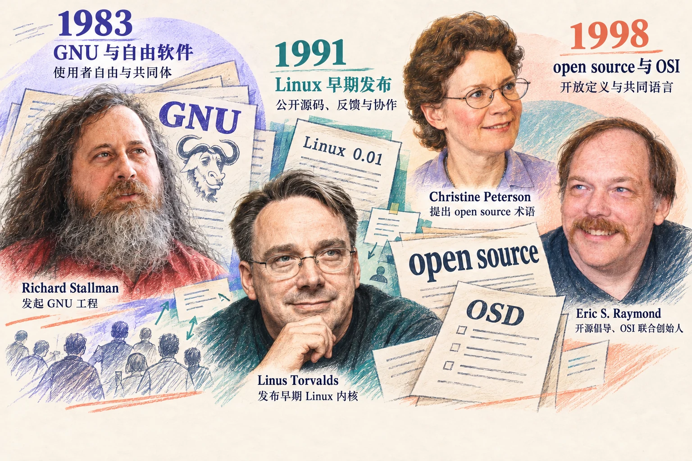

# 开放的力量：成果如何成为共同创造的起点

> 状态：review
> 版本：0.2.2

前两章从一页 R1 研究简报出发，再沿着 R1 和 DSH 的原始材料核对。文中的“导览”泛指帮助读者了解项目的短文，也包括你对研究简报的介绍性改写。设想现在，一位同学想把你的导览改成课堂讲义，另一位想补一幅图，还有人问：“既然项目是开源的，这些东西是不是都能直接拿来用？”

这个问题，关系到作品能否继续生长。别人需要知道哪些内容来自你，哪些来自原项目，允许怎样使用，又应当保留什么。只留下一个下载链接，往往还不够。

本章从这些实际需要出发，认识开放协作的来路，练习读懂材料的使用条件，再为自己的观察站补一份清楚的来源与使用说明。准备好前两章的作品、项目档案和浏览器即可；本章不要求安装软件、编写代码或向社区提交内容。

先记住两个动作：**复用**是利用已有材料继续完成自己的任务，例如改写一段介绍；**贡献**是把有帮助的改进带回他人能够使用或讨论的地方。沿用上一章核对的 DSH 介绍，读完后留下“一项材料的核对记录＋一段给读者看的使用说明”即可，不需要为整站一次解决全部授权问题。

## 3.1 开放为什么能成为学习的起点

设想你遇到两份介绍。第一份只告诉你“这个工具很好用”；第二份还给出了说明书、适用条件、修改记录和问题讨论。即使你不会编程，也能从第二份材料继续追问：作者说的是什么版本？别人在哪里遇到困难？某个步骤为什么改了？

**开放材料首先给了我们继续追问的机会。** 第二章能够区分模型与工具，正是因为我们找到了具体文件。遇到不懂的概念，可以请 AI 解释，再回到原文核对；遇到不完整的说明，可以记录问题。材料越容易找到、读懂和比较，学习越不必停留在别人给出的结论上。

开放还可能让改进积累下来。假如你补了一句“下载代码包不等于下载模型权重”，后来者就少了一次误解。如果他发现这句话仍不够清楚，可以在保留来源的基础上继续完善。前提是：大家既能取得材料，也知道自己可以做哪些改动，以及怎样把改动交给别人。

这里需要分开两件事。**公开可见**说明你能看到某份材料；**开放许可**则说明权利人允许别人怎样使用、修改和传播它。权利人是有权作出相应授权的人或组织；授权就是允许别人做约定范围内的事。署名则是说明作者或来源，三者不是同一个意思。一个能浏览的页面，并不会因此自动授予任意复制、改编和发布的权利。GitHub 的许可说明也区分公开仓库的平台访问规则与作品的复用许可。

因此，打开一个项目之后，我们要继续问：“我想用其中哪一项材料，做什么？”这比笼统地问“它是不是开放的”更容易得到有用答案。

## 3.2 三个历史窗口，看见开放协作的来路

分享程序和共同解决问题的实践，早于今天常见的代码平台。下面选取三个历史窗口，帮助理解使用者自由、协作改进和共同规则。它们不是完整编年史，也不是由几个名人单独推动的一条因果链。

### GNU：使用者能否理解和改变自己的工具

1983 年 9 月，Richard Stallman（理查德·斯托曼）发布 GNU 工程的初始声明，提出构建一个自由的 Unix 兼容系统，并邀请人们贡献程序、时间、设备和资金；工程实际于 1984 年开始。Unix 是一类影响深远的操作系统，这里不需要了解它的技术细节。

**操作系统**负责管理计算机资源，让其他程序能够工作。**源代码**则是开发者编写、用于理解和修改程序的表达形式。只拿到可以运行的程序，与能够查看和修改它的源代码，是不同的条件。

后来形成的自由软件定义强调四类自由：按自己的目的运行，研究并修改，分享副本，以及分享修改后的版本。这里的 free 主要指自由，不只是价格为零。对普通使用者而言，这个问题也很具体：当工具不适合自己时，是否有人能够研究它、调整它，而不只能等待原开发者决定？

### Linux：把尚不完善的工作交给别人共同改进

1991 年，Linus Torvalds（林纳斯·托瓦兹）发布早期 Linux 内核。**内核**是操作系统里直接管理处理器、内存和设备等资源的核心部分；一个完整系统还需要其他工具和软件。

Linux 0.01 的发布说明既提供源码，也坦陈硬件支持和功能仍有限，并邀请读者提出问题与建议。这里值得学习的，是把能做什么、还缺什么和怎样反馈一起交代，而不是等到“无所不能”才允许别人看见。

早期发布也有其当时的使用条件，不能把今天熟悉的许可直接写回 1991 年。历史材料同样需要核对版本。Linux 后来的发展依靠许多个人与组织长期参与；一份发布说明只是观察这一过程的入口。

### open source：让协作拥有能够共同讨论的规则

1998 年，Christine Peterson（克里斯汀·彼得森）在一次讨论中提出 open source 这一称呼。同年，Eric S. Raymond（埃里克·雷蒙德）与 Bruce Perens（布鲁斯·佩伦斯）共同创立 Open Source Initiative，简称 **OSI（开源促进会）**，开展教育、倡导和定义维护等工作。

OSI 的《开源定义》并不把“能看到代码”作为全部标准，还涉及再分发、修改与衍生作品等条件。**再分发**就是把已有材料的副本继续交给别人；**衍生作品**在这里可先理解为基于原作修改、扩展形成的成果，具体是否构成衍生仍要结合材料和行为判断。

自由软件与开源运动有重叠的实践基础，也有不同的论述重点。对本课而言，三个窗口共同留下了可操作的问题：能不能理解和修改？怎样让别人参与改进？共同使用时遵守什么约定？本章不要求记忆人物名单与所有年代，更希望你能把其中一个问题用到自己的导览上。

## 3.3 开放、免费与普惠，分别回答什么

**开放关注权利与条件。** 例如，能否取得某些材料，是否允许修改和再分发，需要保留哪些声明。不同对象的开放方式可能不同，要落实到具体材料，而不是只看宣传中的一个词。

**免费关注某一次取得或使用是否收费。** 一项聊天服务可以免费试用，却没有提供相应代码或模型文件；一项开源软件也可以由服务商代为运行，并对计算、维护或支持收费。软件许可、服务费用和硬件成本需要分别查看。

**普惠关注更多人能否实际受益。** 即使材料允许复用，陌生语言、设备要求、复杂操作或缺少帮助，仍可能让学习者难以开始。普惠不只是一句“人人可用”，还要看不同背景的人能否找到入口、完成任务，并理解结果。

回到我们的课程：提供中文解释、把核心练习控制在普通设备能够完成的范围、给出可下载的材料包，都是降低学习门槛的设计。它们是否真正有效，还需要通过试读和实践检验；设计目标不能直接当成已经实现的效果。

你也可以做这样的改进。把一段难懂的项目说明变成清楚的导览，可能帮助不会编程的同学进入项目。这种贡献的价值来自解决了具体困难，而不取决于是否写出了复杂代码。

## 3.4 同一个项目里，材料也要逐件看

想象你准备在观察站发布一页介绍，里面有自己写的正文、原项目的一段说明、从别处找到的照片，以及 AI 生成的图解。这些材料放在同一个页面上，并不会自动变成具有同一种许可的整体。

首先确认对象，再寻找对应说明。软件通常查看 `LICENSE` 或 `COPYING` 文件；模型要核对具体模型条目和权重的许可；数据要看数据集自身的说明；文章、照片和图表则要找作者、出处及其授权。**许可证**是写明允许行为及相关条件的文件或文本，文件名只是寻找它的线索。

DSH 的固定版本 README 指向 MIT 许可证，同时另外提供第三方声明文件。**第三方材料**是由项目之外的作者或组织提供、被纳入或使用的材料。DSH 的声明明确说明，这些项目保留各自的许可；主项目使用 MIT，不会自动改写所有依赖的条件。这里的“依赖”就是一个软件工作时要用到的其他软件或组件；本章只需知道应寻找对应说明，无须逐个分析程序。

R1 也给出一个很好的提醒。第二章所用 README 的 License 小节将代码仓库与模型权重列为 MIT，并另外说明 Distill 模型的上游来源，包括 Qwen 与 Llama 及相应许可。它们是另外两组模型的名称；“上游”指本项目所依据或使用的先前成果。这里应记录自己选的是哪个条目，并沿它的来源继续核对。只看见页面顶部一个 MIT，就给所有名称相近的模型下同样的结论，会漏掉重要条件。

对于 AI 项目，还要分清代码、权重、数据和训练方法等材料。取得权重，不意味着训练材料已经全部公开；能读到训练报告，也不意味着自己已经具备复现条件。“复现”是按照所述方法再做一次，并检查能否得到相应结果，通常还需要数据、程序和设备等条件。比起急着判断“全部开放”或“完全不开放”，先写出实际获得了什么、允许怎样使用、还缺什么，会更有帮助。

自己的文字和 AI 输出也需要说明。可以记录“我确定了读者与结构，AI 协助起草，我回到原文核对并修改”。这种记录说明创作过程，却不能自动证明输出里的每张图、每段文字都具有可对外授权的条件。模型或工具采用什么许可，也不能直接替代对输出材料和服务条款的检查。

如果没有找到清楚的使用条件，就把该项标为待确认。可以先保留链接和自己的阅读记录，选择条件明确的替代材料，或向权利人询问。**说明来源和核对使用条件，都在帮助作品继续被使用。**

## 3.5 读一次真实许可：允许什么，要保留什么

现在打开 DSH 固定版本的 [LICENSE 许可原文](https://github.com/deepseek-ai/deepseek-harness/blob/f3803c96974ad4a94195fb97e5c637e9c2a3afe3/LICENSE)；[第三章材料包](../../practice/ch03/README.md)也保留了这一份英文原文。这里练习的是读出它与一次具体使用的关系，不要求背诵法律术语。许可的作用是让大家提前知道哪些使用得到允许、怎样继续共享；读清条件之后，就能有依据地往前做。

假设你想把 DSH README 中的一小段介绍，改写成导览里的通俗解释。先记录原文件、段落、版本，以及计划复制或改写的部分；再查看许可是否适用于这份材料，并检查有没有单独声明的例外。本例讨论项目自己的文字，不把页面里的第三方材料一并算进去。

### 先找到三个位置

第一，开头的 **Copyright** 是版权声明，说明该文件列出的权利人和年份。我们读到的 DSH 文件列出 DeepSeek 与 2026 年。年份和名称属于原声明，不应替换成自己的信息。

第二，正文列出了使用、复制、修改、分发等许可，并允许销售副本。这说明 MIT 并不以“只能非商业使用”为前提。但这些允许行为与后面的条件是一体的，不能只摘出“可以修改”四个字。

第三，条件要求在软件的副本或实质性部分中保留版权声明和许可声明；末尾还有按现状提供、没有相应担保等内容。为了不漏掉原文，本练习采用简单做法：需要随改编或复制材料分发声明时，保留完整许可文件，并在使用说明中标出它的位置。仅写一句“感谢 DeepSeek”，不能替代原文要求保留的声明。

“没有担保”也不能被读成“软件一定有问题”。它提醒我们区分许可与质量保证：允许你使用，不代表作者替你的具体设备、任务或结果作出了保证。实际适用性仍要检查。

### 把阅读结果写成别人能够使用的说明

下面是一种说明结构，不是替所有作品决定许可的通用句子：

“本页中关于 DSH 项目定位的介绍，依据某固定版本 README 改写；改动是补充术语解释并调整阅读顺序。原材料及许可见所附链接，原版权与许可声明保留在指定文件中。其他材料另列。”

在本章默认例子中，“某固定版本”可落实到第二章已记录的 DSH README 链接；许可文件保存在 `ch03/licenses/DSH-MIT.txt`。说明写在 `ch03/work/use-and-credit.md`，从这个文件出发，许可的相对链接就是 `../licenses/DSH-MIT.txt`，其中 `..` 表示退回上一层文件夹。包内参考例子展示了可用链接；先仿照它写，再核对自己的实际位置。

自己的核对记录可以稍详细，给读者的说明只需几句清楚的话。把它和导览一起保存，让读者能找到原材料与声明，而不必重做你的查找过程。

不同许可不能照抄同一套条件。例如，Creative Commons 的 **CC BY 4.0（署名 4.0）**常用于文字和图片等作品，其官方摘要要求适当署名、提供许可链接并注明修改，还包含其他条件。名称中多出的字母或版本数字可能改变要求；不要只看见“CC”就按同一种规则处理。实际使用时仍要查看完整条款及材料上的说明。

复杂组合可能需要维护者或相应专业人员帮助核实。本章先把一项材料读清楚，让自己的使用行为与许可条件对应起来。

## 3.6 从复用走向有帮助的贡献

复用让我们不必从零开始，贡献则让已有成果对别人更有用。这种改进可以很小：补上一个容易误解的概念，修正失效链接，注明一个版本差异，或者把真实遇到的问题描述清楚。

下面是一个教学情境，不是已经发生的学生反馈：一位同学读了导览后，以为“安装 DSH 就等于安装了 R1”。你回到第二章的材料，把模型与工具的分工补清楚，并说明实际使用哪个模型还要看配置。这个改动比单纯增加一段宣传语更容易检验，因为它对应一个明确误解。

图中的补页象征修订。原来的材料、读者的困难和新的解释一起保留，让别人看见改变为何发生。插画不是课堂实测记录；自己的观察站应只填写真实发生过的反馈。

有用的反馈通常包含四件事：读到哪里、原本想完成什么、实际遇到什么、希望怎样改进。如果你建议增加一句解释，再附上依据，维护者就更容易判断。只说“这个项目不友好”或“请全面优化”，往往还缺少行动所需的信息。

贡献也需要尊重对方的协作方式。第二章读到的 DSH 贡献指南，在那个版本暂不接收外部 PR，但欢迎操作指南、讨论和答疑等帮助。你可以先把自己的指南整理好；将来准备分享时，再看项目当前的参与说明。不必为了完成练习而发无关帖子，也不能把“提交了”写成“已经被采纳”。

在 AtomGit 保存一个有来源、有修订理由的版本，可以为后续协作留下起点。不过，文件上传、作品可用、有人获得帮助，是不同的完成状态。核心任务先在本地做清楚；没有真实读者反馈时，就记录“尚待试读”，第十至十二章再逐步推进发布、反馈与作品集。

## 3.7 给观察站补齐来源与使用说明

下载第三章材料包，将解压得到的 `ch03` 文件夹放进已有观察站。它与 `ch02` 并列；已有同名文件夹时，先备份并比较，避免覆盖自己填写的记录。尚未完成前两章实际操作，也可以选材料包中的参考对象练习，但要标明自己的作品仍待补做。

第一次做，可以用本章提供的 DSH 介绍与 MIT 原文练习，再把同样方法用于自己的简报。R1 简报没有 DSH 段落时，不必为了练习硬加一段；使用参考材料应注明。先完成这一项；图片或复杂材料组合可以以后再扩展。自己的材料若确实存在授权疑问，记录具体疑问、已读依据和处理选择，也是一项有价值的学习结果。

### 从一项真实材料开始

1. **选定一项。** 从自己的导览中挑一段依据外部材料写成的介绍，或选择准备使用的一幅图。写出作品中的位置与原材料名称，不只填项目名。
2. **说明怎么用。** 是提供链接、直接复制、翻译、改写，还是把它作为新图的参考？这些行为可能涉及不同条件，先把实际行为说清楚。
3. **回到原材料核对。** 在 `ch03/work/reuse-record.md` 记录作者或权利人、固定来源、自己的阅读日期、适用许可和需要保留的内容。找不到的项目写待确认，不让 AI 补造。
4. **补一份可读说明。** 在 `ch03/work/use-and-credit.md` 区分外来材料、自己的新增内容与 AI 参与；写明许可文件的位置、已完成的核对和仍待处理的部分。

这里的路径都从观察站根文件夹算起。`reuse-record.md` 留给自己核对，`use-and-credit.md` 留给后来阅读导览的人；已有来源可从第二章档案复用，不用重新抄一遍调查过程。

材料包中的 `ch03/licenses/DSH-MIT.txt` 是 DSH 原许可的完整副本，用于本章阅读和相应声明保留。**它只标明这份原材料的许可，不会自动成为整个观察站的许可证。** 不能因为下载包里有一个 MIT 文件，就替所有图片、文字和个人作品选择 MIT。

你也可以请 AI 把已提供的说明整理成表格，或者解释一个英文句子。让它同时指出原文位置，再由你核对条件和适用范围。涉及“所有”“必须”“不受限制”之类措辞时尤其要回看上下文。未核对的结论仍标待确认。

本章交付的是这一项材料的说明草稿：哪些已经有依据，哪些需要补充，哪些材料暂不纳入对外分享。若确实选择了自己有权授权的内容，也应写清范围，不覆盖第三方原有条件。

### 先回答，再看参考反馈

1. 一个项目页面可以免费浏览，就能把其中的照片改成封面并公开发布吗？
2. 使用 DSH 创作一段文字，是否意味着这段文字自动采用 MIT？
3. 复制受 MIT 许可覆盖的材料时，只在文末写作者名字是否足够？
4. 你修正了导览的一处错误，但尚未分享给读者，应该怎样记录完成状态？
5. 已确认一段介绍受 MIT 覆盖，准备改写给同学阅读时，你会实际保存和说明什么？

**参考反馈：** 第一题，免费浏览没有回答照片的改编与发布条件，需要查看照片本身的授权及相关说明。第二题，工具许可与输出材料的条件不能直接画等号，要检查输入、输出、服务约定和实际创作情况。第三题，不能用一个名字替代需要保留的版权与许可声明，应根据具体材料和行为落实原文要求。第四题，可以记录“已修订并核对，尚未试读或分享”，不能虚构帮助效果或社区认可。第五题，应说清具体来源与改写范围，保留适用的完整版权和许可声明，并让读者找到它们；新增内容另作说明。回答若只有“我会遵守许可”，还需要落实到具体文件与动作。

完成时，至少有一项材料能够从作品位置追到原始来源，说明你怎样使用、依据什么条件、保留了什么，以及还有什么不知道。试着从导览出发打开使用说明，再打开原材料和许可文件；这一趟能走通，读者才有继续使用的线索。若条件尚未确认，应明确写出暂不分享该材料或选择替代材料的安排。

### 合上前三章，解释一次自己的改进

把第一章初稿、第二章核对记录和第三章使用说明放在一起。选一句具体的话，说明：它最初怎样写；查到了什么材料；为什么保留或修改；后来者能否找到使用条件。暂未完成的步骤如实保留，不用填成一条虚构的成功经历。

如果换成自己专业的一份学习资源，你会先找哪一种依据？文学专业可以从一段译文开始，设计专业可以从一幅图开始，理工科可以从一份程序说明开始。对象可以不同，“说清用途—追到来源—核对条件—留下改进”的方法可以继续使用。

前三章让一页导览有了来路，也为后续分享和协作准备了基础。接下来，我们从观察项目走向理解模型：从容易观察的小例子出发，看看模型怎样从样本中学习，以及怎样判断它是否学会了。
