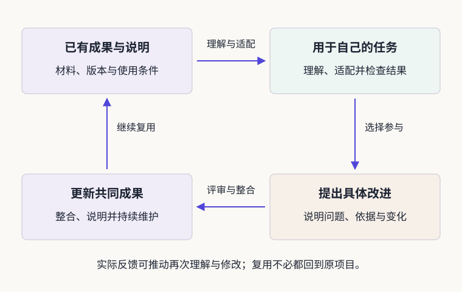

# 开源协作与创新：从成果复用到共同创造

> 状态：published
> 版本：0.4.0

**开源的力量从哪里来，又需要哪些条件？**一项成果能够帮助更多人，往往经历了许多具体工作：作者留下材料和说明，使用者根据新需要进行适配，参与者提出改进，维护者把合适的变化纳入共同成果。

前两章建立了开源与 AI 的基本认识，并学习从目的、成果、材料和协作理解项目。本章继续追问这些工作怎样积累知识、支持创新。你将阅读历史与真实贡献案例，并使用本章提供的开放材料，独立完成一次面向新读者的说明改进。

## 学习目标与阅读准备

学习本章后，应能够：

- 解释复用、反馈与共同维护怎样支持创新，并说明其实现条件。
- 联系 GNU、Linux 与开源定义，理解软件开源的基本思想及其向 AI 延伸的问题。
- 对一项具体材料落实相称的复用与来源说明。
- 区分提出改进、项目接纳和实际受益，解释一次面向读者的修订。

本章需要前两章的项目、材料和来源概念，不需要已有简报或项目画像。核心输入包括材料 A、给定待改说明与预设反馈，均在正文中提供。可用文字编辑器完成，也可借助 AI 比较表达和检查遗漏；实际使用情况如实记录。[第三章材料包](../../practice/ch03/README.md)另提供完整许可文本、记录支架和参考成果。

## 3.1 从成果共享到共同创造

### 3.1.1 复用怎样积累知识与减少重复劳动

一份工具说明、一张数据表或一个模型项目，都可能成为后来者学习与创作的起点。使用者不必从空白重新建立所有知识，而是理解已有成果，选择与新问题有关的部分，再完成必要适配。承认前人的劳动，有助于看清新的贡献发生在哪里。

**复用**是把已有成果用于新的任务，或作为新成果的组成部分，并完成必要的理解、适配和检查。它可以包括改写和组合，也可以是不改变原材料的再次使用。例如，将一份项目说明用于课堂阅读，需要考虑学生的前置知识；把一张图用于新的研究问题，需要确认图所表达的关系是否仍然适用。

**贡献**是把有帮助的材料或改进带到他人能够使用、讨论或共同维护的地方。整理一组可靠来源、补充术语说明、修正文档中的一个数字，都可能构成贡献。是否有价值，要看它回应了什么需要，以及后来者能否实际利用它。

复用与贡献可以相互促进，也可以分别发生。一个人可以依照相应条件在自己的课堂使用材料，另一个人则可能把改进建议交回原项目。具体是否需要分享修改、怎样分享，应看适用条件；不能仅凭“开源精神”为所有使用者设定同一种义务。

### 3.1.2 反馈怎样带来新的理解与改进

同一份成果进入不同使用情境，会遇到不同问题。新读者可能指出一个未解释的术语，教师可能发现示例缺少前置知识，研究者可能发现数据时间范围不清。把问题、依据与建议表达出来，个人经验就有机会成为共同改进的材料。

为什么公开一份成果之后，仍然需要文档、使用条件和维护者？因为不同环节解决的问题不同。

| 环节 | 学习者能够继续做什么 | 仍然需要的工作 |
| --- | --- | --- |
| 找到材料 | 阅读、比较、追问已有成果 | 清楚的入口、版本和材料说明 |
| 确认条件 | 知道具体材料允许怎样使用 | 对应的授权、来源及适用范围 |
| 完成复用 | 将材料用于自己的读者和任务 | 适配、核对与使用说明 |
| 提出改进 | 让别人看见问题和具体变化 | 可理解的理由、差异与交流 |
| 共同维护 | 将合适的改进留在共享成果中 | 评审、整合、更新与持续投入 |

这张表解释的是相互支持的工作，不是项目必须逐级通过的等级表。一个项目可能材料齐全，却缺少适合初学者的说明；也可能有人提出准确的修订，但维护者尚未处理。判断时应找到实际发生的环节。

**例 3-1　一份可以下载的简报，为什么还不容易继续使用？**假设简报只有最终 PDF，图表没有来源，两个术语没有解释，也没有说明哪些内容可以改编。读者虽然取得了文件，却难以核对材料或调整内容。改善它，可以从补充来源、解释术语、提供可编辑正文和说明使用条件开始。这些工作分别解决“能否查到”“能否读懂”“怎样修改”和“允许怎样使用”的问题。

### 3.1.3 创新价值的形成条件与维护成本

创新可以体现在新方法、新用途，也可以体现在使已有成果更适合一种具体需要。开源提供材料复用与共同改进的条件，价值仍需通过有用的改变体现。例如，把一份技术说明改写成初学者能使用的指南，需要理解内容、选择入口并检查读者是否能够继续行动。

**公共价值**可以从一个朴素的问题开始理解：成果是否使更多人获得了实际帮助。对本课程而言，这种帮助可以是更容易找到研究入口、更准确地理解项目关系，或少走一次查找材料的弯路。它需要具体使用情境来说明。

免费获取、明确许可和清楚文档都可能降低门槛，但语言、设备、时间与学习支持仍会影响使用。维护也有成本：有人需要检查新材料、回应问题、更新过时说明。评价开放的作用，应把这些劳动与实际使用放在一起看。关注量和下载量可以提供线索，不能独自证明学习效果。

回到正在改进的作品，先为一种具体需要改善作品，再观察读者能否顺利完成任务。这样，“开放有价值”就能转化为可讨论、可改进的教学问题。

## 3.2 开源的发展与基本思想

### 3.2.1 GNU 与软件自由的追求

软件分享与共同开发的实践早于今天的协作平台。1983 年 9 月，Richard Stallman（理查德·斯托曼）发布 GNU 工程初始声明，提出建设一个自由的 Unix 兼容系统，并邀请人们贡献程序、时间、设备与资金；工程实际于 1984 年开始[1]。

**操作系统**管理计算机资源，为其他程序提供工作条件；**源代码**是开发者编写、用于理解和修改程序的表达形式。Unix 是一类影响深远的操作系统。了解这些背景，便能理解 GNU 所面对的问题：使用者能否研究和改变自己依赖的工具？

自由软件定义后来明确了运行程序、研究并修改、分享副本、分享修改版本等自由[2]。其中 free 关注自由，并不简单等于价格为零。对学习者而言，它意味着遇到不适合自己的地方时，可以在相应条件下研究和调整，而不只是等待原作者决定。

### 3.2.2 Linux 与开放协作的实践

1991 年，Linus Torvalds（林纳斯·托瓦兹）发布早期 Linux 内核。**内核**是操作系统中管理处理器、内存和设备等资源的核心部分；完整系统还需要其他工具和软件。

Linux 0.01 的发布说明提供源码，说明支持的硬件与尚未完成的功能，并邀请读者提出问题和建议[3]。这份材料的教学价值在于：作者把已有能力、当前限制和参与方式放在一起交代，使别人可以判断从哪里开始。

早期版本有其当时的条件，不能直接把后来熟悉的许可写回 1991 年。Linux 的发展也依赖许多个人与组织的长期工作。一份发布说明让我们看到协作的入口；后续改进如何发生，还要继续查阅变更和维护记录。

### 3.2.3 从软件开源到 AI 开放

1998 年，Christine Peterson（克里斯汀·彼得森）提出 open source 这一称呼。同年，Eric S. Raymond（埃里克·雷蒙德）与 Bruce Perens（布鲁斯·佩伦斯）共同创立 Open Source Initiative，简称 **OSI（开源促进会）**[4]。

OSI 维护的《开源定义》不仅讨论能否得到源代码，还涉及再分发、修改与衍生作品等条件[5]。**再分发**是把已有成果的副本继续交给别人；基于原作进行修改或扩展形成的成果，则可能涉及衍生作品及相应条件。

自由软件与开源运动有重叠的实践基础，也有不同的论述重点。三个历史窗口共同留下了值得继续思考的问题：使用者拥有怎样的行动空间？怎样让别人参与改进？共同工作依据什么规则？它们不是完整编年史，也不能被理解为由几位人物单独推动的直线过程。

今天的 AI 项目中，程序、模型、数据、研究说明和社区活动相互联系。第一章将这些对象放进同一幅生态图景，第二章进一步追踪它们在项目中的具体职责。历史中的问题因此获得了新的对象：我们能取得哪些材料？能否调整它们？怎样检查一次改变？

例如，取得模型权重可以支持某些使用和研究，却不能单独说明训练数据、程序和方法已全部提供。**复现**是按照所述方法再做一次，检查能否得到相应结果，通常还需要匹配的数据、程序、设备和操作条件。学习 AI 开源，应保留这样的对象区分，使“开放”落实到能够检查的材料和行动。

## 3.3 材料复用的条件与责任

### 3.3.1 公开可见、免费使用与许可复用

第一章区分了访问、费用和授权，现在把它们放回具体用途。准备改写一段项目说明时，能打开网页回答的是“能否阅读”；是否收费回答的是“取得或使用的成本”；能否修改后分享以及应保留什么，则需要看适用条件。

| 问题 | 阅读时寻找什么 | 不能直接推断什么 |
| --- | --- | --- |
| 能否取得材料？ | 公开入口与可用文件 | 公开可见不自动等于允许任意改编 |
| 使用是否收费？ | 获取方式与服务条件 | 免费服务不自动等于代码开放 |
| 允许怎样复用？ | 对应材料的许可与声明 | 一项材料的条件不自动覆盖整个项目 |

**权利人**是有权作出相应授权的人或组织；**授权**说明允许的行为及范围；**署名**说明作者或来源。许可证是写明允许行为与相应条件的文本。注明出处有助于查证，也需要与实际使用方式对应，不能只凭“已感谢作者”判断所有条件已经落实。

对软件，应结合开源定义和具体许可理解权利；对模型、数据与图文，应辨认各自材料和说明。阅读全部许可体系不是本章目标，先把一项材料的用途与条件对应清楚，再迁移到其他情境。

### 3.3.2 不同材料的使用条件

一份作品可能同时包含自己写的正文、项目说明的改写、外来图表和 AI 辅助生成的内容。它们放在同一个文件中，并不会自动获得相同条件。

寻找许可时，文件名只是线索。软件常见 LICENSE 或 COPYING；模型条目可能另有权重许可与上游说明；数据集、照片和图表也可能有自己的声明。关键是将“这份说明”与“我实际使用的材料”对应起来。

第二章所读 OpenDipper 固定快照的权利说明，将应用代码、数据、地图和品牌资产分别处理，并注明根目录应用许可尚未选定[6]。因此，它可以作为公开建设过程的学习案例，却不能据此替其中所有材料填写统一许可。这个例子提醒我们：项目归属与材料授权是两个需要分别回答的问题。

DSH 的固定版本采用 MIT 许可，并为第三方材料另列声明；R1 的 README 也分别说明代码、权重与派生模型的上游来源[7][8]。本章不要求审计全部依赖，而是要求读者准确指出自己选用了哪一项材料。

本节以 **Open Source Guides（开源指南）**为主例。它是 GitHub 与社区参与者共同建设的知识资源，讨论如何运行和参与开源项目。固定版本 README 将内容标为 CC BY 4.0，并指向更完整的 notices 文件[9]。**CC BY 4.0**即“知识共享署名 4.0 国际许可”；应结合其完整条款理解允许行为与条件[10]。

**材料 A　用于改写的原始内容与条件**

- **A1 · 内容位置。**《How to Contribute to Open Source》中“Do you like to write?”一节列举文档改善、使用示例、教程与翻译等参与方式。
- **A2 · 内容权利。**项目 notices 说明：内容版权归 Open Source Guides authors，按 CC BY 4.0 提供；代码及所列第三方材料另有说明。
- **A3 · 共享条件。**许可第 3 节要求按情况保留作者等已提供信息、相关声明与材料链接，说明修改，并提供许可文本或链接；还应注意完整条款中的其他条件。
- **A4 · 本例范围。**只改写该节的贡献方式说明，不复制人物引语、头像、截图或商标，也不把新文字表述为原项目背书。

材料 A 是依据原文编写的阅读摘记。所选文件固定于提交 e7ac98e…；完整来源见文献[9]及材料包。纸面读者可以先依据本卡分析，再通过原文核对细节。

### 3.3.3 来源署名、修改说明与分享责任

复用可以从四项工作开始：确定材料及位置，说明复制或改写范围，核对相应条件，保存应保留的声明与修改说明。下面先看一项完整示范。

**例 3-2　把开放知识改写成一段可用的建议。**设定读者为第一次了解开源贡献的大学生。原指南提供了多种写作贡献方式；我们选择与本课有关的内容，并增加材料核对的情境。

> 如果你擅长写作，可以从改善项目说明开始：解释一个难懂的概念，整理有依据的使用示例，或编写适合新读者的教程。也可以在项目需要时协助翻译。先选择一处具体需要，写清改动及依据，再按项目约定交流。

这段改写保留了原材料关于写作贡献的思路，缩小了任务范围，并加入课程中的“具体需要、改动及依据”。它适合放在面向初学者的提示卡或项目阅读说明中，不需要把整篇指南复制进来。

与它一起提供的说明，可以写成：

> 本段依据 Open Source Guides authors 的《How to Contribute to Open Source》“Do you like to write?”一节改写，使用的是 github/opensource.guide 提交 e7ac98e…的内容。原内容版权归 Open Source Guides authors，采用 CC BY 4.0。改动包括中文转述、内容压缩及本课程情境补充；原材料、完整许可与免责说明分别见文献[9]、[10]。本段改写不表示原作者认可或背书本教材。

这里的省略提交号用于纸面阅读，文献链接与配套记录保留完整标识。实际作品应将文献编号换成自己的有效链接或附录位置，使读者能够找到材料和声明。

这份说明回答了四个关键问题：依据谁的什么材料，适用什么条件，改了什么，到哪里继续查看。为读者写出的说明可以简短；自己保存的核对记录则可以更详细。来源材料中的版权、许可和免责入口也应一并保留。

**拓展例 3-3　保存许可文件，究竟是在保存什么？**假设需要改写 DSH 项目自身的一段介绍，先定位具体 README 段落并核对是否存在单独声明。固定版本 LICENSE 的版权行为“Copyright (c) 2026 DeepSeek”，其正文列出使用、复制、修改、分发等允许行为，也允许销售副本；同时要求在副本或实质性部分中保留版权与许可声明，并包含按现状提供和不作相应担保的内容[7]。

本例的做法是保留完整原许可，写明改写材料及来源，并在作品说明中提供许可文件的位置。只写“感谢 DeepSeek”不能代替应保留的声明。包内 DSH-MIT.txt 保存该原文；它对应 DSH 的相应材料，不会自动成为整份学生作品的许可证。

比较两个例子，可以发现共同的方法是“落实到材料与行为”，具体处理则取决于适用文本。CC BY 4.0 的说明不能机械替代 MIT 声明，MIT 文件也不能替其他图文作出授权。先读清一项，再将方法用于下一项，比给整个项目贴一个未经核对的标签更可靠。

使用 AI 整理或改写材料时，同样需要回到来源核对。可以说明“我确定读者与问题，AI 协助提出结构，我核对内容并修订表达”，并分别标明外来材料与自己的新增部分。工具的许可不能代替对所用材料的判断。尚未确认的材料，可以先保留阅读入口，再补查或选用条件明确的替代材料。

## 3.4 从具体贡献到持续改进

### 3.4.1 一项真实文档改进的形成过程

AIInfra 是公开维护的 AI 基础设施课程项目。其 PR #364 于 2025 年 12 月 4 日提出，12 月 22 日被合并，修改集中在一份量化说明文档中[11]。**量化**可以先理解为用较少位数表示模型数值的一类方法；这里关注文档变化，无须先掌握完整算法。

**材料 B　一项修订留下的记录**

- **B1 · 变更对象。**文件为量化章节的 Markdown 文档，改动涉及“从多少字节降到 1 字节”的说明。
- **B2 · 可见差异。**原句中的“16 字节”改为“2 字节”，同句保留“降至 1 字节，理论上内存减半”的表述。
- **B3 · 项目决定。**公开记录显示该 PR 已合并；对应合并提交为 b97c038…。
- **B4 · 记录范围。**本轮读取的评论与正式评审列表为空；可确认差异和合并，不能据此补写讨论对话、测试过程或读者受益人数。

**例 3-4　怎样解释这项改动的价值？**一字节为八位。若讨论的是单个数值从 16 位表示降到 8 位表示，对应的是从 2 字节降到 1 字节。这个对照可以帮助读者理解该处修订；但不能据此断言整个系统的内存和运行速度都按同一比例变化，因为其他数据与处理也会占用资源。

贡献者提出了可以定位的变化，项目将其纳入共同成果。这里的可观察结果是“文档已经修改并被接纳”；对后续学习效果的判断，还需要使用与反馈材料。改动虽小，其理由、差异与处理状态却能够被后来者重新查看。

这一案例独立于其他 Issue。不能把两个主题或编号相近的记录拼接成同一次修复，也不能把“合并”理解为每一步内部讨论都有公开记录。

### 3.4.2 提出建议、项目接纳与实际受益

| 可以观察的阶段 | 需要什么依据 | 还不能据此认定什么 |
| --- | --- | --- |
| 提出建议或变更 | 问题位置、理由和可见差异 | 不等于项目已经采纳 |
| 项目接纳 | 明确的评审决定或合并记录 | 不等于所有使用场景已经验证 |
| 实际受益 | 与具体任务有关的使用和反馈 | 不能用关注量直接替代学习或使用效果 |

**评审**是依据项目需要、材料和质量要求检查一项贡献；**维护**包括整合、更新、回应问题及照顾长期使用。一个改动可能有道理，却仍需调整范围、表达或实现方式。理解这些工作，有助于解释为什么公开参与并不等于所有建议都会立即进入正式成果。

图中保留了两条路径：成果可以先服务自己的任务，也可以进一步形成交给共同项目的改进。反馈使问题重新进入理解与适配过程。不同项目的具体流程可以不同，核心是让材料、理由和变化保持可理解。

参与者能够承担的工作也有差异。有人贡献文档，有人检查材料，有人评审并整合变更。维护者的时间和项目范围都是协作条件。进入真实社区前，应阅读当前指南，先理解已有讨论，再提出聚焦且可行动的内容[9]。

### 3.4.3 让后来者理解、使用与继续创造

一个清楚的改进说明通常包括问题位置、影响的任务、依据和建议变化。比如，读者不理解某个术语，作者可以补上解释与例子；后来者发现材料过时，可以指出新来源和相应变化。贡献因此能够被检查和讨论。

共同改进也可以从课程中的阅读开始。对于本章要改写的贡献提示卡，可以使用下面的预设反馈练习：

**预设反馈：**“我知道不会编程也能参与，但还不清楚可以先改哪一处、需要先读什么，以及改完后该怎样交流。”

作者可以据材料补充一种可理解的行动，说明先读规则、再提出聚焦建议，并保留来源。图 AG-03-04 是读者交流的概念插画，不代表已有真人试读。自查、预设反馈与真实读者意见都可以帮助改进，记录时应分别说明。

将来可以按实际需要在同伴之间、自己的项目或上游社区分享。准备好修订稿是本章成果，是否已经提交、获采纳或产生帮助，需要另外的实际记录。后续章节会进一步练习真实协作的组织与回应。

## 3.5 综合实践：复用材料，改进读者说明

### 3.5.1 任务与完成要求

为第一次了解开源贡献的同学制作一张“写作贡献提示卡”。使用材料 A 中的开放指南建议，改善下面的待改说明，补充来源和改写说明。正文约 120—200 字，附记不计入；以读者能理解并知道下一步为主要标准。

**给定待改说明（编写者为练习拟写）：**

> 不会写代码也可以参与开源。打开仓库，写点文档，把修改提交就行。

这段话过于笼统，没有说明材料和规则，也没有区分建议与接纳。结合 3.4.3 节的预设反馈，完成四项工作：

1. **确定复用范围。**使用材料 A1 所述写作贡献建议，面向自己的读者选择内容。
2. **核对并落实条件。**根据 A2—A4 和完整许可入口，保留作者、来源、许可、修改及相关说明。
3. **改善读者说明。**把泛泛建议改成清楚的起点，说明可以做什么、先读什么以及怎样交流；保留前后文字和理由。
4. **解释自己的工作。**说明哪些来自原材料，哪些是新增表达，AI 实际参与了什么，反馈属于哪种情况。

本章的材料、待改说明和反馈已经齐全，不需要前两章文件、OD 数据或公开发帖。若自己已有作品与合适材料，也可采用等量的复用改进任务替换，说明相应来源与用途即可。记录可以直接附在成果后，不要求另交多套表格。

### 3.5.2 参考成果与分析

以下是编写者依据材料 A 改写的提示卡示范，使用预设反馈，未进行真人试读或社区提交。

**写作贡献，可以从一处说明开始**

> 不会编程，也可以从自己能检查的说明问题开始参与。读一段项目文档，选择一个难懂的术语或缺少例子的地方，依据可靠材料补充解释；也可以整理使用示例、编写短教程，或在项目需要时协助翻译。开始前先读贡献指南，看看是否已有相关讨论。交流时写明位置、改动与理由，按项目约定提出建议，再回应反馈。建议是否接纳，由项目评审决定。

**来源与改写附记：**本卡的写作贡献建议依据 Open Source Guides authors《How to Contribute to Open Source》“Do you like to write?”一节改写，© Open Source Guides authors，原内容采用 CC BY 4.0。修改包括中文转述、内容压缩及课堂情境补充。原材料、版权与免责说明见文献[9]，完整许可见文献[10]；本改写不表示原作者为课程背书。配套材料保留有效链接与完整许可副本。

**改进分析：**原说明只说“写点文档”，修改后给出可以选择的具体工作，并补充先读指南、说明理由与回应反馈的顺序。最后一句区分提出建议与项目接纳。该示范展示如何回应预设需要；它是否真正帮助了新读者，还需后续试读。

**个人过程记录：**实际作业应写明自己的选择和修订，以及真实使用 AI 的环节。不能把教材例子的预设反馈或编写过程复制为自己的经历。

### 3.5.3 自我评价与后续学习

从成果出发检查：读者能否知道从哪里开始，能否找到来源和适用说明，能否辨认哪些内容经过改写？再用自己的话解释一次修改为什么有用，以及还有什么需要检查。遇到缺项时，回到具体材料补足。

| 五维目标 | 回看前三章的代表表现 |
| --- | --- |
| 理解 | 解释开源与 AI 的基本对象、项目结构和协作机制 |
| 判断 | 为一项说法选择依据，说明范围与待查问题 |
| 创造 | 完成短说明、项目画像或一项读者说明改进 |
| 协作 | 准备有理由的改进，交代来源和接续方式；真实协作另看实际记录 |
| 迁移 | 更换项目或材料时，调整阅读、核查与表达方法 |

这些表现可以来自不同实践，不要求集中在同一份作品里。本章准备了开放复用与交流的起步能力，后续再深化真实发布、共同修订和方法迁移。

下一部分将通过直观例子和小实验解释模型怎样学习、语言怎样生成、智能体怎样行动。开源项目提供可观察的材料，机制知识则帮助我们进一步解释现象、作出判断。

## 本章小结

复用使知识能够积累，反馈使不同情境中的问题进入共同工作，维护把有价值的改进留在成果中。开放协作支持创新，需要材料、规则、理解、评审和持续投入，实际价值通过具体用途与反馈体现。

GNU、Linux 与开源定义帮助我们理解使用者自由、公开协作与共同规则。延伸到 AI 时，需要把程序、模型、数据和知识材料分别辨认，把开放落实到可检查的条件。

复用应具体到对象、用途与声明，改进应保留理由、变化与处理状态。本章用独立提示卡练习这些方法，也允许学习者在自己的作品中继续探索。

## 思考与练习

### 基础理解

1. 选择 GNU、Linux 或 OSI 的一个历史窗口，说明它回应了什么问题，并把这个问题联系到今天的一项学习活动。
2. 一个项目允许下载材料，但初学者仍很难使用。除了获取权限，还可能缺少哪些条件？提出两项有具体对象的改进。

### 材料分析

3. 根据材料 A，判断“注明 GitHub 即可”“这段内容的许可覆盖所有头像和商标”“改写应说明所作变化”三句话，并解释你的依据。
4. 根据材料 B，哪些结果已经有记录支持：有人提出修改、文件有明确差异、维护者发表了详细评审意见、修改被合并、学生成绩因此提高？分别指出证据与缺口。

### 拓展与迁移

5. 你的一份作品包含一段改写文字、一张未查明条件的图片和自己的分析。怎样分别处理，才能继续推进作品？说明具体动作及仍需确认的部分。
6. 换到自己的专业，选择一项准备复用的学习材料，写出用途、所需依据和一项面向读者的改进。说明哪些可以由 AI 协助，哪些需要你作出判断。

### 参考解答与学习提示

**第 1 题。**例如，GNU 的窗口关注使用者能否研究和修改工具。联系学习活动，可以讨论能否取得某个教学程序的源代码、阅读说明并按条件调整。应解释历史问题与今天的联系，而不只列人物、年份或口号。

**第 2 题。**可能缺少适合初学者的说明、必要材料的位置、版本适配信息或获得帮助的入口。可提出“为某张关系图补充连线含义及一个阅读示例”“为一份数据补上时间范围与字段解释”等。改进是否有效还应结合实际任务检查。

**第 3 题。**前两句不充分。材料 A 指明作者群体、原文位置、CC BY 4.0 与 notices；只写平台名无法完整说明来源和条件，选定文字的许可也不能直接扩大到所有第三方材料及商标。第三句符合材料 A3，但仍应同时处理适用条款要求的其他信息。

**第 4 题。**提出修改、可见文件差异和合并有记录支持。当前读取的评论与正式评审列表为空，不能补写详细意见；成绩变化需要独立的教学数据。还应区分 PR 概述与具体差异，以实际文件变化解释修订内容。

**第 5 题。**改写文字应定位原材料、核对条件并落实相应说明；图片可先保留来源线索，补查或选择条件明确的替代图，未确认前不将它纳入准备公开分享的版本；自己的分析说明依据、贡献与适用范围。三者分别处理，不用一个许可标签替代全部判断。

**第 6 题。**答案可以不同，但应有具体对象与读者。例如，设计专业可核对一幅说明图并改善图注，文学专业可核对一段开放译文并补充背景。AI 可以帮助整理已提供的材料或比较改写版本；用途选择、原文核对、关键取舍与最终说明由学习者负责。

## 参考文献

[1] Stallman, R. The Initial Announcement of the GNU Project. 1983。[原始声明](https://www.gnu.org/gnu/initial-announcement.html)；[GNU 系统历史概述](https://www.gnu.org/gnu/gnu-history.html)。

[2] GNU Project. What is Free Software? [自由软件定义](https://www.gnu.org/philosophy/free-sw.html)。

[3] Torvalds, L. Notes for Linux Release 0.01. 1991。[发布说明](https://www.kernel.org/pub/linux/kernel/Historic/old-versions/RELNOTES-0.01)。

[4] Open Source Initiative. History of the Open Source Initiative。[历史记录](https://opensource.org/about/history-of-the-open-source-initiative)。

[5] Open Source Initiative. The Open Source Definition。[定义原文](https://opensource.org/osd)。

[6] X-lab2017. OpenDipper：Rights and Reuse Notes。[权利说明](https://github.com/X-lab2017/open-dipper/blob/465c4737a36c4c5e67e39f971b3e09d28d1e84f5/docs/RIGHTS.md)。

[7] DeepSeek. DeepSeek Harness：LICENSE；Third-party Notices。[MIT 原文](https://github.com/deepseek-ai/deepseek-harness/blob/f3803c96974ad4a94195fb97e5c637e9c2a3afe3/LICENSE)；[第三方声明](https://github.com/deepseek-ai/deepseek-harness/blob/f3803c96974ad4a94195fb97e5c637e9c2a3afe3/THIRD_PARTY_NOTICES.md)。

[8] DeepSeek. DeepSeek-R1 README：License。[项目说明](https://github.com/deepseek-ai/DeepSeek-R1/blob/0cf78561f1d51c84a21b2190626b21116d5c68bb/README.md#7-license)。

[9] Open Source Guides authors. How to Contribute to Open Source；Legal Disclaimer and Notices。[内容原文](https://github.com/github/opensource.guide/blob/e7ac98e94600c5eea834f9a026c000d26b28df24/_articles/how-to-contribute.md)；[版权、许可与免责说明](https://github.com/github/opensource.guide/blob/e7ac98e94600c5eea834f9a026c000d26b28df24/notices.md)。例 3-2 及提示卡示范的相应段落据此改写：© Open Source Guides authors，CC BY 4.0；修改包括中文转述、压缩与教学情境补充，原作者未为本教材背书。

[10] Creative Commons. Attribution 4.0 International。[官方摘要](https://creativecommons.org/licenses/by/4.0/deed.en)；[完整条款](https://creativecommons.org/licenses/by/4.0/legalcode.en)。

[11] Infrasys-AI/AIInfra. Pull Request #364：Fix Byte Size for Model Weights in Quantization Section. 2025。[变更与合并记录](https://github.com/Infrasys-AI/AIInfra/pull/364)；[文件差异](https://github.com/Infrasys-AI/AIInfra/pull/364/files)。
