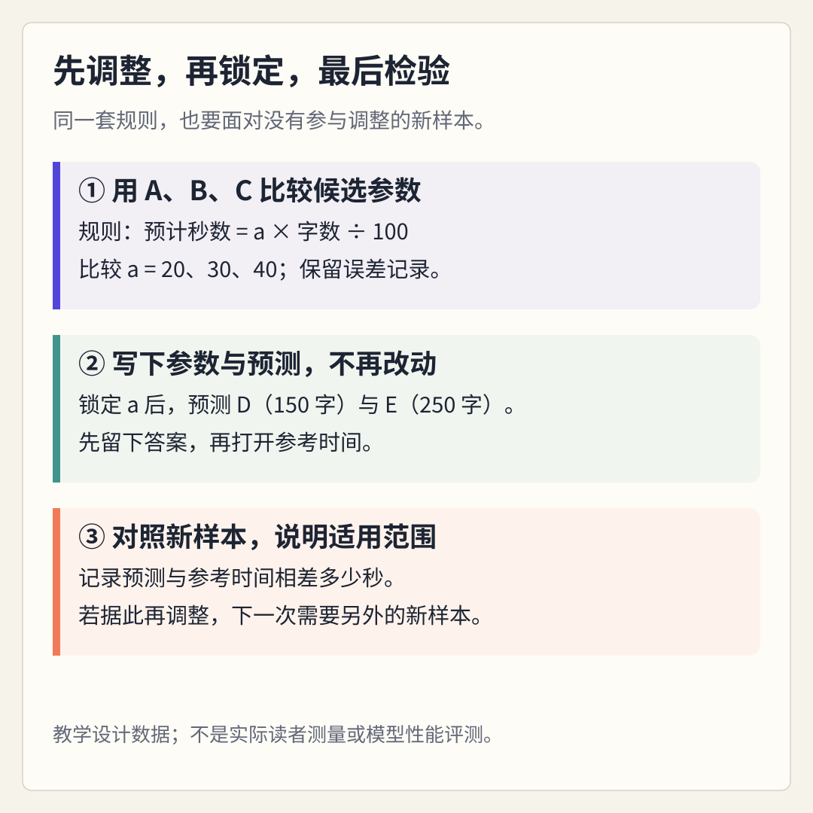

# 模型怎样学会本领：从例子到能力

> 状态：review
> 版本：0.2.0

前三章中，你为新同学准备了一页 DSH 项目导览，核对了来源，也补上了使用说明。现在想在入口处加一句“预计阅读时间”，方便读者安排学习。直接猜一个数字，似乎不够可靠；每次都找人计时，又未必方便。能不能从已有例子中找出一个规则，用来估计新材料的阅读时间？

这个小问题，可以帮助我们看见模型学习的一条基本线索：**给出例子，比较预测和参照结果，调整规则，再看它遇到新例子时怎样表现。** 本章不训练 DeepSeek，也不要求安装 DSH、编程或购买服务。一张纸、一支笔和四则运算就够；愿意的话，也可以使用计算器或表格。

我们使用的字数、时间和情境均为课程编写的**教学合成数据**，不是同学的真实阅读记录，不代表任何人的阅读速度，也不是 DeepSeek 或 DSH 的性能评测。完成后，你将留下实验记录和自己的解释，并知道：这次算出的数字，还不能直接贴到真实导览上当作可靠承诺。

## 4.1 先把“学会”变成一个可以检查的问题

“模型很聪明”不容易直接检查。“给它一篇材料的字数，能否估计读完需要多少秒”，就具体多了。这里的**预测**是根据已有信息估计一个尚未给出的结果，不一定是在预言未来。对一篇已经有人读过、但你还不知道用时的材料，也可以先作预测，再核对。

一条包含输入与参照结果的记录，称为一个**样本**。例如，“一篇材料有 100 字，参照时间是 30 秒”就是一个样本。我们把字数作为输入，把阅读时间作为想估计的结果。在真实任务中，参照时间需要说明怎样测量；本章的参照值由课程设计，只服务于学习。

输入中被选来帮助预测的信息，叫作**特征**。本次只选“字数”一个特征，暂时不考虑生词数量、排版、读者背景或是否需要核对链接。这是为了让计算容易观察，不是认为其他因素不重要。选哪些信息进入模型，本身就是一种取舍。

你可能已经想到：同样 200 字，一段日常介绍和一段陌生术语说明，读起来不会一样快。先保留这个疑问。我们不必一开始就设计一个包办所有情况的系统；可以先检查一个简单规则能做到哪里，再看它遗漏了什么。

本章插画是教学情境示意，不是实际课堂、软件界面或实验现场的记录。真正要留下的证据，是你自己填写的计算、选择和解释。

## 4.2 一个模型，先只留一个可以调整的数

这里的**模型**，可以先理解为把输入变成预测结果的一套计算规则。我们选一个很简单的形式：

> 预计时间（秒）＝每百字预计用时（秒）× 字数 ÷ 100

为了写起来方便，用字母 `a` 表示“每百字预计用时”。不用记字母也能完成实验：把它理解为一个可以调整的旋钮。比如先设为每百字 20 秒，那么 200 字的预计时间就是 `20 × 200 ÷ 100＝40 秒`。

**参数**就是模型中可以通过学习调整的数。这个模型只有一个参数 `a`。把它从 20 调成 30，同一篇 200 字材料的预测就从 40 秒变成 60 秒。字数是每次提供的输入；`a` 则在这次选定之后，对所有材料使用同一个值。二者不要混淆。

现在只看下面三条用于调整参数的样本。把用于学习和调整的这一组样本，称为**训练集**。

| 样本 | 字数 | 教学参照时间 |
| --- | ---: | ---: |
| A | 100 | 30 秒 |
| B | 200 | 60 秒 |
| C | 300 | 90 秒 |

本章规定先比较 `a＝20、30、40` 三个候选值。这样的候选比较，是为了让我们手工看清过程；真实模型通常由程序根据计算结果反复调整大量参数，不会总是只试三个数。

还要留意：我们已经预先选择了“用字数乘一个数”的规则形式。样本帮助我们选择参数，却没有证明所有阅读任务都符合这个形式。规则怎样设计、样本怎样选择、结果怎样检查，都需要人的判断。

## 4.3 怎样知道，一次调整让结果更接近了

先用 `a＝20` 预测 A、B、C，得到 20、40、60 秒。它们与参照值分别相差 10、20、30 秒。这里的**误差**表示预测与参照结果之间的差别；本次只比较相差多少，不区分高估或低估，所以采用**绝对误差**。预测 40 秒、参照 60 秒，绝对误差是 20 秒；预测 80 秒、参照 60 秒，也相差 20 秒。

为了比较三个样本的整体表现，把绝对误差加起来，再除以样本数，得到**平均绝对误差**。`a＝20` 时就是 `(10＋20＋30) ÷ 3＝20 秒`。不要把一正一负的偏差直接相加，否则高估和低估可能相互抵消，看起来没有错，实际上每次都错了。

请先自己算一遍，再对照这张表：

| 参数 a（秒/百字） | 对 A、B、C 的预测（秒） | 三次绝对误差（秒） | 平均绝对误差 |
| --- | --- | --- | ---: |
| 20 | 20、40、60 | 10、20、30 | 20 秒 |
| 30 | 30、60、90 | 0、0、0 | 0 秒 |
| 40 | 40、80、120 | 10、20、30 | 20 秒 |

在给定候选中，`a＝30` 的训练误差最小。因此，我们选择它。这里发生的不是给每篇文章分别填一个答案，而是选出一个共享参数，让同一条规则用于不同字数。

模型训练中，人们常用一个表示预测偏差的数来指导调整，称为**损失**。本实验把平均绝对误差作为比较依据；它只是许多选择之一。Google 的机器学习课程也用损失来解释预测和参照值的距离，并区分不同计算方式。[概念参考：线性回归中的损失](https://developers.google.com/machine-learning/crash-course/linear-regression/loss)。

**训练**就是利用训练样本调整模型，使选定目标有所改善的过程。在本实验中，你亲手完成了一个极简的参数选择过程。训练误差为零，只说明选定规则恰好吻合这三条教学记录；它不等于读者时间可被精确预测，更不等于模型已经理解了文章。

## 4.4 把新样本留在后面，才知道规则能不能继续用

假如考试只考练习时见过的三道题，全部答对，能证明换一道题也会吗？模型同样需要面对没有参与调整的样本。**泛化**指学到的规律在新样本上仍能起作用，而不是只在熟悉记录上表现好。

为此，我们准备 D、E 两条新样本。它们构成本次课堂演示的**测试集**，用来检查已经选好的模型。先不看参照时间，只读字数：D 为 150 字，E 为 250 字。请在纸上写下选定参数 `a＝30`，再分别算出两个预测值。写好后，才继续阅读下一小节。

“先锁定”的意思是留下一个清楚的时间顺序：选择参数时没有利用测试答案，算出预测后才揭开参照值。页面无法替你隐藏已经读过的信息；如果你已看到后面的答案，就如实记为“跟随演示复算”，不要把它写成一次独立的未知样本测试。[第四章材料包](../../practice/ch04/README.md)把输入与参考反馈分开，便于按顺序操作。

### 写好预测后，再揭开参照值

D 的教学参照时间为 48 秒，E 为 72 秒。使用 `a＝30`，两个预测分别为 `30 × 150 ÷ 100＝45 秒`、`30 × 250 ÷ 100＝75 秒`，所以每条都相差 3 秒，平均绝对误差也是 3 秒。

训练集上的误差是零，新样本上不是零。这并不矛盾：学习的目标不是保证每条新记录都与预测完全一致，而是在说明清楚的条件下，得到有用的结果。本次两个样本只能帮助我们理解检查方法，数量太少，且由课程设计，不能支持真实效果判断。

如果看了 D、E 的答案后又调整参数，再用 D、E 宣布“新样本表现很好”，检查的含义就变了：它们已经参与了选择。这种本不该进入训练或选择过程的信息进入了其中，属于**数据泄漏**的一种情况。若继续改模型，应另外保留未参与修改的样本作最终检查。

实际工作常进一步区分训练集、验证集和测试集：训练集用来学习参数，验证集帮助比较和选择方案，测试集保留到最后检查。本章为了观察基本顺序，只做一次训练后的测试；不要求掌握完整工程流程。[概念参考：划分数据集](https://developers.google.com/machine-learning/crash-course/overfitting/dividing-datasets)。

## 4.5 旧题全对，为什么还不能放心

考虑另一种办法：把 A、B、C 的答案记在卡片上，遇到完全相同的字数就直接查答案。这也能在训练记录上得到零误差，但如果没有规定新字数怎样处理，它就不能回答 150 字需要多久。这个对照提醒我们：**记住旧答案与形成可用于新情况的规则，不是同一件事。** 它不是说模型绝不会记忆；真实模型的记忆与泛化可能同时存在。

**过拟合**通常指模型过于贴合训练样本中的特定细节，导致它在新样本上的表现变差。零训练误差本身不能证明过拟合，必须结合新样本表现、数据和任务来判断。本章三条整齐的数据，也不足以展示复杂模型过拟合的全过程。

现在再看一条刻意设计的边界样本 F：200 字，参照阅读时间为 150 秒。情境设定是术语较多、读者还需要停下来核对材料。我们的模型只看字数，仍预测 60 秒，绝对误差达到 90 秒。

这条记录不是“某位同学读得慢”的真实发现，而是提醒我们检查遗漏因素。训练样本中表现好的关系，换到另一种材料或阅读任务时，可能不再适用。**数据分布**可以先理解为样本中各种情况出现的方式和比例，例如短文多还是长文多、熟悉内容多还是陌生内容多。实际使用条件与训练时不同，就要警惕原来的判断是否仍有依据。

发现 F 误差大，不必立即把 `a` 改成 75，迁就这一条记录。先问：我们估计的是快速浏览还是认真理解？训练材料是否覆盖这种情况？字数是否足够？测量方式是否一致？随后才决定增加样本、增加特征、换规则，还是缩小适用范围。以上都是下一步可调查的问题，本章不把尚未做过的改进写成已经有效。

这也回到了观察站的表达方式。如果想给导览标注阅读时间，可以先写“阅读时间尚未实测”，或不显示数字；不要把合成样本得到的 `a＝30` 直接变成面向读者的保证。诚实地说明边界，比给出一个看似精确但没有依据的数字更有用。

## 4.6 从这个小模型，看见大模型训练的一部分

手工调一个数字，与训练语言模型当然不是一回事。不过，我们已经抓住一条可以继续追问的线索：输入是什么，学习目标是什么，哪些数会被调整，用什么材料检查结果？

语言模型处理文字时，通常先把文字转成称为 **token** 的处理单位；它可能是一个字、一个词的一部分，或其他文本片段，不应简单等同于汉字或单词；参见 [token 的基础说明](https://huggingface.co/learn/llm-course/chapter2/4)。许多生成式语言模型的预训练目标之一，是根据前面的内容预测下一个 token。用于比较的目标可以从已有文本中构造，不必由人逐个手写所有答案。**预训练**是模型获得广泛基础能力的重要训练阶段；之后还可以有面向任务或行为的进一步训练。[概念参考：Hugging Face 的语言模型说明](https://huggingface.co/learn/llm-course/chapter1/4)。

不同于本章只调整一个参数，大模型具有大量相互作用的参数，通常由程序组织计算与更新。我们的小公式没有展示文字表示、神经网络结构、训练数据处理或复杂训练阶段，也没有复现 DeepSeek 的训练过程。它帮助理解的是“依据样本调整参数”和“用未参与调整的材料检查”这两个基本动作。

还要分清**训练**与**推理**。训练会通过相应学习过程更新模型参数；推理是使用模型参数处理当前输入、给出结果。你在第一章把项目材料交给 AI，请它改写导览，通常是在使用已有模型完成一次推理任务。回复随着材料改变，并不自动说明模型参数已被这次对话重新训练。服务是否保存或后来使用对话数据，是另一个需要查看具体设置与政策的问题。[概念参考：使用已训练模型进行推理](https://huggingface.co/learn/llm-course/chapter1/8)。

第二章曾见到模型权重文件。**权重**是模型参数的一种常见称呼。取得它们，可以成为运行模型的条件之一，却不等于取得全部训练数据和训练过程，也不能仅据此断言能够从头复现。第三章关于“具体公开了哪些材料”的问题，在这里有了新的含义：看懂一份模型说明时，还要区分已发布的参数、训练方法的描述和独立复现证据。

## 4.7 给观察站留下一次有边界的实验

打开[第四章材料包](../../practice/ch04/README.md)，把 `ch04` 文件夹放在已有观察站中，与前三章材料并列；若已有同名文件夹，先备份并比较，避免覆盖记录。纸面学习者可以直接照着记录栏填写，最后拍照或保留纸张，不需要为了完成任务安装软件。

按顺序留下四项内容：

1. **计算与选择。** 用 A、B、C 比较三个参数，至少写出一次预测和一次误差计算；记录为什么选 `a＝30`。
2. **新样本检查。** 留下 D、E 的预测，再记录揭开参照值后的差别。若事先看过答案，注明“复算演示”，不要虚构未知测试。
3. **个人解释。** 用自己的话说明训练误差为零为什么不够，以及 F 提醒你检查什么。不要只抄“模型有局限”。
4. **导览的范围说明。** 为已有导览补一句“本次学习使用教学合成数据，真实阅读时间尚未测量”，或写明暂不标注阅读时间的理由。还没有自己的导览时，针对第一章参考导览写建议，标明这是参考材料练习。

如果使用表格，请先手算一条，再检查表格结果是否相同。若请 AI 协助解释公式或整理记录，仍由自己核对每个数，并写明哪些是 AI 协助完成的。不要把 AI 输出的“实验成功”当作已经亲手完成计算的证据。

### 先回答，再看参考反馈

1. 在本章中，字数与参数 `a` 分别扮演什么角色？
2. `a＝30` 在 A、B、C 上完全吻合，能否据此说所有导览的阅读时间都能准确预测？
3. 看过 D、E 的答案后改了参数，再用它们作为最终测试，问题在哪里？
4. F 与 B 都是 200 字，却设定了不同时间，这提醒你检查什么？
5. 把一份新材料粘贴给 AI，回复改变了，是否证明模型权重已经被更新？

**参考反馈：** 第一题，字数是输入特征，`a` 是依据训练样本选择并共享使用的参数。第二题，不能；那只是三条合成训练记录上的结果，新材料、真实读者和不同阅读任务都未获验证。第三题，测试答案参与了修改，它们已不再提供同样意义上的独立检查，应另外保留未参与选择的材料。第四题，字数可能遗漏术语难度、阅读目的等因素，还要检查样本和实际使用条件是否相似；不能把一个边界例子直接当成统计结论。第五题，不能；当前输入改变可以在推理时改变输出，参数是否更新需要另外的过程证据。

完成时，合上表格，试着向同学解释：“我根据哪些例子选了什么规则，又用什么没有参与选择的材料检查它；哪一种情况使我不再放心；因此，我在导览中只作出了怎样的有限说明。”能够讲清这条链，比记住一个公式更重要。下一章再追问：模型已经经历了训练，为什么面对具体问题时仍会答错？
