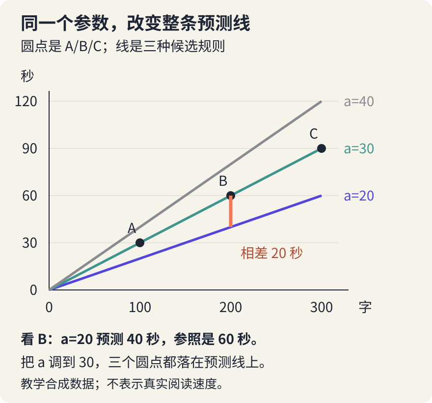
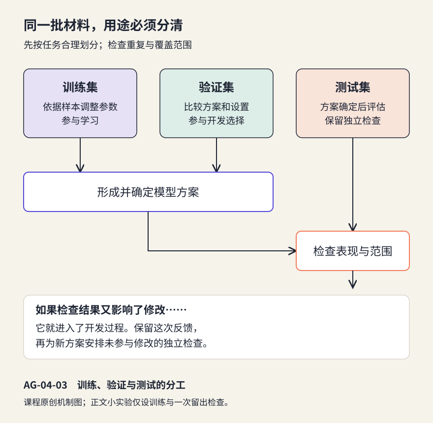

# 机器学习基础：从例子到能力

> 状态：review
> 版本：0.5.0

**看过一些例子，为什么可能处理没有见过的新情况？**读开源项目的模型说明时，我们常见“训练数据”“参数”“测试结果”等词。它们分别回答模型依据什么学习、什么发生了改变、怎样检查学习效果。把这些关系弄清楚，才能判断一项性能声明与自己的任务有什么关系。

第一部分介绍了开源项目、材料和协作。本章开始第二部分“理解 AI”：先用一个能手算的小模型观察学习过程，再把这套认识带到大模型训练。例题设在开源文档阅读情境中，所有字数和时间均为教材设计数据，不是真实读者测量，也不用于给任何项目评定质量。

## 学习目标与阅读准备

学习本章后，应能够：

- 用具体例子区分样本、特征、目标、参数与预测。
- 根据误差选择给定候选参数，解释训练、验证和测试的不同作用。
- 用新样本检查结果，说明泛化判断所依赖的条件。
- 联系公开训练材料，区分训练、模型使用与复现所需的材料。

只需理解加减乘除和表格，无需编程或前章作品。正文给出完整例题与独立实践；[第四章材料包](../../practice/ch04/README.md)提供可分开阅读的训练卡、核对卡和记录表。可以借助 AI 解释算式或检查表达，最终应能够自己说明参数为什么这样选。

**阅读起点。**第一章把模型与产品分开，第二章教我们寻找项目材料。本章要进一步看清材料中“模型学会了什么”的含义。先用四个常用词建立认识：

| 词语 | 在本章中怎样理解 |
| --- | --- |
| 输入 | 交给模型的信息，例如一段文档的字数 |
| 输出 | 模型计算得到的结果，例如估计的阅读秒数 |
| 模型 | 把输入转换为输出的计算规则；训练后保留下来的是可以再次使用的规则及其参数 |
| 评价 | 按事先说明的办法检查结果，例如比较预测时间与已知目标差多少 |

先跟随 4.1—4.3 节完成一次“看数据、选参数、查新样本”，再用 4.4 节理解这些关系怎样出现在大模型中。读到公式时，把字母看作一个待确定的数即可；本章不要求微积分或编程。4.5 节会给出另一组完整数据，供你独立运用这套方法。

## 4.1 数据、样本与学习任务

### 4.1.1 先把问题写成可检查的任务

假设一个开源社区想在文档目录旁提供阅读时间提示。“让 AI 理解文档”过于宽泛；“根据一段文档的字数，估计阅读秒数”则明确了输入和输出，也使结果可以比较。前一个说法描述愿望，后一个说法规定了本次研究的任务。

**模型**是把输入转换成输出的一种计算规则。**机器学习**利用数据和一定的学习方法来调整规则，使它在指定任务上取得较好的表现。任务、数据、模型与评价办法共同决定了“学得好”意味着什么；不能只看到一个分数，就把它解释成普遍的智能水平。

第一章所说的人工智能包含多种实现方法，机器学习是其中重要的一类。这里的“学习”有可观察的含义：模型依据样本调整内部的数值，而后用调整好的规则处理新输入。它不表示计算机具备了与人相同的学习经历。对本例而言，我们可以直接规定“每百字估计 30 秒”，也可以比较若干候选数值，依据样本选择；后一种做法让数据参与了规则的确定。

预测一个数值的任务通常称为**回归**，例如估计阅读时间；从若干类别中作判断的任务称为**分类**，例如把社区问题分为“安装”“使用”“文档”等类别。分类标签也可能模糊：同一条 Issue 可以同时涉及安装和文档。选择任务之前，需要先说明怎样判定目标，而不是把已有表格中的列直接当作可靠答案。

### 4.1.2 样本、特征与目标各承担什么作用

本章先使用下表中的三条记录。

| 样本 | 输入：字数 | 目标：阅读时间（秒） |
| --- | --- | --- |
| A | 100 | 30 |
| B | 200 | 60 |
| C | 300 | 90 |

一条用于学习或检查的记录称为一个**样本**。模型可以利用的输入属性称为**特征**，本例只有字数。用于比较预测结果的已知值称为**目标值**，在许多任务中也叫标签。本例的目标值由编写者设定；真实研究中则要说明由谁测量、如何测量、什么算阅读完成。

按一定目的组织起来的一组样本称为**数据集**。把输入与已知目标配对，用它们指导学习，称为**监督学习**。这里的“监督”来自可供比较的目标，不是指有人一直盯着计算机。读表时，一行是一个样本，字数列是输入特征，时间列是目标；模型算出的预测还需要另外一列保存。已知目标用于检查预测，两者可能相同，也可能不同。

**例 4-1　同一份文档，能有不同的目标时间吗？**读者甲浏览标题，读者乙理解全部术语并执行示例，两人的时间可能不同。如果把两类记录混在一起，却不记录阅读目的，模型面对的就不再是一个清楚的任务。较好的做法是先限定“面向怎样的读者、完成怎样的阅读”，再决定是否增加读者经验、术语数量等特征。

这也说明，数据表中的目标不是脱离条件的真理。机器学习可以调整参数，却不能自动补上从未记录的任务含义。

### 4.1.3 数据选择决定能观察到什么

只收集短小的入门说明，便很难据此判断模型是否适合长篇架构文档；只收集熟悉项目的维护者记录，也不能直接代表首次接触项目的学生。样本数量与样本是否覆盖实际任务，是两个需要同时考虑的问题。

数据准备通常包括选择材料、处理缺失或重复记录、统一格式，并保留适当来源说明。AIInfra 的训练专题把数据准备、计算调度与优化过程放在同一张工程地图中[4]；Chip Huyen 的配套摘要也强调训练数据与目标任务的联系[5]。在本课程里，我们先抓住一个判断：**数据是否足以代表这次打算解决的问题？**更多数据可能增加覆盖，也可能只是重复同一种偏差。

图 AG-04-01 用桌面材料和封存的新样本表现学习与检验的分工。计时器是概念隐喻；本章没有进行真人阅读测量。

## 4.2 参数、预测与误差调整

### 4.2.1 参数是规则中可以调整的数

我们选择一个很简单的规则：

**预测时间（秒）＝a × 字数 ÷ 100。**

其中 a 表示每 100 字对应的预测秒数，是模型的**参数**。字数由输入样本提供，a 则通过学习来选择。取 a＝20，200 字的预测是 40 秒；取 a＝30，同样的输入得到 60 秒。输入没变，改变的是规则中的参数。

逐步代入一次就能读懂这个式子：200 字 ÷ 100＝2，表示有两个“百字”；若每百字按 30 秒估计，就得到 30 × 2＝60 秒。a 不是某篇文档的字数，也不是每次直接照抄的目标时间；模型选定 a 后，会把同一个 a 用于不同输入。

这个模型假定时间与字数成正比，暂不考虑打开文档、查找术语等固定或额外耗时。模型结构先限定了能够表达的关系，参数再决定其中的具体数值。因此，调整参数与改变模型结构是不同的工作。本章只在 a＝20、30、40 三个候选值中比较，不宣称找到所有可能规则中最好的一个。

### 4.2.2 用误差比较候选规则

**预测误差**描述预测与目标之间的差别。为了不让早估与晚估相互抵消，本例先取差的绝对值，再对三个样本求平均。这种衡量办法称为**平均绝对误差**。用于衡量预测偏差并指导训练的数值准则称为**损失**；平均绝对误差是其中一种选择[1]。

**绝对值**只计差距的大小：预测 40 秒、目标 60 秒，少了 20 秒；预测 80 秒、目标 60 秒，多了 20 秒，两者的绝对误差都是 20 秒。**平均值**是把各项相加，再除以项数。因此本例的计算顺序是“每条先求差距，再把三个差距平均”，而不是先把带正负的差相加。这样，早估和晚估都被计入。

**例 4-2　把三个候选参数算清楚。**a＝20 时，A 的预测为 20 秒，绝对误差为 10 秒；B、C 的误差分别为 20、30 秒。平均绝对误差是（10＋20＋30）÷3＝20 秒。

| 参数 a | A/B/C 的预测（秒） | A/B/C 的绝对误差（秒） | 平均绝对误差（秒） |
| --- | --- | --- | --- |
| 20 | 20 / 40 / 60 | 10 / 20 / 30 | 20 |
| 30 | 30 / 60 / 90 | 0 / 0 / 0 | 0 |
| 40 | 40 / 80 / 120 | 10 / 20 / 30 | 20 |

在给定的三条训练样本、三个候选值和这一损失准则下，应选择 a＝30。这个结论带有明确条件；它还没有回答遇到另一篇文档时是否可靠。

图 AG-04-02 的三条线对应三个候选参数。圆点是教学目标值，点与线在同一字数处的竖直距离表示误差；线经过训练点，不等于已通过新样本检验。

### 4.2.3 训练是围绕目标反复调整

本例的学习过程可以概括为：用当前参数产生预测，比较目标得到误差，再选择更合适的参数。这个依据数据调整模型的过程称为**训练**。计算机可以重复完成这种工作，大模型则使用更高效的优化方法处理大量参数，通常不会逐个穷举所有可能取值。

**算法**是完成一项计算或选择所遵循的步骤。本例“逐一计算三个候选的损失，选择损失较小者”就是明确的步骤；模型则是最后用于预测的规则及其参数。算法说明怎样学，训练得到的模型说明以后怎样算。实际训练往往从一组初始参数出发，逐步寻找使损失减小的调整方向，这一过程称为优化；本章理解调整的目的即可。

损失准则也包含取舍。平均误差相同的两个规则，可能一个处处略有偏差，另一个多数样本准确却在少数样本上偏差很大。如果特别关心严重晚估，就需要另外检查这类错误。一个总分有助于比较，却不能替代对错误类型和实际用途的分析。

训练得到较低损失，只说明模型更适合用来调整它的这些数据。接下来必须暂时停止调整，把模型带到未参与选择的样本中。

## 4.3 训练、测试与泛化能力

### 4.3.1 用留出的样本检查预测

模型在新样本上继续取得适当表现的能力称为**泛化**。把训练样本中的答案全部记住，未必能够处理新输入。我们固定 a＝30，先对 D、E 作预测，再与目标比较。

| 样本 | 字数 | 固定参数的预测（秒） | 教学目标（秒） | 绝对误差（秒） |
| --- | --- | --- | --- | --- |
| D | 150 | 45 | 48 | 3 |
| E | 250 | 75 | 72 | 3 |

两条留出样本的平均绝对误差为 3 秒。这是本例的一项检查结果，不能推出“任何文档都只差 3 秒”。样本太少，情境也由教材刻意设置；其用途是让读者看见先选择、再检查的区别。

### 4.3.2 训练集、验证集与测试集的分工

**训练集**用于学习参数。反复开发模型时，通常还会留出**验证集**，帮助选择模型方案、训练设置或停止时机；最后用未参与这些选择的**测试集**估计表现。三者的分工有助于减少把开发过程中的选择效果误当成新情境能力的问题[2]。

为什么需要验证集？假设开发者在“只看字数”和“同时看字数与术语数量”两个方案之间选择，既要把每个方案训练好，也要比较它们处理其他样本的表现。验证集帮助作这种开发选择；方案确定后，测试集再提供一次尚未用于选择的检查。它们可以来自同一批按规则划分的数据，关键是用途分开，并尽量覆盖预计使用的情境。

图 AG-04-03 中，训练和验证都可能影响开发决定；测试用于方案确定后的检查。如果根据测试结果继续调整，原测试材料就已进入开发过程，需要另外安排独立检查。

本章为了使算式保持简单，只用 A/B/C 选择给定参数，D/E 作一次留出检查，没有另设验证集。读者如果已经读过答案，应把自己的操作称为复算。**材料能否作为独立检查，取决于它怎样被使用，而不取决于文件名是否写着“测试”。**

**例 4-3　看过答案，再宣称测试通过。**某同学看到 D 的目标为 48 秒，就把 a 改成 32；发现 E 偏大，又继续调回去。这个过程可以帮助改进模型，却已经使用 D、E 做选择。接下来应保留修改记录，并寻找新的检查样本，不能把调整后的 D/E 成绩当作从未见过这些答案时的表现。

### 4.3.3 过拟合、信息遗漏与情境变化

**过拟合**指模型过度适应训练数据的细节，在训练数据上表现很好，在相关的新数据上却表现较差。训练误差很低本身并不足以判定过拟合，需要比较新数据上的表现[3]。另一方面，模型从一开始就表达不了任务所需的关系，也可能造成较大误差。

如果模型连训练数据中的主要规律都没有学好，通常称为**欠拟合**，可能与规则过于简单或训练不足有关。与之不同，**使用情境变化**是实际遇到的对象或条件变了，例如原先只面向入门文档，后来改用于专业论文。观察错误时，可以先分清“已有规律没学好”“过度贴合训练细节”和“使用条件变了”，再寻找证据；一个错误样本不足以替我们选定原因。

现在加入 F：200 字，教学目标为 150 秒，情境是读者遇到陌生术语，需要反复核对。模型预测 60 秒，差 90 秒。B 与 F 的输入都是 200 字，而目标不同；本章的规则对相同输入总给出相同结果，因此不可能同时准确给出两个值。

这提示我们检查遗漏特征、阅读目的和测量条件，但仅凭 F 还不能证明具体哪种原因导致偏差。即使训练和测试时表现都好，实际使用时换了读者或文档类型，也可能失效。发现错误之后，应先问“输入和任务是否变了”，再决定补材料、改模型还是缩小适用范围。

## 4.4 从小模型实验理解大模型训练

### 4.4.1 从一个参数到许多参数

**神经网络**由多层可调整的计算组成，前一层的输出成为后一层的输入。训练通过调整大量参数，使整个网络更好地完成任务。参数数量增加，可以表达更复杂的关系，也带来更多数据、计算与检查需求。参数多不自动保证某一具体任务更好。

可以先把每一层理解为一次信息加工：将上一层提供的数值组合、变换，再交给下一层。许多层连接起来的神经网络是深度学习的基础；“神经”是名称，不表示它完整复制了人的大脑。**权重**是其中控制数值怎样组合的一类参数，网络还可以有其他可学习参数。项目发布时常用“模型权重”泛指保存下来的已训练参数集合。我们的小模型只有一个可调数 a，大模型则保存着许多相互配合的数值。

手算模型与大模型共享“数据—预测—损失—调整”的基本关系，但二者的结构、训练规模和优化方法差别很大。我们的实验没有模拟完整神经网络，也没有训练语言能力。理解这个小例子的价值，在于以后看到“损失下降”“测试集成绩”时，能够追问这些说法对应什么。

### 4.4.2 预训练与后训练怎样形成能力

**预训练**通常在大量数据上进行，使模型学习可用于多种任务的规律和处理信息的方法。以常见的一类语言模型为例，文本本身就能提供学习目标：给定前面的内容，预测接下来的词元，即模型处理的文本单位。把一段已有文本在某处切开，前面部分可作为输入，紧接着的单位就能作为目标；它来自文本自身，无需为每个位置另请人写答案。这类办法称为**自监督学习**[6]。具体的词元和逐步生成过程将在第五章展开。

监督学习和自监督学习都有学习目标，区别在于目标怎样获得。本章手算题直接给出阅读秒数；上述语言学习则从原始文本中构造目标。文本能够提供目标，也不代表其中每句话都是真实、完整或适合所有任务的材料，因此数据选择仍然重要。

**后训练**是在已有模型基础上继续调整，以更好地遵循指令、完成任务或符合质量要求；可以使用任务示范、偏好或其他反馈。**微调**是基于已有模型继续训练的一类做法，可出现在不同适配阶段。这里不要求记住各种算法缩写，而要理解：这些工作都需要说明训练材料、目标与评价条件[5]。

已有参数用于处理新输入时，称为**推理**或模型使用。这里的“推理”是技术术语，不意味着每次输出都进行了可靠的逻辑论证。把一页材料放进当前对话，通常是在改变本次输入，并没有因此更新基础模型参数；这一点将成为第五章的起点。

### 4.4.3 公开材料让训练过程更可追问

大模型训练还需要保存数据和模型状态、安排计算资源、处理故障，并记录不同实验。**AI 基础设施**为这些工作提供计算、存储、通信和软件支持。AIInfra 的训练与推理专题可以作为继续阅读这些角色的入口[4]；本章不展开集群搭建，也不把资料中的性能数字直接用作所有模型的结论。

回到第一部分的项目阅读，想判断“开源后能否复现训练”，应分别寻找材料：

| 想回答的问题 | 应寻找的材料 | 只有模型权重还缺什么 |
| --- | --- | --- |
| 怎样使用已有模型？ | 权重、结构配置、词元处理与运行说明 | 适用环境和完整使用条件 |
| 怎样得到这组参数？ | 数据说明、训练代码、配置与过程记录 | 数据可得性、计算资源和训练细节 |
| 怎样得到这个成绩？ | 评测样本、指标、提示或设置、评测代码 | 可检查的评价条件与复现记录 |

本表中的结构配置说明模型如何组成，运行说明交代怎样把它加载并用于输入，评测指标则规定怎样衡量结果。公开权重有助于使用与研究；完整重现原训练还需要更多条件。具体开放程度应逐项看材料，而不只看项目名称中的“开源”二字。这使第二章的材料阅读多了一层依据：你已经知道，为什么“能下载模型”和“能检查它怎样训练”需要寻找不同文件。

## 4.5 综合实践：比较学习结果，解释适用条件

### 4.5.1 独立任务与完整输入

请为一段开源文档的阅读时间建立教学模型，使用本章同一公式与候选参数，但换一组训练目标：

| 字数 | 100 | 200 | 300 |
| --- | --- | --- | --- |
| 教学目标（秒） | 28 | 63 | 84 |

先分别计算 a＝20、30、40 的平均绝对误差并选择一个。再固定所选参数，对 150、250、200 字作预测；核对目标分别为 48、72、150 秒，其中最后一条带有“陌生术语较多、需核对”的情境。全部数据均为教学设定。它们用于练习方法，不构成独立的真实阅读研究；若已读过目标，记录为已知答案后的复算。

保存一份简短实验说明，包括完整算式、选择理由、留出样本的结果，以及对最后一条偏差的解释。无需建立网站、导览或前章作品。可以用纸笔、表格或 AI 辅助计算，注明实际用法，并自行复核至少一条算式。

可以先自己完成一个样本，再请 AI 检查三组计算是否使用了同一公式，并解释一处差异。你来核对它指出的问题、决定是否修改，最后用自己的话解释参数选择。若与同伴交流，可以交换说明，请对方检查“是否交代适用条件”；自学时则暂时遮住参考结果，先读自己的说明是否足够清楚。复算、解释和修订共同构成本次学习，不必另做一套展示作业。

### 4.5.2 参考结果与分析

三个候选参数的绝对误差总和依次为 55、11、65 秒，平均值约为 18.33、3.67、21.67 秒。因此在这些候选中选择 a＝30，尽管训练误差不是零。固定参数后，三个新输入的预测依次为 45、75、60 秒；前两条误差各为 3 秒，最后一条误差为 90 秒。

一个有依据的结论可以写成：“在本组候选、合成样本与平均绝对误差准则下，a＝30 最合适；两个较接近训练情境的检查样本偏差较小，复杂阅读情境偏差较大。只用字数不足以同时解释相同字数下的不同目标，真实使用前还需补充测量与任务条件。”这里没有把教学习题成绩当成实际部署结论。

### 4.5.3 自我评价与迁移

检查自己的说明能否回答四个问题：哪一项是参数、选择依据是什么、新样本是否参与过选择、结论适用于什么范围。如果只写“a＝30 最好”，应补上比较条件；如果只写“复杂文档使模型失败”，应说明这只是待检查的解释。

进一步可以把任务换成“根据历史 Issue 的信息估计响应时间”。先不计算，列出可能的特征、目标怎样定义、哪些情况需要分开观察。你会发现，有些问题需要补充数据，有些需要重新定义任务。能够识别这一区别，就是将本章方法迁移到开源生态研究的开始。

## 本章小结

机器学习围绕明确任务，利用样本和损失准则调整参数。训练成绩需要与新样本表现区分，泛化判断还依赖样本、任务和使用情境。大模型使结构和规模变得复杂，但数据、参数、评价与公开材料仍是理解它的重要入口。下一章转向参数通常保持不变的一次使用：语言怎样生成，材料怎样影响回答，又怎样核对依据。

## 思考与练习

1. 在阅读时间模型中，字数、a、目标秒数和预测秒数各是什么？
2. 若 a＝30，400 字的预测是多少？能否因此保证真实读者用时相同？
3. 两个模型的训练误差都为零，应怎样进一步比较？
4. 根据测试集结果多次改参数后，原测试集还能承担什么作用？
5. B 与 F 字数相同而目标不同，增加训练轮数必然解决问题吗？
6. 一个项目公开了权重与成绩表。若要复查成绩和训练过程，分别还需要哪些材料？

## 参考反馈

1. 字数是输入特征；a 是可调整参数；目标是用于比较的已知值；预测是模型根据输入与参数计算出的结果。
2. 预测为 120 秒。这是给定公式的输出；实际读者、文档与任务条件不同，可能产生不同时间。
3. 用未参与选择且符合目标任务的新样本比较，并检查错误类型与成本。训练零误差本身不能证明泛化好，也不能单独证明过拟合。
4. 它仍可提供开发反馈，但已参与选择；最后评估应另留未参与修改的材料，并说明其覆盖范围。
5. 不必然。对相同输入，这个规则只能输出一个值；应检查特征、任务定义和测量条件，增加轮数不会凭空补出缺失信息。
6. 复查成绩要看评测数据、指标、运行设置与代码；复查训练还要看数据说明、训练代码、配置、记录和资源条件。材料可见、许可适用与能够复现也应分别判断。

## 参考文献与延伸阅读

[1] Google. [Machine Learning Crash Course: Linear regression—Loss](https://developers.google.com/machine-learning/crash-course/linear-regression/loss)。损失与误差度量。

[2] Google. [Datasets: Dividing the original dataset](https://developers.google.com/machine-learning/crash-course/overfitting/dividing-datasets)。训练、验证与测试的分工。

[3] Google. [Overfitting](https://developers.google.com/machine-learning/crash-course/overfitting/overfitting)。训练表现与新样本表现的区别。

[4] Infrasys-AI / AIInfra. [大模型训练与 AI Infra](https://github.com/Infrasys-AI/AIInfra/blob/b97c0385ba07a62a717d82a0e7aed2927f12fc35/00Summary/04TrainingStack.md)。数据准备、计算调度与训练流程的工程阅读入口。

[5] Chip Huyen. [AI Engineering 配套资源：Chapter Summaries](https://github.com/chiphuyen/aie-book/blob/f375e0065ef19e4f411b809a2f9a2d65582db287/chapter-summaries.md)，第 2、8 章摘要。数据、基础模型与训练视角；这是配套摘要，不是原书全文。

[6] Hugging Face. [Transformers v4.46.0: Causal language modeling](https://huggingface.co/docs/transformers/v4.46.0/en/tasks/language_modeling)。自回归语言学习与模型使用。

上述网页查阅于 2026-10-30。例题与实践数据均由课程编写者为教学设计，不来自这些资料的真实实验。

