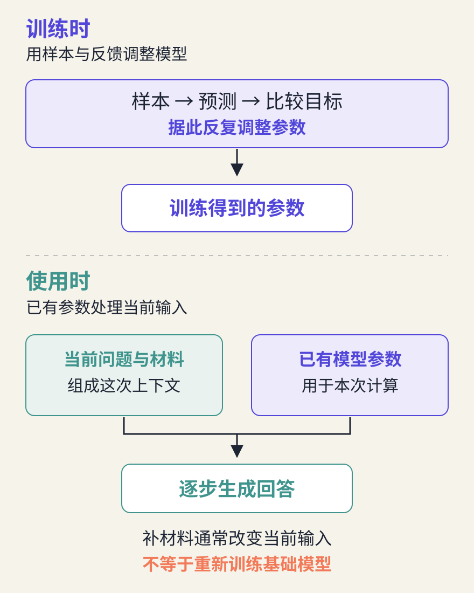
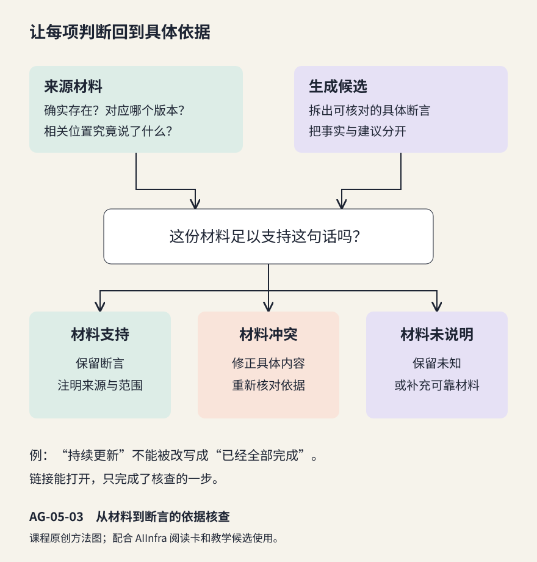

# 大语言模型的生成与局限：生成、知识与证据

> 状态：review
> 版本：0.5.0

**同一个模型，为什么换一份材料就可能给出不同回答？**上一章讨论了训练怎样改变参数。本章把视线移到模型的使用：给定当前问题与材料，文字怎样一步步产生，哪些内容可以据此相信，哪些还需要查证。

开源社区积累了大量文档、讨论与课程。AI 可以帮助我们提炼和比较这些材料，也可能把未说明的事情补成肯定结论。理解生成机制的目的，是使创作更有依据：既能组织好输入，也能判断输出。本章以 AIInfra 的公开课程材料为独立案例，不需要沿用前章作品。

## 学习目标与阅读准备

学习本章后，应能够：

- 用直观过程解释词元、上下文与逐步生成。
- 区分训练所得、当前材料与检索信息，说明各自的作用。
- 对照来源检查具体断言，区分材料冲突、缺少依据与表达不确定。
- 在明确条件下比较两次生成，解释材料组织的影响与结论范围。

需要第四章“训练调整参数、使用已有参数”的认识。正文提供完整阅读卡、教学候选与反馈，纸面可完成机制和证据分析；实际生成对照需要一个可用的 AI 工具，可选择 DSH 或其他工具。[第五章材料包](../../practice/ch05/README.md)提供同一模板生成的两份提示与空白记录。阅读教学候选和亲自运行分别记录。

**阅读起点。**把第四章的“根据字数输出时间”换成“根据已有文字继续生成文字”，输入和输出变复杂了，但仍能逐层观察。先联系以下四个概念：

| 概念 | 本章中的含义与联系 |
| --- | --- |
| 参数 | 训练得到的内部数值；本章讨论的一次普通生成通常使用已有参数 |
| 推理 | 用已有模型处理输入；在本章中，它产生新的文字 |
| 提示（prompt） | 提供给模型、引导本次生成的输入，可以包含任务、材料和示例；它可以是一整段说明 |
| 上下文 | 本次生成实际能够利用的信息，既可能含提示，也可能含此前对话和工具返回 |

先读 5.1 节理解文字如何产生，再读 5.2—5.3 节分清信息从哪里来、怎样核查，最后用 5.4—5.5 节做一次有明确条件的比较。首次阅读只需能用例子解释这些关系；词元编号、概率计算和检索算法不要求编程实现。

## 5.1 词元、上下文与逐步生成

### 5.1.1 文字先转成模型能够处理的单位

**大语言模型（Large Language Model，LLM）**是在大量语言等数据上训练、能够处理和生成语言的模型。“大”描述模型与训练规模的特点，不是对所有任务都有效的质量保证。本章聚焦常见的逐步文本生成过程。模型处理的基本单位称为**词元（token）**。它可能对应一个词、词的一部分、字符或其他片段，不应简单理解成“一个汉字”或“一个英文单词”。

**分词器（tokenizer）**把文本转换为模型所用的词元编号，也能把生成的编号转换回文字[1]。同一句中文或同一段代码，在不同分词器下可能得到不同数量和边界的词元。因此，比较“字数”“词元数”和“模型能容纳的内容量”时，需要先说明计量方法。

编号可以理解为词表中的索引，用来区分不同词元；编号大不代表更重要或更正确。模型还会把编号转换为可计算的数值表示，再进行后续处理。对读者而言，先分清“人看到的文字”和“模型处理的单位”就足够：页面显示一段连续文字，模型内部不一定以同样的词句边界处理它。

为便于阅读，本章用“读取原稿”“创建新稿”等完整短语说明续写方向。它们是教学词卡，不是真实分词结果；没有展示某个模型的实际概率。

### 5.1.2 下一步依据已经出现的内容

**上下文**是模型本次生成所能利用的输入信息，以及生成过程中已经出现的内容。这里讨论的模型每次根据已有内容预测下一个词元，把选出的词元接到后面，再继续下一次预测。新生成的内容也成为后续输入的一部分，这种方式称为**自回归生成**[2]。

可以按四步理解：把提示转换为词元；计算下一词元的各个候选及其可能性；选出一个并接到后面；用更新后的内容继续，直到生成结束标记或达到长度等停止条件。界面上逐渐出现的一段回答，是多次选择的结果。这里的“自回归”描述生成方式，不是要求读者先掌握统计模型。

**例 5-1　同一句开头，背景为什么重要？**现在都从“接下来，我会……”继续写。如果前文要求先了解现有文档，合理的续写方向可能是“读取原稿”；如果前文已核对原稿并要求另存候选，合理方向可能是“创建新稿”。

| 已给背景 | 共同开头 | 教学续写方向 |
| --- | --- | --- |
| 先查看原稿，暂不修改 | 接下来，我会…… | 读取原稿并核对内容 |
| 原稿已核对，另存一份候选 | 接下来，我会…… | 创建新稿并保留原稿 |

这不是实际模型调用记录，而是说明“前面的信息会参与后面的选择”。已经生成的错误前提也可能进入后续上下文，使之后的解释沿错误方向展开。因此，早些检查关键事实，比只润色最终语气更有帮助。


图 AG-05-01 用短语卡片表现上下文与续写的关系。这里的“读取”“创建”仍是生成的文字；文件是否真的被操作，要到第六章讨论工具与执行。

### 5.1.3 生成概率与事实正确性是不同问题

**概率**用数值表示一种结果出现的可能性；0 表示不可能，1 表示必然，也可写成 0% 到 100%。把全部候选的概率放在一起，就是**概率分布**。为解释选择，假设一个只有甲、乙、丙三个候选的教学例子，概率依次为 60%、30%、10%，总和为 100%。这些数由教材设定，不是某个模型的实测结果。

如果每次都选概率最高的候选，就会选甲；如果按这些概率进行**采样**，可以把它理解为按不同比重抽取一个候选，乙和丙也有机会被选中。真实模型面对的是词表中的大量词元，应用还可以先筛选候选，再采样[2]。无论怎样选，都需要返回一个词元，才能继续下一步。

模型给下一词元较高概率，表示它在当前条件下更倾向于生成这个词元，不等于对应事实有同样高的正确概率。流畅、熟悉的表达可能与材料不符；不常见但准确的新信息也可能不符合模型原先的倾向。

生成设置可以影响输出的多样性与稳定性；即使问题相同，多次回答也可能不同。改变采样设置不会自动提供新证据，也不保证消除错误。Chip Huyen 的配套摘要把这种概率性与应用评价联系起来：使用者需要通过检查和比较了解输出的表现[3]。

逐步生成并不意味着模型只能机械复制现成句子；训练可以使它形成复杂的语言和任务能力。但一个答案是否适用于眼前问题，仍要检查内容与依据，不能从“写得像解释”直接推出“已经证明”。

## 5.2 训练所得、当前材料与检索信息

### 5.2.1 参数中形成的规律与知识

上一节解释了文字如何接着生成，还留下一个问题：生成所依赖的信息从哪里来？可以先区分训练阶段形成的能力、本次提供的材料，以及使用工具找来的外部材料。三者会在同一次回答中相遇，却有不同的获得过程。

训练使模型参数发生变化，形成语言规律和许多可用于回答问题的知识。模型通常不是把每条知识都连同原网页地址作为可逐条查询的档案保存；它也可能记住某些具体文本。因而，能说出一件事与能准确指出原始出处是两种能力。

当问题涉及新的项目版本、刚发生的讨论或没有公开的材料，训练所得可能不足以回答。即使一个项目在训练中出现过，也不能据此假定模型知道它现在的目录、接口或维护状态。使用时需要当前材料，而不是让模型用旧印象填满空白。



图 AG-05-02 区分训练与本次使用。补充一份文档通常改变当前上下文；它不等同于对基础模型进行再次训练。

### 5.2.2 当前上下文怎样组织任务

实际应用中的上下文可能包括任务指令、对话历史、参考材料、工具说明和工具返回。李博杰及贡献者的《深入理解 AI Agent》第 2 章展示了这些信息怎样共同进入模型调用[4]。不同工具的界面与消息结构有所不同，读者应关心实际送入了哪些信息，而不只看聊天窗口中的最后一句话。

指令告诉模型要做什么，材料提供可用的事实，示例帮助说明期待的形式。三者混在一起时，模型可能把材料中的一句建议误当成本次任务要求。清楚标出“任务”“材料”“输出要求”，有助于人和模型共同理解边界。

模型能够处理的上下文长度有限，称为**上下文窗口**。应用可能截断、概括或只选取部分材料；“上传了整个仓库”并不自动意味着每次回答都读取了所有文件。有效组织需要选择与问题相关的内容、保留出处和版本，并检查关键条件是否真的进入了本次输入。

例如，写给初学者的项目说明，可以把“说明用途、给出阅读入口”放在任务栏，把带出处的 README 摘要放在材料栏，再说明希望采用一段短文。这样的整理既方便 AI 使用，也让后来核查的人知道每句话应向哪里寻找依据。上下文组织本身就是研究与表达的一部分。

### 5.2.3 检索增强把外部材料带入生成

**检索**是围绕问题查找相关信息，来源可以是网站、项目文档或整理好的本地资料库，并不一定是互联网搜索。**检索增强生成（Retrieval-Augmented Generation，RAG）**把查找材料与生成回答结合起来：先取回相关片段，再让模型结合这些片段回答。它可以帮助使用当前或专门材料，通常不需要因此修改基础模型参数[3]。

例如，问“AIInfra 哪些文件分别介绍训练和推理”，检索环节要找到相应目录或文件，生成环节再把文件名、作用和学习顺序组织成回答。这里至少有两个独立问题：找回的材料是否合适，回答是否忠实使用了材料。找错版本会影响后者；找对材料也不能保证生成不添加无依据的承诺。

手工把两段来源贴进对话，同样有助于理解“先提供依据、再生成”的关系，但不等于搭建或测评了完整 RAG 系统。本章只要求读者识别这些环节；检索算法和系统部署留作延伸学习。

## 5.3 生成错误、不确定性与依据核查

### 5.3.1 从具体断言识别问题

模型可能生成貌似合理、实际不符合事实或给定材料的内容，这类现象常被称为**幻觉**。这个词帮助描述现象，却不应代替具体分析。检查一段话时，先找出其中可以核对的**断言**，即它声称成立的具体事情。

**例 5-2　把“持续更新”写成“已经全部完成”。**AIInfra 的固定版 README 说明课程内容持续补充。若候选写成“全部课程已经完成”，就与材料冲突。若写成“学习后一定能独立部署任意规模模型”，则材料没有提供这样的保证；这属于缺少依据。若说“可以先读概述，再选一个专题”，可以作为编写者提出的学习建议，但应让读者看出这是建议。

| 检查结果 | 本例中的表现 | 合理处理 |
| --- | --- | --- |
| 材料支持 | 课程围绕 AI 基础设施组织内容 | 保留并注明来源 |
| 与材料冲突 | 将“持续更新”改成“全部完成” | 改正具体断言 |
| 材料未说明 | 承诺学习时长或完成效果 | 标明未知，或补充可靠依据 |
| 作者建议 | 建议先概览后选专题 | 标出建议，不冒充项目规定 |

“材料未说明”与“这件事一定是错的”不同。证据不足时，可以暂缓判断；这种克制使表达更准确，也为后续研究留下清楚的问题。

### 5.3.2 链接存在，还要看是否支持这句话

**例 5-3　引用正确的页面，也可能得出错误结论。**某段介绍在“所有实践无需任何环境准备”之后放了 AIInfra 的 README 链接。即使链接能够打开，也只说明这个页面存在；还需找到能够支持该断言的原文。目录中有“训练”和“推理”，也不等于每个实践都已完成，更不等于所有环境要求相同。

核查可以沿三个问题进行：来源是否确实存在并对应所用版本；相关位置究竟说了什么；这段材料是否足以支持当前断言。引用编号是线索，不是质量印章。让 AI 再说一遍“我已核实”，也不能替代打开来源或检查实际材料。



图 AG-05-03 将生成候选拆为可检查的断言。修改可以是补来源、纠正冲突、缩小表述范围或保留未知；不是每个空白都必须由模型补成答案。

### 5.3.3 不确定性怎样进入负责任的表达

Neo Lee 的课件用若干问题引出语言模型的长处与局限[6]。教材采用其中“通过具体任务检验”的思路，不把某个演示题固化为当前所有模型都会失败的结论。能力会因模型、版本、工具和任务条件而不同。

比较稳妥的表达是说明知道什么、依据什么、还有什么没有检查。例如：“依据所给目录，可以确认有训练与推理专题；各节当前完成度和具体设备要求仍需查看相应文件。”这比笼统加一句“AI 可能出错”更有用，因为读者知道下一步应查哪里。

模型自报“很有把握”，只是一句待检查的表达；即使给出“90%”，也不能据此认为十个类似答案中就会有九个正确。真实评价还要看它在一组任务上的实际表现、哪些类型经常出错，以及用什么办法判定。本章先在少量材料上练习判断，评价更多作品的方法将在后续章节继续展开。

## 5.4 任务条件、输出比较与结果判断

### 5.4.1 让比较围绕一个清楚的问题

能核查一段回答之后，就可以进一步问：怎样改善输入，让回答更有用？**对照比较**是有意识地改变一个条件，观察结果是否随之变化。本章把两组条件简称为 A、B；它们是输入条件的名字，不是两个模型的名称。

如果同时更换模型、修改问题、加入材料，又改变输出长度，得到的差异很难解释。本章只研究一个较小的问题：在同一任务中，补充与问题有关的目录材料，输出是否出现了更具体且有依据的学习入口？

为此，应尽量保持工具、模型版本、任务指令与可见设置相同，使用两个新的对话，分别提供材料 A 和材料 A＋B。关闭不需要的搜索或文件工具，可以减少额外来源的影响。若某些设置不可见、无法关闭记忆或自动搜索，就记录限制，缩小结论范围，不声称做到严格实验控制。

### 5.4.2 先定评价依据，再看哪份更好

判断可以围绕三个并列维度展开：**准确性**看断言是否有依据，**任务完成度**看是否回答了指定问题，**可用性**看初学者能否据此继续阅读。这些维度不总是同步变化。长一点可能更完整，也可能添加更多未经支持的内容；少写一点可能显得保守，却更忠实于材料。

保留两份原始输出，再标注一处具体变化及其材料依据。若要请 AI 帮忙评价，应同时给它原始材料与判据，并自行复核关键判断。Chip Huyen 的评价摘要提醒读者，AI 评价者也有自身的条件和局限[3]。

### 5.4.3 从一次观察形成有限结论

一次 A/B 对照可以显示本次出现的差异，不能证明某种提示写法总是更好，也不能用来给模型排总榜。需要更稳定的认识时，可以对多个问题或重复运行作记录，并关注失败情形，而非只挑最好的一次。

如果补充材料后没有变好，应查看材料是否相关、是否清楚、是否与指令冲突，以及模型是否实际使用了它。没有差异也是观察结果。良好的比较保留反例，使结论能被复查，而不是预先指定 B 必须获胜。

## 5.5 综合实践：改善材料组织，比较生成结果

### 5.5.1 独立阅读材料与共同任务

以下阅读卡由课程根据 AIInfra 固定版本改写，仅提供本次需要的事实。版本为 b97c0385，来源见[5]。材料 A 与 B 可直接复制使用，无需下载项目或安装软件。

**材料 A：课程概览。**

- **A1** AIInfra 是围绕 AI 基础设施组织的开放课程，讨论大模型相关的系统设计。
- **A2** README 说明文字课程正在持续补充，提供文字、视频与课件入口。

**材料 B：目录线索。**

- **B1** 00Summary/04TrainingStack.md 的内容结构包括数据准备、计算调度、训练工具链、预训练与后训练、微调与评估。
- **B2** 00Summary/05InferStack.md 的内容结构包括训练与推理差异、运行时与推理引擎、内存管理、服务化与推理流程优化。

**怎样读这张目录卡？**文件路径表示材料在仓库中的位置：00Summary 是文件夹，末尾的 .md 表示 Markdown 文本文件。先找对入口即可，不必先学完里面所有工程术语。第四章已经解释训练与推理；目录中的计算调度是安排计算任务与资源，推理引擎是执行模型计算的软件，内存管理是安排运行中的数据存放，服务化是把模型包装为能够接收请求并返回结果的服务。这些词帮助辨认专题用途，部署方法留待需要时继续学习。

请在两次输入中使用完全相同的任务，只改变“材料”部分：

```text
请仅依据下列材料，为第一次接触 AI 基础设施的大学生写一段 100—180 字的学习入口说明。
说明 AIInfra 是什么，并指出分别了解训练与推理应查哪些具体文件。
事实句后标出所用材料编号；建议请注明“建议”。
材料没有给出的具体文件、学习时长、设备要求或完成效果，请说明无法据此确定，不要猜测。
材料：
{{MATERIALS}}
```

条件 A 只放材料 A；条件 B 放材料 A＋B。提示中的占位符由相应材料替换。保存原始输入与输出，再对照来源解释一处变化。没有可用 AI 工具时，先分析下面的教学候选并设计对照输入，注明实际生成待完成；两种路径都能练习依据判断，但教学候选不能冒充实跑输出。

### 5.5.2 教学候选与参考分析

以下两段由课程编写者构造，故意保留可比较问题，不是模型调用记录，也不是固定的预期输出。

**候选甲：**“AIInfra 是已经全部完成的 AI 基础设施课程。只需先读训练篇，再读推理篇，就能在两小时内学会部署任意模型。”

**候选乙：**“AIInfra 围绕 AI 基础设施组织开放课程，文字内容仍在补充。[A1][A2] 建议从概述目录中的训练文件 00Summary/04TrainingStack.md 和推理文件 00Summary/05InferStack.md 入手。[B1][B2] 学习时长、设备要求及完成效果无法据此确定。”

甲把更新状态改成了完成状态，又加入没有依据的时长和效果保证。乙中的文件入口由 B 支持，但若它被当作条件 A 的输出，仅凭 A 无法为文件名提供依据；实际运行时，应查看它是否使用了额外来源或自行补充了内容。因此，评价一段话要同时看文本和它当时能够依据的材料。

实际 B 输出也可能错误。如果它只抄文件名却不说明用途，可以在准确性之外指出可用性不足，再修订一处表达。修订稿另存，原始输出保留，避免把人工改好的结果当成模型原始表现。

### 5.5.3 自我评价与迁移

一份合格记录应让别人知道：比较了什么，哪些条件相同，唯一计划改变的材料是什么，实际发生了什么，结论的范围是什么。至少选一条断言，把它与材料编号或具体来源位置联系起来。

在比较之后，选一处确有依据但不够清楚的表达，借助 AI 改写为初学者更容易理解的说法，再自行核对含义。可以请同伴回答“读完后知道该打开哪个文件、为了了解什么吗”，据此修订；独立学习时也可按这两个问题自查。这样，材料阅读、AI 创作和读者反馈进入同一份记录：既保留比较依据，也形成一段更有用的说明。

可以进一步把案例换成开源软件、模型或社区介绍。迁移时仍需准备足够材料和同样明确的判据，不必照搬 AIInfra 的文件名。未来这些有来源的说明和比较记录，可以经整理与授权成为课程作品库的学习材料；本章不要求公开上传。

## 本章小结

生成依赖已有参数与当前上下文，逐步产生词元。训练所得、当前材料和检索信息能够共同帮助回答，但各有作用与限制。检查应落到具体断言与来源，比较应保留条件和原始结果。下一章再向前一步：当模型提出读取、写入或查询请求时，系统怎样实际执行，并利用反馈继续完成任务。

## 思考与练习

1. 一个词元一定等于一个汉字或一个英文单词吗？
2. 给对话加入最新 README，是否就完成了对基础模型的微调？
3. 检索返回了正确文件，能否据此保证最终回答准确？还需检查什么？
4. 材料未说明设备要求，能否写成“无需设备准备”？怎样修订？
5. A 与 B 使用不同模型又提供不同材料，能够把差异归因于材料吗？
6. B 给出了正确文件名，却没有使用材料编号，你会怎样评价并继续核查？

## 参考反馈

1. 不能。边界由分词器决定，可能对应不同文本片段；真实词元数量应由实际分词器确认。
2. 通常没有。它改变当前输入；微调涉及继续训练和参数更新。应用保存对话，也不等于基础模型因这次对话立即更新。
3. 还要检查是否用对版本、片段是否完整、断言是否由材料支持，以及是否加入未说明的内容。检索和生成是两个需要分别检查的环节。
4. 不能。可以写“给定材料没有说明，需查对应实践要求”；未知不等于没有要求。
5. 不能作单一归因。应尽量保持模型等条件相同；若无法控制，只能报告这两组条件下的观察。
6. 文件名准确是一个维度，可追溯性是另一个维度。先回到 B 核对名称与用途，再补上对应来源；不要只因缺少编号就把所有内容判错，也不要因名称正确便忽略依据。

## 参考文献与延伸阅读

[1] Hugging Face. [LLM Course: Tokenizers](https://huggingface.co/learn/llm-course/en/chapter2/4)。文本、词元与编号。

[2] Hugging Face. [Transformers v4.44.0: Generation with LLMs](https://huggingface.co/docs/transformers/v4.44.0/llm_tutorial)。自回归生成与生成策略。

[3] Chip Huyen. [AI Engineering 配套资源：Chapter Summaries](https://github.com/chiphuyen/aie-book/blob/f375e0065ef19e4f411b809a2f9a2d65582db287/chapter-summaries.md)，第 2—6 章摘要。采样、评价、提示与 RAG；本章没有将配套摘要当作原书全文。

[4] 李博杰及贡献者. [《深入理解 AI Agent：设计原理与工程实践》第 2 章：上下文工程](https://github.com/bojieli/ai-agent-book/blob/dbc046eb896ac4e39aa19c7774c8bf49583b89a6/book/chapter2.md)，上下文构成与模型调用相关节。

[5] Infrasys-AI / AIInfra. [README](https://github.com/Infrasys-AI/AIInfra/blob/b97c0385ba07a62a717d82a0e7aed2927f12fc35/README.md)、[训练专题](https://github.com/Infrasys-AI/AIInfra/blob/b97c0385ba07a62a717d82a0e7aed2927f12fc35/00Summary/04TrainingStack.md)、[推理专题](https://github.com/Infrasys-AI/AIInfra/blob/b97c0385ba07a62a717d82a0e7aed2927f12fc35/00Summary/05InferStack.md)。本章阅读卡依据项目说明与文件目录改写，不以文件存在推定全部实践已经完成。

[6] Neo Lee.《建立智能时代的个人工具箱 / Skill Set in AI Era》，Autumn 2026，第 20—23 页。维护者提供的实训课件；采用其任务观察思路，未转载原图与整份课件。

网页查阅于 2026-10-30。教学词卡、候选甲乙与参考分析均为课程原创示例；实际模型输出由学习者按所用条件另行保存。

