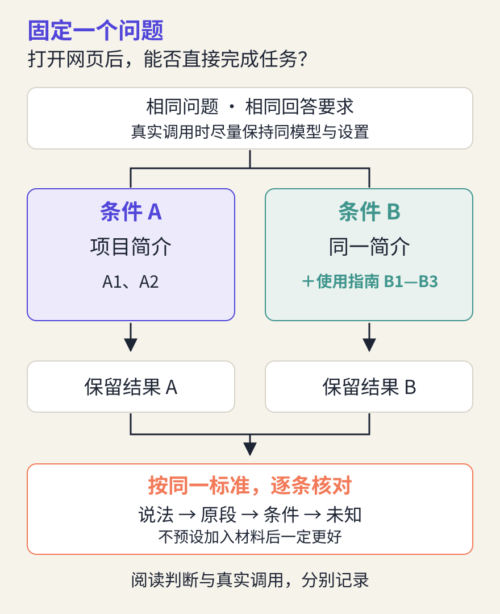

# AI 为什么会答错：生成、知识与证据

> 状态：review
> 版本：0.2.0

第四章，我们从一个阅读时间小实验认识了训练：利用样本调整参数，再用没有参与调整的材料检验。模型经过训练，可以形成有用的能力；这却没有回答另一个问题：为什么它有时说得条理清晰，关键事实仍然不对？

回到观察站。假设导览里出现这样一句话：“DSH 是智能体工具，打开网页就能自动完成文件任务。”它很简洁，也很像一条友好的使用指引。可是，“是智能体工具”真的足以支持“打开就能完成”吗？

本章从这句话出发，看看回答怎样生成、材料怎样影响回答，以及我们怎样作出有依据的修订。你不需要学习复杂公式；核心任务用纸笔和给定文档就能完成，已有可用 AI 工具的读者还可以做一次真实对照。

## 5.1 一段回答，是怎样接着写出来的

先做一个很短的续写：“为了让后来者核对，我在导览里保留了……”你可能接“来源链接”，也可能接“文档版本”。前面的内容给出了方向，但没有唯一的后续句子。

生成式语言模型处理文字时，也会利用前面的信息预测后续片段。第四章提到，模型处理的基本文字单位叫 **token**，中文常译为**词元**。词元可以是一个字、词的一部分或别的片段，具体怎样切分取决于模型使用的方法。下面用完整短语解释过程，只是为了便于阅读，并不是某个模型的真实分词结果。

模型根据当前输入，计算哪些后续词元更可能出现；系统按照一定规则选出后续内容，把已经生成的内容接回输入，再继续生成，直到结束。选择规则可以偏向高可能性的候选，也可以包含抽样。因此，同样的问题可能出现不同措辞；具体是否变化还取决于设置和实现。

这不是每写一句都先打开一部百科全书。模型的参数包含训练形成的规律，支持它组织语言、处理关系和完成许多任务；但**一个片段在当前条件下更可能出现，不等于它陈述的事情更可能为真**。这里的“可能性”针对文本生成，不是附在每条事实上的真实性保证。

在写故事时，想象出一个新情节可以是优点；写观察站的项目说明时，凭空补出一个安装步骤或运行结果就会误导读者。判断回答是否合适，要先看任务是在创作虚构内容，还是在说明可核对的事实。

图中的查书动作是概念比喻，不是模型内部真的坐着一个查书的人。它提醒我们：生成一段通顺文字，与核实这段文字所说的事，是两个需要分别检查的环节。

## 5.2 回答之前，它实际看到了什么

“请把它讲清楚。”如果不知道“它”指什么，这条要求很难执行。把问题改成“请根据这两段项目说明，为第一次接触 DSH 的同学写一页导览”，读者、对象、依据与成果就具体了。

**上下文**是模型在这次生成时可以利用的输入信息。它可能包括系统或应用给出的要求、你的问题、纳入本次请求的对话片段、提供的文档，以及工具返回的材料。**提示词**是我们给模型的指令或问题；它可以是上下文的一部分，而不是所有上下文的总称。

可以用两个不同时间的动作来区分：训练让模型调整参数，形成处理任务的能力；使用时，把当前问题和材料交给已有模型，得到这次结果。给它补上项目指南，通常是在改变当前输入，没有当场重新训练基础模型。

软件还可能保存历史对话、把长材料整理成摘要，或从文件中取回片段再交给模型。这些都是需要观察的材料处理过程，不能只凭“它记得我说过的话”就断定模型权重改变了。

实际任务里，**你看得到的文件不一定就是模型已经读到的文件**。把文件放进文件夹，不代表它自动进入本轮上下文；回答里说“我读过了”，也需要与文件读取记录或具体内容核对。第六章会继续追踪 DSH 怎样读取材料和执行动作。

因此，任务卡中除了写“你要做什么”，还应明确“依据哪些材料、材料是哪一版、缺少依据时怎样处理”。材料多并不自动更好：与问题无关、彼此冲突或版本不明的内容，也会增加判断难度。先选对材料，再确认它实际进入了任务。

## 5.3 说得很像，为什么仍然可能不对

当模型生成的内容不符合事实、与给定材料冲突，或编出似乎存在的来源时，人们常把这类现象称为 **AI 幻觉**。这个说法描述输出问题，不意味着 AI 像人一样产生了感官幻觉，也不能据此认定它有意撒谎。NIST 的生成式 AI 风险资料特别提醒：错误内容可能带着自信语气，甚至附上看似合理的解释和引用。

从读者视角，可以先分清三种情况：

| 回答中的说法 | 怎样判断 | 下一步 |
| --- | --- | --- |
| 与适用的可靠材料明确冲突 | 有依据指出这条说法错误 | 改正，并保留纠错依据 |
| 材料没有涉及，却说得很肯定 | 当前依据不足，暂不能确认 | 补查、缩小说法或写明未知 |
| 引用确实存在，但不支持该结论 | 引用与结论不匹配 | 找到相关原段，重新判断 |

**缺少依据不等于已经证明错误。**一份项目简介没有写准备步骤，我们不能直接推出“不需要准备”，也不能仅凭这个缺漏列出自己猜测的步骤。恰当的回答可以是：“这份材料只说明项目身份，无法据此确认使用条件。”

回答出问题可能涉及训练材料、任务理解、当前材料、推断过程或工具返回结果。只看一段输出，通常无法确定内部原因。比起笼统地说“它幻觉了”，更有帮助的是指出：哪句话、与哪段材料、在哪个条件下不一致。

表达上的自信不能替代证据。模型重复同一句话，或另一个模型给出相同答案，都不等于获得了独立事实来源；它们可能沿用了相似的信息与错误。模型给出的“我很确定”也不能直接当作经过校准的正确率。

## 5.4 给出来源以后，还需要检查什么

第二章已经练习过沿着来源找依据。现在把这个动作放到生成结果上：先从回答中挑出一条会影响读者行动的说法，再找到它指向的原始材料，确认材料是否真的支持这句话。

例如，“DSH 能处理文件”谈的是功能；“我这次已经完成文件任务”谈的是一次具体操作。前者可以查文档中的能力说明，后者需要查看此次任务的实际产物。把功能介绍放在完成声明后面，不会把它变成运行证据。

同样，链接能打开，只证明链接对应的页面存在。还要检查对象、版本和适用条件：它是在讲同一个项目吗？是历史文档还是当前配置？原段描述的是必要条件，还是保证所有情况都会成功？

实践中，可以先查资料，再把找到的相关段落交给模型组织回答。系统把这种“检索材料，再辅助生成”的方式组织起来时，常称为**检索增强生成**（RAG）。它让回答有机会利用外部资料，但检索可能漏掉关键内容，资料可能过时，模型也可能读错。手动贴两段资料可以帮助理解这个思路，却不等于已经实现或验证了一个完整的 RAG 系统。

本章使用 DSH 的固定文档版本，方便每个人核对同一份材料。这能支持“该版本文档如何说明”，不能保证后来版本界面和步骤完全相同。真正操作时仍需对照当前环境。

如果暂时打不开原站，可以使用课程整理的材料卡，明确记录“依据课程转述，尚未自行访问原文”。不要为填满来源栏，编造链接、页码或访问记录。

## 5.5 只改变一件事，看看依据怎样变化

现在围绕一个问题做对照：

> 根据所给材料，新用户打开 DSH 的 Web UI 后，能否不做其他准备就直接输入并完成文件任务？

Web UI 指通过网页界面使用工具。我们比较两种材料条件：**条件 A** 只有项目简介；**条件 B** 保留完全相同的简介，再加入使用指南。问题、回答要求与判断标准保持一致，只改变提供的材料。

打开[第五章材料包](../../practice/ch05/README.md)。材料 A1—A2 来自固定版 README 的课程转述；B1—B3 来自同一版本的 Web UI 指南。**先只读材料 A，留下初步回答，再读新增材料 B。**即使前三章已经让你知道操作条件，也请分清“自己原来知道什么”和“本轮给出的材料能支持什么”；这不是对你进行未知事实的盲测。

### 先完成不依赖账号的核心练习

1. 只看 A，写两三句话回答问题，逐条标出材料编号；依据不足时明确写出。
2. 再加入 B，重新回答同一个问题。保留第一份答案，不用新答案覆盖它。
3. 画出发生变化的一句话：是新增了可用依据，发现原先说错了，还是只是改了措辞？没有变化也如实记录。
4. 再看材料包的两份“待审稿”，判断各自哪里有依据、哪里越界，最后对照自查反馈。

两份待审稿由课程编写者构造，用于练习审稿，**不是实际模型运行结果**。你的核心任务是比较材料条件、形成并核对判断；这能留下阅读与推断证据，不能据此声称某个模型的效果提高了。

完成初判后，可以核对这一点：简介 A 交代项目身份与开发者预览状态，并没有提供完整使用条件。指南 B 则说明它从服务已经启动的状态开始，介绍模型配置，并要求新 Web UI 添加、选中工作区；未选中工作区前，会话输入框不可用。“工作区”就是当前任务使用的文件位置。

因此，对这个固定文档版本，可以指出“仅打开网页还不够”。即使完成指南中的准备，也不能只凭文档宣布某次文件任务成功；还要实际打开结果检查。这两层判断应当同时保留。

### 有可用工具时，再做真实调用

如果已有可用的 DSH 或其他 AI 对话工具，可以使用材料包中两份完整提示词，各在一个新会话中运行。它们只有材料段不同；不要把第一次回答、自己的评价或参考答案带进第二次会话。无需为本练习付费或安装新工具，接入条件未满足时完成上面的核心路径即可。

尽量保持同一模型、模式和可见设置。关闭额外搜索或工具检索（如果界面支持），避免模型自行加入另一批材料；若无法关闭或看不到设置，记录这一限制，结论就限定为“这个应用在这些可见条件下的表现”。不得把提示词中的“不检索”当作工具确实没有使用的证明。

保留两次完整输入、原始输出、日期、实际显示的模型名称和工具记录。看不到的信息写“未显示”，不要猜。想再做一轮时，先约定两种条件各再运行几次，保留全部结果，不只挑出最符合预期的一对。

我们希望减少其他因素的干扰，并不预设加入 B 就一定更好。它可能让答案更具体，也可能没有变化，甚至引入误读。一次对照只能描述这次现象；不能证明普遍因果，更不能给模型排总名次。

## 5.6 怎样比较，才能把结论写得恰当

先约定评价标准，再看哪份答案“好看”。本章只检查四件事：是否回答了同一个问题；关键说法有没有材料支持；有没有把文档能力写成实际成功；不确定处是否说清楚。

例如，一份待审稿写：“它是智能体框架，因此打开网页就会自动完成文件任务。”前半句在 A1 中有依据，后半句却没有从前半句必然推出。它遗漏了使用条件，也跨越到了未验证的结果。文字流畅没有弥补这个跳跃。

另一份待审稿写：“按所给版本的指南，使用前仍需完成相应准备，并选中工作区；实际文件任务是否成功，需要另外检查。”这份说法保留了条件与边界。但我们仍要追到 B1—B3，看它有没有漏掉重要限制，不能因为语气谨慎就免于核对。

实际记录时，把比较拆成具体陈述，比给整段回答一个笼统分数更有用：

| 检查项 | 条件 A 的结果 | 条件 B 的结果 |
| --- | --- | --- |
| 是否说明当前材料的范围 | 记录原话及依据 | 记录原话及依据 |
| 准备条件是否有支持 | 没有材料时是否保留未知 | 是否正确使用 B1、B2 |
| 是否声称任务已经成功 | 如有，记录具体说法 | 如有，记录具体说法 |
| 还有什么不能确认 | 例如实际环境和运行结果 | 同样需要保留 |

只有真的完成调用，才写“模型在本次条件 B 中增加了……”。没有调用，就写“我读到 B2 后，把原先的判断改为……”。如果两次结果没有变化，可以写“本次没有观察到这一变化”；这也是结果，不需要把它修饰成成功案例。

一个合格的结论还应说明局限：只比较了一个问题；材料是课程选择的片段；此前已读过相关内容；应用可能有不可见设置；尚未实际验证软件操作。按真实情况选择适用项，不需要机械抄满。

## 5.7 让导览中的一句话更可靠

把材料包的 `ch05` 文件夹放进已有观察站，与 `ch04` 并列。文件中的空白记录由你填写；`.md` 可用普通文本编辑器打开，也可以在纸上记录后拍照保存。有同名文件夹时先比较，保留已有作品。

本章留下的核心成果是 `ch05/work/comparison-record.md`：同一个问题、两种材料条件、两份回答或判断、逐条证据和一段局限说明。最后，把其中一个发现变成导览里的修订，写在同一份记录的末尾：原句是什么，改成什么，为什么。

例如，可以把开头那句过于简略的指引改成：“按本次查阅的 DSH 指南，使用 Web UI 需先完成相应准备并选中工作区；发出任务后，还要检查实际文件。”如果要把它做成可操作教程，应继续补充适用版本与具体步骤。这次修订只解决证据范围，不冒充已经完成完整操作验证。

还没有自己的导览，可以针对第一章参考导览提出修订建议，注明所用材料；不需要为完成本章重新制作整站，也不要求公开发布。用 AI 帮助整理记录时，说明它参与了什么，保留自己作出的判断。

### 合上材料，试着回答

1. AI 给出通顺的解释，为什么还需要核验？
2. 给模型增加指南后，回答变了，是否说明模型权重被训练了？
3. 材料中没有写准备步骤，可以说“不需要准备”吗？
4. 回答附了真实链接，就一定有依据吗？
5. 两次对照中 B 更好，可以说“加资料总能消除幻觉”吗？

**参考反馈：**第一题，生成文本的能力不提供逐条事实保证，应核对关键说法。第二题，通常是上下文改变，需要额外过程证据才能声称参数更新。第三题，不可以；未提及不能推出不存在。第四题，还要看原段是否支持结论、版本和条件是否适用。第五题，不可以；这只是有限条件下的观察，材料、模型和任务改变后需要重新检查。

现在，你可以把“AI 好像说得有道理”变成更具体的判断：“这句话由哪段材料支持，还有哪些条件没有验证？”下一章，我们再把视线从回答移向行动，追踪一次 DSH 任务到底读了什么、做了什么、留下了什么。
