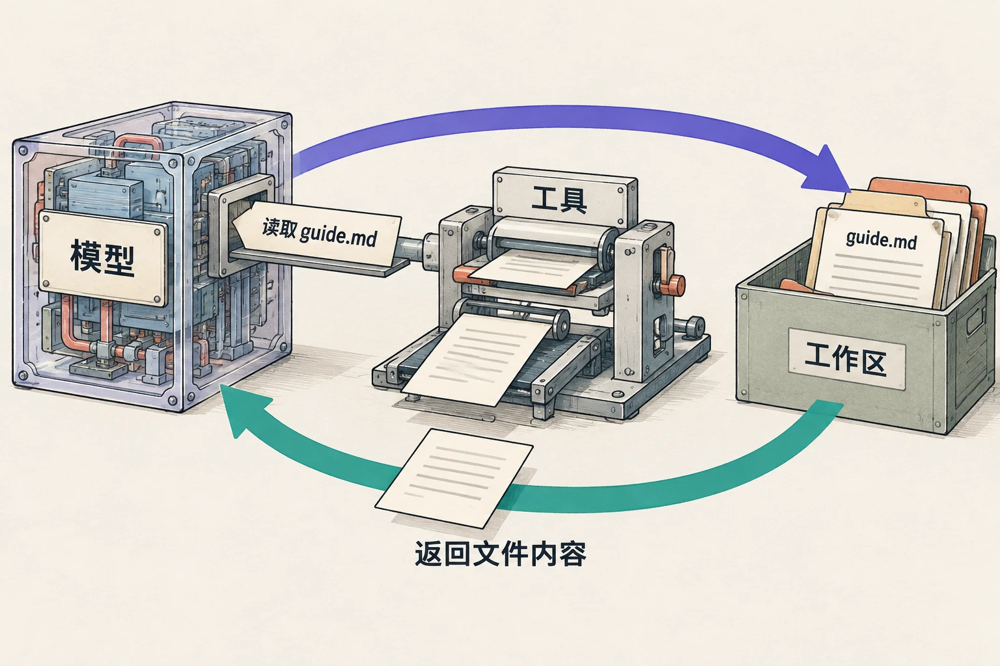

# 智能体的工作机制：拆解 DSH 的一次任务

> 状态：review
> 版本：0.3.1

前五章留下了一份有来源、有使用说明的导览。第五章还为它起草了一个任务示例。现在要把这个新段落整理进文件，并根据自己的阅读意见改一遍。**这次不重做导览，也不把已经纠正的错误重新塞回去。**

在聊天框中写出一段话，和修改工作区里的文件，中间隔着什么？本章沿一次小任务打开这层结构：模型提出下一步，工具执行，返回结果进入后续处理，人再给出反馈。你将看到，智能体不是把一条提示词一次性“变成完成”，而是根据每一步的结果继续工作。

本章有两层活动：人人可以先完成机制演练；达到“从实际任务记录辨认读取、生成和执行”的目标，则要追踪自己的 DSH 任务，或使用第一章保留下来的真实记录。材料包没有伪装成实测的预填日志；当前课程也尚未完成这项 DSH 操作验证。

## 6.1 模型与工具之间，DSH 做了什么

设想你发出任务：“读取旧导览，在‘可以怎样用’后补一个例子，另存新稿。”模型需要组织文字，但读取文件和写入文件是软件操作。**工具**就是可被调用的具体操作能力；调用工具时，必须说清动作需要的对象，例如读哪个路径、写入什么内容。

图把软件画成了取件装置：文件仍在工作区，返回的是文件内容。它是机制比喻，不是 DSH 界面。图中的两条大箭头概括往返方向：读取请求必须由中间的工具执行，返回内容也由工具提供，不表示绕过工具直接访问文件。真正连接两边的是软件提供的工具及其返回值，不是模型像人一样伸手翻文件夹。

DSH 的固定版[架构文档“轮次流程”](https://github.com/deepseek-ai/deepseek-harness/blob/f3803c96974ad4a94195fb97e5c637e9c2a3afe3/docs/architecture.zh.md#turn-flow)将一个步骤说明为一次模型请求及其工具调用；一个轮次可以包含多个步骤。对本章任务，可以把职责理解成四件事：

| 组成 | 在本次任务里做什么 |
| --- | --- |
| 模型 | 根据目标和已有内容，生成修订文字或提出工具请求 |
| 工具 | 按路径读取文件，或把指定内容写入文件，返回结果 |
| 会话记录 | 留下输入、输出与工具事件，供后续处理和回看 |
| 智能体循环 | 把上一步结果接入下一步，继续请求模型，直到结束或停止 |

这里的**循环**就是“做一步—看结果—再决定下一步”。DSH 不只是一个聊天窗口；它把这些部分组织起来。官方架构还说明这些部分可由插件提供，插件就是可加入或替换的功能组件。本章不需要安装插件或读源码，先理解为什么同一模型接上不同工具，能完成的任务就会不同。

## 6.2 一次正常循环：读到什么，下一步就多知道什么

先用一个很短的教学示例看清过程。假定原稿的“可以怎样用”只有一句：“可以围绕两份材料整理项目导览。”我们希望增加具体例子，其他已经核对的内容不变。

**第一步，取得原稿。** 模型提出读取 `materials/guide-before.md`。工具返回正文后，后续生成才有这份原稿的具体内容。仅知道文件名，不能知道段落写了什么；工作区中还有其他文件，也不意味着它们全部被读入。

**第二步，生成并写入。** 根据原稿与要求，模型形成候选段落，例如：“可以先让 DSH 读取原稿和两份材料，补上一段通俗解释，再把新稿另存；读者打开文件，比较新增段落。”随后，写入工具收到新路径和内容，尝试创建 `work/guide-candidate.md`。

**第三步，查看反馈。** 工具返回创建结果。系统可以继续读取新稿，比较保存内容；人也打开它查看。这里返回的不是一句装饰性消息，而是下一步判断的输入：成功时可以读回检查；文件已存在时需要停下，不能覆盖；读不到文件时要先定位问题。

读这幅图时，沿回线看一圈：下一次模型请求比上一次多了什么？读文件之后多了原稿，写文件之后多了操作结果，人的反馈之后多了修改要求。这也是第五章“当前材料影响生成”的延伸，只是材料现在由工具和协作过程不断补入。

这段示例说明工作方式，不规定真实任务必须分成恰好三个步骤。一次请求可能提出多个工具调用，具体界面也可能合并显示。可见记录不是模型全部内部思维；我们研究的是它实际请求了什么、返回了什么，以及产物怎样改变。

## 6.3 只改一个返回结果，下一步为什么不同

现在把第一步的路径换成 `materials/guide-before.txt`，工具返回“未找到文件”。先别看下面的解释，你认为下一步最应该做什么？

A. 按记忆补一份导览，继续写。
B. 对照任务卡中的路径，确认 `.md` 与 `.txt` 的差异，再读取指定文件。
C. 扫描整个个人文档目录，找任何叫 guide 的文件。

本例应选 B。错误发生在取得输入材料这一环，不是模型“不会写导览”。任务卡指定 `.md`，实际请求却是 `.txt`，所以先修正这个具体差异；没有必要扩大访问范围。正确路径也失败时，再检查文件是否放在选中的工作区，并向人说明缺哪份输入。

**同一个目标，遇到不同反馈，会走向不同下一步。** 这正是循环的意义。若总按预定脚本向下写，无论工具返回什么都宣布完成，就没有真正利用反馈。

再想一种情况：写入时连接断开，结果不明。此时既不能确定失败，也不能确定成功。先检查目标文件是否已经出现，再决定要不要重试，可以避免重复创建或覆盖。本章只需记住这一个区别：明确失败可以针对原因处理，结果不明要先查状态。

## 6.4 追踪自己的 DSH 任务

下载[第六章材料包](../../practice/ch06/README.md)，把 `ch06` 放进观察站。用自己已经核验过的导览**副本**替换 `materials/guide-before.md`；没有自己的作品时，包内提供延续前章正确内容的参考导览。两份来源卡仍沿用第一章的 A/B 编号。

### 先把任务放在合适的位置

已有可用 DSH 时，按[固定版 Web UI 指南](https://github.com/deepseek-ai/deepseek-harness/blob/f3803c96974ad4a94195fb97e5c637e9c2a3afe3/docs/user/guide/index.zh.md)中的工作区选择方式，把 **ch06 文件夹本身**选为工作区。这样 `materials/` 和 `work/` 都从这一层开始。安装、模型接入与额度准备沿用第一章，不在本章重新安装。

本任务只读三份输入、创建一个新稿，之后按你的反馈修改本次新稿；不覆盖原稿、不联网、不发布。确认 `work/guide-candidate.md` 尚不存在，已有时换一个新名称并同步修改提示词。使用无隐私的练习副本，不授权整个个人目录。

DSH 的[安全说明](https://github.com/deepseek-ai/deepseek-harness/blob/f3803c96974ad4a94195fb97e5c637e9c2a3afe3/SAFETY.zh.md)提示它仍是实验性开发者预览，审批不能保证隔离；教学方应先核实环境和权限。出现审批时，核对动作与路径，拒绝与本次任务无关的安装、删除或发布。是否出现弹窗取决于策略，不是每一步固定都会弹窗。接入条件不具备时，先做下一节演练，不要求自行付费或放宽权限。

### 发出任务，跟住三处变化

发送包内 `prompt.txt`。已有第五章选好的候选段落时，把它附在提示词末尾；没有时，让 DSH 根据材料起草。第五章任务卡的 A/B 编号属于那次对照，不要直接当成本章来源编号；附入段落的事实应按本章两份来源卡重新核对。不把作者的机制练习当作输入。它要求读取原稿及 A/B 两份材料，保留原来的说明，在“可以怎样用”后新增“一个可以尝试的任务”，并另存候选。

在过程中只抓三处关键位置，不必抄整段会话：

1. **读到原稿之后：**记录一次实际读取请求与返回。返回里哪句话来自你的旧稿？如果界面不显示，写明未显示，继续看能看到的部分。
2. **保存新稿之后：**打开 `work/guide-candidate.md`。圈出新增段落，检查旧内容与来源是否保留。新段落应是可尝试的任务说明，而不是编造你已完成过的经历。
3. **你给反馈之后：**指出一个真实的阅读问题。例如“这个例子只写了‘处理材料’，请具体说出读取、整理、保存分别做什么”。让它只改新稿中的对应段落，再打开文件比较变化。

如果新段落已经很清楚，可以提出一个新的合理要求，例如把例子压缩成三句，每句对应一个动作。先保存修改前的段落，再发出反馈，方便比较。结果没有改善，也照实说明哪里还不合适。

记录保存在 `work/task-record.md`：日期、工具/模型、三处关键事件、修改前后段落和一句解释——**哪一个返回或反馈，让下一步改变了？** 失败也能提供实际任务证据；但未取得输入或未形成文件时，产物环节仍是待完成，不填成成功。

## 6.5 没有接入，也能先把循环走一遍

用材料包里的 `examples/mechanism-cards.md` 做一次分角色练习。一人或自己依次扮演“提出下一步”“执行文件动作”“提供反馈”三个角色：先写下读取请求，再按路径打开原稿；返回什么，就把什么写到记录旁；得到正文以后才起草新段落，并手工另存。

进行到读取环节时，先拿到“文件未找到”卡，选择下一步；核对正确路径后，再拿到“已返回原稿”卡。观察两种结果怎样改变后续动作。整个演练只用公开练习文件，手工保存的副本不能记作 DSH 写入。

这个活动完成的是**机制演练**。若要达到本章实际任务目标，之后仍需补做 6.4，或回看第一章真实记录中的一次读取、写入与修订；不必为了填表编造工具事件。这里只保留一个清楚的待补项，不需要写一页免责声明。

### 合上材料，向同伴解释

1. 读取工具返回原稿后，下一次模型请求多了什么？
2. 如果没有写入工具，模型能否只靠一段回答把你的文件改掉？
3. 原稿读取失败，为什么不应直接把整个任务叫作“模型生成失败”？
4. 你的哪一句反馈，让新稿发生了什么具体改变？

**参考反馈：**第一题是原稿的具体内容进入后续上下文。第二题，写文件仍需要相应软件操作，也可以由人手工保存。第三题，失败发生在材料取得这一环，应先核对路径与工作区。第四题要给出修改前后的一处差异；没有实际运行就用机制演练解释，并保留实跑待补。

到这里，三章各打开了一层：第四章解释**参数怎样从样本中选出来**，第五章解释**当前材料怎样影响生成**，第六章解释**工具反馈怎样改变下一步行动**。它们共同帮助你设计更清楚的任务、看懂结果，并改进同一件作品。理解 AI 的目的，不是只会列出“不能保证什么”，而是更有把握地决定接下来怎样做。
