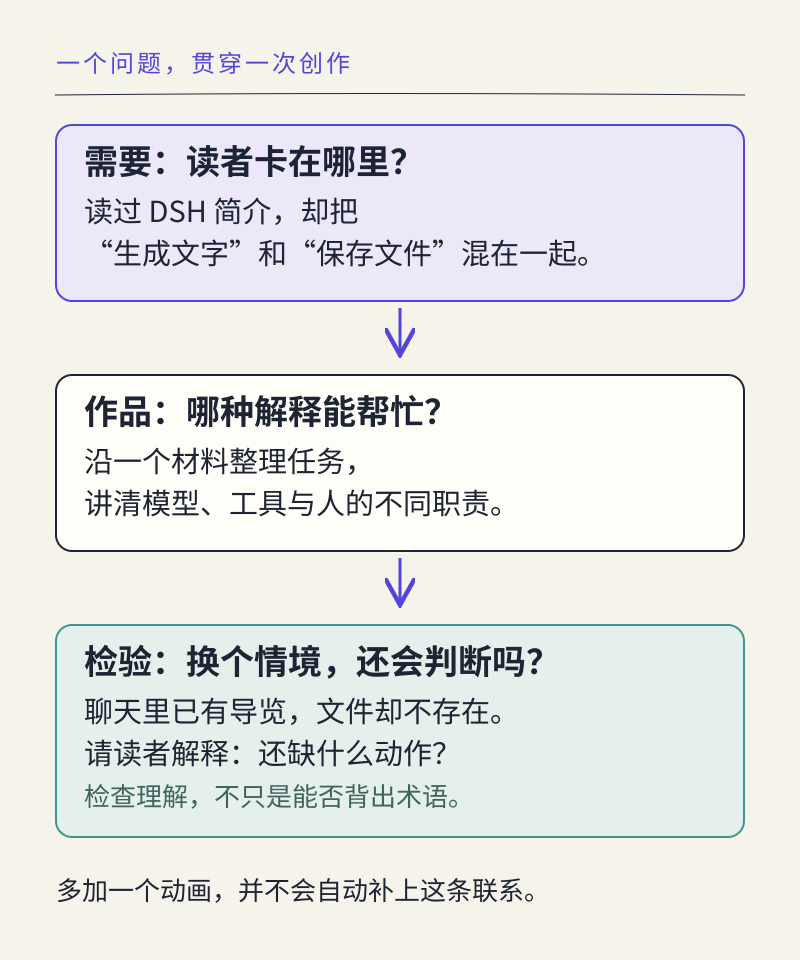

# 创作选题与方案设计：从观察到设计

> 状态：review
> 版本：0.4.0

一位同学打开 AIInfra，希望弄清大模型训练和推理为什么需要不同的基础设施。项目提供了丰富的目录、文字与课件，他却还要作出一个选择：现在应该先读什么，读到什么程度才足以回答自己的问题？另一位同学想为读书小组制作一份导览。她可以让 AI 很快写出一篇介绍，但如果没有先想清读者的起点，介绍越完整，读者反而可能越难开始。

这是本章的教学情境。AIInfra 是真实项目；这两位读者及其困惑是用来分析设计的设定，不是对项目开展用户调研后的结论。一份有用的作品，可以从这样的小问题出发：帮助特定读者选择阅读入口，说明理由，并保留继续查证的路径。

第三部分把前面的认识与机制知识用于更自主的创作。第七章研究为什么做、做什么，第八章研究怎样构建，第九章研究怎样评价与改进。三章分别提供完整材料，你可以每章尝试新的作品，也可以自愿延续一个值得深入的问题。

## 学习目标与阅读准备

学完本章，你应能够：

- 区分读者需要、设计假设与解决方案，用具体任务解释创作价值。
- 限定创作对象与范围，比较方案并说明取舍。
- 根据问题选择材料、分析方法和表达形式。
- 借助 AI 形成可检查的创作方案，独立解释关键决定及条件变化。

本章会用到前六章的项目材料、来源判断与 AI 使用概念，不要求你交出前章作品。正文提供全部起步材料，[第七章材料包](../../practice/ch07/README.md)提供可复制的材料卡、提示和方案支架。实际 AI 辅助需要可用工具；尚无工具时，可以先完成方案分析，随后补充真实合作过程。

**阅读起点。**先分清四个词，再跟随一份方案从问题逐步成形：

| 词语 | 本章中的含义 |
| --- | --- |
| 读者需要 | 某类人在具体情境中想完成的事，例如找到适合自己问题的阅读入口 |
| 创作方案 | 对准备做什么、使用哪些材料、怎样完成和检查的说明 |
| 范围 | 这次作品覆盖的对象、问题和深度，决定工作做到哪里 |
| 完成标准 | 能据此检查作品是否达到目的的条件，例如读者能指出所选入口及理由 |

先读 7.1—7.2，形成一个值得做且做得完的问题；再读 7.3—7.4，把材料、方法和人机分工连起来；最后在 7.5 用独立材料完成方案。此时不必制作成品，设计本身就是本章要练习的能力。

## 7.1 从专业兴趣与读者需要确定选题

### 7.1.1 兴趣提供方向，问题确定行动

**选题**是把一个宽泛的兴趣，转成这次创作准备回答的问题。“我对开源模型感兴趣”提供了方向，却没有说明作品帮助谁、要回答什么。把它改成“帮助本专业读书小组辨认两个模型项目的任务和阅读入口”，材料与表达就开始有了选择依据。

兴趣很重要：它使你愿意继续查材料、理解陌生概念和修正第一次判断。但兴趣还要与一个具体用途相连。教育专业的学生可能关心怎样解释模型生成，新闻专业的学生可能关心如何核对项目宣传，计算机专业的学生可能关心从哪个技术主题进入一套课程。围绕同一个开源项目，不同专业可以形成不同作品。

本书所说的**作品**，是能够被他人阅读、使用或接续的成果。它可以是一份导览、一张解释图、一篇分析报告或一个交互展示。采用**产品视角**，意味着追问成果怎样帮助人完成任务；它不要求商业化，也不要求把所有作品做成软件。

开源材料为选题提供了可观察的起点。README 说明项目目的，目录呈现知识组织，公开讨论显露具体问题，版本记录展示变化。AI 可以帮助提出问题和整理线索，学习者则要判断哪些问题有材料支撑，哪些值得为自己的读者继续研究。

### 7.1.2 用四个问题理解使用情境

Neo Lee 的课件把理解使用者放在产品规划的前面[1]。在本课程中，可以用四个相互联系的问题形成初步判断：读者是谁，他要完成什么，没有你的作品时怎样做，你的作品准备带来什么改变。

这四问不只是填写模板。若读者是第一次接触基础设施的同学，他可能需要少量术语和清楚入口；若读者是已经有训练经验的开发者，他可能需要实现差异与运行条件。读者不同，相同材料的组织方式也会改变。

本章情境中的读者会打开网页，已知道“训练改变模型参数、推理使用模型”，但尚不熟悉基础设施目录。他想选择一个可以继续阅读的主题。现有办法是直接看项目 README，或向 AI 提问。作品准备提供的帮助，是把两个入口的用途与读者的问题联系起来，让他带着明确问题回到原材料。

“增加一个推荐按钮”属于解决办法，“知道哪个入口更适合当前问题”才是需要。若先锁定按钮，容易把设计变成证明按钮有用；先理解需要，则可能发现一张清楚的比较卡已经足够。GOV.UK 的用户需求指南也强调，需求描述应指向用户要完成的事情，来自设计者的看法应继续作为假设检验[3]。

**例 7-1　从功能愿望回到读者任务。**某同学提出：“我要做一个 AI 基础设施排行榜，越热门的资源越靠前。”怎样判断这个选题是否适合本章情境？

**分析：**先问排行榜帮助读者作什么决定。热度不直接说明内容是否适合初学者，也不说明它能回答训练或推理的哪类问题。若当前读者需要选择阅读入口，可以先比较两个专题的对象、预备知识和用途。只有当排序与任务有明确关系、数据口径适合时，排行榜才成为可讨论的方案。

**结论：**把选题改成“为初学者设计训练与推理的阅读选择卡”，更容易建立材料、用途和检查标准之间的联系。它是针对这一情境的取舍，不是对排行榜形式的一般否定。

### 7.1.3 从观察形成假设，再寻找支持

**观察**记录实际看见或发生的事情；**假设**是对原因、需要或可能效果的解释，尚待验证。例如，“README 列出了多个专题”可以由文件核对；“初学者一定会因此迷路”则需要读者使用方面的证据。不能把后一句写成前一句的必然结果。

你可以先实际走一遍现有阅读路径，记下一个术语、一处来回跳转或一个无法回答的问题。这是自己的体验。也可以请愿意参与的同学尝试完成一个具体任务，听他解释选择。提问时保持开放，例如“你现在最想弄清什么”，而不是“你是不是需要一个自动推荐功能”。一次观察提供线索，尚不足以代表所有读者。

AI 可以列出可能的困难、提出不同读者视角，帮助你发现遗漏。它模拟的角色仍是设计材料，不是已经访谈到的人。方案可以诚实地写：“我假设新读者需要比较阅读入口，准备通过一次任务走查检查。”一个说清依据与验证办法的假设，比编造“多数用户需要”更有用。

当真实反馈与原先想法不同，选题可以变化。若读者已经能选入口，却看不懂“基础设施”，作品就可能转向解释图；若原材料已经清楚，补一条定位准确的说明也可能足够。创作价值来自解决具体问题，不由作品体量决定。

## 7.2 创作对象、核心问题与作品范围

### 7.2.1 让对象、问题与成果互相对应

**创作对象**是作品研究或表达的事物；**核心问题**是作品要回答的主要疑问；**成果形式**是把回答呈现出来的方式。三者相关，但不能互相替代。

本章可把 AIInfra 的训练与推理阅读入口作为对象，把“不同问题从哪里继续读”作为核心问题，把“一页阅读选择卡”作为成果形式。对象是两个入口，不是整个 AI 行业；问题是阅读选择，不是判定哪个技术更先进；形式可以调整，核心用途仍应成立。

下面的材料足以支持本章分析。它们是对真实项目的课程归纳，不是原文长篇摘录；固定版本供回查，目录存在不表示其中每一项已经实测或适合所有初学者[2]。

**材料 A：AIInfra 的项目与目录。**

- **A1** AIInfra 是围绕 AI 基础设施组织的开源课程项目，README 介绍其大模型系统相关主题，并说明文字内容仍在持续补充。
- **A2** README 的课程大纲包含大模型系统概述、计算集群、通信与存储、集群容器与云原生、分布式训练、分布式推理、大模型算法与数据、大模型应用。
- **A3** 概述目录列出 `00Summary/04TrainingStack.md`，题为“大模型训练与 AI Infra 的关系分析”；列出 `00Summary/05InferStack.md`，题为“大模型推理与 AI Infra 的关系分析”。
- **A4** 以上材料支持说明项目主题和两个阅读入口；它们没有给出本班学生的阅读难度、完成时间或学习效果，也不能单凭目录证明读者已具备运行实验的条件。

文件名中的目录表示文件在项目中的位置，`.md` 表示 Markdown 文本。读者可以先使用材料卡分析，无需克隆仓库。你在第五、六章可能见过这个项目；本章重新给出所需信息，不依赖之前的记录。

### 7.2.2 用范围控制复杂度

**范围**至少包含对象数量、问题深度与使用情境。只研究两个入口，可以认真说明它们为何不同；一开始覆盖所有基础设施主题，则需要更多专业知识和依据。范围缩小应保留一个完整用途，使读者能够完成一次有意义的判断。

例如，本章第一版只帮助读者选择训练或推理概述，提供选择理由、来源位置与一个继续阅读的问题。它不承诺帮助读者完成分布式训练部署，也不复制所有教程。这样的限制有教学理由：当前材料能够支持阅读定位，尚不能支持具体环境的运行保证。

**约束**是创作必须考虑的条件，如材料可获得性、读者基础、时间、设备和复用条件。约束不只是障碍，也帮助确定合适形式。若作品需要课堂打印，一页文字与比较表可能合适；若读者需要反复筛选大量对象，交互展示才可能值得增加。


图 AG-07-01 中的取景，不是把想法随意砍掉，而是保留这一次需要看清的内容。范围可以在获得新材料后扩大；每次扩大，都应重新检查读者需要、材料和完成条件。

### 7.2.3 比较方案，说明取舍

同一个需要通常有不止一种办法。让 AI 提出两个不同方案时，要求它解释使用路径、所需材料和可能不足，而不是只换两个标题。人再按任务比较，才能看出差异来自哪里。

Neo Lee 将产品能力区分为核心、基本与关注能力[1]。用于本章作品时，**核心能力**是让读者根据问题选择入口；**基本能力**是名称清楚、出处可查、文档可读；**关注能力**可以是额外的视觉装饰或个性化推荐。三类描述作用，不是普遍固定的优先级：若读者依赖文字阅读图件，完整文字解释就属于基本能力。

| 方案 | 读者怎样使用 | 现有材料是否足够 | 本轮取舍 |
| --- | --- | --- | --- |
| 阅读选择卡 | 比较两个问题，选择对应入口，再回源阅读 | A1—A4 可支持定位；术语解释可依据前章知识补入 | 作为第一版，保留来源和选择理由 |
| 自动学习路线推荐器 | 输入基础与目标，系统生成个性化路线 | 还需学习基础的表示、更多课程关系和推荐效果检查 | 暂不实现，可保留为后续假设 |

**例 7-2　“功能更多”是否意味着方案更好？**假设 AI 建议把推荐器作为第一版，因为它包含测验、推荐和自动评分。你会怎样回应？

**分析：**先承认这些功能可能服务某些需要，再回到当前问题。现有输入只含项目定位与两项目录，尚不能支持可靠的个性化路线，更不能据此评价学习效果。阅读选择卡能让读者看见选择理由，并且可以用相同材料直接检查。

**结论：**本轮先做选择卡，记录推荐器所需的新材料与验证问题。拒绝一项建议不是停止创造，而是让创作承诺与当前条件相称。

## 7.3 材料选择、分析方法与表达形式

### 7.3.1 先知道要证明什么，再搜集材料

**材料**是用于理解和创作的信息；当它能够支持某项判断时，才在那个判断中发挥**证据**作用。一份项目 README 能支持项目自述的用途，却未必能支持“学生最容易学会”的结论。来源可靠与用途匹配需要同时考虑。

选材可以从三个问题开始：我准备说什么，这句话需要哪类材料，现有材料是否足够。若要介绍阅读入口，目录与文件说明有用；若要比较运行表现，就需要相同任务和条件下的实际结果；若要解释读者困难，就需要阅读过程或反馈。不要先收集几十个链接，再让 AI 把它们拼成一个看似完整的故事。

本章使用固定版本，是为了让同伴能够回到相同位置检查。**版本**表示材料在某个时间点的状态；它支持复查，不代表最新版。作品引用当前项目时，应重新核对状态；只使用给定快照时，则写清依据的范围。

开放创作还要考虑材料怎样复用。记录作者、项目、文件与版本；引用原句、重用图像或改写内容时，依相应材料的条件处理。第三章已经建立复用意识，本章把它放进方案：准备原创解释什么，需要保留哪些署名，哪些资料只提供链接。公开可见本身不能替代对复用条件的核对。

### 7.3.2 选择能回答问题的分析方法

**分析方法**是把材料转化为判断的具体办法。通识创作可以从分类、比较和关系解释入手，不必一开始使用复杂统计。

**分类**按明确条件把对象分组。例如按“希望理解训练”与“希望理解推理”组织入口。**比较**让对象回答相同的问题，例如各入口讨论什么、与读者的问题有何联系、从哪里回查。**关系解释**说明事物怎样联系，例如前章的训练与推理概念怎样帮助理解基础设施目录。

比较之前，要确认对象具有可比性。两篇专题可以比较阅读用途，却不宜仅凭篇幅判断技术优劣。材料没有提供的信息应记为尚未核对；把缺失信息填成“没有此能力”，会改变判断的含义。

**例 7-3　从材料到一句有根据的建议。**依据 A3，可以写“想理解训练与基础设施的联系，可从训练概述入口继续读”。能否进一步写成“训练概述只需十分钟，人人都能学会”？

**分析：**前一句根据标题与读者问题建立阅读联系，是有说明的选读建议；后一句增加了时间和学习效果承诺，需要另行观察或测量。标题不能证明这些内容。

**改写：**“如果你想了解训练与基础设施的联系，可以先选训练概述；遇到陌生术语时回到本课第四章复习。本文尚未测量阅读时间。”最后一句可放在使用说明中，不必在每个段落重复。

### 7.3.3 让表达形式服务于理解

选择形式时，先考虑读者需要看见什么关系。一段短文适合解释原因，一张表适合并列比较，一幅图适合表现结构或过程，交互页面适合让读者按条件探索。形式的选择应能说明：它减少了哪一种阅读困难。

本章的两入口选择卡可以采用简短引导与两行比较表。若把两个入口画成大小悬殊的圆，读者可能误以为大小表示优劣；若没有相应数据，这种视觉暗示反而增加误解。第八章将进一步讨论图文表达，这里先把想表达的关系说清楚。

AI 可以提出多个布局，也可以把同一材料改写成不同形式。比较时看信息是否保留、关键区别是否突出、来源是否容易对应。优美的语言与热闹的页面不能自动补足缺少的材料。

对于开源企业、模型或开发者画像，同样可以使用这套方法，但需要重新确定对象与维度。企业画像可能关心项目参与和公开活动，模型画像可能关心任务与发布材料；不能只换名字、继续沿用训练与推理的两列。具体案例可以逐步发展，先学会在新条件下调整方法。

## 7.4 人机分工、创作方案与完成标准

### 7.4.1 把人机合作安排在具体判断中

前两部分已经让 AI 参与阅读和表达。现在任务更开放，人的作用也从核对一段文字，扩展到确定目的、选择范围、组织材料和决定停止点。AI 可以协助探索方案、比较结构、起草说明和寻找遗漏；关键选择需要能够由你解释。

一种有效安排是：先给 AI 读者情境和材料，请它提出不同方案；自己选择方案并写明理由；再请 AI 检查方案中有没有超出材料的承诺。三步分别产生候选、决定和检查意见，不能用最后一句“整体很好”替代全部判断。

Chip Huyen 的配套摘要把“是否值得构建”放在应用制作之前[4]。本课程将这个视角用于更小的作品：如果一条现有官方链接已经满足需要，作品可能只需增加解释；如果确有理解缺口，再决定新增内容。AI 辅助的价值可以体现在更准确的取舍，而不只体现在生成更多文字。

没有可用 AI 时，先比较正文给定的两种方案，完成自己的设计。实际借助 AI 的目标仍需在工具可用后补做；不要把阅读参考答案记成一次模型调用。采用聊天工具、DSH 或其他 Agent 时，都记录真正发生的帮助与自己的决定。

### 7.4.2 用一份简明方案连接各项选择

**创作方案**不需要成为长篇项目申请书，但必须让别人理解“为什么这样做”。把读者与需要、核心问题与范围、材料与方法、成果结构、人机分工和检查办法串成一页短文，就能支持讨论。是否采用表格，由内容决定。

这些内容应互相推导。例如，读者要选择阅读入口，所以作品需要并列说明；材料只覆盖两个专题，所以不承诺完整学习路线；目标是能够解释选择，所以检查时要让读者说出理由，而不仅是找到链接。某项功能无法回到这些关系时，就应重新考虑它的必要性。



图 AG-07-02 用同一行对齐任务、作品安排和检查方式。它帮助发现一种常见断点：方案写着“让人理解”，成果却只有链接，检查又只统计点击。补上解释内容与理解问题后，三者才真正对应。

还要写清最需要验证的一项假设。本例可以是“读者已经理解训练与推理的基本区别”。若它不成立，第一版就需要在入口前加一句解释。把假设明确列出，使后来获得的反馈有地方落下，而不是推翻整份方案时才发现前提未说明。

### 7.4.3 从用途写出可检查的完成标准

完成标准描述作品应达到的状态，**检查方法**说明怎样确认这个状态。例如，“来源清楚”是方向；“每个阅读入口旁标出文件名和所据版本，检查者能够指出其对应来源”更容易执行。

本例可采用三项标准：读者能根据当前问题选择一个入口并说明理由；每个入口都有对应文件及来源；材料不能支持的运行条件或学习效果没有被写成保证。第一项关注用途，第二项关注依据，第三项关注判断范围。

“做一张表”和“写满一千字”只说明形式。它们有时是交付约束，却不足以说明作品有用。相反，一份短而完整的选择卡，也可能满足本轮目的。你需要解释哪些内容不可省略，哪些细节可以等进一步材料到位后再补。

检查标准也不应无限增加。先覆盖最影响读者选择的关键点；拓展为交互页面后，再加入筛选、无结果提示和返回等对应要求。第九章会具体讨论怎样依标准评价与复查。

## 7.5 综合实践：设计一件开源主题作品

### 7.5.1 任务与完成要求

使用本章材料 A 和以下情境，借助可用 AI 完成一份创作方案。也可以选择自己的开源项目，但应提供同等清楚的材料与范围，不能让更换对象变成跳过依据。

**给定情境：**为已知道训练与推理基本区别、尚不熟悉 AIInfra 的同学设计阅读入口。读者希望从一个具体问题出发，选择下一份资料，并知道为什么选择它。第一版可以用文档或纸面卡片呈现，不要求运行上游实验。

先写自己对读者问题的理解，再让 AI 根据同一材料提出两种方案。比较它们需要的材料、完成成本和可检查性，选择一个，并保存一项采纳或拒绝 AI 建议的理由。随后补齐范围、来源、内容安排、人机分工和三项完成标准。最后指出一项仍需验证的读者假设。

可以使用下面的提示，将材料 A 与给定情境放在提示之后：

```text
请依据所附情境和材料 A，为这类读者提出两种不同的开源主题作品方案。
每种方案说明：帮助读者完成什么、如何使用、需要哪些材料、现有材料缺少什么。
不要把情境写成真实访谈，不推断未给出的阅读耗时、学习效果或运行能力。
请指出一个需要我作出取舍的问题，暂不制作成品。
```

核心成果为一份方案，草图、比较和个人说明可以放在同一文档里，无需另交一套长报告。没有 AI 时先用 7.2 的候选比较练习，记录为方案分析；实际合作完成后再补入真实工具与决定。也可请同伴指出方案中的一个含糊处，依据实际反馈修订。

### 7.5.2 参考方案与分析

下面是编写者示范，供检查结构与理由，不是学生实测成果。

> **作品：AIInfra 训练与推理阅读选择卡。**面向已理解两者基本区别的初学者，帮助其从自己的问题选择下一份概述。作品使用 A1—A4 及所列固定来源，采用“我想了解什么—为什么读这一篇—从哪里继续”的比较结构。
>
> 第一版只覆盖训练与推理两个入口，保留项目定位、来源文件和版本。核心是解释选择理由；清楚标题和可查出处是基本条件；自动推荐与装饰动画暂不加入。它相对于直接复制目录的帮助，是把读者问题和材料用途对应起来，实际帮助程度仍需检查。
>
> 我先确定读者与范围，请 AI 提出两种组织方式并检查遗漏；自己选择比较卡，核对每项建议与材料的关系。完成后，用同一个阅读任务检查能否选择入口并解释理由，逐项核对文件和版本，删去材料不支持的效果承诺。待验证假设是读者是否已经分清训练与推理；若不能，应增加一句前置解释。

这份方案没有安排每一个操作按钮，却已经能够指导制作。它解释了用途、范围和形式的关系，也让第九章的评价有标准可依。没有读者试用，就保留“待验证”；没有真实 AI 对话，就不能把上面的分工设想填进运行记录。

换成另一种作品也可能成立。例如，用简短解释图对照训练与推理，再附两项入口，仍能满足相同目的。你应说明图中的关系如何帮助选择，而不必照抄参考方案的外观。

### 7.5.3 自我评价与后续学习

完成后，把方案交给自己或同伴，只看方案回答：它帮助谁完成什么？为什么选择这种形式？材料能够支持哪项判断？最需要验证的假设是什么？哪条标准可以实际检查？如果这些问题必须由作者口头补充，方案还需要进一步说明。

本章重点看选择是否有理由，而不是方案是否宏大。能够指出不做什么及其原因，能够根据新条件修改设计，都是自主创作的表现。个人解释应指向实际选择，例如“暂不做推荐，因为现有资料不足以描述不同基础的路线”，而不是笼统写“我负责审核”。

第八章提供另一套完整方案和材料，用于学习构建。你可以直接使用，也可以继续实现这份选择卡；两条路径都能练习相同的方法。作品形式和对象可以变化，读者、材料、范围与检查之间的联系应当保留。

## 本章小结

创作选题把兴趣转化为具体读者的问题。方案把对象、范围、材料、方法、表达与人机分工连接起来；完成标准则让作品用途能够被检查。开放材料为创作提供基础，AI 帮助探索和表达，学习者通过解释取舍与检验假设形成自己的判断。

本章从一份小方案起步，练习的是可迁移的方法：遇到新项目、新读者或新条件时，重新确定需要，选择相称的材料与形式，再决定怎样验证它是否有用。

## 思考与练习

### 基础理解

1. “我想做一个开源项目聊天机器人”为什么还不是完整的需求描述？请补充使它成为可讨论选题的信息。
2. 区分观察与假设：“目录包含多个专题”“新读者不知道先看哪篇”“增加比较卡会帮助选择”。分别需要什么依据？
3. 本章选择卡的来源、主题动画和阅读理由，分别承担什么作用？这些分类是否对所有读者都固定不变？

### 材料分析

4. 根据 A1—A4，判断“AIInfra 所有课程都已完整发布，初学者可以按目录直接完成实验”是否成立，并给出相称改写。
5. AI 提出增加自动推荐、测验和评分。请依据本章情境，选择一项暂缓功能，说明缺少的材料以及未来怎样验证其必要性。

### 拓展与迁移

6. 把读者换成准备组织一次读书活动的教师。保留一个可用方法，修改一项范围或标准，并说明为什么。不要假设学生阅读时间已经测量。

## 练习参考反馈

1. 需要说明谁在何种情境中想完成什么，现有办法有哪些困难，以及作品准备带来何种改变。机器人是候选形式，不能自动证明需要存在。
2. 第一项可核对目录；第二项需要具体阅读观察或反馈；第三项是关于改进效果的假设，需要比较实际使用。一次个人体验不能直接代表全部新读者。
3. 来源支持核查，阅读理由体现核心用途，动画可能是额外体验。分类依赖任务与读者；对某些表达目的，动态图解可能成为关键内容，不能机械排序。
4. 不成立。A1 明确内容持续补充，A3 只确认入口，A4 没有运行与效果证据。可写“可从目录选择相关概述，具体内容和运行条件需继续核对”。
5. 合理答案应说明功能与需要的关系。例如个性化推荐需要学习基础、主题依赖与推荐结果检查；可先观察教师或同学的实际选择困难，再判断是否值得实现。
6. 教师可能更关注可用于讨论的问题、材料范围和准备条件。可以保留“任务—材料—标准”的对应，改为检查能否选出一份可讨论材料并说明前置知识。不是只把“学生”改成“教师”。

## 参考文献与延伸阅读

[1] Neo Lee．《建立智能时代的个人工具箱 / Skill Set in AI Era》．Autumn 2026，用户提供课件，第 24—27、47—53 页；本章重点参考需求理解、概念规划与能力取舍。原课件不随教材公开。

[2] ZOMI 及 AIInfra 贡献者．[AIInfra README](https://github.com/Infrasys-AI/AIInfra/blob/b97c0385ba07a62a717d82a0e7aed2927f12fc35/README.md)．固定版本 b97c038；课程背景、大纲与 00Summary 目录，访问日期：2026-10-31。

[3] GOV.UK Service Manual．[Learning about users and their needs](https://www.gov.uk/service-manual/user-research/start-by-learning-user-needs)．2016；本轮读取需求、假设与研究方法相关正文，访问日期：2026-10-31。

[4] Chip Huyen．[AI Engineering：第 1 章配套摘要](https://github.com/chiphuyen/aie-book/blob/f375e0065ef19e4f411b809a2f9a2d65582db287/chapter-summaries.md#chapter-1-introduction-to-building-ai-applications-with-foundation-models)．2025；固定版本 f375e00，访问日期：2026-10-31。这里使用配套摘要的选题视角，不视为原书全文阅读。
