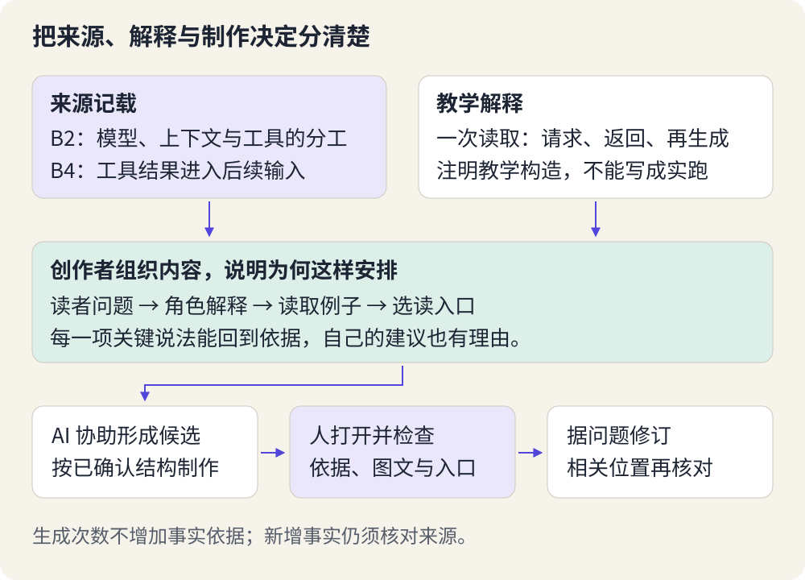

# 把想法变成作品：与 AI 一起工作

> 状态：review
> 版本：0.2.0

第七章留下了一份设计说明：为具体读者解决一个小问题。这一章，我们要把它变成别人可以打开、阅读或使用的东西。

最容易走的弯路，是把设计说明全部交给 AI，只说“做得专业一点”，然后等待一个看起来很完整的结果。它也许有漂亮标题和丰富功能，却没有讲清读者最想知道的那一件事。创作需要另一种节奏：先做出能看见的局部，检查它，再继续向前。

我们继续制作导览的配套角色地图。你也可以沿自己的选题制作指南、音频脚本或其他作品。**核心任务是用 DSH 形成实际候选，并解释自己的一次关键决定**；不要求手写代码。暂时没有接入时，可以先完成纸面原型，实际 AI 协作仍留待补做。

## 8.1 先让想法有一个可以修改的样子

**原型**是用来试探设计的初步版本。它不必完整，也不必漂亮，但应该让某个重要问题变得可观察。例如，一张角色地图最初只需四块纸片：读者的问题、一个任务、角色关系、一段新情境判断。把它们摆在一起，就能检查讲解顺序。

假如草图先摆了六个术语定义，最后才出现任务，读者可能还不知道为什么要记这些名词。把“一份材料怎样变成导览”放到最前面，再在动作发生时解释角色，抽象概念就有了落点。此时移动纸片只需片刻；等排版、配图都完成后再改结构，反而更费力。

原型并不等于“故意做差”。暂时省去的是精美排版，不能省掉核心关系。例如箭头方向错了，会使试读者形成错误理解；这类问题应先改。反过来，如果你想试的是标题顺序，先用方框代表插图就够了，不必先生成一整套图片。

### 本例怎样起步

先写一个读者问题：“我提供的两份材料，怎样变成一份能打开的导览？”接着用两三句话交代任务：读取材料，整理成导览，保存后由人检查。再把模型、工具、工作区的解释放在它们实际参与的地方。

最后留一个新情境，而不是再抄一遍定义：“文件已经保存，可以直接算作已经在 AtomGit 分享了吗？”这个问题能检验作品有没有把本地文件和公开分享区分开。此时不需要演示上传，相关实践留到第十章。

也可以先做两个很小的开头来比较：一个从“模型、工具、工作区分别是什么”开始，另一个从“两份材料要变成什么结果”开始。术语表便于已经知道问题的人快速查找，任务开头更适合本例尚未建立关系的初学者。选择后者的依据是读者起点，不是某种格式永远更好。你不必把两套完整作品都写完，比较开头就能作出第一项取舍。

## 8.2 把大任务拆成有结果的小步

**任务分解**是把一个目标拆成若干能够检查的动作。关键不是列得越细越好，而是每一步结束后，你都能看到东西，并决定是否继续。

“美化一下、丰富一点、继续优化”很难形成这样的检查点。对角色地图，可以分成三个有明确结果的小步：

| 小步 | 这一步拿到什么 | 你决定什么 |
| --- | --- | --- |
| 排讲解顺序 | 一份短提纲或纸面草图 | 先出现的问题是否贴近读者，概念是否在需要时解释 |
| 写一个完整例子 | 从输入材料到保存候选的讲解 | 每个动作是谁做的，结果出现在哪里 |
| 形成可阅读候选 | 能独立打开的文件，含来源和一道判断题 | 是否覆盖第七章标准，哪些多余内容应删除 |

这三个步骤用于本例，不是所有创作必须遵循的流水线。写到第二步才发现第一步缺了“工作区”的解释，就回去补上。**迭代**正是依据已经看见的结果，修改作品或下一步计划。

任务分得太碎也会失去整体。“让 AI 分别写五十句话”可能使每句话都通顺，却不再围绕同一个读者问题。每走完一小步，都要回看整件作品：它现在能否帮助读者完成原来的任务？

## 8.3 给 AI 足够的材料，也给它清楚的边界

第五章说明上下文怎样影响生成，第六章说明工具怎样把材料和反馈带入过程。现在把它们用于创作。一次有效委托至少要说明：**给谁做、解决什么、依据什么、这一轮产出什么**。

对本例，“请写一张专业的 AI 角色地图”缺少读者起点和关系依据。更有用的委托是：“为读过 DSH 简介的初学者，沿两份材料整理成导览的例子解释角色。先给讲解顺序，不展开安装；依据指定材料，遇到材料没有支持的功能就指出缺口。”

材料也要经过选择。旧导览告诉 AI 已经讲过什么，设计说明告诉它这一版要帮助谁，机制短卡帮助它把职责讲准确。把整个硬盘或许多不相关网页放进去，并不会自动让结果更合适。输入过多还可能使重点淹没在细节里。

对关系图尤其要小心：**DSH 是组织模型请求、工具执行与反馈的框架；模型和工具是其中参与任务的部分。工作区是文件位置，不是另一个会思考的角色。**不能把它们都画成同一条传送带上的独立工人。下面这张图用于检查讲解的结构，不是要求你临摹的唯一版式。

图中的模型负责生成候选内容或工具请求，工具执行具体读写，返回结果进入后续处理。人决定目标，查看产物，并决定是否分享。AtomGit 的仓库与协作能力属于分享和共同改进的阶段；本例没有预设 DSH 与 AtomGit 已经自动连接。

一页作品容不下整个架构，简化是必要的。但简化应该省去暂时不需要的细节，不能改变谁负责什么。例如可以省略插件内部名称，却不能把“模型提出写入请求”改写成“模型已直接修改文件”。

## 8.4 用 DSH 制作你的第一版

下载[第八章材料包](../../practice/ch08/README.md)，把 `ch08` 放进观察站。将第七章设计说明的副本放到 `materials/design.md`，替换其中的准备提示；将已有导览的副本放到 `materials/project-guide.md`。没有自己的导览时，可使用包内标明身份的参考稿。`materials/role-notes.md` 提供本例所需的机制短卡和原始来源。

已有可用 DSH 时，把 **ch08 文件夹本身**选为工作区，模型接入沿用前章。先确认设计已填写、输入能打开、`work/artifact-v1.md` 尚不存在。若重做，另取新名称，并同步修改提示词。这里的 `.md` 是前面已经使用的 Markdown 文本文件，用纯文本编辑器也能阅读，不是要求你编写程序。

本次只授权读取这三份练习输入、创建本次新稿，不联网、安装或公开发布。出现与范围不符的动作就停下来检查；具体审批方式沿用第六章的权限说明。自己的其他选题需要先把对应公开材料放进这个练习文件夹，并调整提示词中的内容要求，不能只改标题。

### 先讨论结构，再保存候选

发送材料包的 `plan-prompt.txt`。它要求 DSH 先读取三份输入，只在会话中提出讲解顺序和一个需要你决定的取舍，暂不写作品。检查提纲：读者的问题是不是在前面？术语是否有解释？有没有偷偷扩大范围？

然后用自己的话回复一个决定。例如：“先交代两份材料与目标文件，去掉插件分类；读者需要沿一个完整任务分清生成和保存。”这是作者示例，不是你必须复述的答案。你的决定应针对实际提纲。

确认后，在同一会话发送 `create-prompt.txt`，请它据此创建 `work/artifact-v1.md`。若换了会话，把确认过的提纲和决定一并附上；新会话不能被假定已经知道先前讨论。创建后从文件夹实际打开文件，先顺着阅读一遍，再检查来源链接与关键关系。会话里说“完成”并不代替这个打开动作。

这一版至少应有可理解的任务例子、必要角色解释、一道新情境判断与简短来源说明。字数不做统一要求：长到读者找不到重点，就删；短到关系断裂，就补。音频或网页等形式可以在清楚的内容基础上扩展，但只交空白布局还不是可阅读作品。

### 让一次反馈真正改变作品

打开候选后，不要只说“再优化”。指出位置、困难和期待变化。例如：“第二段连续出现三个术语，我还不知道它们各做什么。请先用‘读取材料—形成文字—保存文件’的任务讲解，再在相应位置解释术语。不要添加新功能。”

保留第一版，再请 DSH 把修订稿另存为 `work/artifact-v2.md`。若这个名字已经存在，先换新名称。打开两版比较：问题是否被解决？有没有把准确关系改错？若第一版已经合适，可以保留它，说明自己为何拒绝一项增加复杂度的建议，不必为证明“迭代过”而制造错误。

真正的分工在这里变得清楚：AI 可以提出内容、组织方案和修改候选；你要判断是否解决了目标读者的问题。审美、准确性与取舍仍需要有人承担责任。

## 8.5 一次决定，怎样留下创作的理由

**取舍**是在不能同时满足所有想法时，说明优先保留什么、暂缓什么。它不必发生在复杂技术之间。选择保留一个具体例子而删去四段术语说明，就是很有价值的取舍。

作者示例：假如候选把模型、工具、工作区和 AtomGit 排成四个并列方框，读者容易把文件位置和处理动作混为一谈。我们会保留“沿一个任务解释”的思路，拒绝“四个独立工人接力”的表达，改成 DSH 内部的模型与工具、外部的文件位置，以及由人决定的分享阶段。理由是关系要讲对，不是因为某种图形看起来更先进。这个例子说明判断方法，不声称某次 DSH 真生成过这样的草稿。

在 `work/decision.md` 留下实际使用的工具/模型、选定的作品文件名，以及一条关键决定：原建议是什么、你如何处理、为什么。可以引用作品中的两句话，不必复制整段会话。若沿用了作者参考稿，保留来源身份；AI 的参与也用一句话说明。

没有 DSH 接入时，先手工完成原型和材料准备，记为“原型准备”。教学方可在具备接入和额度的环境中安排后续实际协作；不要求自学者为了赶进度自行付费，也不把手工原型写成工具已执行的成果。

### 用自己的作品回答

1. 原型还很简陋时，为什么仍然值得检查？
2. “把作品做得更好”与一条具体反馈，差别在哪里？
3. 你的作品为什么选择当前形式？哪一项看似吸引人的功能被你暂缓了？
4. 如果 AI 的修订更流畅，却把工具执行说成模型直接读写，你会怎样处理？

**参考反馈：**原型能较早暴露结构问题；具体反馈指明哪里影响了读者完成任务，并说明期待的变化。第三题需依据自己的设计回答，不存在统一最佳形式。第四题应保留有用表达、纠正职责关系，不能用语言流畅替代概念准确。

本章结束时，你手中应该有一份实际候选和一条自己的决定。它已经可以拿出来检查，却还不意味着每句话都准确、每个人都读得懂。下一章，我们让问题在交付之前显现出来，并用修订回答它们。
