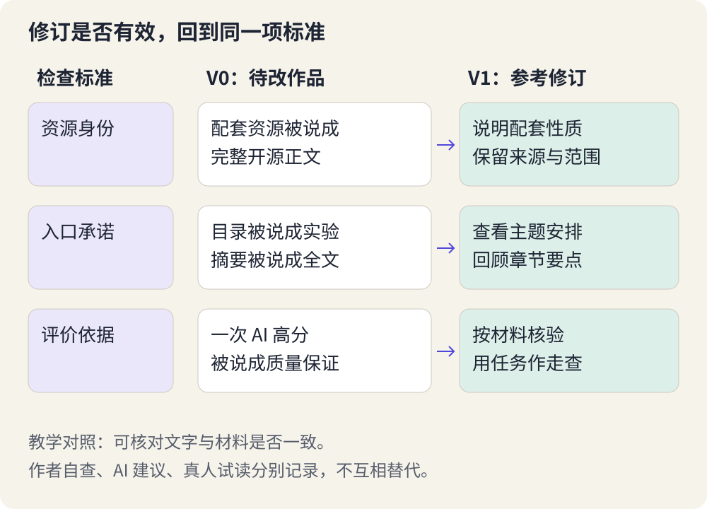

# 让作品经得起检验：准确、好用、可理解

> 状态：review
> 版本：0.2.0

第八章的候选已经能打开了。接下来，先别急着问“还能加什么”，而要问：“它现在真能帮助设计中的那位读者吗？”

一件作品可以措辞流畅，却把事实说错；也可以事实都对，却让人找不到从哪里开始；还可能每段都能看懂，但读者遇到新情况仍然不会判断。它们是不同的问题，不能只靠“再检查一遍”一起解决。

本章将沿角色地图做三种检验：关键内容有没有依据，作品是否能顺利使用，读者能否用它理解新情境。你会从自己的候选中找出一个实际问题，做一次有针对性的修订，并比较修改前后。自学者可以先独立完成核验与阅读检查，不必等待同伴，也不编造反馈。

## 9.1 把“不错”变成三个具体问题

**检验**是带着一个明确的问题，采取相应动作，查看结果是否符合预先约定的标准。第七章的设计说明现在派上用场了：它帮助我们决定应该检查什么，而不是打开文件后漫无目的地挑毛病。

| 检验角度 | 对角色地图要问什么 | 一次合适的动作 |
| --- | --- | --- |
| 准确 | 模型、工具与工作区的职责讲对了吗？ | 挑一句关键判断，与对应来源逐句比较 |
| 好用 | 离开作者的解释，作品还能打开并找到重点吗？ | 在实际阅读设备上，从入口走到例子和判断题 |
| 可理解 | 看过之后，能解释稍有不同的情况吗？ | 用“有回答、无文件”的情境，要求说明缺少的动作和理由 |

如果你做的是小工具，第二项就要实际操作一个正常输入，再尝试一个合理的异常输入；做的是音频说明，则要听得清关键关系，并有可阅读文字稿。作品形态不同，检查动作也不同。不能用“链接都打开了”证明讲解有帮助，也不能用“同伴很喜欢配色”证明内容准确。

先选三个最关系到作品目标的点。这个数量是本章练习的起点，不表示检查三处就足以保证任何作品可靠。简单作品可能很快查完；涉及更多数据或操作时，还要根据影响补查。

## 9.2 核验一句话，沿它自己的依据走

**核验**是把具体说法与可用证据对照。第二、三章已经训练过来源判断；现在我们用它检查自己的新作品。

假设角色地图写着：“模型提出工具请求，工具执行文件读写。”先圈出这句，再找到机制材料所链接的固定版 DSH 架构与使用指南。架构中的轮次流程区分模型请求、工具调用与结果；使用指南描述读取和编辑工作区文件的能力。它们能够支持本例的职责解释，却不能证明你今天这次写入已经成功。后一个问题应打开实际产物或查看真实任务结果。

这就是核验的关键：**证据要回答正在检查的那一句话。**链接能打开，只说明入口可达；网页确实谈论 DSH，也不等于其中支持了任意 DSH 功能。

遇到不一致时，先判断是哪一种问题。若是把工具执行误写成模型直接访问文件，应纠正概念；若是来源说“可能”而作品写“必定”，应收回过度断言；若使用方法已经随版本变化，应写清所依据的版本，并检查当前读者采用哪一种环境。不要把暂时打不开的来源自动判为假，也不能让 AI 编一个看似合理的新链接来填空。

自己的作品含有数据时，也按同样方式检查。至少找一项关键数字，回到原始数据或计算过程，重算它的单位、范围和计算方法。例如百分比的分母究竟是全部样本还是成功样本？这里不要求所有作品增加数据；没有数字的角色地图不必为了展示“严谨”硬加一张统计图。

### 图也会作出判断

一个箭头、一组并列方框，都可能向读者传递关系。图上的“工作区”如果被画成发号施令的角色，即使正文另有解释，也会制造冲突。检查图时，可以暂时忽略颜色，用一句话读出每条主要关系；看看这句话是否仍然准确。

文字很小、主要关系只靠颜色区分，也会让一些读者失去信息。必要解释应能在正文或图的文字说明中读到；把整页正文截图成图片，并不能自动改善阅读体验。

## 9.3 走一次使用过程，看看卡在哪里

**使用过程**是读者为完成一个目标而采取的一连串动作。作者熟悉自己的作品，容易无意识地补上省略的信息：知道文件在哪儿，知道标题是什么意思，也知道箭头应该怎样读。检查时要刻意把这些“我当然知道”拿开。

先做独立检查：从作品入口开始，不看自己的设计笔记，寻找任务例子、保存结果的说明和新情境题。再换到准备交付的阅读方式，例如手机上实际打开图解。检查放大后关键文字是否清晰，是否有被遮挡的内容，图片之外是否还有可阅读的解释。不要只把桌面窗口缩小，就宣称所有手机都能使用。

**异常情况**是偏离预期、但现实中可能出现的情况。对一页图解，可以是某张图打不开：读者还能靠正文理解吗？对整理材料的小工具，可以是输入为空：它能否指出缺材料，而不是生成一份貌似有依据的结果？只在练习副本和任务范围内检查，不需要用个人资料做测试。

有愿意帮忙的同伴时，可以进一步请他完成一个小任务：“看完这张图，解释为什么聊天里有导览，文件夹却可能没有新文件。”先展示讲解和问题，把参考解释留到回答之后。若对方已看过这一题的答案，就换一个同样需要区分职责的新情境，不能把背出原答案当作迁移。不要先指着工具方框说“答案在这里”。告诉他是在检查作品，不是在考他；先观察他找哪里、停在哪里，再问那一处为什么难懂。若你提供了提示，就记录提示，不能把提示后的完成写成独立完成。GOV.UK 的可用性测试指南提供了这类观察方法。

记录“在三个位置之间来回找，仍没找到保存位置”，比“他觉得不够友好”更容易指导修订。只保留与问题有关的信息；不默认录音、拍照或公开对方身份。同伴不愿参与时，尊重选择即可。

自查、AI 建议和同伴反馈各有用途。自查可以发现断链和缺少解释，AI 可以提出检查线索，同伴则能呈现作者未预料的阅读过程。它们不能互相冒充；没有同伴时，本章仍能完成实际作品的核验和修订，但“读者是否独立理解”这一项应保留待验证。

## 9.4 改最影响目标的地方，再用同样的问题复查

问题多时，先处理会误导结论、阻止完成任务的地方，再改善表达和外观。角色地图把职责讲反了，比标题间距不一致更紧迫；打不开作品，也比少一张装饰图更需要先解决。

下面是一组**作者编写的局部示例**，只演示怎样定位和修订，不是实际 DSH 输出或学生反馈。

原片段：“读取材料后生成导览，再进行核验。”

这个句子不一定全错，但读者无法从中知道谁生成、怎样落到文件、核验看哪里。如果设计目标正是分清这些职责，它就漏掉了最要紧的解释。我们可以把它改为：

“工具读取指定材料，把内容提供给后续处理；模型据此形成导览文字。写入工具将候选内容保存到工作区中的指定文件后，人打开该文件，核对文字和来源。只有聊天回答、还没有文件时，保存与检查这两步仍未完成。”

修订不只是把句子拉长。它补的是原标准要求的关系：谁在做、结果在哪里、接下来检查什么。若你的实际作品已经讲清这些，不要把示例缺陷再塞回自己的导览。去处理真实存在的另一个问题。

**复查**是在修改后，再做一次相关检查。对这次修订，可以仍然问：“聊天里有文字但文件不存在，还缺什么？”也要顺带看修改有没有造成新问题：是否把段落变得过长？来源是否仍支持？图上的关系是否与文字一致？

比较前后时，尽量保留相同任务、材料与阅读条件。原来用手机看，修改后只在大屏幕看，不能据此断定手机体验改善；同一个人第二次做题可能因为记住了答案而答对，不能把全部变化都归因于作品。你可以记录“缺少保存位置的说明已补齐并复核”，而不急于宣布“所有读者现在都懂了”。

如果修订没有解决问题，就保留这次尝试，回头检查原因。也许困难来自例子选得不合适，继续增大字号并不能解决；也许文字已经清楚，真正的问题是下载后图片路径断了，需要修路径而不是重写概念。

## 9.5 为自己的候选做一次有依据的改进

下载[第九章材料包](../../practice/ch09/README.md)，把 `ch09` 放入观察站。将第八章选定候选复制到 `materials/candidate.md`，设计说明复制到 `materials/design.md`；同时带上实际引用的材料和图片，保留原件。包内不提供一份假装是你作品的候选。若还没有候选，先返回第八章完成制作。

从设计中选择三个关键点，在 `work/review.md` 记下对应的检查动作和实际结果：一项内容依据、一项使用检查、一项理解或效果检查。没做的检查写明待做，已经做但未通过的也照实记录。不需要把每句文字都登记成审计表。

选一个影响目标的真实问题，保留修改前的片段或文件名，提出针对性的修改。可以自己编辑，也可以使用包内 `revise-prompt.txt` 请 DSH 协助；若使用 DSH，把 **ch09 文件夹本身**选为工作区，先在记录中写明问题、依据和期待变化，并把允许读取的来源文件名填进提示词。另存为 `work/artifact-revised.md`，已有同名文件就先换新名称，不覆盖候选原件。

接着重复与问题相关的检查，写出一个有边界的比较结论。例如：“原稿没有说明保存位置；修订稿已指明工作区中的指定文件，与材料相符。读者能否独立解释，还没有实际试读证据。”这比笼统的“修改后更好了”更有用。

暂时没有发现问题时，可以换一个贴近目标的情境，或检查原本未覆盖的阅读条件，看看作品是否仍然适用。不要故意破坏再修复，也不要编造读者意见。仍无改进依据，就保留核验结果，将“有依据的修订”标为待完成，之后随实际问题推进。

### 用一处改动解释你的判断

1. 为什么来源链接都能打开，仍不足以说明作品准确？
2. 同伴在你指明答案后做对，说明了什么，又不能说明什么？
3. 修订后文字更多，能否据此认为作品更好？
4. 只有自己检查过的作品，可以怎样描述当前质量？

**参考反馈：**第一题还需要核对具体说法是否得到对应内容支持。第二题说明提示帮助完成了任务，不能证明原作品能被独立使用。第三题要看是否补上目标所需的解释，也要检查新增负担。第四题应报告实际检查与修订结果，留下尚未进行的读者验证，不扩大成所有人都能用。

这三章把一次创作连了起来：从具体问题出发，借助 AI 形成候选，用检查推动有理由的修改。你积累的不只是一份文件，还有选择问题、组织解释、判断建议和改进成果的能力。下一篇，我们把这件作品整理到 AtomGit，让别人更容易找到、使用，并参与改进。
