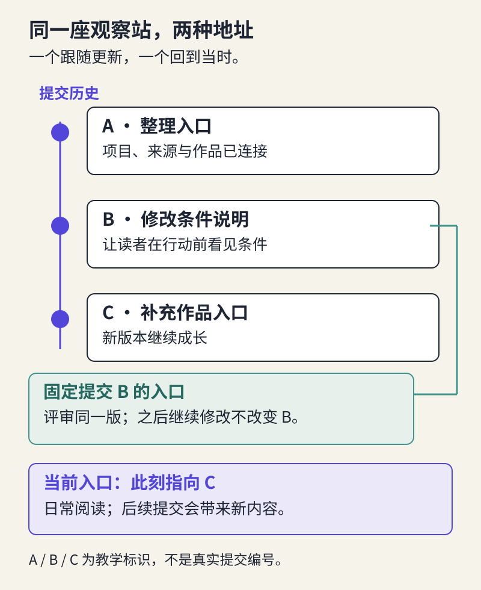

# 开源作品的组织与发布：在 AtomGit 整理与分享

> 状态：review
> 版本：0.2.1

第九章结束时，你已经有一座能走通一条使用路径的观察站。现在把它交给另一位同学：你发过去的是文件夹、压缩包，还是一个链接？他打开后能否找到作品？下周你修改了内容，他又怎样知道自己看的是哪一版？

这些问题把我们带进第四篇。前一篇学习怎样做出产品，这一篇学习怎样让产品进入共同使用、反馈与改进的过程。本章先把已有成果整理到 AtomGit，形成一个能访问、能理解、能追溯的版本。你不必重新开发网站，也不必学会一整套程序员命令。

## 10.1 平台让一份作品拥有共同的地址

在自己的电脑上，你知道“最后一版”放在哪里，也记得为什么删掉某段话。其他人没有这些背景。聊天中连续发送“最新版”“最新版2”，很快会使作品内容、修改理由和讨论分散在不同地方。

**协作平台**把作品和围绕作品发生的活动放在同一个空间。**仓库**是其中一个项目的文件集合及其版本记录，可以保存程序，也可以保存说明文档、图片和教学材料。AtomGit 是本课程采用的协作平台；DSH 则帮助你处理材料与制作内容。DSH 写好了本地文件，不意味着它已经出现在 AtomGit 上，上传与分享仍是另一步动作。

平台的发展也改变了协作方式：有了共同的地址，人们可以指出同一个问题，比较同一处修改，接着别人的成果继续做。这对文档创作者同样有用。修改一个让初学者误解的标题，也可以像修改程序一样留下原因和前后差异。

平台也会围绕不同对象提供服务。GitHub 常用于软件及相关文档的协作；Hugging Face Hub 为模型、数据集和演示应用提供相应入口；AtomGit 的官方指南区分代码仓、模型仓与数据集仓。它们的能力有交集，不能把这些例子理解成互相排斥的分类。本课先用代码仓保存轻量文档与图件，因为观察站当前交付的是解释和作品入口，不是大模型权重。

这里的“上架”还有一个条件：作品应当让人知道从哪开始。文件被存起来，只解决了“在哪里”；下面还要解决“怎样用”。

## 10.2 给来访者一条清楚的起步路径

先沿用第七至九章选定的用户旅程，不重新按课程作业排列文件。本例仍帮助初学者辨认 DeepSeek 模型与 DSH，找到依据，再打开合适的导览。你要做的是把已经验证过的路径带到共享空间。

仓库通常在首页展示 **README**，即项目的起步说明。`README.md` 中的 `.md` 表示 Markdown 文本格式：文字仍可直接阅读，少量符号用于表示标题、链接等排版。第一章已经接触过它；这里最需要的写法是 `[给读者看的名称](文件路径)`。例如 `[先读 DSH 入门导览](station.md)` 会指向同一文件夹里的 `station.md`。路径要和实际文件名一致，包括大小写。

如果你在第八、九章制作的是单文件观察站，第一版只需把已检查的候选复制为 `station.md`，与 `README.md` 放在一起。候选引用了图片或其他文件，就一起带入并保持相对位置。这里的改名只是整理交付，不代替重新核验内容。若已有多页版本，也可保留其结构，只要入口能走通。

README 的开头可以像这样写。下面是作者为本例编写的说明片段，不是你的完成记录：

> 这个观察站帮助第一次接触开源 AI 的同学，辨认模型与智能体工具，并找到有依据的入门作品。先打开“认识项目与阅读导览”，再根据自己的条件选择继续阅读或准备文件任务。本版提供文档阅读路径；运行 DSH 需要另外确认接入条件。

接着放上真正能打开的作品链接、当前版本说明和反馈位置即可。不要让读者先跨过一屏课程感言，也不要列出还没有内容的“智能推荐”“社区排行榜”。五块内容可以逐步生长，首页先照顾本版确实能完成的任务。

### 移动文件，会改变什么

`station.md` 里如果引用了电脑上的 `C:\Users\…`，其他人打不开；如果引用了一个需要你个人登录的文档，公开仓库也不会自动替读者获得权限。把作品复制到一个新文件夹，从 README 重新进入，通常能较早发现本地路径和遗漏附件。随后仍要在平台上检查一次，因为本地可读不等于在线可读。

浏览器能展示 Markdown，并不保证任意 HTML 文件都会作为网站运行。若你的成果是网页、音频或小工具，在 README 说清“在线阅读”“下载打开”或“进入已部署网站”，分别提供真实入口。没有部署就提供可用的下载方式，不把仓库地址写成已经运行的应用地址。

## 10.3 保存版本，让别人知道正在看什么

**版本管理**记录作品怎样变化。一次**提交（commit）**把一组改动及其说明记入历史，并获得可定位的标识。它让你可以回到当时的内容，查看后来哪里变了。平台在浏览器中创建或编辑文件时，也可以完成这样的提交。

设想你第一次上传观察站后，发现 README 仍写“阅读项目材料”，读者不清楚里面有什么。你把它改成“认识 DSH：用途、条件与入门导览”，并说明“改明确入口名称，方便初学者选择”。这条说明把改动和目的连接起来，比“更新”“完成作业”更有帮助。

每次提交尽量围绕一个能解释的目的。多个相关文件可以一起修改；分几次提交也很正常。重要的是别人能理解变化的范围，而不是人为增加提交次数。若出现问题，先查看历史，明确要恢复哪一处，再形成一项清楚的新修改；不要用“删除整个仓库重传”解决普通错字。

**当前入口**与**固定版本入口**用途不同。仓库首页通常展示当前默认分支的内容，会随提交变化；某次提交对应的文件或历史页面用于回查那个时刻。**分支**可以先理解为一条持续演进的版本线，第十一章会用它安排待讨论的修改。

给日常读者分享当前入口，方便他们得到更新；给评审或比较记录留下这次提交的入口，方便双方讨论同一版。`v0.1`、`v0.2` 这样的作品版本名便于人阅读，但仅把文件名改成“v0.2”不会自动固定仓库内容。本章用一个清楚的版本名、日期和对应提交即可，平台的标签与发行版功能可在需要分发多个正式版本时再学习。

## 10.4 把说明和作品一起交出去

第三章整理的来源与使用说明，现在也要随作品一起交付。读者应能找到重要材料的来处、适用条件和允许的使用方式。只写一句“资料来源于网络”，无法帮助他判断能否继续复用。

保留你自己的整理和第三方材料之间的区别。项目文档、模型权重、图片以及你的文字可能适用不同条件，不能因它们放进同一仓库就默认采用同一种许可。没有明确复用依据的图片，可以改为链接到原处；不要为了凑完整封面，把不明来源材料一并公开。若自己的对外许可尚未确定，应先说明当前分享范围，不套用一个许可证覆盖全部外部材料。

**可见性**回答谁能访问，**使用许可**回答获得材料后可以怎样使用。公开仓库不自动解决许可问题，私密仓库也不意味着可以任意上传第三方内容。延续第三章已经核对的说明，遇到不清楚的材料先缩小分享范围或请教师协助确认。

AI 参与说明同样要具体。例如：“DSH 根据所列材料协助起草项目卡；我核对了接入条件，调整入口顺序，并检查链接。本次只完成文档创作，尚未验证导览介绍的其他功能。”它交代了工作内容和判断责任。不要笼统写“全部由我独立完成”，也不必把整份聊天记录公开。包含个人信息、账号密钥或私人目录的原始记录不属于作品的必需附件。

对本例，可以把来源、AI 参与和本版范围放在 README 末尾；原有观察站已经解释清楚，就从入口链接过去，不另复制一份容易不同步的长说明。读者在需要时找得到，比每页重复一遍更好。

## 10.5 在 AtomGit 完成一次可检查的分享

准备好已核验的候选和必要附件后，打开[第十章材料包](../../practice/ch10/README.md)。其中的操作卡按 2026-10-30 阅读到的 AtomGit 官方文档编写，给出“创建或进入仓库—在线编辑文件—查看提交—检查分享”的浏览器路径。菜单名称变化时，按动作找官方帮助；无须把命令行教程全部学完再开始。

如果第一章已经建立了自己的仓库，继续使用它。本章新增的是清楚的入口、版本和共享检查，不是再建一个同名项目。没有仓库时，可创建自己的代码仓，以便保存文档作品。选择公开还是限成员访问，要符合内容与课程约定；需要登录、获得权限或完成账号验证时，按平台当前要求处理。暂时不能使用 AtomGit 的同学，先整理本地作品包，平台分享保留为待完成。

在浏览器中创建或编辑 `README.md` 与 `station.md`，预览内容，再用有意义的说明提交。第一次可以先保存作品，再补上入口链接；随后检查最终状态，避免分享尚未接通的中间版本。不要上传整个 DSH 工作区。里面可能混有缓存、配置和与你这次作品无关的材料。

提交后做两件事：第一，重新打开仓库入口，沿同一条旅程找到项目、来源和作品；第二，打开提交历史，确认本次改动确实存在，保存对应地址。若是公开作品，用未登录状态检查可见性；若是限成员访问，请有相应权限的人检查，或记录目前尚未完成他人访问验证。作者自己的账号能看到页面，不足以证明别人也能看到。

### 给同伴一个任务，不给他一套答案

愿意参与的同伴可以收到这样的请求：“请从这个入口选一个项目，找到一件现在能阅读的作品，并告诉我你会怎样继续。”先让他尝试，再问哪里不清楚。使用第九章的观察方法即可，不必再做一份长问卷。记录一处实际行为、你给过的提示，以及需要处理的具体位置。

自学者先做同样的访问与路径检查，再看材料包中的预设问题：链接能打开但只是原始 HTML，是否算网页已经上线？作者账号能读私密仓库，能否写“任何人可访问”？这些反馈帮助你检查概念，不是读者已经试用的证据。

本章最后留下一个作品入口、一个能定位的版本，以及简短的访问检查。已有作品说明足以容纳这些信息时，直接补进去；材料包中的空白记录只是可选支架。下一章围绕其中一个真实问题，邀请改进或参与别人的改进。

### 自查与参考反馈

1. 朋友说“我看到的内容和你说的不一样”，你首先核对什么？
2. README 写了“欢迎使用”，却没有作品入口，应怎样补？
3. 上传了 AI 生成的作品，自己需要说明哪项具体工作？

**参考反馈：**先核对地址、分支或提交版本及访问权限，不能立即认定对方没有刷新。入口应直接指向可用成果并交代用途和条件。个人说明应指向实际核验、取舍或修订；若只是保存了输出，就据实说明，后续再补上应做的检查。
