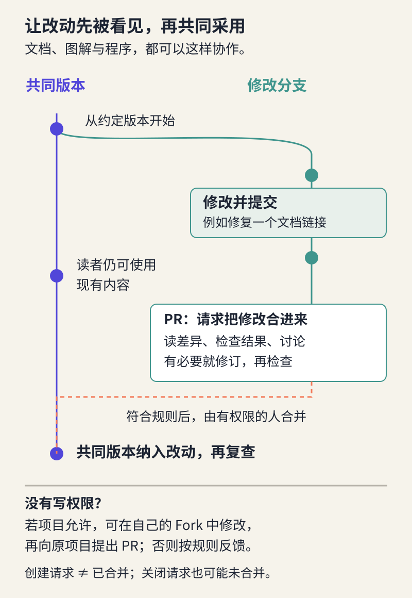

# 在反馈中共同改进：完成一次开源贡献

> 状态：review
> 版本：0.2.0

观察站已经有了可以分享的版本。另一位读者也许发现作品入口打不开，或者指出某句话把“读过文档”写成了“已经运行”。你会怎样处理？直接改掉、回一句“收到”，还是把问题与改动连接起来，让后来的人知道发生了什么？

本章从一个很小的文档问题进入协作。你会学习如何描述问题、阅读修改差异、回应建议，并在 AtomGit 留下可追溯的改进。核心任务可以完全不写程序：帮助别人找到作品、纠正解释或补齐必要材料，都是有价值的工作。

## 11.1 先找到值得别人花时间的问题

**贡献**是对共同成果提供实际帮助。它可以是提交修改，也可以是一个足够具体的问题报告、一段经过核对的补充说明，或帮助维护者验证问题是否解决。价值来自减少了什么困难，而不是发出了多少条消息。

先从同伴的观察站或课程协作空间开始，比随意找一个大项目更容易理解读者、材料和维护范围。去真实上游项目之前，先读 README 与贡献说明，搜索已有讨论，判断问题是否已经有人处理。**上游**在这里指你所复用、希望回馈的原项目；给同伴的观察站改了文档，贡献发生在同伴项目，不能因此写成“已被 DSH 官方采用”。

一个适合起步的问题通常范围小、位置清楚、能说明影响。例如：“从 README 打开导览失败，而实际文件在 `works` 文件夹中。”相比之下，“这个项目体验很差，建议全面重构”需要别人替你寻找问题，难以直接行动。

对贡献对象也保留选择。你擅长解释，可以补一个读者确实需要的例子；擅长视觉，可以检查图中的角色关系；擅长数据，可以核对统计条件。若只是想练习按钮，先在自己的练习空间演练，不把无意义的 Issue 或重复 PR 发给真实维护者。

## 11.2 把“有问题”写成可以处理的 Issue

**Issue** 是围绕一个问题、建议或任务展开的讨论记录。它有标题、内容和后续回应，便于持续跟踪。一个 Issue 不一定代表程序故障，也可以记录文档缺失或产品改进建议。

下面是作者构造的观察站情境，不是实际社区报告。作品已移动到 `works/guide.md`，README 的入口却仍指向旧位置。可以这样报告：

> **标题：README 的导览入口仍指向旧路径**  
> 我从仓库 README 的“作品”部分打开导览，目标是 `guide.md`，该位置没有文件；文件列表中可以看到 `works/guide.md`。预期是从首页直接进入导览。建议先核对本次移动，再更新入口并检查导览里的返回链接。这里记录的是当前版本的路径问题，尚未检查其他入口。

这段话交代了**位置、动作、实际结果和期待结果**，还给出检查范围。真实提交时再附上相应版本地址，必要时补一张不含私人信息的截图。图片帮助定位，文字仍要能够独立说明问题。

注意把观察与解释分开。“点击后打不开”是观察；“可能因为文件移动后没更新链接”是推断。提供依据可以提高推断的可信度，但不要直接责备作者粗心。问题报告的目标是共同定位原因。

如果没有重现对方的问题，可以问：“你打开的是哪一版？入口显示什么？”先补齐差异，不要因为自己电脑正常就立即关闭。若发现已有同类 Issue，在那里补充新的、相关的信息即可，避免让讨论分裂成多个重复记录。

## 11.3 读懂差异，才知道自己同意了什么

**差异（diff）**显示两个版本之间增加、删除或修改的内容。常见界面用减号表示移除的旧行、加号表示加入的新行，也可能用左右两栏对照。颜色是辅助，真正要读的是内容。

下面仍是作者演练。旧文件中的链接和改动后的链接如下：

```diff
- [阅读导览](guide.md)
+ [先读 DSH 入门导览](works/guide.md)
```

即使不懂程序，也能检查两件事：路径是否对应真实文件；新名称是否准确说明读者会得到什么。然后打开修改后的入口，确认它真的可用。看见绿色新增行不能代替实际检查。

如果 AI 同时建议加一句“该观察站已经通过同伴试学”，你要追问它的依据。修复链接不需要新增这项承诺。保留有用的改动、拒绝没有依据的扩写，正是第五章“生成不等于事实”在协作中的应用。

有时差异突然变成整页重写，原本很小的修复被埋进几十处改动。可能是格式工具重新排版，也可能是 AI 顺手改了无关内容。先判断哪些变化属于本次问题；能分开时，将整理格式与修复问题分开提交，减少评审者猜测的负担。这里追求的是容易理解的修改，不是规定每个 PR 只能改一行。

对图片、音频等难以直接比较文本的作品，提供前后版本、指出修改区域，并说明怎样检查效果。例如图中把“模型直接保存文件”的箭头改成经过工具执行，可以用两张局部图解释。不要仅附一个新文件让评审者自行寻找差别。

## 11.4 让修改先被讨论，再进入共同版本

如果每个人都直接改共同版本，一项尚未核实的修改就可能影响所有读者。**分支**让一组待讨论的修改沿自己的版本线推进，同时保留共同使用的版本。它与复制出 `最终版2.md` 的区别在于：系统能够记录它从哪里开始、后来怎样变化，并比较两条版本线。

**合并**是把一条分支的改动整合到另一条分支。**Pull Request（PR，拉取请求）**则把“希望合并哪些修改、为什么、检查过什么”组织成一个可评审的请求。创建 PR 后，修改还没有自动成为共同版本；需要按项目规则讨论、检查并由有权限的人合并。

没有原项目写入权限时，平台可能允许你创建 **Fork**，即放在自己账户下、保留与原项目关系的仓库副本。你在自己的副本中修改，再向原项目提出 PR。Fork 是仓库层面的副本，分支是仓库内的版本线，两者用途不同。遇到私密仓库或不允许 Fork 的项目，应按该项目约定提供反馈，而不是尝试绕过限制。



本课文档协作可用浏览器完成：在允许的仓库或 Fork 中创建修改分支，在线编辑文件并提交，再选择源分支和目标分支创建 PR。**源分支**装着你的修改；**目标分支**是希望它进入的地方。提交前核对这两个方向，避免把练习副本误当成原项目。

PR 说明可以很短：“修复 README 导览入口，关联所述路径问题；只改链接名称和路径；已从首页打开作品，并检查返回入口。”问题明确时不必另造一条 Issue 来凑流程；已有 Issue 则把它与 PR 连接。不要让 AI 生成一长串没有实际执行过的测试清单。

### 两个人改到同一处怎么办

你正在修改链接时，同伴可能也改了同一行。系统有时无法自动决定怎样组合，这叫**合并冲突**。它不表示谁做错了，而是需要人判断两项意图如何同时保留。

例如你修正了文件路径，同伴改好了入口名称，最终版本通常可以同时保留两项帮助。先读双方改动及理由，再编辑成一致的结果，重新检查链接。不要只为了消除提示而机械选择“全用我的”或“全用对方的”。不熟悉操作时可以请维护者协助，保留原始修改；本课不要求独立处理复杂冲突。

## 11.5 回应意见，让讨论真正改变作品

**评审**是对修改及其影响作检查并提出意见。好的反馈能够指向具体内容，例如“新的入口名明确了，但作品页面没有回到项目档案的链接”。“不错”“已看”可以表示收到，却不能说明核验了什么。

作者回应时也应落到改动：“已补回档案入口，位于导览末尾；从首页进入并返回的路径已检查。”若暂不采纳，可以解释理由：“本版只提供离线手册，增加在线筛选超出当前范围；我先把目录名称改清楚。”有依据地拒绝一个建议，比口头答应但不处理更负责。

AI 可以协助压缩问题描述、解释差异或提出检查点。发送前仍要逐句核对，尤其是版本、运行结果和他人意见。让 AI 代拟“谢谢建议”很容易，真正的学习发生在你判断建议是否符合用户任务、决定怎样修改，并检查结果的过程中。

讨论结束后还要区分状态。**已提交**说明修改已提出；**待评审**说明仍在等待处理；**已合并**说明改动已进入目标分支；**关闭但未合并**可能是重复、范围不合适或已有其他解决方案。一个关闭的 Issue 也不自动证明某个修复已经上线。回到实际文件和目标版本再核对。

如果暂时没有回复，留下真实的等待状态即可。可以根据项目规则适时补充新信息，不必反复催促，更不应为了获得“已合并”去制造微小而无用的提交。你的学习证据可以说明发现了什么、怎样改进、在哪里提出，以及目前到哪一步。

## 11.6 完成一次有帮助的协作

打开[第十一章材料包](../../practice/ch11/README.md)。先用其中的教学文件读一次差异：找出真正修复问题的变化，辨认候选稿里混入的无依据说法，再与参考稿比较。演练帮助你理解机制，不计作真实社区贡献。

随后选择一个实际对象：同伴观察站、课程空间，或你已经读懂贡献规则的相关项目。完成一项具体反馈或文档改进，说明依据和检查方式。有权限并准备好时，按材料包操作卡提交 PR；没有修改权限时，准确的问题报告同样可能帮助维护者。改动越小，越应把它帮助了谁说清楚。

同时查看自己的作品有没有收到意见。有就回应并说明处理；没有就记录尚未收到，不虚构来回对话。如果本次只能在个人仓库练习分支与 PR，可以保留完整操作证据，但应称为个人演练，不能把自己的批准记成他人评审。真实协作部分等合适机会补上。

在已有的“反馈与协作”页留下一段记录，连接问题、修改和回应即可；需要支架可用材料包的 `work/contribution.md`。不重复粘贴平台上整段讨论，避免将来两处版本冲突。

### 判断这些情况

- 你的 PR 还没有合并，但帮助维护者确认了一个真实问题。能否说明贡献？
- AI 重写了整页文档，修好了链接，也删掉了来源。可以直接接受吗？
- 合并已完成，能否立即声称所有读者的访问问题都解决了？

**参考反馈：**可以说明已提供的具体帮助和待处理状态，不扩大为“代码已被采用”。修复链接与删除来源应分别评估，保留必要依据并再次检查。合并只是版本变化，还要按原问题复查访问条件；平台动作完成不等于所有使用场景都通过。

至此，观察站不仅有作品，也开始拥有别人能够理解的改进过程。最后一章把这些过程转化为你的能力说明，并用一个新问题检验它能否带你继续前进。
