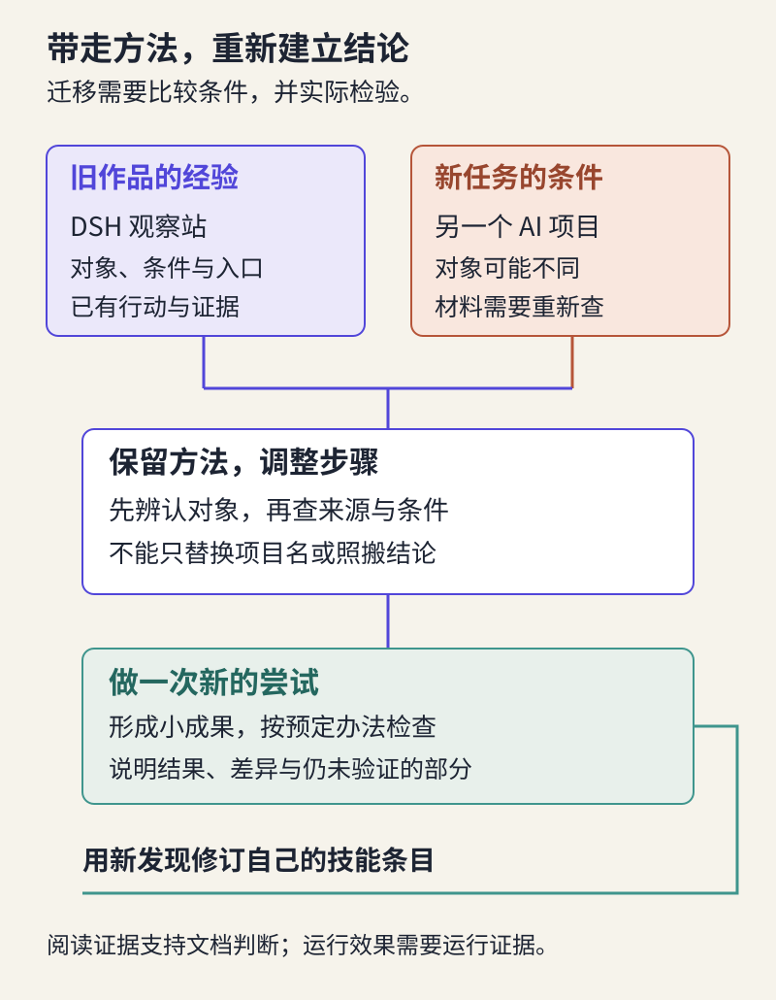

# 建立个人技能集与作品集：让学习继续发生

> 状态：review
> 版本：0.2.0

假设有人看完你的观察站，问：“这件作品里，哪些地方体现了你的能力？换一个项目，你还能做到吗？”一句“我用 DSH 做的”只说明使用了工具。一页精美封面，也不能单独回答这两个问题。

回看整门课，你已经有许多可以回答的材料：辨认项目时找过的依据、解释 AI 机制时做过的练习、设计入口时的取舍、AI 候选里的错误、修改前后的差异，以及真实发生的反馈。最后一章从这些材料中选择有代表性的部分，形成技能集与作品集，并完成一次新的尝试。

## 12.1 把工具名称换成自己能够完成的事

**技能集**是你能够在一定条件下运用的能力与方法。它可以包括辨认项目、核验说法、设计信息入口、与 AI 分步制作、评审修改和回应反馈。Agent 的 Skill 文件可以承载某些操作方法，但人的技能集不受这种文件格式限制。

“会用 AtomGit”太宽泛，别人不知道你会保存文件、读差异，还是组织多人协作。“能为一项文档修订说明问题、检查差异并回应意见”，则指向具体动作。工具可以变化，这项能力仍有继续使用的机会。

也不要把能力写得比证据更大。在第四章完成了参数选择和新样本检验，可以说明你能用小实验解释学习与泛化的区别；尚不足以写“掌握大模型训练”。第六章若只读了任务机制，还不能写“已独立部署并熟练使用 DSH”。准确的能力说明能帮助你找到下一步，而不是削弱成果。

一个有用的技能条目可以写成短段落，包含**能完成的事、适用条件、关键方法和证据位置**。例如：

> 我能把分散的项目说明组织成初学者可阅读的路径。先确认对象与材料版本，再按读者任务安排入口，连接来源和作品，最后沿路径检查。我的证据是观察站入口前后两版及一处修改理由。遇到需要实际运行才能判断的说法，我会另做测试，不能仅凭文档下结论。

这是写法示例。把它换成自己的动作与文件，删掉尚未做过的部分。某个技能只有阅读基础也可以记录为正在练习，之后再补上亲自完成的证据。

## 12.2 选择一件作品，把关键决定讲清楚

**作品集**是为了让别人理解你的工作而选择、组织的成果。它不必收进全部作业。对第一次建立作品集的同学，一件能够使用、来龙去脉清楚的观察站，往往比十个只有封面和标签的项目更有说明力。

给代表作品写一个短案例，读者应能顺着它理解：当时帮助谁完成什么，作品怎样回应这个问题，哪次决定改变了它，以及现有结果能说明到哪里。把具体证据链接放在对应叙述旁边，不让读者去几十个文件中猜测。

例如，笼统的“我优化了用户体验”，可以改成：“原入口按课程作业分类，新读者需要先猜每一类内容。我把入口改为认识项目、阅读作品，再保留内容目录；修改前后文件在这里。自己从入口能够找到作品，但尚未观察陌生读者是否独立完成。”这段话交代了问题、动作、理由和边界。以后获得真实试用结果，再更新最后一句。

你可以打开[作者示范的作品与方法页](../../practice/demo/growth.md)。它引用本课程实际存在的档案、导览和编辑记录，示范怎样用已有成果说明一种方法。它没有替你完成作品集，也没有把文档编写写成 DSH 实跑经历。

### 作品漂亮，为什么还要看过程

AI 可以生成相似的页面，模板也可以复制。但为什么保留某个功能、拒绝某个承诺、修正哪个概念，需要回到具体情境判断。作品集保留一两处这样的决定，可以让别人看见你的理解，而不只是最终外观。

在小组中也一样。共同作品可以共享，个人说明应当指出自己负责的内容、讨论和判断，再承认他人的工作。可以写“我整理来源并发现一处条件遗漏，同伴制作了图解，AI 协助起草”，而不是所有人都把同一件成果说成独立完成。一个真实而清楚的分工比模糊的主导者头衔更可信。

## 12.3 方法能带走，结论需要重新建立

**迁移**是把已经学过的方法用于新的情境，同时判断哪些条件变了。把 DSH 项目卡中的名称替换成另一个项目，不足以完成迁移，因为项目对象、材料结构和使用条件可能完全不同。

下面用 **Transformers** 项目作一个作者演示。它是供开发者使用的模型软件库，提供调用和使用多类模型的程序组件；这里的“库”可以先理解为供程序复用的一组工具。它与某个具体模型、托管模型的平台、直接对话的网页服务不是同一个对象。本章只读官方说明，不要求编程或安装。

新问题是：“能否把 Transformers 作为一个与 DSH 相同的现成聊天工具，放进观察站的‘直接开始’入口？”沿用第二章的方法，我们先打开项目官方介绍，再看安装与入门说明，而不是让 AI 根据熟悉的名字补全答案。

本例选取官方 **v4.57.1** 文档作为固定阅读版本，访问日期为 2026-10-30。该版本只是本例依据，不代表当前最新版，也不是本课推荐的安装版本。介绍页说明它围绕模型定义与使用提供能力；安装和入门材料涉及 Python、PyTorch 及模型文件等条件。Python 是编程语言，PyTorch 是机器学习软件框架，这里只需辨认它们是运行所需的软件条件，不必掌握写法。

因此，原来面向 DSH 的“准备服务、模型与工作区”的说明不能整段搬过来。面向初学者的新入口可以改成“认识模型软件库：先读用途与所需条件”，再连接官方入门材料。我们由此完成的是**项目辨认与入口设计的迁移**，并没有运行模型，更不能声称该库在自己的电脑上表现如何。

| 原来用过的方法 | 在新项目中保留什么 | 必须重新确认什么 |
| --- | --- | --- |
| 建立项目档案 | 对象、用途与来源彼此对应 | 它是模型、工具库、服务还是平台 |
| 说明开始条件 | 把条件放在行动入口前 | 实际依赖的软件、模型文件与资源 |
| 设计阅读路径 | 从读者问题进入材料与作品 | 新读者需要阅读、准备还是实际运行 |
| 核验结果 | 区分文档依据与自己的观察 | 哪些判断只靠阅读无法完成 |

这里最重要的产出不是“认识了另一个名字”，而是发现原方法哪里适用、哪里需要调整。迁移失败也能提供信息：如果新项目缺少材料，你可以缩小问题、换一个可观察对象，或记录尚不能判断，而不是补造档案。

## 12.4 自己完成一次新的尝试

打开[第十二章材料包](../../practice/ch12/README.md)。先选一种已经亲自用过的方法，再选择一个本章尚未替你回答的 AI 项目问题。问题可以很小，例如：某个开源语音项目适合给谁介绍？一份模型说明是否支持观察站中某项用途？一个项目的入门材料能否组织成老师可直接选用的阅读路径？

若继续研究 Transformers，请另提自己的问题，不能把上一节的结论原样交回。也可以选择其他有公开材料的 AI 项目。你要说明这次的新条件是什么：对象换了、读者换了、任务改变了，还是可用资源不同了。只改变封面颜色没有检验方法迁移。

先在观察站现有的作品或探究页写下问题及判定办法，再寻找材料、进行动作。文档型任务可以通过核对真实来源、形成一个新的项目卡或解释片段来完成；需要实际运行才能作答的问题，则要安排运行条件。无法运行时，将问题收窄到阅读能支持的范围，不提交一个假想的性能结论。

你仍可以请 AI 协助翻译术语、比较材料或起草内容，但要保留自己的一项决定：哪些方法继续用，哪一步改了，为什么。若 AI 建议一个链接或项目事实，先实际打开核对；找到标题相似的页面不等于找到了支持这句话的依据。

最后用预先写下的办法检查结果。新的入口是否真的连接到适合的材料？解释是否符合新对象？哪些内容仍不确定？在 `work/transfer.md` 或已有记录中留下简短的结果和调整，不需要完整复述聊天过程。

本章要求的是一次可见的新尝试，不是再完成一个庞大项目。完成后，把新发现带回技能条目：原先写“读 README 就能判断使用条件”，现在也许要改成“先读项目介绍，再按问题追到安装、模型或服务说明”。技能会随着碰到的例外变得更准确。

## 12.5 交付一个能继续生长的观察站

回到观察站首页，用来访者的眼光打开它。五块内容现在应各有真实作用：项目档案提供对象与依据；理解探究展示机制学习；AI 创作提供可用作品；开放协作连接问题和改进；个人积累说明方法与代表成果。某块尚未发生，就如实说明当前范围，不为了目录整齐补造内容。

整理本阶段时，保留日常入口和一个能回查的版本，把最值得读的一件作品放到显眼位置。来源、使用条件与 AI 参与沿用已有说明，检查是否与这版一致。第十一章的真实协作记录可直接链接，尚在等待的请求也保留其真实状态。

给自己做一次简短的口头说明：从入口打开一件作品，解释它帮助谁；指出一处重要判断及其依据；再说明新问题中哪一步改变了。无法解释的地方，就是下一轮要补的学习，而不是再增加装饰。教师或同伴也可以据此展开讨论，无须只数文件或统计提交次数。

本课的五项学习成果可以帮助你判断下一步：能否解释一种 AI 机制，能否根据材料形成有边界的判断，能否做出可用作品，能否在真实反馈中改进，能否把方法用到新情境。每项都找一处现有证据即可，允许同一件作品支持多个方面。没有真实协作或模型运行证据的部分，继续安排后续实践，不靠课程读完来自动补齐。

### 持续成长不需要不停扩建

给观察站选择一个具体的维护触发条件：来源版本变了、作品入口失效了、读者提出了新的理解困难，或你准备把它用于另一门课。届时回来检查相应内容。新增项目或功能之前，再问一次第七章的问题：谁需要它，它带来什么改变？

你也可以把方法带到自己的专业。文科同学可以检查 AI 对史料的解释是否有出处；设计同学可以研究图像工具怎样支持作品迭代；理工科同学可以把任务转成受控实验。这些方向会带来新的专业标准，课程提供的是开始观察、判断和协作的方法，后续仍需补充领域知识。

不必用 Star 数、作品数量或工具名称堆出一个能力形象。能让别人用上一件成果，能解释一次有依据的取舍，并在新的条件下继续学习，已经构成了值得展示的起点。

### 最后的自查

1. 我的代表作品里，哪一处最能说明自己的判断？
2. 我的方法在哪些条件下有效，哪里还没有验证？
3. 新项目让哪一步发生了变化，这种变化怎样影响结论？
4. 下次回来时，我准备检查或改进哪一件具体的事？

**参考反馈：**第一题要指向作品或差异，不能只回答“我负责审核”。第二题区分阅读、操作和他人使用证据。第三题需要说明新条件怎样改变动作或结果；仅替换名称不够。第四题给出触发条件与检查对象，比“持续提升能力”更可执行。

课程可以在这里告一段落，观察站仍然可以继续生长。带着对 AI 的理解、能够说明依据的判断，以及一件可以共同改进的作品，再去打开下一个项目。
