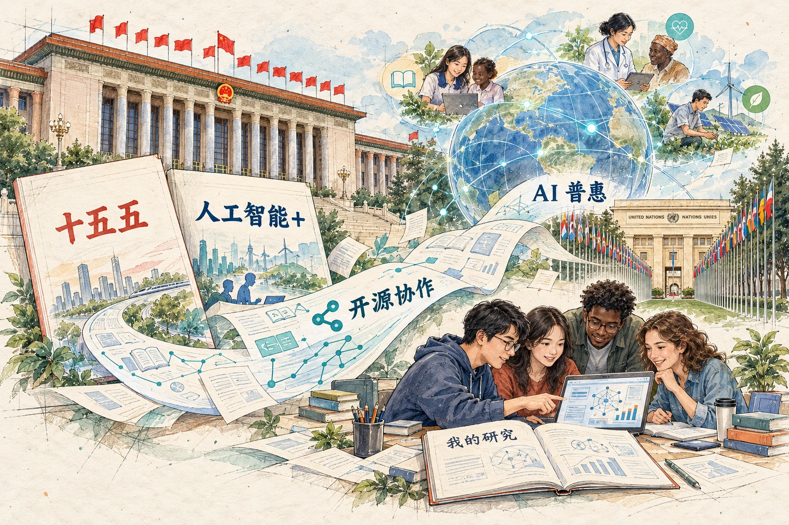
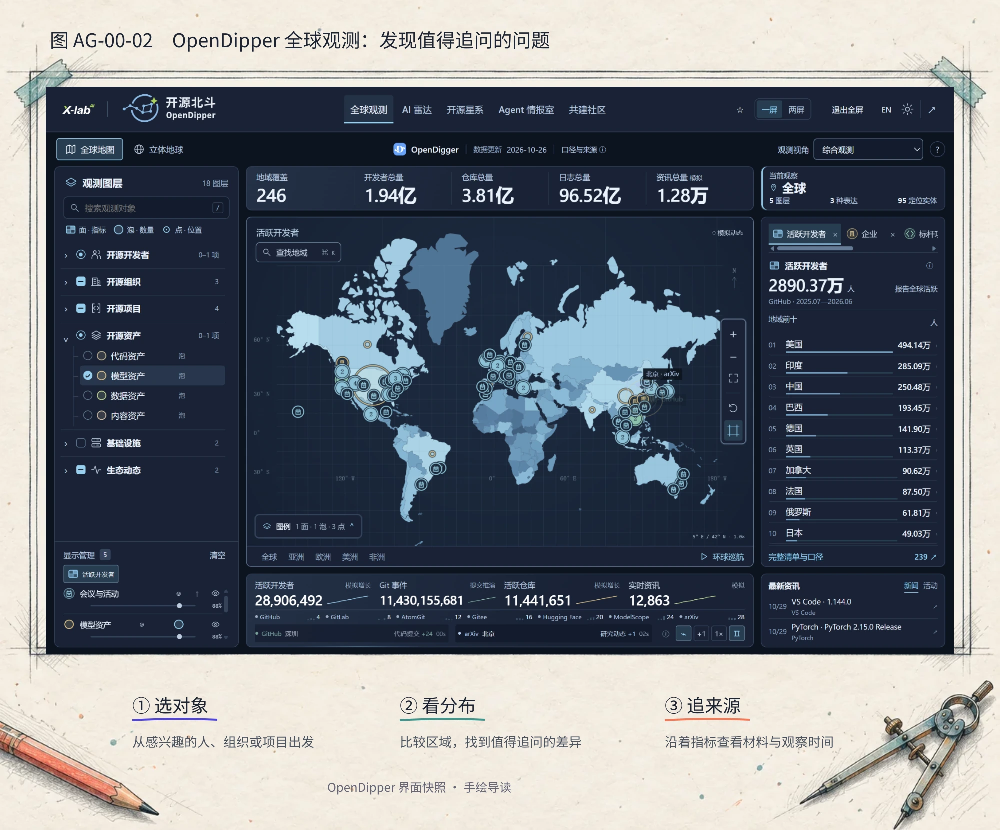
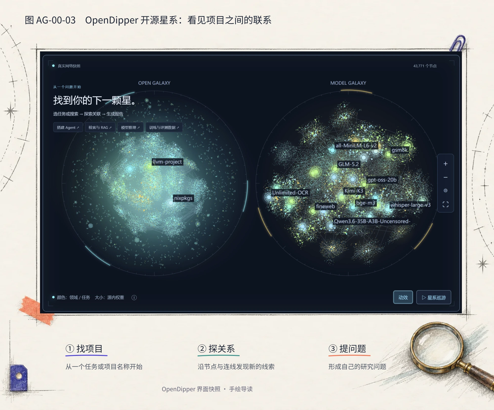

# 让 AI 惠及更多人

> 状态：review
> 版本：0.4.0

人工智能（AI）正在改变人们获取知识、开展研究和创造作品的方式。它能否让不同地区、不同专业、不同背景的人都获得发展的机会，取决于技术的进步，也取决于人们如何学习、分享与合作。**让更多人能够理解 AI、用好 AI，并参与它的创造，是这个时代共同的课题。**

## 从国家战略，到全球共同课题

在中国，这一课题已经进入国家发展的重要部署。面向 2026—2030 年的[“十五五”规划纲要](https://www.forestry.gov.cn/lyj/1/szxx/20260314/663252.html)，将开源体系建设列入数字中国建设，并部署人工智能在产业、民生与治理中的应用。开源逐渐成为连接技术创新、产业发展和人才成长的一项基础。

[国务院关于深入实施“人工智能+”行动的意见](https://www.cac.gov.cn/2025-08/27/c_1758018277755538.htm)进一步提出支持模型、工具与数据集开放，建设面向全球的开源生态，同时推进人工智能通识教育、跨学科培养，并鼓励高校认可开源贡献。这些部署把技术的发展与人的能力建设联系起来：更多人学会理解、应用和改进 AI，才能让它进入更广泛的专业与生活场景。

这也是全球合作的共同关切。2024 年 7 月，联合国大会通过中国主提的加强人工智能能力建设国际合作决议。决议关注发展中国家的能力建设，将负责任地使用开源 AI 等方式与普惠发展相联系，服务联合国可持续发展目标。这里的“可持续发展”，包含教育机会、健康福祉、减贫和环境等与每个人有关的议题。

中国提出的[《人工智能能力建设普惠计划》](https://www.mfa.gov.cn/web/wjb_673085/zzjg_673183/jks_674633/fywj_674643/202412/t20241218_11496414.shtml)，把联合国框架下的国际合作、人工智能素养培养、教育资源共享和开源开放社区建设连接起来。**AI 普惠，既需要技术与资源能够被获得，也需要人们具备理解、使用和共同改进它们的能力。**

对大学生而言，这些宏观方向可以落到具体的学习中。研究本专业适合使用什么工具，判断一段 AI 回答是否可靠，把自己的发现整理成别人能用的材料，都是参与的起点。开源提供了一种途径：在相应许可下，人们能够研究、使用、修改和分享已有成果，并通过社区交流继续完善它们。

本课程正是对这一时代需要的教学回应。我们希望把 AI 的基础理解、独立判断、实际创作与开放协作带给所有专业的学习者。你会从一个真实项目出发，逐步积累能够再次运用的方法，也留下可以与他人共同改进的作品。图 AG-00-01 将国家发展方向、全球普惠愿景与个人学习放在同一幅画面中；接下来，让我们看看这样的联系怎样在真实工作中展开。

## 从一个真实的项目说起

打开“开源北斗”OpenDipper，世界地图上分布着开发者、组织与项目；换到“开源星系”，许多软件、模型与数据集又以节点和连线的方式出现在眼前。

这些图像很容易吸引我们停下来。但更有意思的是它们引出的问题：谁在共同建设今天的 AI？一个项目怎样与其他项目发生联系？如果想为自己的专业寻找合适的 AI 工具，可以从哪里开始？

OpenDipper 将我们的好奇带到真实的开源生态中。观察全球开源发展、把研究写成报告、再用可视化让更多人理解和探索，是与它相互联系的一项实践；《2026 全球开源发展报告》让我们看见了这种工作方式。

## 一份报告，让世界看见开源

2026 年 7 月，在瑞士日内瓦举行的联合国“人工智能向善（AI for Good）”全球峰会期间，中国科协联合国咨商开源创新专委会发布《开源创新国际合作宣言》。同期发布的《2026 全球开源发展报告》预览版将这份宣言收录为序言。这段实践记载在[中国国际科技交流中心的发布报道](https://www.ciste.org.cn/gzdt/kxzs/art/2026/art_bed9ae4a12b049e7b4ae56083023159e.html)中。

全球 AI 普惠与可持续发展的愿景，需要具体的研究来帮助人们认识现实。一份全球开源发展报告，要回答的远不止“有哪些热门项目”。开发者如何参与，组织如何协作，模型与软件怎样被复用，技术的发展又怎样影响不同地区和行业？这些问题需要把分散的材料组织起来，选择观察方法，再形成能够解释现象的发现。

今天，你可以在[报告在线版](https://www.x-lab.info/2026-Global-Open-Source-Development-Report/2026/zh/)中看到文字分析与地图、榜单、技术全景和关系网络相互配合。正文帮助读者理解研究的问题、方法和结论；可视化则让读者选择对象、比较差异，沿着感兴趣的线索继续探索。报告的内容与相关材料也在公开仓库中持续维护。

这里包含一种值得学习的工作方式：**提出问题，研究材料，形成报告，再让发现成为别人可以阅读、探索和继续改进的成果。**

这也是本课程综合实践的原型。你可以从身边一个具体的问题开始，逐步完成自己的研究报告和动态展示页面，让一次学习成为一件对他人有用的作品。

## 开源北斗，把好奇变成研究问题

**开源北斗 OpenDipper，简称 OD，是面向全球开源生态的数据观测与研究工具平台。**所谓“开源生态”，可以先理解为项目、开发者、组织、资料与工具，以及它们之间的协作和复用关系。一个 AI 工具能够被我们使用，往往连接着许多人的工作。

OpenDipper 把这些分散的对象与线索组织成不同的探索入口。与它名字相近的 **OpenDigger** 则是开源数据分析项目，也是其数据基础之一：前者侧重帮助人发现、探索和组织研究，后者侧重开源数据的分析。这两个项目各有职责，也相互联系。

先看图 AG-00-02。全球观测把分散的信息放到地图上：左侧选择想观察的对象，中间查看分布，右侧进一步了解指标和相关材料。比如，观察开发者的地域分布，会引出“不同地方的人如何参与开源”这样的问题。地图帮助我们找到值得深入了解的差异，研究则继续追问差异怎样形成。

再看图 AG-00-03。开源星系换了一种观察方式：一个点代表一个对象，称为**节点**；连线表示系统整理的一种关系。你可以从熟悉的项目出发，发现相关的软件、模型或数据集。阅读一条连线时，先了解它表示什么关系，再沿相应材料继续查找，就能把一幅网络图变成研究的线索。

两幅图保留了当时的界面快照，帮助我们认识探索方式。学习时可以先读图，再带着自己的问题进入[OpenDipper](https://www.x-lab.info/open-dipper/)。

在本课程中，OD 有两重身份。它是我们使用的学习工具，提供数据、方法和场景；它也是我们研究的真实项目。我们既可以借它了解别的项目，也可以追问：这样一个平台为何需要这些功能？怎样组织材料？怎样让不同的人共同完善它？你的建议、资料补充或体验反馈，都可能成为参与建设的起点。

## 用开源来理解 AI，用 AI 来贡献开源

人工智能让计算机能够完成识别、预测、生成等任务。今天我们常见的生成式 AI，可以根据输入的文字、图片等材料产生内容。要更好地使用它，值得进一步理解：它从哪里学到能力，为什么会这样回答，又在什么条件下容易出错？

开源为这样的学习打开了一扇门。对于软件，**源代码**是人们理解和修改程序所用的指令与文件；项目公开的说明、模型材料、设计讨论和修改记录，也为我们提供了走近技术的入口。

你不必一开始就读懂全部代码。可以先阅读项目的 README，也就是项目说明文件；找到一个具体例子，比较一次条件变化，再试着用自己的话解释结果。随着学习深入，这些局部理解会逐渐连接起来。

课程将以 **DeepSeek 模型**和 **DeepSeek Harness（简称 DSH）智能体工具**作为重要案例，也借助它们进行创作。模型可以理解为通过数据学习规律、根据输入产生输出的计算系统；智能体则把模型与工具、材料和任务步骤组织起来，使 AI 能参与更完整的工作。你会逐步了解它们怎样学习、生成和行动，也会尝试让它们协助阅读、分析、制图与制作页面。

理解会改变使用方式。例如，知道模型的回答受所给材料影响，就会更认真地准备资料；理解工具怎样执行任务，就会更清楚地安排工作和检查结果。你也可以把这些经验写成说明、补成案例或做成图解，分享给遇到相同问题的人。

**用开源来理解 AI，用 AI 来贡献开源。**理解技术与参与创造，就这样连接起来。

## 你的研究，也可以被别人用起来

假设你关心一个与校园生活有关的问题：**为校园口述史整理录音，可以选择哪些开放的语音识别工具？**语音识别，就是把说话的声音转成文字。这个问题既涉及 AI，也涉及语言、历史、资料整理和真实使用需求。

你可以从 OD 中寻找相关项目线索，再阅读项目说明，了解它们面向什么语言、需要什么设备、有哪些使用条件。随着比较深入，你可能发现，“适合普通话访谈”和“适合方言资料”需要关注的材料并不相同。这样的发现，会帮助你把最初宽泛的问题改得更具体。

接下来，用研究报告说明你为何选择这些对象，怎样比较，发现了什么，还有哪些值得继续了解的问题。AI 可以协助整理材料和制作草稿，你则不断作出选择、解释理由，并把研究变得更清楚。

配套的**动态展示页面**让读者也参与探索。例如，读者选择一种语言或设备条件后，可以查看相应的候选工具、比较说明和原始资料。页面的“动态”体现在能够回应读者的操作；一组认真整理好的固定材料，同样可以支持有用的交互。

最后，把报告、页面及相关材料放在 **AtomGit** 上，组成同一个开源项目。AtomGit 是保存项目文件、记录修改并支持交流协作的平台；其中保存一组文件及其修改历史的空间，称为**仓库**。同学可以阅读你的作品，指出不清楚的地方，补充新的项目，或者在你的工作基础上继续研究。

这就是课程大作业的基本形态：**一份专业的开源研究报告，一个配套的动态展示页面，以及一个可以继续成长的 AtomGit 开源项目。**“专业”体现在问题清楚、方法合理、依据充分和表达有用。你的选题可以来自自己的学科、兴趣或生活经验。

## 五种能力，在同一件事中成长

完成这样的项目，需要的不只是会向 AI 提问。课程希望你逐步形成五种相互支持的能力：

- **理解：**解释一个工具、模型或现象怎样工作，把零散概念联系起来。
- **判断：**比较材料与方法，说明选择的理由和结论的适用条件。
- **创造：**把研究与想法做成清楚、有用、能够被他人使用的成果。
- **协作：**复用前人的工作，交流反馈，与别人共同改善作品。
- **迁移：**从一次实践中提炼方法，面对新的问题仍能继续探索。

这就是本课程采用的**理解—判断—创造—协作—迁移**五维学习目标框架。五种能力会在任务中反复交织：制作页面时，你可能发现原来的分类不清楚；收到反馈后，你可能重新理解读者的问题；整理报告时，又会把这次尝试提炼成下一次可以使用的方法。

**作品集保存你做出的成果，技能集沉淀你能够再次运用的方法。**我们希望你最终能够说明自己学会了什么，也能拿出让别人看得见、用得上的作品。

## 四篇十二章，逐步走向共同创造

第一篇**认识开源**，从一次小创作走进真实项目，认识公开材料、复用和共同协作。你先获得可以观察和讨论的经验，再理解这些经验背后的概念。

第二篇**理解 AI**，通过例子和小实验，探索模型怎样学习、怎样生成，以及智能体怎样借助工具行动。这些认识会帮助你更好地使用 AI，也更有依据地评价它的结果。

第三篇**AI 创作**，把问题、材料与想法逐步组织成研究和作品。你将考虑读者需要什么，怎样安排报告，怎样让动态页面帮助别人理解，并在尝试中持续改进。

第四篇**开放协作**，在 AtomGit 保存版本、分享成果、交流反馈，进一步发展自己的项目。你也会回顾个人方法，把它带到新的研究对象和专业情境中。

学习可以从很小的成果开始：一页项目导览、一段比较说明、一幅解释图，都能逐步进入后来的研究报告。基础知识与作品随着课程共同成长。

## 从你的第一个问题开始

这本书面向所有专业的大学生，也欢迎教师与自学者。核心学习路径无需编程或机器学习先修。你可以先从阅读材料、自然语言表达、观察结果和浏览器操作开始，再根据兴趣深入实现细节。

独立学习时，先理解章首的问题，跟随一个例子尝试，再用自己的话解释发生了什么。遇到陌生术语，先读它附近的解释；遇到暂时没有答案的问题，可以把它记下来，在后续章节或实践中继续追问。老师、同伴与 AI 都可以帮助你，但逐渐形成自己的理解和判断，是学习最值得投入的部分。

本课程由 **X-lab 开放实验室与奇点智能研究院联合出品**。从全球开源发展的研究，到每位学习者自己的作品，我们希望同一种开放精神贯穿其中：理解已有成果，表达自己的发现，再让别人能够接着创造。

**理解 AI，学会判断，在开放协作中创造。**

现在，不妨想一想：在你熟悉的专业或生活中，有哪个 AI 问题值得认真研究，也值得向别人讲清楚？带着它进入第一章，先完成一页小小的导览，让自己的第一次尝试成为后续探索的起点。
