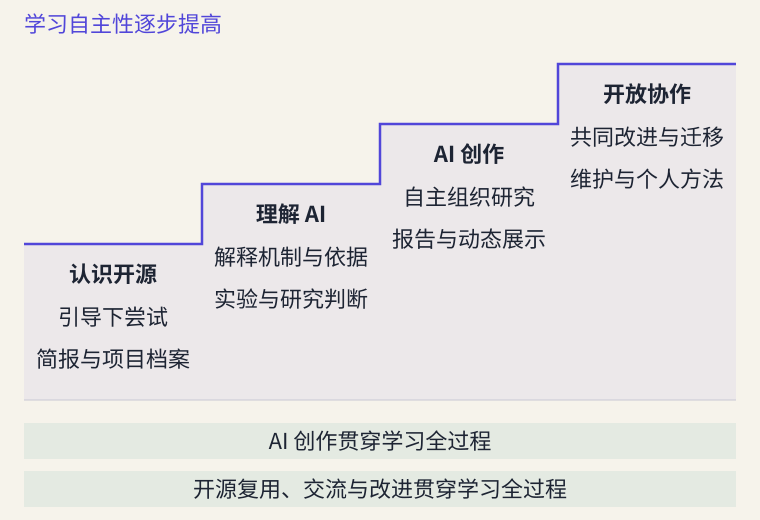

# 引言：在开源中学习，与 AI 共同创造

> 状态：review
> 版本：0.5.0

一份项目说明，可以帮助我们理解一种技术；一段公开的讨论，可以让我们看见改进怎样发生；一项自己的研究，也可以成为别人继续探索的起点。本书邀请你进入这样的学习过程：理解已有成果，借助 AI 开展研究与创作，再把有价值的发现带回开放社区。

**用开源来理解 AI，用 AI 来贡献开源。**这是本课程的核心理念。我们希望你在学习结束时能够做到：**理解 AI，学会判断，在开放协作中创造。**

## 以开源开展创作，与 AI 一起研究

本课程从一开始就采用开源创作与人机合作的方法。面对一个问题，你可以阅读真实项目，依据相应许可复用材料，借助 AI 整理思路、分析信息和制作作品，再通过交流与修订继续改进。开源使已有知识能够被研究和接续，AI 为阅读、表达和实现想法提供支持；学习者负责确定目的、作出关键判断，并承担成果责任。

这里的创作既包括文字、图表和页面，也包括资料整理、方法说明与项目改进。当一项改进回应了真实需要，能够帮助他人理解、使用或继续创造时，它就可能产生创新价值。你不必先成为程序员，才有机会参与这样的过程。

这一学习方式回应着更广泛的时代需要。在中国，面向 2026—2030 年的[“十五五”规划纲要](https://www.forestry.gov.cn/lyj/1/szxx/20260314/663252.html)将开源体系建设纳入数字中国建设；[国务院关于深入实施“人工智能+”行动的意见](https://www.cac.gov.cn/2025-08/27/c_1758018277755538.htm)将模型、工具和数据集开放，与人工智能通识教育、跨学科培养等部署联系起来。

在全球层面，联合国大会于 2024 年通过加强人工智能能力建设国际合作决议，关注发展中国家的能力建设与普惠发展。中国提出的[《人工智能能力建设普惠计划》](https://www.mfa.gov.cn/web/wjb_673085/zzjg_673183/jks_674633/fywj_674643/202412/t20241218_11496414.shtml)进一步连接人工智能素养、教育资源共享和开源开放社区。技术与资源能够被获得，人们也具备理解、使用和共同改进它们的能力，AI 才能惠及更多人。

对每位学习者而言，这些方向可以落到具体行动：研究本专业适合使用什么工具，解释一个 AI 现象，比较几项公开材料，或者把自己的发现整理成别人能用的成果。本书将从这些可理解、可尝试的问题出发。

## 五维目标：让知识、判断与行动共同成长

本课程提出并采用**理解—判断—创造—协作—迁移**五维学习目标框架。它帮助我们回答一个重要问题：借助 AI 完成了作品，自己究竟学会了什么？

| 维度 | 学习时不断追问 | 可以逐步形成的表现 |
| --- | --- | --- |
| 理解 | 它是什么，为什么这样工作？ | 解释 AI 与开放协作的基本机制，联系概念与现象 |
| 判断 | 我凭什么相信、比较和选择？ | 依据材料与方法作出选择，说明结论适用的条件 |
| 创造 | 怎样让想法成为有用的成果？ | 借助 AI 把问题转化为作品，并改善其实际用途 |
| 协作 | 怎样与他人共同把事情做好？ | 适当复用已有成果，交流反馈，参与共同修订 |
| 迁移 | 换一个问题或条件，如何运用所学？ | 提炼个人方法，在新情境中调整、应用和发展 |

五个维度会在同一任务中反复交织。例如，为同学比较语音识别工具时，你需要理解工具的用途，判断材料是否支持某项说法，制作清楚的比较说明，根据读者反馈修改，再把比较方法用于新的工具。作品的进步与个人能力的成长由此联系起来。

每个阶段的要求有所不同。起步时，能结合一段材料解释一次选择，就是有价值的进展；随着学习深入，你会独立组织更完整的研究，回应不同意见，并在新的条件下调整方法。五维目标帮助你看见成长，也帮助教师给出具体反馈。

## 从真实项目进入开源生态

本书的综合实践来自真实的开源研究与传播工作。2026 年 7 月，在日内瓦举行的联合国“人工智能向善（AI for Good）”全球峰会期间，中国科协联合国咨商开源创新专委会发布《开源创新国际合作宣言》；同期发布的《2026 全球开源发展报告》预览版将宣言收录为序言。相关经过见[中国国际科技交流中心的发布报道](https://www.ciste.org.cn/gzdt/kxzs/art/2026/art_bed9ae4a12b049e7b4ae56083023159e.html)。

在今天的[报告在线版](https://www.x-lab.info/2026-Global-Open-Source-Development-Report/2026/zh/)中，文字分析与地图、榜单、技术全景和关系网络相互配合。报告解释问题、方法和发现，可视化让读者选择对象、比较差异，沿感兴趣的线索继续探索。这样的研究与表达，是本课程实践的一个原型。

**开源北斗 OpenDipper，简称 OD，是面向全球开源生态的数据观测与研究项目。**开源生态包括软件、模型、数据、开发者、社区与组织，以及它们之间的协作和复用关系。OD 帮助我们从这些对象中发现问题、寻找材料和组织研究。

图 AG-00-02 展示全球观测入口：选择观察对象，查看分布，再了解相关材料。看到不同地区的参与差异后，我们可以继续追问：差异怎样形成，现有数据能说明什么？

图 AG-00-03 展示开源星系入口。图中的点代表项目等对象，连线表示系统整理的关系。你可以从熟悉的项目出发，寻找相关软件、模型与数据集，再回到材料中了解关系的具体含义。两幅图保留了当时的界面快照，读者可以先读图，再进入[OpenDipper](https://www.x-lab.info/open-dipper/)继续探索。

OD 在课程中既是研究工具，也是学习对象。作为工具，它提供观察入口与研究线索；作为对象，它让我们研究一个项目怎样组织材料、设计功能和开展协作。与它名称相近的 **OpenDigger** 侧重开源数据分析，是其数据基础之一；本书会在需要时介绍两者的具体联系。

课程还使用 **DeepSeek 模型**与 **DeepSeek Harness（DSH）智能体工具**。它们既提供理解 AI 的案例，也支持阅读、分析与创作。第二部分将解释模型与智能体的基本机制，让你逐渐知道工具为什么这样工作，怎样更好地安排任务与检查结果。

## 让自己的研究成为可以接续的开源作品

本课程的实践情境是**科技研究与咨询：开源生态专题**。你将围绕具体问题，完成一份**开源生态专题研究报告**及其配套的**开源生态研究展示**，并把二者作为同一个项目，在 AtomGit 上开放维护。

假设你关心：**为校园口述史整理录音，可以选择哪些开放的语音识别工具？**语音识别就是把声音转成文字。你可以从 OD 寻找项目线索，再阅读项目说明，比较语言支持、设备需求和使用条件。AI 可以协助整理材料、提出比较角度和制作草稿，你需要核对关键依据，解释选择的理由。

报告说明为何选择这些对象、怎样比较、发现了什么，以及结论适用于哪些情况。配套展示则让读者按语言或设备条件查看候选工具、比较说明与原始资料。这里的“动态”是页面能够回应读者的选择；认真整理的固定材料，同样可以支持有用的交互。

**AtomGit** 是保存项目文件、记录修改并支持交流协作的平台。报告、页面、材料和说明组成同一个项目后，同学可以指出不清楚的地方，补充新的资料，或者在相应许可下继续开展研究。

“专业”体现在问题清楚、方法合理、依据充分和表达有用。最初的一页研究简报，可以逐步扩展为报告；一张比较表，可以发展成帮助读者探索的页面。选题可以来自你的专业、兴趣或生活经验，研究范围随能力与材料条件逐步确定。

## 学习矩阵：两条知识线与一份持续成长的作品

全书以**认识开源、理解 AI、AI 创作、开放协作**四篇组织十二章。开源的技术与理念、AI 的机制与方法相互联系，贯穿式研究项目把所学转化为实际经验。

| 学习重心 | 开源知识与实践 | AI 知识与人机合作 | 研究作品的成长 |
| --- | --- | --- | --- |
| 第一部分：认识开源 | 认识项目、材料、复用与共同创造 | 区分模型与产品，借助 AI 阅读、起草和修订 | 同一份简报逐步补充项目档案、来源与改进 |
| 第二部分：理解 AI | 借助项目材料观察机制，认识开放材料的作用 | 探究学习、生成与工具行动，解释结果和局限 | 用机制实验与对照分析改善研究判断 |
| 第三部分：AI 创作 | 研究开源生态，适当复用数据、文档与工具 | 组织人机合作，完成分析、表达和检验 | 形成专题研究报告及配套动态展示 |
| 第四部分：开放协作 | 组织项目、交流反馈、共同维护和持续贡献 | 用 AI 支持修订、整理与迁移，保留个人判断 | 在 AtomGit 开放维护，形成作品集与个人方法 |

四篇分别突出一种学习重心。你从第一章就会借助 AI 创作，也会开始理解来源、复用和他人的劳动；后续章节让这些经验变得更深入、更自主。需要解释时回到概念，需要判断时查阅材料，需要改进时重做尝试，知识与行动在这一过程中相互促进。

## 学习阶梯：从有支持的尝试走向自主创造

图 AG-00-04 展示全书的学习递进。台阶表示自主程度与任务复杂度的变化：先在示范和材料支持下完成一次尝试，再解释机制与依据，继而自主组织研究，最终在反馈中共同改进并迁移方法。

第一部分的三个章节共同完成起步阶段。第一章帮助你建立初步认识，形成一页研究简报；第二章带你打开完整项目，补充材料与项目档案，修正自己的判断；第三章解释开源的力量，通过一次适当复用和面向读者的改进，让同一份作品更有用。

这时，你已开始经历理解、判断、创造、协作与迁移。继续进入后续部分，既有成果会成为新的起点。全书的具体章目与节次可参见[全书目录](contents-review.md)。

## 怎样使用这本书

本书面向所有专业的大学生，也欢迎教师与自学者。核心学习路径无需编程或机器学习先修。你可以从阅读材料、自然语言表达、观察结果和浏览器操作开始，根据兴趣进入更深入的技术与实践。

每章先提出值得理解的问题，再解释必要概念，结合真实项目、例题、图件和实践展开。阅读时，可以先跟随一个完整示例，再尝试自己的问题；完成后用自己的话解释关键选择，对照练习反馈继续修订。拓展材料支持进一步探索，核心知识与主要分析材料在正文中即可阅读。

AI 可以帮助你理解陌生内容、提出思路和制作成果。保留自己的问题意识，回到材料检查重要说法，说明采纳或修改建议的理由，会让一次创作同时成为一次学习。**作品集保存你做出的成果，技能集沉淀你能够再次运用的方法。**

本课程由 **X-lab 开放实验室与奇点智能研究院联合出品**。从真实开源项目出发，带着自己的专业与好奇参与创造，也让后来者能够接着你的工作继续前行。

现在，带着一个你愿意研究、也愿意向别人讲清楚的问题，进入第一章。
